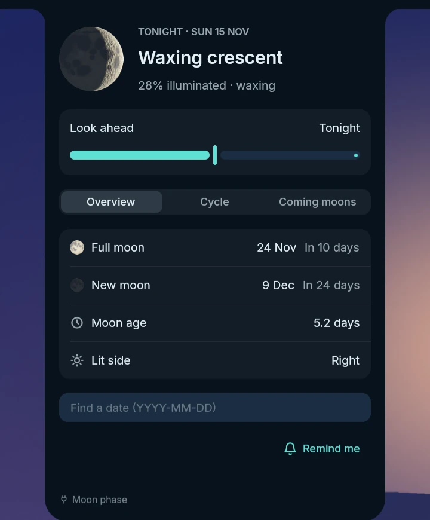
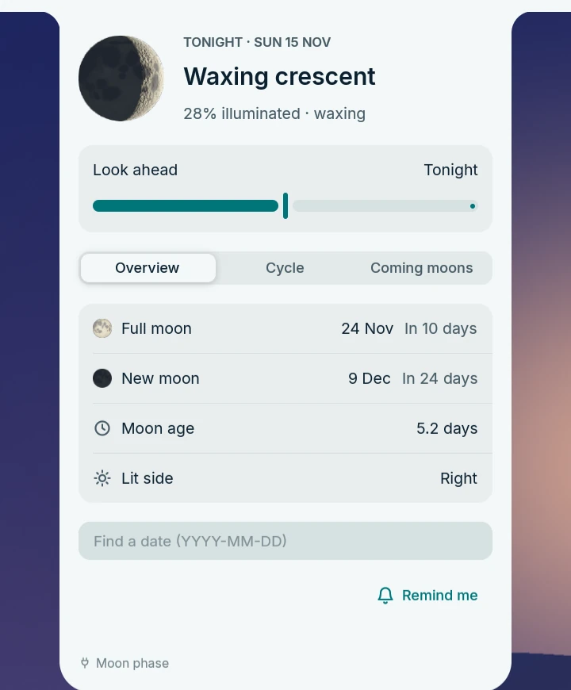
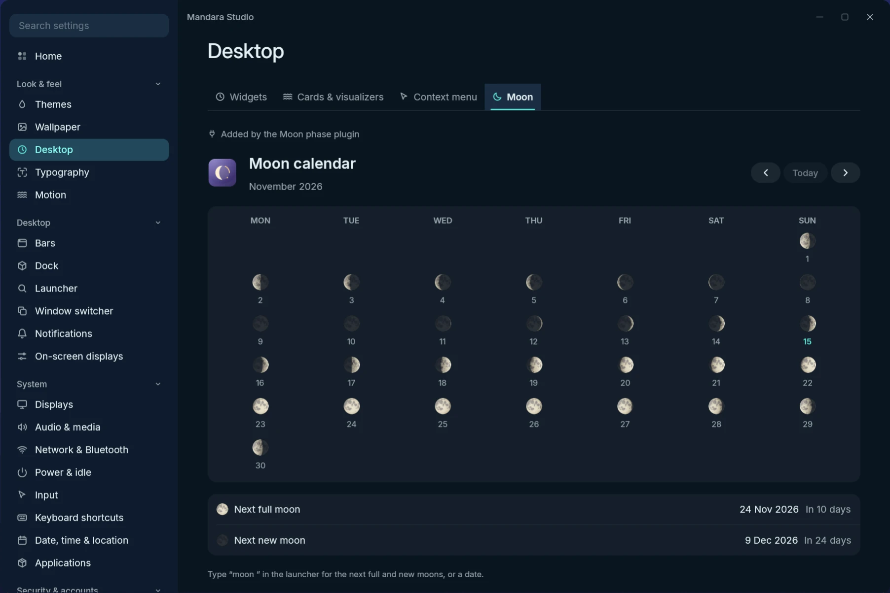
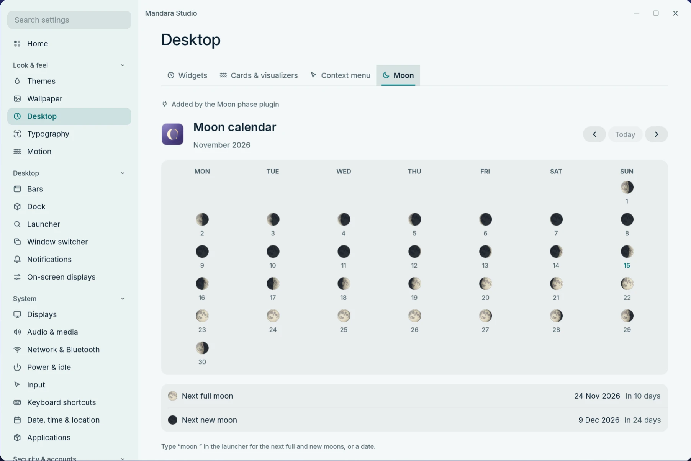

# Writing and publishing Mandara plugins

Everything in Mandara is a plugin: the bar items, the panels that drop from
them, and the sidebar cards. Third-party plugins are written in **Rust**,
compiled to a **WebAssembly component**, and run **sandboxed**. A plugin has
no filesystem, network or environment access, each call has a time budget,
and a crash only disables that plugin. The shell keeps running.

Plugins can go deep: rich native views in the bar, panels, the sidebar, on
the desktop and as tabs in Studio's pages; launcher results; commands people
run from the terminal, compositor shortcuts, hooks, skills and agents;
private storage and timers; and the desktop's own services (media,
wallpapers, folders, windows, workspaces, the clipboard, notifications, the
network, other plugins), each behind a capability the person grants and can
revoke. Mandara enforces every rule.

Plugins hot-reload: drop a folder in, rebuild, edit a translation, or delete
it, and Mandara picks the change up live, without restarting. Bar items,
panels and sidebar cards that are already open switch to the new build at
once.

**Studio → Plugins** is a store with five places: **Discover** (the store
front), **Installed** (your library), **Updates** (marketplace plugin
updates), **Community** (the GitHub marketplace) and **Develop** (the
author's handbook). Every card opens the plugin's **product page**: its
cover and icon, what it may access, its settings, where it fits in the bar
and sidebar, and its homepage and folder.

**Studio → Plugins → Develop** (`mandara studio plugins --tab develop`) is this
guide, built from your system. It shows your plugin folders resolved to real
paths, the format, the architecture with the real time budgets, the WIT
contract of your Mandara build, and copyable commands. Its **Validate**
section lists every plugin it finds with its load status and the actual
error, and can test-load a plugin. Jump to a section with `--scroll
<folders|format|architecture|contract|quick-start|validate>`. The tabs'
older names still work as deep links: `--tab local` opens Develop and
`--tab marketplace` opens Community.

Contributing to Mandara itself (built-in plugins, Studio, the shell)? See
[AGENTS.md](AGENTS.md), the contributor guide.

## Contents

1. [Quick start](#quick-start)
2. [Anatomy of a plugin](#anatomy-of-a-plugin)
3. [The API (WIT)](#the-api-wit)
4. [Views](#views)
5. [Desktop widgets](#desktop-widgets)
6. [Outlets in plugin.toml](#outlets-in-plugintoml)
7. [Capabilities](#capabilities)
8. [Security model](#security-model)
9. [Designing views](#designing-views)
10. [Walkthrough: the moon-phase example](#walkthrough-the-moon-phase-example)
11. [Settings, commands and permissions](#settings-commands-and-permissions)
12. [Localization](#localization)
13. [Where plugins live](#where-plugins-live)
14. [Publishing to the marketplace](#publishing-to-the-marketplace)
15. [Design and quality standard](#design-and-quality-standard)

## Quick start

You need a running Mandara (download a release and run `bin/mandara
install`; see [Install](docs/install.md)) and a Rust toolchain.

```bash
rustup target add wasm32-wasip2
git clone --depth 1 https://github.com/theHamdiz/mandara mandara-src
cp -r mandara-src/plugins/examples/moon-phase my-plugin
cp -r mandara-src/crates/mandara-plugins/wit my-plugin/wit
cd my-plugin
# The example points at the WIT inside Mandara's repository; use your copy.
sed -i 's#"../../../crates/mandara-plugins/wit"#"wit"#' src/lib.rs
sed -i 's/^name = "moon-phase"/name = "my-plugin"/' Cargo.toml
# edit plugin.toml (id, name) and src/lib.rs
cargo build --release --target wasm32-wasip2
mkdir -p ~/.local/share/mandara/plugins-dev/my-plugin
cp plugin.toml ~/.local/share/mandara/plugins-dev/my-plugin/
cp -r locales assets icon.png cover.png ~/.local/share/mandara/plugins-dev/my-plugin/ 2>/dev/null
cp target/wasm32-wasip2/release/my_plugin.wasm ~/.local/share/mandara/plugins-dev/my-plugin/plugin.wasm
```

The plugin appears in **Studio → Plugins** within a second: on Installed,
under *Third-party*, with a *Development* badge. Plugins in the development
folder are enabled automatically. Add it to the bar from its product page
or the bar designer (Studio → Bars → Bar), or open its panel with
`mandara msg panel open my-plugin`.

To iterate, rebuild and copy the `.wasm` again. Mandara notices the change
and reloads the plugin in place, including any of its surfaces that are
open.

## Anatomy of a plugin

An installed plugin is one folder:

```
my-plugin/
├── plugin.toml        # manifest (required)
├── plugin.wasm        # the compiled component (required)
├── locales/           # translations (optional)
│   ├── ar.toml
│   └── es.toml
├── assets/            # images the plugin draws, through asset-image (optional)
├── icon.png           # 256×256 rounded-square tile: Studio cards and product page (optional)
└── cover.png          # 16:9 cover (1600×900) on top of the product page (optional)
```

Its source project is an ordinary Rust crate with the WIT contract beside
it:

```
my-plugin/
├── Cargo.toml
├── plugin.toml
├── src/lib.rs
├── wit/plugin.wit     # copied from crates/mandara-plugins/wit/
├── locales/
├── icon.png
└── cover.png
```

See [`assets/README.md`](assets/README.md) for the grid, palette and style the
built-in icons and covers use; matching it makes a plugin feel native.

### `plugin.toml`

Studio → Plugins → Develop shows an annotated `plugin.toml` with every field
and every setting type. A unit test checks it with the real parser
(`mandara_plugins::authoring::EXAMPLE_MANIFEST`). The essentials:

```toml
id = "moon-phase"            # 1–64 lowercase letters, digits, - and _; unique
name = "Moon phase"
description = "Tonight's moon: phase, illumination and days to the next full moon"
author = "Your Name"
version = "0.1.0"            # default "0.0.0"
zone = "right"               # default bar zone: left | center | right
entry = "plugin.wasm"        # the component, relative to this folder (default)
permissions = []             # capabilities it asks for (see Capabilities)
homepage = "https://github.com/you/mandara-moon-phase"   # "Homepage" button in Studio

# Name and description per language (ISO 639-1 codes).
[i18n.ar]
name = "طور القمر"
description = "قمر الليلة: طوره ونسبة إضاءته والأيام حتى البدر"
```

Only `id` and `name` are required. An invalid id, an empty name or an
unknown permission is reported (in the log and in Develop → Validate); the
marketplace refuses invalid ids.

### `Cargo.toml`

```toml
[package]
name = "my-plugin"
version = "0.1.0"
edition = "2024"

[lib]
crate-type = ["cdylib"]

[dependencies]
wit-bindgen = "0.63"

[profile.release]
opt-level = "s"
lto = true
strip = true
```

## The API (WIT)

The interface is [`crates/mandara-plugins/wit/plugin.wit`](crates/mandara-plugins/wit/plugin.wit)
(package `mandara:plugin@0.2.0`, API level 1): one `plugin` world. Generate
the bindings from your copy of the `wit/` folder:

```rust
wit_bindgen::generate!({ world: "plugin", path: "wit" });

use mandara::plugin::{broker, host, storage};
use mandara::plugin::ui::{self, Surface, Value};
// `Palette`, `View`, `Context`, `Event`, `Hit` and `HostInfo` come from the world.

struct MyPlugin;

impl Guest for MyPlugin {
    fn negotiate(_host: HostInfo) -> Vec<String> { vec!["ui.layout".into()] }
    fn init() -> Result<(), String> { host::log("hello"); Ok(()) }
    fn render(theme: Palette, context: Context) -> Option<View> {
        match context.surface {
            Surface::Bar => Some(bar_item()),
            Surface::Panel => Some(panel()),
            _ => None,
        }
    }
    fn on_event(event: Event) { /* clicks, typing, commands, broker replies */ }
    fn refresh_ms() -> u32 { 60_000 } // render again while on screen (0 = only after events)
    fn launcher_query(provider: String, query: String, limit: u32) -> Vec<Hit> { Vec::new() }
    fn on_call(caller: String, operation: String, payload: String) -> Result<String, String> { Err("no operations".into()) }
}

export!(MyPlugin);
```

**Exports:** your plugin provides these.

| Function | Purpose |
|---|---|
| `negotiate(host)` | Called first, with the API level, the host's features and Mandara's version. Return the features you use; a host lacking one refuses to load the plugin with a clear message instead of half-working. |
| `init()` | Runs once after `negotiate`. Return `Err` to refuse to load. |
| `render(theme, context)` | The view for a surface (`bar`, `panel`, `sidebar`, `desktop`, `studio`) and outlet (`""` for your bar item, panel and sidebar card; a `[[widgets]]` id; a `[[studio-tabs]]` id), or none for nothing there. |
| `on-event(event)` | Input (a click, typed text, Enter, a switch, a slider, a choice, a key, a list's visible rows), a launcher choice, a command, and broker replies. Afterwards every surface of the plugin renders again. |
| `refresh-ms()` | How often to render again while a surface is on screen, in milliseconds (0 = only after events; anything else at least 250). It runs only while a surface is drawn: a closed panel or a hidden sidebar costs nothing. |
| `launcher-query(provider, query, limit)` | Results for one of your `[[launcher]]` providers, under a 30 ms launcher budget (past it the plugin stops). At most 24 results. |
| `on-call(caller, operation, payload)` | Another plugin calls an operation you list in `serves`. JSON in, JSON out. |

**Host imports:** Mandara provides these.

| Function | Purpose |
|---|---|
| `log(message)` | Writes to Mandara's log, tagged with your id. |
| `now-unix-ms()` | The current time, in milliseconds since the Unix epoch. |
| `setting(key)` | Your `[plugins.settings.<id>]` value, as JSON (the declared default until the user changes it). |
| `command(line)` | Queues one of Mandara's interface commands. Needs the `commands` permission (and, for commands a capability covers, that capability). |
| `locale()` | The interface language: `en`, `ar`, `fa`, `ur`, `es`, `pt`, `fr`, `de`, `tr`, `ru`, `hi`, `mr`, `bn`, `te`, `id`, `sw`, `vi`, `zh`, `ja` or `ko`. |
| `translate(text)` | Looks `text` up in your `locales/` catalog. |
| `submit(request)` | Asks a host service for something: returns a request id at once, never waits. The answer arrives as a `replies` event. |
| `cancel(id)` | Ends a subscription or drops a waiting request. |
| `granted()` | The capabilities granted right now. |
| `asset-image(name)` | An image handle for a PNG, JPEG or WebP in your `assets/` folder (at most 512 KiB, no folders, no links out of `assets/`). |
| `get(key)`, `set(key, value)`, `remove(key)`, `keys()` | Your private storage (`storage` interface): kept across restarts in `~/.local/share/mandara/plugin-storage/<id>.json`, out of every other plugin's reach, at most 1024 keys, 128-byte keys, 64 KiB values and 1 MiB in all. |

**Features** `negotiate` may name (this host has all of them): `ui.layout`,
`ui.input`, `ui.toggle`, `ui.slider`, `ui.choice`, `ui.grid`, `ui.scroll`,
`ui.list`, `ui.image`, `ui.canvas`, `ui.keys`, `launcher`, `studio-tabs`,
`broker`, `plugin-calls`, `files.read`, `net.binary`, `net.images`,
`launcher.async` and `studio.live-wallpaper`.

**The palette** every render receives is the live theme as `#rrggbb`
strings: `primary`, `on-primary`, `surface`, `on-surface`,
`on-surface-variant`, `container`, `error`, `success`, `warning`, and
`dark` (whether the theme is dark). Views can't set colours directly (use
tones), so the palette is for decisions, such as picking a different
picture in light mode.

## Views

A view is a tree stored as an arena: `nodes[root]` is the top node and
`children` are indices into the list. Mandara draws it with its own
components, so plugins look native in every theme, light or dark, and
right to left in Arabic. Every
node has a stable `id` (it keeps a field's text and caret, a list's scroll
and keyboard focus across renders), `kind`, `text`, `hint` (placeholder,
tooltip or image description), `action`, `value`, `min`, `max`, `step`,
`index`, `children`, `style`, `options`, `image`, `marks` and `disabled`.

| Kind | Meaning |
|---|---|
| `row` / `column` | Children side by side / stacked, `style.gap` apart. `style.align`: `auto` (rows centre, columns stretch), `start`, `center`, `end`, `stretch`. |
| `group` | An inset grouped section: one quiet rounded surface whose children are rows separated by hairlines, the settings-list look. Prefer groups to cards in cards. |
| `card` | A rounded card. |
| `grid` | Children in `index` equal columns (1–12). |
| `scroll` | A vertical scroll area, `style.height` tall. |
| `list` | A virtual list: `index` rows of `style.min-height` each (default 36) in a `style.height` viewport. Send only the rows around what's visible as children (rows `value` .. `value + children`); scrolling elsewhere sends a `range(first, count)` event, and rows you haven't sent draw as placeholders. Mark rows `grow` to fill the width. |
| `text`, `icon` | A label; a bundled icon by name. |
| `button` | `style.tone`: `accent` is your one filled primary action, `muted` a plain text button, anything else a quiet tinted button. Children (an icon) come before `text`. |
| `meter`, `spacer`, `divider` | Progress (`value` 0–1), flexible space, a thin rule. |
| `input` | A text field: `text` is its value, `hint` its placeholder; sends `text` while typing and `submit` on Enter. |
| `toggle` | A switch (on when `value` ≥ 0.5) with `text` as its label; sends `checked`. |
| `slider` | `min`..`max`, snapping to `step`; sends `number` once per value reached, not per pointer move. |
| `choice` | A segmented control: `options` (`value`, `label`), the chosen one at `index`, raised; sends `choice`. |
| `image` | A host-issued image handle, drawn at `style.width` × `style.height` with `style.radius`. Pictures are decoded once at the size they're drawn by Mandara's bounded thumbnail worker, never full size. |
| `canvas` | Vector `marks` (`rect`, `ellipse`, `line`) in fractions of the canvas, with a tone, opacity and corner radius: bars, rings, sparklines and charts. Without a width a canvas fills its parent. |

Nodes with an `action` are focusable: Enter or Space activates them, and
other keys arrive as `key` events (with Ctrl, Alt, Shift and Super). A view
can name a node in `focus` to move keyboard focus there once.

A view is checked before anything is drawn and refused whole (the plugin
keeps running) when it has more than 2048 nodes, 262144 bytes of text
(256 KiB), 2048 canvas marks, 32 options in a choice, 100000 list rows, or
a child index outside the view.

A third-party panel opens at 360 × 380 px (or its `[panel]` size) with
16 px of padding and a quiet line naming the plugin. One plugin instance
backs every surface, so state you keep in the plugin is shared between them.

## Desktop widgets

A plugin can also put widgets on the desktop, next to Mandara's own clocks,
weather and gauges (which are first-party plugins themselves). People find
your widgets in Studio → Desktop → Widgets and in the desktop's right-click
**Add widget** menu, place them anywhere, resize them and choose their
numerals, calendar and language.

List them in `plugin.toml`, so Mandara can offer them without loading your
plugin:

```toml
[[widgets]]
id = "moon"                     # lowercase letters, digits and - (unique)
name = "Moon tonight"           # translated through locales/
description = "Tonight's phase, large"
icon = "moon"                   # a bundled icon (default "package")
width = 280                     # logical px at scale 1 (default 320 × 180)
height = 200
```

Choose an icon for what the widget does. `sparkles` is reserved for AI
features; procedural generation and ordinary automation use other symbols.
At most 16 widgets per plugin.

`render` draws each placed widget with `context.surface = desktop` and
`context.outlet` set to its id; `context.instance` tells placed copies
apart, `width` and `height` are its size now, and `numerals` (`auto`,
`western` or `eastern-arabic`), `calendar` (`gregorian`, `hijri`, `both` or
`none`) and `language` (a code, empty for the interface language) are the
person's choices for its text. Honour them: write Eastern Arabic digits
when asked (or when `auto` and the language is Arabic), and leave dates out
for `none`.

```rust
fn render(_theme: Palette, context: Context) -> Option<View> {
    match context.surface {
        Surface::Desktop if context.outlet == "moon" => Some(moon_widget(&context)),
        _ => None,
    }
}
```

The view is drawn on a glass card of that size in the theme. Switching your
plugin off in Studio hides its widgets (people keep them in their list),
and nothing of it runs until one of its widgets is placed and shown.

## Outlets in plugin.toml

```toml
# Plugin-level fields first: after a [table] or [[array]] header, TOML
# would give them to that table.
# Operations other plugins may call (they need plugins.call:moon-phase).
serves = ["phase"]
# Where its code lives and where to report problems: Studio shows
# "Source code" and "Report an issue" on its page and its store card.
repository = "https://github.com/you/moon-phase"
support = "https://github.com/you/moon-phase/issues"

# Its panel's size (logical px; 280–720 wide, 200–880 tall).
[panel]
width = 380
height = 572

# Typed first in the launcher, it asks only this provider. With global =
# true it also adds a few results to plain searches, once the person grants
# `launcher.global` (it then sees what they type). At most 4 providers.
[[launcher]]
id = "moon"
name = "Moon phases"
prefix = "moon "
icon = "moon"

# A tab in a Studio page's tab bar: themes, bars, desktop or wallpaper.
[[studio-tabs]]
page = "desktop"
id = "moon"
title = "Moon"
icon = "moon"

# Commands: `mandara msg plugins run moon-phase remind`, from a compositor
# shortcut, a hook, a skill or an agent. `mandara msg plugins commands`
# lists every plugin's.
[[commands]]
name = "remind"
summary = "Post a reminder of the next full moon"
```

Studio tabs appear after a page's own tabs with an "Added by …" line above
your view, so people always know what is yours. Launcher results run
`mandara msg plugins launch <plugin> <provider> <id>` when chosen, and you
get a `launch` event; a command arrives as a `command` event with its name
and words.

## Capabilities

Every service is a capability: list it in `permissions`, and the person
grants it on your plugin's page in Studio (Plugins → your plugin →
Permissions). Declaring grants nothing, every grant can be revoked at any
time, and Mandara checks the live grants when each request arrives:
revoking closes open subscriptions at once and image handles that relied on
the grant stop drawing. Ask only for what you use.

| Capability | Operations (payload → answer) |
|---|---|
| `commands` | Interface commands through `host::command` (declaring it is consent; commands a capability below covers need that capability too). |
| `media.read` | `status` → the track (`title`, `artist`, `album`, `position`, `length`, `status`, `can_next`, `can_seek`, `volume`, `art` image handle, `at_ms`); `subscribe` → the same, again on every change. |
| `media.control` | `play-pause`, `next`, `previous`, `seek {seconds}`, `volume {level 0–1}`. |
| `wallpaper.read` | `current` → `{name, image}`; `list {offset, limit ≤ 60}` → `{total, offset, items: [{name, image}]}` of the wallpaper folder. |
| `wallpaper.set` | `apply {image}`: a handle from `wallpaper.read` or `files.folders` only (needs a user gesture). |
| `files.folders` | `folders` → the folders the person chose for you in Studio (`{id, name}`, never paths); `list {folder, offset, limit}` → image names and handles (or `list {project, offset, limit}` for the pictures inside one project); `projects {folder, offset, limit ≤ 60}` → `{total, offset, items: [{project, name, title, kind, live, preview}]}`, the folders directly inside it as opaque project handles, with the title and type from a `project.json`, `live` when it can run as a live wallpaper, and a preview image handle (its declared preview, else its first image, `0` when none); `choose` opens your Studio page to add one (needs a user gesture). |
| `files.read` | With `files.folders` and an approved folder: `entries {folder, offset, limit ≤ 60}` (or `{directory: handle, ...}`) lists regular files and subfolders as `{name, kind, handle, size}`; `read {file: handle, offset, limit ≤ 65536}` returns `{encoding: "base64", body, size, offset, next_offset, eof}`. Entries scan at most 20,000 names and report `truncated`. Links and special files are skipped. This permission is separate from image/project browsing and must be granted explicitly. |
| `wallpaper.live` | `render {project, output?}` plays a project handle from `projects` as a live wallpaper, on one display (a name from `status`) or on every display that shows the wallpaper (needs a user gesture) → `{rendering: [outputs], renderer}`; `stop {output?}` ends your scenes → `{stopped}`; `status` → `{renderer, problem?, outputs: [{output, state: off, running, paused or failed, plugin, error}]}`. Needs `files.folders` too. |
| `notifications.send` | `send {title, body}`. |
| `windows.read` | `list`, `active` (the JSON of `mandara msg window list` / `window active`). |
| `windows.control` | `focus {id}`, `close {id}` (closing needs a user gesture). |
| `workspaces.read` | `list`. |
| `workspaces.control` | `view {workspace 1–32}`. |
| `system.read` | `resources`, `power`. |
| `clipboard.read` | `text` → the copied text (needs a user gesture). |
| `clipboard.write` | `text {text}` copies it. |
| `open.web` | `open {url}`: https only, no user name or password (needs a user gesture). |
| `osd.show` | `show {title, icon, level 0–100}`. |
| `theme.control` | `mode {mode: "light" or "dark"}`. |
| `events` | `subscribe {topic}`: `theme`, `wallpaper`, and with their read capability `windows`, `workspaces` and `power`, and with `wallpaper.live` `live-wallpaper` (the `outputs` of `status`). Each change arrives as `{topic, value}`. |
| `timers` | `after {ms}` (5 s to 1 day) or `every {ms}` (at least a minute): wake-ups arrive as replies. Needs no grant. |
| `launcher.global` | Not a service: lets your `global` launcher providers see plain searches and add results to them (at most 2 plugins are asked per search). |
| `net:<host>` | `fetch {url, method GET or POST, body}` returns text (256 KiB); `fetch-binary` returns up to 128 KiB as `{status, encoding: "base64", body}`; `fetch-image {url}` uses GET and returns `{status, image}` for a PNG, JPEG or WebP thumbnail (512 KiB encoded, at most 2048 px per side). All use the exact approved HTTPS host on port 443, no redirects/proxy/private addresses, and the existing 10 s network budget. Request bodies stay under 16 KiB. Two requests run at a time, with at most 32 waiting across plugins. |
| `plugins.call:<id>` | Any operation plugin `<id>` lists in `serves`, with a JSON payload; answered on the next tick (calls never nest). |

**User gestures.** Reading the clipboard, opening a page, setting a
wallpaper, starting a live wallpaper, closing a window and opening the
folder chooser only work while
your plugin handles a click, key press, typed text, launcher choice or
command: never from a render, a timer or a reply. One gesture allows one
such request; a request made at another time fails at once.

**Results arrive on the next tick.** Replies are delivered a frame after
the call that caused them, never inside it, so answering a reply with a new
request is fine and can't loop the shell.

For asynchronous launcher providers, cache your reply in `extension-event`
and return the cached hits from `launcher-query`. A broker reply refreshes an
open launcher query that used your plugin, even when its first result was empty.
The selected result is kept when it still exists. Closing the launcher removes
its subscription; no launcher refresh timer runs in the background.

Studio's folder permission offers **Find Steam Workshop folders**. It reads
Steam's registered libraries, including libraries on other drives and Flatpak
Steam, then presents existing Workshop content folders for individual approval.
Discovery grants nothing. General file reads additionally need `files.read`;
directory traversal uses host-issued handles and refuses links and special files.
One file operation runs at a time, with at most 32 waiting across plugins.

Use `fetch-image` for supported static thumbnails, then put the returned image
handle in a view or launcher hit. API and thumbnail CDN hosts each need their
own permission. Images share a content-addressed disk cache, bounded to 64 files
and 16 MiB, and decode through the existing thumbnail worker at the drawn size.
Evicted handles may need fetching again; GIF animation is not supported.

**Limits.** At most 8 requests wait or run per plugin and 8 subscriptions
stay open; a request payload is at most 16384 bytes (16 KiB) of JSON and a
reply at most 256 KiB; 32 replies wait for you (a subscription's older
update is replaced by its newest); 256 image handles per instance.

## Security model

- The sandbox is unchanged: no files, network, environment or programs,
  and blocking waits return at once. Services are reached only through the
  broker, and the broker is enforced by Mandara, never by WIT alone.
- Requests are checked three times: when submitted (declared, granted, a
  known operation, the payload's size and shape, a user gesture where
  needed), against the live config before anything runs, and again when a
  result is delivered. Revoking a grant applies to every loaded plugin at
  once, drawn or not.
  Internal per-plugin permission generations also cancel earlier work and
  non-asset handles when access is revoked then restored before Studio's edits
  reach the shell. Restoring a permission never revives an earlier request.
- `host::command` also needs the capability a
  command stands for (media commands need `media.control`, `notifications
  send` needs `notifications.send`, and so on), so `commands` can't get
  around a revoked grant.
- Views must be trees (each node has one parent), so a small view can't
  expand into a huge one; list rows are at least 16 px.
- Pictures are measured from their headers before decoding and refused past
  about 40 megapixels; decoded sizes are rounded so the cache stays small.
- Image handles are opaque and belong to one plugin instance; their files
  are re-checked against the grants before every draw. Folder listings
  never leave the granted folder (links pointing out are skipped), and
  links are resolved when a folder is read, so a folder swapped for a link
  since it was listed can't lead out either. Project handles die with the
  folder's grant and are never drawn.
- Live wallpapers run only a renderer Mandara knows
  (`linux-wallpaperengine`, a build with `--layer`), found on `PATH` when you
  ask. Mandara writes its whole command line: the project folder from your
  handle, checked again inside the granted folder; the display from its own
  list; your video wallpaper frame-rate limit, sound and mouse off, and its
  usual pause for fullscreen windows. Plugins never send a program, an argument, a path or
  an environment variable. Only scene and video projects run (web ones run
  scripts). The renderer gets no shell, a minimal environment and no
  input, leads its own process group, and is killed if the shell dies. One
  runs per display. It is paused (`SIGSTOP`) where the desktop can't be
  seen, by the video wallpaper rules, and it ends when any wallpaper is
  applied, either grant is revoked, the plugin is switched off, removed or
  rebuilt, the display goes away or the shell quits.
- Payloads never become command lines: window and workspace ids are
  validated, and controls run Mandara's own documented commands.
- Plugin-to-plugin calls need both sides: the caller's grant and the
  callee's `serves`. They run on the next tick, so two plugins can't call
  into each other re-entrantly.
- Network: one host per capability, https only, no redirects. The host's
  addresses are checked once and the connection is pinned to exactly those
  (a second lookup can't redirect it to your network: DNS rebinding).
- Studio loads a plugin's tab in its own process; there, the services that
  belong to the shell (media, windows, events, …) answer with an error.
  `wallpaper.live` forwards typed status, render and stop requests to the shell,
  which rechecks its current grants, plugin state, display and project before
  acting. Studio never owns a renderer process and cannot supply its executable
  or arguments. The same pause, stop and crash-cleanup rules apply from either
  interface.
- Combined grants add up. A plugin that may read something (your media,
  clipboard or windows) and connect to the internet could send what it
  reads there; Studio warns when a plugin has both.
- Spoofing: plugin panels end with a quiet line naming the plugin, Studio
  tabs say "Added by …", launcher results name their plugin, and fields
  never mask text (no fake password prompts).
- The compliance check probes every surface, desktop widget, Studio tab and
  launcher provider, and fails a release whose views break a limit,
  whose launcher runs past its budget, or that needs features no host has.

## Designing views

Mandara's surfaces are calm and consistent, and yours should blend in: one
surface, sections as `group`s with rows and a value at the trailing edge,
one filled `accent` button at most, a segmented `choice` for switching
views, `caption`-sized muted text for context, tabular figures for numbers,
and real artwork (images or canvas marks) rather than emoji used as art.
Check light and dark themes and right-to-left languages before publishing.
The moon-phase example shows each of these.

## Walkthrough: the moon-phase example

[`plugins/examples/moon-phase`](plugins/examples/moon-phase) is a complete
plugin: a moon icon with the lit percentage in the bar, and a panel with
tonight's moon as rendered
artwork, a look-ahead slider, a segmented view switch, grouped details, an
illumination chart, a virtual list of coming full and new moons, a date
field and a reminder. It adds a month-of-moons tab to Studio → Desktop,
launcher results (`moon `), `remind` and `show` commands, a desktop widget,
remembers its view in private storage, and serves a `phase` operation to
other plugins. Its moon pictures are original, rendered by the Rust program
in [`art/`](plugins/examples/moon-phase/art) for every phase and hemisphere.
Read [`src/lib.rs`](plugins/examples/moon-phase/src/lib.rs) alongside this;
the notes below cover the parts every plugin has.

| Its panel | Its tab in Studio → Desktop |
|---|---|
|   |   |

**Named sizes on a 4 px rhythm.** Every size and gap is a constant:

```rust
const HERO_MOON_PX: f32 = 72.0;
const ROW_MOON_PX: f32 = 16.0;
const TITLE_PX: f32 = 20.0;
const CAPTION_PX: f32 = 11.0;
const SECTION_GAP: f32 = 16.0;
const ROW_GAP: f32 = 8.0;
```

**Negotiate what you use.** An older Mandara without one of these refuses
to load the plugin with a clear message:

```rust
fn negotiate(_host: HostInfo) -> Vec<String> {
    FEATURES.iter().map(|f| (*f).to_string()).collect()
}
```

**Real artwork through image handles.** The moon is a picture per phase in
`assets/`, asked for once and cached:

```rust
fn moon_image(m: &Moon, hemi: Hemisphere) -> u64 {
    let frame = ((m.age / SYNODIC * ART_PHASES).round() as usize) % ART_PHASES as usize;
    let name = format!("moon-{}-{frame:02}.png", if hemi == Hemisphere::North { 'n' } else { 's' });
    ART.with(|art| *art.borrow_mut().entry(name).or_insert_with_key(|name| broker::asset_image(name).unwrap_or(0)))
}
```

**Groups of rows, values at the trailing edge.** One helper builds a
settings-list row; a `group` draws hairlines between rows:

```rust
fn line(t: &mut Tree, lead: Option<u32>, label: &str, value: &str, detail: &str) -> u32 { /* label, spacer, value, muted detail */ }

let full = line(t, Some(full_art), &host::translate("Full moon"), &date.short(), &when(days));
t.group(&[full, new, age, side])
```

**State in one place.** Everything the views remember lives in one small
`State` in a `thread_local!` `RefCell` (numbers and two short strings,
nothing that grows), and events update it:

```rust
("ahead", Value::Number(v)) => with(|s| s.ahead = v.round().clamp(-LOOK_DAYS, LOOK_DAYS) as i32),
("upcoming", Value::Range((first, _))) => with(|s| s.list_start = first.min(UPCOMING)),
("date", Value::Submit(text)) => with(|s| s.found = Date::parse(&text).map(|d| d.days)),
```

**A virtual list that pages.** The list declares 200 rows but sends only
the 24 around what's on screen; scrolling elsewhere sends a `range` event
and the plugin answers with those rows on the next render.

**Services through the broker.** "Remind me" submits a request and shows
what happened when the reply arrives; until notifications are granted in
Studio, it says so instead:

```rust
match broker::submit(&broker::Request { capability: "notifications.send".into(), operation: "send".into(), payload }) {
    Ok(id) => with(|s| s.reminder = Some(id)),
    Err(why) => with(|s| s.status = denied(&why)),
}
```

**Settings arrive as JSON.** A choice is a quoted string, a switch is
`true` / `false`:

```rust
fn hemisphere() -> Hemisphere {
    match host::setting("hemisphere").as_deref() {
        Some("\"south\"") => Hemisphere::South,
        _ => Hemisphere::North,
    }
}
```

**Remembered across restarts.** The chosen view goes to private storage
and `init` reads it back:

```rust
let _ = storage::set(MODE_KEY, &key);
```

**Translation.** Labels, hints and option labels in views are translated by
the host from `locales/`. Composed strings go through `host::translate`
with a placeholder:

```rust
host::translate("In {days} days").replace("{days}", &n.to_string())
```

**One render for every surface.** `render` matches on `context.surface`:
the bar item, the panel, the compact sidebar card, the desktop widget (with
the person's digits) and the Studio tab. `refresh_ms()` returns `60_000`:
the moon changes slowly.

## Settings, commands and permissions

- **Settings:** declare them in `plugin.toml` with `[[settings]]` and
  Studio shows them, with native controls, in your plugin's **settings
  modal** (its product page → Settings, or
  `mandara studio plugins --plugin <id> --settings`). Edits apply live.
  The moon-phase example declares:

  ```toml
  [[settings]]
  key = "hemisphere"            # lowercase letters, digits, - and _
  type = "choice"               # bool | number | text | choice
  label = "Hemisphere"          # translated through locales/<code>.toml
  help = "Where you watch from: it decides which side of the moon is lit"
  default = "north"
  choices = [{ value = "north", label = "Northern" }, { value = "south", label = "Southern" }]

  [[settings]]
  key = "show_percent"
  type = "bool"
  label = "Illumination in the bar"
  help = "Show the lit percentage next to the moon icon"
  default = true
  ```

  A number with both `min` and `max` becomes a slider:

  ```toml
  [[settings]]
  key = "refresh"
  type = "number"
  label = "Refresh every"
  default = 15
  min = 5                       # min + max → a slider; otherwise a number field
  max = 60
  step = 5
  unit = " min"
  ```

  | Field | Applies to | Meaning |
  |---|---|---|
  | `key` | all | Required, at most 64 characters. The name you read with `host::setting`. |
  | `type` | all | `bool` (switch, the default), `number`, `text` or `choice`. |
  | `label`, `help` | all | Shown in Studio and translated through your catalog; the key is used when `label` is empty. |
  | `default` | all | Used until the user changes it; must match `type` (for `choice`, one of the values). Without one: `false`, `min` (or 0), `""`, or the first choice. |
  | `min`, `max`, `step`, `unit` | `number` | Slider range (both `min` and `max`), snapping step and suffix. |
  | `choices` | `choice` | Plain strings (`["north", "south"]`) or `{ value, label }` tables. |

  Invalid declarations (bad key, a choice without choices, a default of the
  wrong type, `min` ≥ `max`, a step that isn't positive, a duplicate key)
  are skipped with a warning in the log and in Develop → Validate. Values
  are stored in `~/.config/mandara/config.toml`:

  ```toml
  [plugins.settings.moon-phase]
  hemisphere = "south"
  ```

  Read them with `host::setting("hemisphere")`, which returns the JSON text
  `"south"` (the declared default when the user hasn't chosen yet). A change
  in Studio reaches your plugin before its next render.
- **Commands:** with `permissions = ["commands"]`, `host::command("media play-pause")`
  runs one of Mandara's interface commands, the same as `mandara msg …`.
  Only interface actions are allowed, because commands run outside the
  WebAssembly sandbox: `panel`, `sidebar`, `sidebar tab open`, `launcher`,
  `launcher search`, `switcher`, `menu`, `osd`, `osd show`, `media next` /
  `previous` / `play-pause` / `seek`, `audio volume up` / `down` / `set`,
  `audio mute`, `audio mic mute`, `notifications send`, `notifications dnd`,
  `pomodoro`, `weather refresh`, `calendar refresh`, `theme mode`,
  `workspace view` / `toggle` / `cycle-layout`, `todo add`, `todo done`,
  `notes add`, `notes append`, `clock now`, `info` and `ping`. Anything that
  starts programs or changes settings, startup apps, compositor config,
  plugins, power or the network is refused (and logged). Commands run
  after your call returns, their output doesn't come back to your plugin,
  and a failure is logged.
  At most 16 commands can be queued per call, and without the permission
  `host::command` returns an error.
  Users see the permission, with what it allows, on your plugin's product
  page in Studio.
- **Capabilities:** plugins reach Mandara's services through
  [capabilities](#capabilities) the person grants and can revoke.
- **No other access:** there is no filesystem, network, environment or
  subprocess access (WASI is linked but empty). Each call has a 100 ms time budget (1 s for `init`). A
  call that runs past it, or traps, stops the plugin: its surfaces show
  *plugin stopped* until it is reloaded (a rebuild or any change to its
  files, or a shell restart). Components are compiled to native code once
  and cached in `~/.cache/mandara/plugins/`. Loading is lazy: a plugin is
  instantiated the first time one of its surfaces is shown.

## Localization

Write your plugin in English. Ship translations as
`locales/<code>.toml` files containing `"English" = "Translation"` pairs:

```toml
# locales/ar.toml
"Full moon" = "بدر"
"{percent}% illuminated" = "مضاء بنسبة {percent}%"
"In {days} days" = "بعد {days} أيام"
```

- **Labels:** every `text` and `button` label in your views is translated
  automatically.
- **Composed strings:** call `host::translate` with a placeholder, then
  substitute the value:

  ```rust
  host::translate("{percent}% illuminated").replace("{percent}", &format!("{:.0}", m.illumination() * 100.0))
  ```

- **Settings:** `label`, `help` and choice labels go through the same
  catalog.
- **Name and description:** translate these in `plugin.toml` under
  `[i18n.<code>]`.
- **Fallback:** anything without a translation stays English, which is the
  fallback for every language.
- **RTL:** when `host::locale() == "ar"` the interface is right-to-left.

Mandara itself is translated into English, العربية, Español, Français,
Deutsch, Türkçe, Русский, हिन्दी, 简体中文 and 日本語. Each plugin decides which
of these it supports.

## Where plugins live

| Folder | Origin | Default |
|---|---|---|
| `~/.local/share/mandara/plugins-dev/` | your own, in development | enabled |
| `~/.local/share/mandara/plugins/` | installed (marketplace or by hand) | opt-in (a marketplace install switches it on) |
| `$XDG_DATA_DIRS/mandara/plugins/` (e.g. `/usr/share/mandara/plugins/`) | distribution packages | opt-in |

Mandara's built-in plugins are composable: a calm default set is on (the bar
essentials, quick settings, media, weather, wallpaper, screenshot and
clipboard) and the rest ship opt-in (`PluginManifest::opt_in`): the dock,
mini stats, screen time, prayer times, the wallpaper generator, Wallhaven,
cursor themes, Boot look, containers, services, drives, updates, the process hunter,
the authenticator, soundscapes, world clock, network speed, the color
picker, Pomodoro, notes, to-do, privacy and the app installer. A config
written before a default changed keeps what it had on: `[plugins]
defaults_version` records the defaults a config was written for, and
`mandara_config::upgrade` writes the plugins an older config had on into
`enabled`. An opt-in plugin's state can be read without the registry with
`PluginsConfig::opted_in(id)` (the compositor emitters use it for
`cursors`).
First-party plugins without a bar item work the same way, for example the
**App installer** (`app-installer`): it installs apps dropped on the dock or
Studio (AppImage, Flatpak, portable archives, native packages through the
system package manager), with its settings in its Studio modal and the
`apps install` / `apps jobs` commands; other surfaces call its Rust API
(`mandara_ui::plugins::app_installer::{accepts, install, queue}`). The
**Wallpaper generator** (`wallpaper-generator`) is another: procedural
wallpapers and AV1 loops from `mandara-wallgen`, designed in Studio →
Wallpaper, with a Generate button in the wallpaper picker, an opt-in
schedule and the `wallgen …` commands; other surfaces call
`mandara_ui::plugins::wallpaper_generator::{generate, generate_from_picker, wallgen}`.

Any plugin can be switched off (`plugins disable <id>`), which stops its bar
item, sidebar card, launcher entries, commands (they answer that the plugin
is off) and background work. A built-in can also be removed
(`plugins remove <id>`): off, out of the bar and sidebar layouts, and listed
under *Removed Mandara plugins* in Studio until `plugins restore <id>` puts
it back where it was. The launcher, the session menu and the main menu are
core and refuse both. Config: `[plugins] enabled`, `disabled`, `removed`
(+ `removed_places`).

If the same id exists in several folders, the first one in this table wins.
An id that clashes with a built-in plugin is skipped with a warning.
Changes are picked up about half a second after the last write, by the
shell and by an open Studio window alike, with no restart.

To see why a plugin doesn't show up, open **Studio → Plugins → Develop →
Validate** (`mandara studio plugins --tab develop --scroll validate`). It
shows each folder Mandara found and its status: running, off, failed to load
(with the error), stopped after a trap, invalid manifest, component missing,
shadowed by another folder, or clashing with a built-in. **Test load** runs
the plugin once in Studio's own sandbox.

Useful commands:

```bash
mandara msg plugins list             # every plugin: origin, enabled, removed / essential, runtime (running / failed / disabled + error, or not-loaded)
mandara msg plugins reload           # rescan now: adds, reloads changed and drops deleted plugins (normally automatic)
mandara msg plugins enable my-plugin # disable <id> turns it off again
mandara msg panel open my-plugin     # open its panel
```

## Publishing to the marketplace

The marketplace is free and runs on GitHub. There is no account to create
and no review queue.

1. **Make a public repository**, for example `you/mandara-moon-phase`, with
   the plugin's source (including its `wit/` folder).
2. **Add the topic** `mandara-plugin` (repository → About → ⚙ → Topics).
3. **Package a release.** Attach an asset named `<id>.mandara.tar.gz`
   containing your plugin folder:

   ```bash
   cargo build --release --target wasm32-wasip2
   mkdir -p dist/moon-phase
   cp plugin.toml dist/moon-phase/
   cp target/wasm32-wasip2/release/moon_phase.wasm dist/moon-phase/plugin.wasm
   cp -r locales assets icon.png cover.png dist/moon-phase/ 2>/dev/null || true
   tar -czf moon-phase.mandara.tar.gz -C dist moon-phase
   gh release create v0.1.0 moon-phase.mandara.tar.gz --title "v0.1.0" --notes "First release"
   ```

4. **That's it.** If the store policy permits it, your plugin shows up in **Studio → Plugins → Community**
   (and in Discover's *New & updated* and *Community picks* shelves),
   ranked by stars. Users can install, update or remove it with one click.
   Installing switches it on (it's added to `plugins.enabled`) and it loads
   live, without restarting the shell.

The topic discovers plugins, and the store's moderation policy filters the
results. Forks and archived repositories are included (archived ones carry
a badge). A repository without a usable release is
still listed; installing it says *No release yet* (or *No plugin file yet*
when releases exist but none has the archive) and offers *Check again*.

- **Which release:** the latest release if it has the archive, otherwise
  the newest published release that does, pre-releases included. Drafts
  are never used.
- **Which file:** any asset ending in `.mandara.tar.gz` (any case). If a
  release has several, the one named after the repository wins
  (`mandara-moon-phase` or `moon-phase`). The plugin id always comes from
  `plugin.toml`, not from the file name.
- **Archive layout:** `plugin.toml` at the root of the archive or inside
  one top-level folder.

Archives are checked when installed. Absolute paths and paths that escape
the plugin folder are rejected, links and device files are skipped,
archives are limited to 64 MB, and the id must be valid. The new version is
staged and swapped into `~/.local/share/mandara/plugins/<id>/` in one
rename. Releases are fetched over HTTPS from GitHub's API.

Searches are anonymous. GitHub allows ten a minute, so Studio reuses an
answer for a minute and fetches at most 300 results (it asks you to narrow
the search beyond that). When the limit is hit, Studio says how many
seconds to wait. Offline mode (Studio → Privacy) blocks the marketplace
entirely.

To test your release flow without publishing, point Mandara at a mirror
or mock of the API with `MANDARA_MARKETPLACE_API` (default
`https://api.github.com`), for example
`MANDARA_MARKETPLACE_API=http://127.0.0.1:8080 mandara studio plugins --tab community`.
It needs `/search/repositories`, `/repos/<owner>/<repo>`,
`/repos/<owner>/<repo>/releases/latest` and `/repos/<owner>/<repo>/releases`.
The API override keeps the central moderation policy active. Local test
fixtures supply an explicit `PolicySource`; the integration tests in
`crates/mandara-plugins/tests/marketplace.rs` and
`crates/mandara-services/tests/self_update.rs` do this without reaching GitHub.

### Store moderation

Community listings follow [`policy.toml` in mandara-store-policy](https://github.com/theHamdiz/mandara-store-policy).
It is runtime data: changing a rule needs no Mandara build or release and
does not trigger Mandara's CI. An empty file allows every repository.

The optional `version` is `1`. Each `[[publishers]]` entry selects an
account with a positive `github_id`, a `login`, or both. Each `[[plugins]]`
entry selects a repository with a positive `repository_id`, an
`owner/repo` string in `repository`, or both. Names are case-insensitive.
When supplied, numeric IDs take precedence over readable names, so rules
follow renames without affecting someone who later takes the old name.
GitHub metadata must include the IDs needed by numeric rules.

Every entry accepts an optional `reason` and two booleans: `hide` and
`deny_install`, both defaulting to `true`. `deny_install` covers updates
as well as first installs. Set `deny_install = false` to hide a listing
while allowing direct installs, or `hide = false` to leave a blocked
plugin visible. Matching account and repository restrictions combine.
Unknown fields, unsupported versions and invalid selectors reject the
whole policy update.

Mandara checks the policy when community results are requested and before
an install or update, including direct repository installs and cached
update plans. It reuses a validated answer for up to a minute, then checks
with an ETag; there is no background polling. Cached search results are
filtered again with the checked policy. A failed refresh keeps the last
valid rules. After 24 hours without successful validation, installs and
updates pause until verification succeeds; browsing still applies the
known rules. If another Mandara process keeps the refresh lock past its
timeout, the same cache limits apply: reading the last valid rules does not
renew their age or start a competing refresh. If no valid policy has ever
loaded, community browsing,
installs and updates pause with a retry message. Offline mode sends no
requests.

Moderation never disables or removes installed plugins, changes enabled
settings, or affects built-in plugins and local development folders.
Unlike a release's compliance warning, a store block cannot be bypassed
with **Install anyway**.

### Before you publish: compliance check

Every release is checked on the user's machine before it installs or
updates, in the real sandbox with the normal time budgets (it takes well
under a second). Run the same check on your folder first:

```bash
mandara msg plugins vet ./dist/moon-phase   # {"ok":true}, or {"ok":false,"class":…,"reason":…}
```

A release that fails is classed as one of three:

- **Broken:** `plugin.toml` doesn't parse or has problems, `plugin.wasm`
  is missing, isn't a `wasm32-wasip2` component or doesn't compile or
  start, or `init` or a render traps or runs past its time budget.
- **Malicious:** its id or name is a built-in plugin's, it imports
  interfaces beyond the plugin world and the empty WASI the host links, or
  it queues commands while loading or rendering, before any user event.
- **Placeholder:** it's the unchanged template (`my-plugin`) or the
  moon-phase example republished as it is, or its bar item, panel and
  sidebar card all show nothing.

A failing release doesn't install. Studio flags that version with the
reason ("This version (v1.2) isn't recommended: …") and offers *Install
anyway* (with a second confirmation for a malicious one); an update that
fails isn't applied and the installed version keeps running. The flag
belongs to that release only: your next release is checked afresh, and
when it passes the warning disappears.

### Automating releases (GitHub Actions)

```yaml
# .github/workflows/release.yml
on: { push: { tags: ["v*"] } }
jobs:
  release:
    runs-on: ubuntu-latest
    permissions: { contents: write }
    steps:
      - uses: actions/checkout@v4
      - uses: dtolnay/rust-toolchain@stable
        with: { targets: wasm32-wasip2 }
      - run: cargo build --release --target wasm32-wasip2
      - run: |
          ID=$(grep '^id' plugin.toml | cut -d'"' -f2)
          mkdir -p dist/$ID && cp plugin.toml dist/$ID/
          cp target/wasm32-wasip2/release/*.wasm dist/$ID/plugin.wasm
          cp -r locales assets icon.png cover.png dist/$ID/ 2>/dev/null || true
          tar -czf $ID.mandara.tar.gz -C dist $ID
      # Optional: delta updates. Users on the previous version download a
      # small patch for plugin.wasm instead of the whole archive (Mandara
      # falls back to the archive whenever the patch can't be used).
      - name: Patch from the previous release
        env: { GH_TOKEN: "${{ github.token }}" }
        run: |
          cargo install --locked --git https://github.com/theHamdiz/mandara mandara-delta
          ID=$(grep '^id' plugin.toml | cut -d'"' -f2)
          PREV=$(gh release list --exclude-drafts --json tagName --jq '.[].tagName' | grep -vxF "$GITHUB_REF_NAME" | head -n 1 || true)
          mkdir -p previous
          [ -n "$PREV" ] && gh release download "$PREV" --pattern "$ID.mandara.tar.gz" --dir previous || true
          mandara-delta plugin --new $ID.mandara.tar.gz $( [ -f previous/$ID.mandara.tar.gz ] && echo --old previous/$ID.mandara.tar.gz ) --out delta
          (cd delta && sha256sum * ../$ID.mandara.tar.gz | sed 's#\.\./##' > SHA256SUMS)
      - uses: softprops/action-gh-release@v2
        with:
          files: |
            *.mandara.tar.gz
            delta/*
```

The delta step writes `update.json` (the archive's and `plugin.wasm`'s
SHA-256s, plus the patch from the previous release), the patch
`<id>-<old>-to-<new>.patch.zst`, a small `<id>-<new>.meta.tar.gz` (every
file but `plugin.wasm`, so the manifest, icons and locales stay current)
and `SHA256SUMS`. `version` in `plugin.toml` names the versions. Releases
without these still update: Mandara downloads the archive (checked against
`SHA256SUMS` when present). To try it locally, run `mandara-delta plugin
--new new.mandara.tar.gz --old old.mandara.tar.gz --out delta` (or `cargo
xtask plugin-delta` in Mandara's repository).

### Updates

Mandara checks installed marketplace plugins with its own update check:
Studio → Plugins → **Updates**, the *N plugin updates · Update all* banner
on Installed and the About update card (**Include marketplace plugins**),
or the command line:

```bash
mandara update plugins                       # installed marketplace plugins with a newer release
mandara update plugins apply [ID] [--full] [--dry-run]
mandara update plugins rollback ID           # put the previous version back
```

It compares the release tag with the installed one (semver when both are),
updates by patch first and the archive as the fallback, swaps the folder
atomically and keeps the previous one. The shell hot-reloads the plugin and
its enabled state is kept.

## Design and quality standard

Every plugin, by a person or an AI coding agent, is held to the same bar as
the built-in ones: it should look designed, feel native, and cost next to
nothing. **If you are an AI agent, everything in this section is a
requirement, not a suggestion.** Don't report a plugin as done until each
pass below has run and found nothing left to fix.

### Design: tasteful and creative, never a template

- **Start from the glance.** Decide what someone needs in one second and
  make that the hero: one large value or icon, then supporting details in
  `muted` text. Build the hierarchy from size, weight and tone, not from
  more colours or more boxes.
- **Be creative inside the native vocabulary.** Grouped sections, grids,
  charts, images, meters, sliders and segmented controls go a long way: a
  meter as a progress arc of the day, a small chart as the story of the
  week, a grid of images as the hero (see [Designing views](#designing-views)).
  A card holding a title and three plain text lines is a placeholder, not a
  design (and `plugins vet` refuses placeholders).
- **One job per surface.** The bar item is compact: an icon and at most a
  short value. The panel holds the details and actions. The sidebar card is
  a summary. The desktop widget is readable from across the room. A Studio
  tab holds settings and browsing, laid out like Studio's own pages.
- **Tones, never colours.** Mandara themes every node for each palette,
  light and dark, from the wallpaper. Use `accent` for the one thing that
  matters most, `error` / `warning` / `success` only for real states.
- **A spacing scale.** Pick a few named gaps and sizes (for example 4, 8,
  12 and 16 px; 13, 16 and 28 px text) and use only those. Keep icon sizes
  consistent within a row, and give numbers a fixed width so values don't
  jitter.
- **Every state is designed.** Loading, empty, error and "nothing today"
  each get a deliberate view with a short sentence, never a blank card.
- **Real data only.** Never show made-up values as real.
- **Words.** Short labels in sentence case. Translations run longer
  (German) and right to left (Arabic, Persian and Urdu); Mandara mirrors
  rows for them, so check that nothing clips or reads in the wrong order.
- **Icons mean what they say.** Sparkles are only for AI features; pick the
  icon that names the thing.

### Polish: several passes, pixel by pixel

Rebuild and look again after every pass. Inspect real screenshots of the
bar item, the panel, the sidebar card and any desktop widget; reading the
code is not looking. In a Mandara checkout, the demo sandbox gives you a
private desktop for this:

```bash
cargo xtask sandbox up
mkdir -p target/sandbox/home/data/mandara/plugins-dev/my-plugin
# copy plugin.toml, locales/, icons and plugin.wasm there (it hot-reloads)
cargo xtask sandbox msg plugins enable my-plugin
cargo xtask sandbox msg panel open my-plugin
cargo xtask sandbox shot my-plugin-panel.png
cargo xtask sandbox msg theme mode light                     # then dark
```

1. **Structure.** Does the tree follow the hierarchy you chose? Remove every
   node that adds nothing, and flatten wrappers that only add depth.
2. **Visual.** Light and dark, two or three wallpapers, English and Arabic.
   Is the hero obvious? Does it look like it belongs next to the built-in
   media, calendar and weather plugins?
3. **Pixel.** Zoom in. Equal gaps, aligned edges and baselines, text and
   icons centred on the same line, nothing truncated or wrapping onto a
   lonely word, no uneven padding.
4. **Resources.** The checks in the next section, measured, not assumed.
5. **Code.** The Rust rules below, Clippy, then `mandara msg plugins vet
   <dir>`.

If a pass changes anything, run every pass again.

### Resources: extremely light

- **Memory only grows.** A WebAssembly plugin's linear memory never shrinks:
  whatever you allocate at the peak stays reserved for as long as the
  plugin runs. Keep peaks small. Stream instead of buffering, reuse one
  scratch buffer, and give every collection a fixed upper bound (a ring of
  the last *n* readings, not an ever-growing list).
- **Render cheaply.** `render` runs for every surface each time it is
  drawn. Compute when state changes (in `on-event`, or when the time moves past a
  boundary), keep the result, and only rebuild the small view tree from it.
  Don't format, parse or sort the same data on every call.
- **Refresh rarely.** Use `refresh-ms` `0` if only clicks change the view,
  and otherwise the longest interval that still looks right. A clock showing
  minutes doesn't need a 250 ms refresh.
- **Small trees.** Fewer nodes render faster and use less memory on both
  sides. Never send hidden or off-screen content.
- **Small binaries.** Few dependencies with `default-features = false`, no
  heavyweight crates for simple jobs (a hand-written parser beats a regex
  engine for one format), and the release profile from the example
  (`opt-level = "s"`, `lto = true`, `strip = true`). Check the size of
  `plugin.wasm` after each change and keep it as small as you can.

### Rust: no anti-patterns

- **Never panic.** A panic traps and switches your plugin off. No `unwrap`,
  `expect`, unchecked indexing or `panic!` on any path real input can
  reach; handle the error and show the designed error state.
- **Borrow, don't copy.** Pass `&str` and slices. No `.clone()` just to
  satisfy the borrow checker, no `collect()` only to count, search or
  iterate once, no `to_string()` on values you only compare.
- **Allocate once.** `Vec::with_capacity` when the size is known; `write!`
  into one reused `String` instead of chains of `format!` in hot paths.
- **Simple state.** Plugin state is shared by the bar item, the panel and
  the card: keep it in a `thread_local!` or `static` with `Cell`, `RefCell`
  or atomics. No `static mut`, no `unsafe` you can't justify in a comment,
  no webs of `Rc<RefCell<…>>`.
- **Types that say what they mean.** Enums instead of strings and flags,
  named constants instead of magic numbers, small focused functions.
- **Clean tools.** `cargo fmt`, and `cargo clippy --release --target
  wasm32-wasip2 -- -D warnings` prints nothing. Read what
  `clippy::pedantic` suggests and fix what applies.

### The basics

- **Be native.** Use tones, not hard-coded colors, so your plugin fits
  every palette.
- **Name your numbers.** Keep sizes and gaps in named constants, as the
  example does, so the layout is easy to tune.
- **Be clear.** Use short labels, and give sentences one placeholder per
  value.
- **Translate.** Ship at least the languages you can review; English is the
  fallback.
- **Ask for little.** Request `commands` only if the plugin really runs
  Mandara commands; users see every permission before they install.
