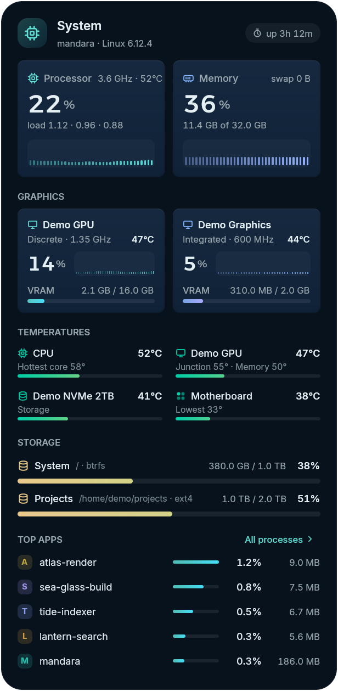
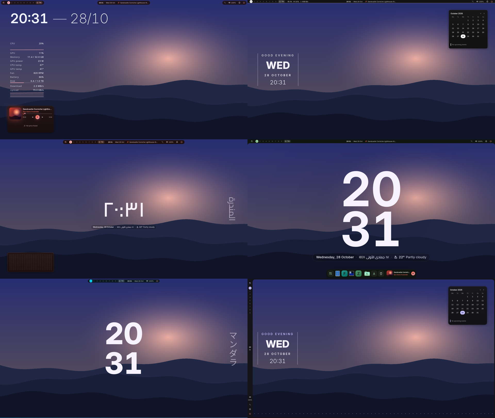
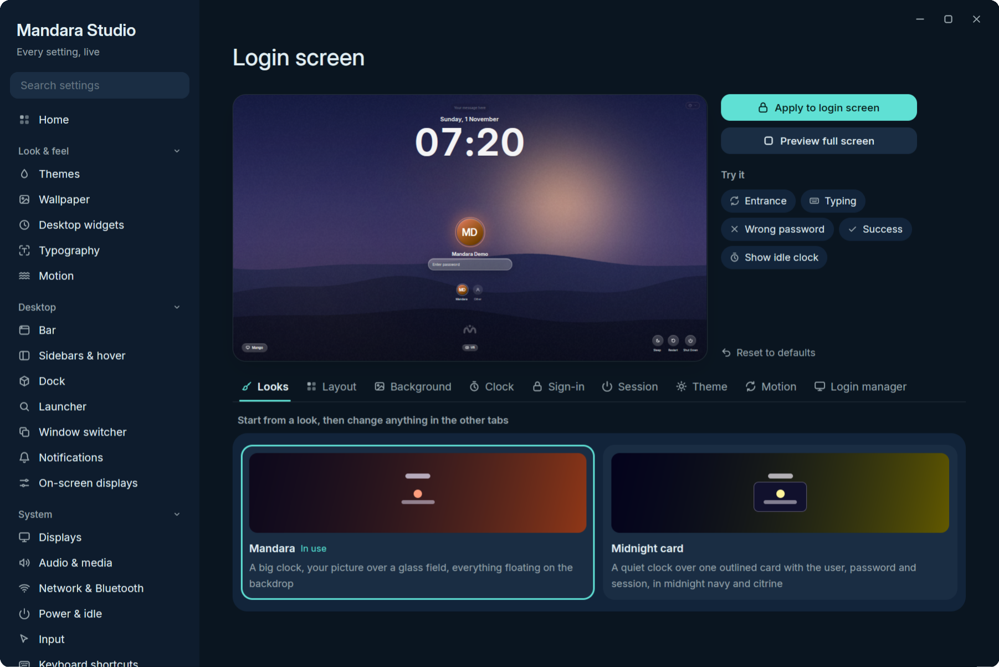

<p align="center">
  <picture>
    <source media="(prefers-color-scheme: dark)" srcset="assets/brand/mandara-banner-dark.webp"/>
    <source media="(prefers-color-scheme: light)" srcset="assets/brand/mandara-banner-light.webp"/>
    
  </picture>
</p>

<p align="center">
  <b>A beautiful, fast Linux desktop that fits in under 100 MiB of RAM.</b>
  <br/>
  Design-first, spring-animated and written entirely in Rust.
  <br/>
  <i>Frames built in about 0.1 ms, ready for 1000 Hz displays: a shell that feels like an instrument, not a toolkit.</i>
</p>

<p align="center">
  <a href="docs/install.md">
    
  </a>
</p>

<p align="center">
  <a href="https://github.com/theHamdiz/mandara/stargazers"></a>
  <a href="https://github.com/theHamdiz/mandara/releases/latest"></a>
  <a href="https://github.com/theHamdiz/mandara/commits/main"></a>
  <a href="https://discord.gg/kPBaS2reQ3"></a>
  <a href="docs/README.md"></a>
  <a href="#license"></a>
  <a href="https://ko-fi.com/thehamdiz"></a>
</p>

<p align="center">
  <a href="docs/building.md#build-fingerprint"></a>
  <a href="docs/desktop.md"></a>
  <a href="docs/performance.md"></a>
  <a href="docs/install.md#compositors"></a>
  <a href="docs/plugins.md"></a>
  <a href="docs/languages.md"></a>
  <br/>
  <a href="docs/performance.md"></a>
  <a href="docs/performance.md"></a>
  <a href="docs/performance.md"></a>
</p>

<p align="center">
  
</p>

<p align="center">
  <a href="docs/install.md"><b>Install</b></a> ·
  <a href="docs/README.md"><b>Documentation</b></a> ·
  <a href="docs/studio.md">Studio</a> ·
  <a href="docs/plugins.md">Plugins</a> ·
  <a href="docs/commands.md">Commands</a> ·
  <a href="CHANGELOG.md">What's new</a>
</p>

---

**Mandara Shell** is a native Linux Wayland desktop shell, written in Rust
on [GPUI](https://github.com/zed-industries/zed). It's everything around
your windows: the bar, a dynamic island, a dock, a launcher, a sidebar,
notifications, wallpapers, desktop widgets, the lock screen and the login
screen, plus a settings app that changes all of it live. It runs on
**MangoWM, Niri, Hyprland, Umbriel, Sway and River Classic**, and it's one small, fast program
you install with one command.

It's made to feel good to use. Panels pour out of the bar on real spring
physics, colours follow your wallpaper and your music, and the whole
desktop stays light enough to run all day without you noticing it.

## One shell, many desktops

Pick a bar style, a wallpaper and a few desktop widgets, and Mandara turns
into a different desktop. Each of these takes a minute in Studio, and every
widget can be moved, resized and restyled right on the desktop.

<table>
<tr>
<td width="33%" valign="top"><br/><sub><b>Music corner</b>: glass pills, a turning record, a pocket player and a live wave visualizer.</sub></td>
<td width="33%" valign="top"><br/><sub><b>Night sky</b>: the notch bar, a cookie-dial clock, the moon, the sun's arc and the weather.</sub></td>
<td width="33%" valign="top"><br/><sub><b>Daylight</b>: light mode, the island bar, a quote, your to-dos, the focus timer and the month.</sub></td>
</tr>
</table>

## At a glance

| | |
|---|---|
| **What** | A complete Wayland desktop shell: bar, island, dock, launcher, sidebar, notifications, OSDs, wallpapers, desktop widgets, lock screen, login manager, settings app |
| **Compositors** | MangoWM, Niri, Hyprland, Umbriel, Sway and River Classic (0.3), all first-class; your own config gets one include line at most, nothing more |
| **Built with** | 100 % Rust, one binary (`mandara`), GPU-rendered with GPUI and wgpu |
| **Resources** | Under 100 MiB RAM, under 190 MiB video memory, about 0.1 % CPU idle |
| **Settings** | `~/.config/mandara/config.toml`, edited live by Mandara Studio (`mandara studio`) |
| **Automation** | `mandara msg <command>` with JSON replies; `mandara commands --json` lists them all |
| **Plugins** | 73 built in; third-party plugins in Rust, compiled to sandboxed WebAssembly |
| **Languages** | 15, including right-to-left Arabic, Persian and Urdu |
| **License** | GPL-3.0-or-later |

## What sets Mandara apart

Mandara is built for one job: being the complete desktop for **MangoWM,
Niri, Hyprland, Umbriel, Sway and River Classic**. These are the strengths it was designed
around, each one measured or shipped today:

1. **Six compositors, each first-class.** It speaks every compositor's
   own IPC natively: MangoWM's and River's tag bitmasks (view, toggle-view,
   tag moves), Niri's scrolling columns, Hyprland's, Umbriel's and Sway's
   workspaces. It reads
   each compositor's version and writes its exact config dialect, down to
   Hyprland 0.57's Lua config.
2. **It never breaks your compositor config.** It adds one include line
   (none at all on River, whose settings it sends over River's protocol);
   everything else goes into its own drop-in files. Every change is
   checked by the compositor's own validator (`mango -p`, `niri validate`,
   `Hyprland --verify-config`, `umbriel config validate`, `sway --validate`)
   and rolled back if it objects.
3. **A whole desktop in one native binary.** Bar, dynamic island, dock,
   launcher, side bars and sidebar, notification center, on-screen
   displays, wallpaper engine, desktop widgets, clipboard manager,
   screenshots, screen recording, offline OCR, polkit agent, lock screen,
   login manager and a settings app: one Rust program, no QML, JavaScript,
   Python or shell glue.
4. **Fast by measurement, not by claim.** Under 100 MiB of RAM, under
   190 MiB of video memory, about 0.1 % CPU idle, and frames built in
   0.1–0.2 ms: 95% of frames finish inside the 1 ms a 1000 Hz display
   allows.
   [How it's measured](docs/performance.md)
5. **Real motion.** Analytical spring physics that can be interrupted
   mid-flight, and OKLCH colour blending, so every morph, slide and theme
   change stays smooth.
6. **Every setting live, in a real app.** Mandara Studio has 31 pages; drag
   a slider and the bar follows as you drag. Nothing needs a config file
   unless you want one.
7. **A colour engine, not a colour picker.** Material You (HCT) palettes
   from your wallpaper, hand-tuned themes, and opt-in theming of Ghostty,
   GTK 3/4, Qt 5/6, Kvantum, Zed, kitty, foot, Alacritty, btop and more.
8. **Your desktop, your look.** Six bar styles on any edge, side bars that
   join the top bar into one frame, one-click Looks, dozens of desktop
   widgets placed per monitor, and three launcher looks.
9. **Safe, rich extensions.** 73 plugins built in. Third-party plugins are
   Rust compiled to sandboxed WebAssembly: a crashing plugin is switched
   off and the shell keeps running.
10. **Scriptable end to end.** Almost everything the interface does is a
    `mandara msg` command with JSON replies, so scripts and AI agents can
    drive and inspect the whole desktop. [How](docs/agent-ready.md)
11. **Installs and updates itself, safely.** One command sets it up on Arch,
    Debian/Ubuntu, Fedora, openSUSE, Void, Alpine, Gentoo and Solus,
    takes over an existing setup without losing it, and updates arrive as
    small, signed binary patches from Studio → About → Update now. NixOS
    gets a flake with NixOS and Home Manager modules.
12. **Made for everyone.** 15 interface languages, right-to-left Arabic,
    Persian and Urdu included, and fonts chosen for every script it shows.

## Why you'll like it

- **It's light.** The whole desktop needs less memory than a browser tab
  and sits at about 0.1 % CPU when idle. [How](docs/performance.md)
- **It looks the way you want.** Six bar styles (now including a notch that
  hangs from the top edge), side bars of icons and pills that join the top
  bar into one frame, one-click Looks, desktop widgets, a hundred dials for
  corners, glass and motion, and themes made from your wallpaper.
  [Your desktop](docs/desktop.md)
- **Everything is a click away in Studio.** 31 pages of settings, all
  live: drag a slider and the bar follows as you drag.
  [Mandara Studio](docs/studio.md)
- **It does a lot out of the box.** A media island with lyrics, a sound
  mixer per app, screenshots and screen recording, copying text from the
  screen, a launcher with three looks (a list, an icon grid or a centred
  Spotlight-style search bar), a clipboard that sorts what you copy, a
  drag-and-drop app installer, night light, and 73 built-in plugins.
  [Everything else](docs/more-features.md)
- **It welcomes you in.** A matching lock screen and login screen with
  your own wallpaper, and ready-made looks for both.
  [Lock screen and login](docs/lock-and-login.md)
- **It speaks your language.** Fifteen languages, with Arabic, Persian
  and Urdu laid out right to left. [Languages](docs/languages.md)
- **It plays well with scripts and AI agents.** Nearly everything the
  interface does is also a command with JSON replies.
  [Automation](docs/agent-ready.md)

## A look around

<table>
<tr>
<td width="50%" valign="top"><br/><sub><b>Media</b>: colours from the album art, a live spectrum and synced lyrics.</sub></td>
<td width="50%" valign="top"><br/><sub><b>Sound</b>: every output, your microphone and every app playing.</sub></td>
</tr>
<tr>
<td width="50%" valign="top"><br/><sub><b>Weather</b>: an animated sky, hourly and five-day forecasts.</sub></td>
<td width="50%" valign="top"><br/><sub><b>Resources</b>: CPU, memory, every GPU, temperatures and disks.</sub></td>
</tr>
</table>

<p align="center">
  
  <br/>
  <sub>Six Looks, one click each: the bar, widgets, colours and fonts change together.</sub>
</p>

<table>
<tr>
<td width="50%" valign="top"><br/><sub><b>Mandara Login</b>, the login screen</sub></td>
<td width="50%" valign="top"><br/><sub><b>The lock screen</b>, made to match</sub></td>
</tr>
</table>

<p align="center">
  
  <br/>
  <sub><b>Mandara Studio</b>: every setting, live, with previews like this login screen designer.</sub>
</p>

## Desktop widgets

Dress up your desktop with dozens of widgets: clocks of every
kind, calendars with your events, the sky, the weather, what's playing, a
to-do list you tick right there, quick toggles, a desk cat and more. Each
one can sit on a glass or solid plate, take a shape (a circle, a scalloped
cookie, a flower, torn paper…) and wear a frame like washi tape or a
polaroid. Pick Western or Eastern Arabic digits, the Gregorian or Hijri
calendar and the language of the day names. Widgets come from plugins, so
you turn on only the ones you want, and plugins can add their own.
[Desktop widgets](docs/desktop.md#desktop-widgets)

<table>
<tr>
<td width="50%" valign="top"><br/><sub><b>Your day</b>: tick tasks, start the timer, see what's next.</sub></td>
<td width="50%" valign="top"><br/><sub><b>What's playing</b>, painted six ways, with the desk cat bobbing along.</sub></td>
</tr>
<tr>
<td width="50%" valign="top"><br/><sub><b>The sky</b>: the sun's arc, the moon, the weather and the next prayer.</sub></td>
<td width="50%" valign="top"><br/><sub><b>Your language</b>: Eastern Arabic digits and the Hijri calendar.</sub></td>
</tr>
</table>

## Install

One command, from any shell:

```bash
sh -c 'cd "$(mktemp -d)" && curl -fsSL "https://github.com/theHamdiz/mandara/releases/latest/download/mandara-$(uname -m)-linux-gnu.tar.gz" | tar xz && exec ./mandara-*/bin/mandara install'
```

The installer checks its own signature, sets up what your distribution
needs, and hooks into your compositor without touching your own config
files (no compositor yet? it offers to install one). It works on Arch,
Debian and Ubuntu, Fedora, openSUSE, Void, Alpine, Gentoo and Solus. Updates arrive by small binary patch: Studio → About →
**Update now**.

On **NixOS**, Mandara is a flake: try it with
`nix run github:theHamdiz/mandara`, or add it to your system with
`programs.mandara.enable = true;` (a NixOS module and a Home Manager
module come with it). Nix keeps it updated.

→ **[Install guide](docs/install.md)**: Arch packages, NixOS, other
options, coming from another setup.

## Common questions

**Does Mandara change my compositor config?** Only by one include line.
Everything else goes to `~/.config/mandara/generated/`, and each change is
checked by the compositor's own validator and rolled back if it objects.

**How do I update?** Studio → About → **Update now**. Updates are small,
signed binary patches.

**Can I script it or let an AI agent drive it?** Yes. Nearly every action
is a `mandara msg` command with a JSON reply, and scripts can push live
progress to the bar.

**Can I write my own plugins?** Yes, in Rust, compiled to a sandboxed
WebAssembly component. They hot-reload while you work and can be shared
through the GitHub marketplace. [Writing plugins](PLUGINS.md)

More answers in the **[FAQ](docs/faq.md)**.

## Learn more

- **[Documentation](docs/README.md)**: every feature, one topic per page
- **[FAQ](docs/faq.md)**: short answers to common questions
- **[Using Mandara](docs/usage.md)**: commands and default shortcuts
- **[Plugins](docs/plugins.md)** and **[writing your own](PLUGINS.md)**
- **[Why Mandara](docs/why-mandara.md)**: how it compares with other shells
- **[Building from source](docs/building.md)** and
  **[contributing](AGENTS.md)**

## Star history

<p align="center">
  <a href="https://www.star-history.com/#theHamdiz/mandara&Date">
    <picture>
      <source media="(prefers-color-scheme: dark)" srcset="https://api.star-history.com/svg?repos=theHamdiz/mandara&type=Date&theme=dark"/>
      <source media="(prefers-color-scheme: light)" srcset="https://api.star-history.com/svg?repos=theHamdiz/mandara&type=Date"/>
      
    </picture>
  </a>
</p>

## Supporting Mandara

Mandara is free, open source and always will be. If it makes your desktop a
little nicer and you'd like to say thanks, you can chip in toward the AI
credits and developer time that go into it:

[](https://ko-fi.com/thehamdiz)

It's entirely optional. Using Mandara, telling a friend, writing a plugin
or reporting a bug helps just as much. Thank you!

## License

Mandara Shell is free software under the **GNU General Public License,
version 3 or later** ([LICENSE.md](LICENSE.md), notice in
[COPYRIGHT.md](COPYRIGHT.md)). Vendored code keeps the license in its
folder, and fonts and models downloaded on demand keep their own: OFL for
Google Fonts, Apache-2.0 for the PaddleOCR models and the Depth Anything V2
Small depth model.
