<p align="center">
  
</p>

<h1 align="center">Mandara Shell</h1>

<p align="center">
  <b>A GPU-accelerated Linux desktop shell in under 100 MiB of RAM.</b>
  <br/>
  Design-first, spring-animated and written entirely in Rust.
  <br/>
  Named after <b>المندرة, El-Mandara</b>, the coastal district of Alexandria.
</p>

<p align="center">
  <a href="#build-fingerprint"></a>
  <a href="#features"></a>
  <a href="#performance"></a>
  <a href="#why-mandara"></a>
  <a href="#plugins"></a>
  <a href="#languages"></a>
  <br/>
  <a href="#performance"></a>
  <a href="#performance"></a>
  <a href="#performance"></a>
  <a href="#license"></a>
  <a href="https://ko-fi.com/thehamdiz"></a>
</p>

<p align="center">
  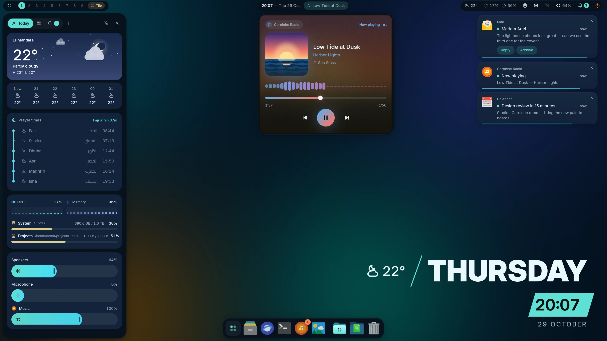
</p>

<p align="center">
  <a href="#agent-ready">Agent-ready</a> ·
  <a href="#why-mandara">Why Mandara</a> ·
  <a href="#performance">Performance</a> ·
  <a href="#features">Features</a> ·
  <a href="#plugins">Plugins</a> ·
  <a href="#install">Install</a> ·
  <a href="#usage">Usage</a> ·
  <a href="#configuration">Configuration</a> ·
  <a href="#building-from-source">Building</a> ·
  <a href="#supporting-mandara">Support</a>
  <br/>
  <sub>Guides: <a href="docs/studio.md">Studio</a> · <a href="docs/commands.md">Commands</a> · <a href="PLUGINS.md">Plugins</a> · <a href="docs/configuration.md">Configuration</a> · <a href="docs/login-manager.md">Login manager</a> · <a href="docs/releasing.md">Releasing</a> · <a href="docs/development.md">Development</a> · <a href="AGENTS.md">Contributing (AGENTS.md)</a></sub>
</p>

---

Mandara is a status bar, dynamic island, dock, launcher, sidebar,
notification center, wallpaper engine, lock screen, login manager,
screenshot and recording studio, and settings studio for **MangoWM, Niri
and Hyprland**. All of it ships as one native Rust binary built on
[GPUI](https://github.com/zed-industries/zed), the GPU-accelerated UI
framework behind the Zed editor.

There's no QML, JavaScript runtime, Python or shell-script glue. It's one
process, rendered on the GPU and animated with real spring physics.

## At a glance

<table>
<tr><td><b>Light</b></td><td>under 100 MiB of RAM and under 190 MiB of video memory for the whole shell (<a href="#performance">measured</a>), ~0.1 % CPU idle</td></tr>
<tr><td><b>Native</b></td><td>100 % Rust in one binary; the exact line count and hashes of this build are in the <a href="#build-fingerprint">build fingerprint</a></td></tr>
<tr><td><b>Extensible</b></td><td>41 first-party plugins built in; third-party plugins in sandboxed WebAssembly, from a GitHub marketplace or a folder</td></tr>
<tr><td><b>Compositors</b></td><td>MangoWM (tags), Niri and Hyprland, all first-class, configured non-destructively</td></tr>
<tr><td><b>Complete</b></td><td>bar, dock, launcher, notifications, sound mixer, lock screen, login manager, wallpaper engine, drag-and-drop app installer and uninstaller, and more</td></tr>
<tr><td><b>Generative</b></td><td>a built-in <a href="#wallpaper-generator">wallpaper generator</a>: twelve styles, up to 8K, the smallest lossless files and seamless video loops, all in pure Rust</td></tr>
<tr><td><b>Global</b></td><td>10 interface languages, including right-to-left Arabic</td></tr>
<tr><td><b>Live</b></td><td>Mandara Studio: 31 pages of settings, every change applied instantly</td></tr>
<tr><td><b>Agent-ready</b></td><td>almost everything the UI does is a documented CLI command with JSON replies, so scripts and AI agents can drive and inspect the desktop (<a href="#agent-ready">how</a>)</td></tr>
</table>

## Agent-ready

Mandara is built to be driven from the command line, by you, your scripts
or an AI agent. Almost every action in the bar, panels and Studio is a
command on the running shell, and the catalog describes itself:

```bash
mandara commands --json                      # every command with its arguments and examples
mandara msg --json shell state               # what is open right now, as JSON
mandara msg config get /bar/height           # read any setting; config set /bar/height 30 changes it live
mandara msg --json plugins list              # every plugin, enabled or not, and why one failed
mandara studio plugins --plugin weather --settings   # open Studio exactly where a setting lives
```

Launcher skills chain commands into named routines, hooks run commands on
desktop events, and installs and setup have dry runs
(`mandara install --dry-run`, `mandara setup --check`). See the
[command tour](docs/commands.md) and, for contributors and coding agents,
[AGENTS.md](AGENTS.md).

## Why Mandara

The Linux desktop has three excellent modern shells:

- **[Caelestia](https://github.com/caelestia-dots/shell)** has gorgeous spatial
  choreography.
- **[Noctalia](https://docs.noctalia.dev)** has depth, polish and ergonomics.
- **[Dux Shell](https://github.com/duxlabs-dev/dux-shell)** (DankMaterialShell
  until its 2.0 rename) has first-class compositor control.

They're built differently. Caelestia and Dux run on Quickshell (Qt Quick /
QML), with Go for Dux's CLI and helpers. Noctalia v5 is a ground-up rewrite in
native C++ with OpenGL ES, with no Qt or GTK, and uses Luau for scripted
widgets and plugins. Mandara takes the best idea from each and rebuilds them
in Rust as one native, compiled program, with plugins compiled to sandboxed
WebAssembly.

| | **Mandara** | Noctalia v5 | Dux (DMS 2.0) | Caelestia |
|---|---|---|---|---|
| Runtime | **Native Rust binary (GPUI, wgpu/Vulkan)** | Native C++ binary (OpenGL ES, no Qt/GTK) | Quickshell + QML (+ Go) | Quickshell + QML |
| Interpreted UI layer | **None** | None in the core; Luau for scripted widgets | QML/JS | QML/JS |
| Animation | **Analytical spring physics, interruptible, 144 Hz** | Native (C++) | Qt animations | Qt animations |
| Color engine | **Material You (HCT) palettes + OKLCH tweening** | Material You | Material You (matugen) | Material You |
| Plugins | **Rust → sandboxed WebAssembly, hot-reloaded, GitHub marketplace** | Luau | QML | — |
| Plugin crash isolation | **A trapping plugin is disabled; the shell keeps running** | In-process Luau VM | Shared process | Shared process |
| Compositors | **MangoWM (tags), Niri, Hyprland, all first-class** | Niri, Hyprland, … | Niri, Hyprland, … | Hyprland |
| Compositor settings GUI | **Gaps, borders, rounding, blur, rules, keybinds; non-destructive drop-ins** | Partial | Yes | — |
| Bar layouts | **Edge frame, glass pills, dynamic island; top or bottom** | Several | Several | Island |
| Screen recording | **Built in (native screencopy → AV1/WebM, pure Rust)** | External tools | External tools | External tools |
| OCR (copy text from screen) | **Built in, offline: English, العربية, Español, Français…** | — | — | — |
| Interface languages | **10, with RTL Arabic** | Several | Several | English |
| Settings app | **Mandara Studio: 31 pages in six groups, live preview, drag-and-drop layout designer, maintenance and repair** | Settings panel | Settings app | Config files |

Desktop and system features:

| | **Mandara** | Noctalia v5 | Dux (DMS 2.0) | Caelestia |
|---|---|---|---|---|
| Idle & screens off | **Lock / screens off / sleep, mains vs battery timeouts, lock before sleep (`ext-idle-notify`)** | Yes | Yes | n/s |
| Night light | **Sun schedule or fixed times, transitions, app exceptions (`wlr-gamma-control`)** | Yes | Yes | n/s |
| Display settings | **Arrangement, modes, scale, VRR, revert countdown, auto profiles, DDC/CI brightness** | External-monitor brightness | Yes | n/s |
| App dock | **Plugin: magnification, smart auto-hide, per display** | Yes | Yes | n/s |
| Alt-Tab window switcher | **Live previews, MRU, screen time** | Yes | Compositor overview | n/s |
| Hot corners | **Yes, any action or command** | Yes | Yes | n/s |
| Calendar events | **ICS / webcal feeds and folders, reminders (no CalDAV yet)** | CalDAV / ICS | Tasks only | n/s |
| VPN & hotspot | **VPN switch, WireGuard / OpenVPN import, hotspot with QR** | VPN | VPN + hotspot | n/s |
| Keyboard, mouse & touchpad | **Written to compositor drop-ins, layout labels** | Layout labels | Yes | n/s |
| Settings profiles & backup | **Profiles, undo, export / import, support report** | Export, support report | Theme registry | n/s |
| User accounts | **AccountsService: create, edit, photos, passwords** | — | Yes | n/s |
| Lock screen | **`ext-session-lock` + PAM, configurable look** | Yes | Yes | Yes |
| Polkit agent | **Built in** | Yes | n/s | n/s |
| Keyring unlock | **GCR prompter, unlock at login (GNOME Keyring, KWallet), KeePassXC dialog** | n/s | n/s | n/s |
| System tray | **StatusNotifierWatcher + menus** | Yes | Yes | Yes |

The comparison reflects the projects as we understand them at the time of
writing. The second table comes from a survey of Noctalia v5.4.0's and Dux
2.0's settings schemas (October 2026): "—" means we found no such setting,
**n/s** means not surveyed. Caelestia wasn't surveyed for it. Corrections are
welcome.

## Performance

A desktop shell runs all day, so Mandara treats memory and power like a
feature. Measured on the optimized release build, on a 4K display at scale
1.5 under MangoWM, with the bar, sidebar, notifications, wallpaper and depth
clock running, once the shell has settled (it hands freed memory back to the
system every 30 seconds, and program code it hasn't touched lately every 10
minutes):

| Resident memory (RSS) | Video memory | Idle CPU | Threads |
|---|---|---|---|
| **72–78 MiB** (about 26 MiB of it the shell's own memory; the rest is program code and shared libraries) | **170–185 MiB** | ~0.1 % of one core | 31 |

Opening a panel hits every frame at 144 Hz on that 4K display (release
build, measured: 0 late frames, a median of 6.06 ms per frame).
Studio → Performance shows the shell's own CPU, memory, video memory and
frame times live, so you can check these numbers on your machine (Studio
runs as its own process and is measured separately):

<p align="center">
  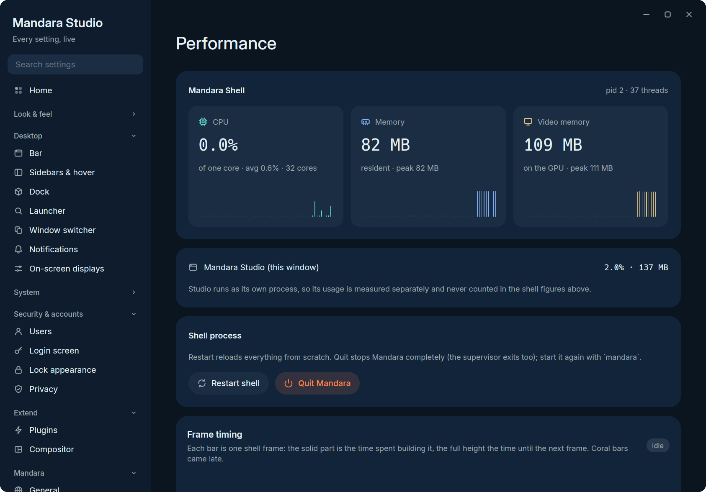
  <br/>
  <sub>Studio → Performance in the demo session the screenshots are taken in.</sub>
</p>

That's a whole GPU-rendered, spring-animated desktop (bar, dock, launcher,
sidebar, notifications, wallpaper and widgets) in less memory than a single
browser tab, without trading away speed. It took deliberate work at every layer:

- **Hand-tuned glibc malloc.** We benchmarked mimalloc v2 and v3, jemalloc
  and glibc on the real shell. Tuned glibc won: at most 2 malloc arenas
  (`M_ARENA_MAX`) instead of one per thread, and a `malloc_trim(0)` every 30
  seconds that hands freed pages back to the kernel. It needs no C
  allocator in the build. The other allocators stay one cargo feature away
  ([numbers](docs/releasing.md#memory-allocator)).
- **A patched GPUI renderer.** `vendor/gpui_wgpu` is GPUI's wgpu renderer
  with six Mandara patches ([details and measurements](vendor/gpui_wgpu/MANDARA-PATCHES.md)):
  path and anti-aliasing textures allocated lazily and sized to what is
  actually drawn (stock GPUI reserves ~166 MiB for a 4K surface that may
  never draw a path), configurable MSAA, small initial glyph/icon atlases
  that grow on demand, and GPU suballocation blocks capped at 16 MiB instead
  of 64 MiB kept forever. A full-screen shell surface needs about half the
  video memory of stock GPUI.
- **A wallpaper that costs no video memory.** The desktop background is
  painted in software on a separate thread into shared-memory buffers.
  Crossfades run inside the compositor (`wp_alpha_modifier_v1`), and once
  the compositor has the pixels, the shell keeps no copy. That removed a GPU
  window per display, about 130 MiB of swapchain at 4K.
- **Few threads.** All D-Bus, network and audio services share one tokio
  runtime with two workers, and GPUI's worker pool is capped at four.
- **Nothing ticks off screen.** Spectrum, graphs, timers and network
  sampling run only while you can see them.
- **Optimized releases.** Fat LTO, one codegen unit, stripped symbols, and
  `cargo native` for your exact CPU.

## Features

<table>
<tr>
<td width="50%" valign="top">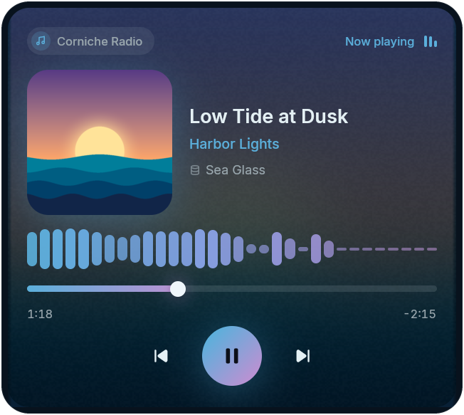<br/><sub><b>Media island</b>: colors come from the album art and crossfade between tracks. The visualizer is a real-time PipeWire/PulseAudio spectrum (FFT), with seekable progress and synced lyrics.</sub></td>
<td width="50%" valign="top">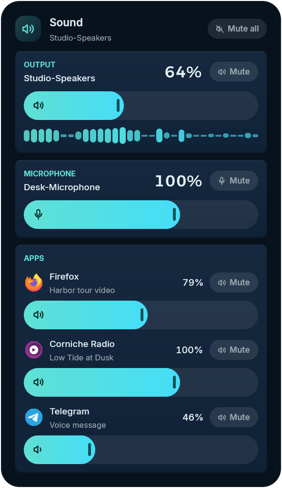<br/><sub><b>Sound</b>: output and microphone, one <b>Mute all</b> switch, and a volume slider, mute and output picker for every app playing sound.</sub></td>
</tr>
<tr>
<td width="50%" valign="top">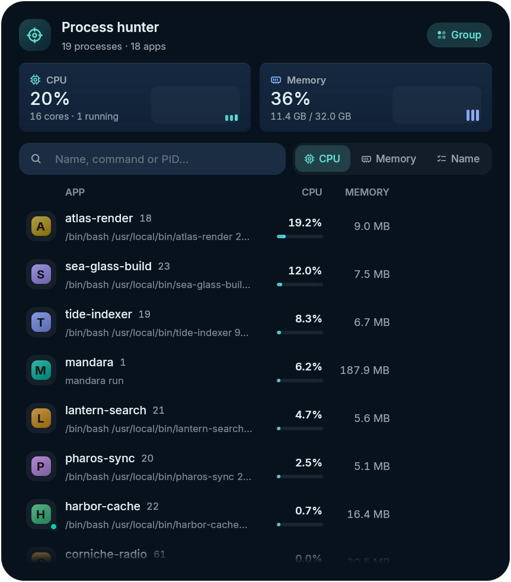<br/><sub><b>Process hunter</b>: live CPU and memory, apps grouped, search by name, command or PID, end or force-kill.</sub></td>
<td width="50%" valign="top">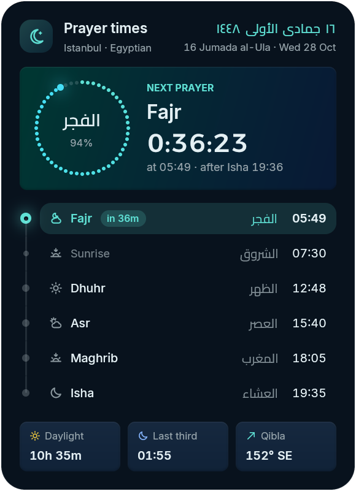<br/><sub><b>Prayer times</b> (opt-in): next-prayer countdown ring, day timeline, Hijri date and Qibla.</sub></td>
</tr>
<tr>
<td width="50%" valign="top">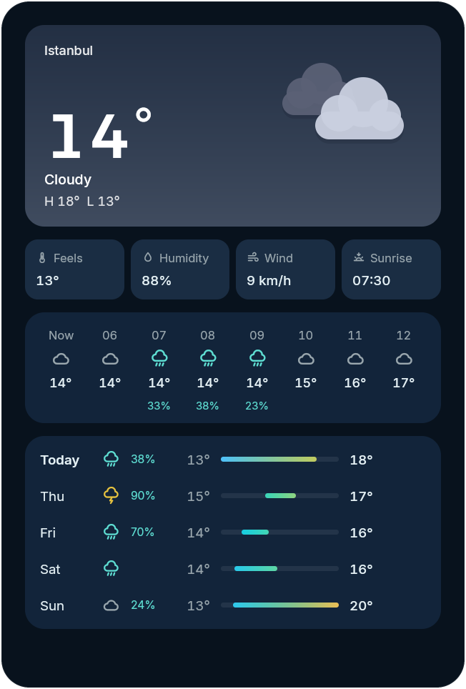<br/><sub><b>Weather</b>: an animated sky, hourly and five-day forecasts.</sub></td>
<td width="50%" valign="top">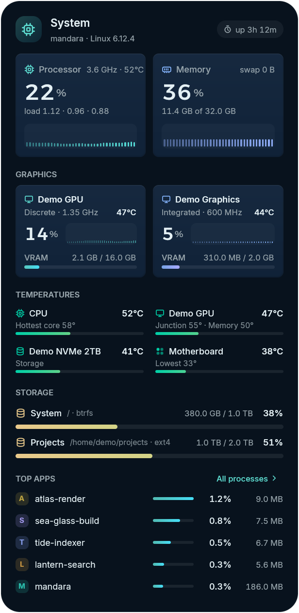<br/><sub><b>Resources</b>: CPU, memory, every GPU, temperatures and disks, live.</sub></td>
</tr>
</table>

<p align="center">
  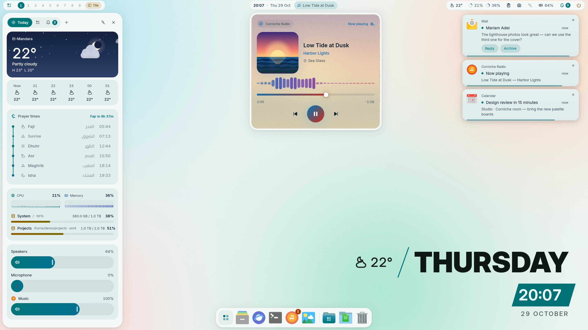
  <br/>
  <sub>The same desktop in light mode (<code>mandara msg theme mode light</code>).</sub>
</p>

### Shape it your way

- **Every corner, one dial.** Corner roundness scales every radius in the
  shell (bar, panels, sidebar, cards, chips, launcher, OSD, dock), keeps
  nested corners concentric, and updates live, open panels included.
- **Bar, your way:** edge frame (flush or floating), glass pills, island, a
  24 px **hairline** dense with live stats, a single **micro pill**, or a slim
  **side bar** on the left or right edge with an optional screen frame
  (panels open sideways from it). Each style has its own radius, item padding
  and spacing, separators, center-group alignment, accent tint, glass rim,
  shadow, and text and icon size.
- **Panels you can shape:** drop-down panels get width, maximum height,
  padding, gap to the bar, anchoring, opacity, shadow, an open animation
  (morph, fade and slide, or none) and their own spring; the sidebar and
  power dock sit flush or float, with their own radius, card styling,
  header layout and tab position.
- **Studio explains itself:** controls that don't apply to your current
  layout say why, and every settings group has a one-click Reset.

### Looks and desktop widgets

<p align="center">
  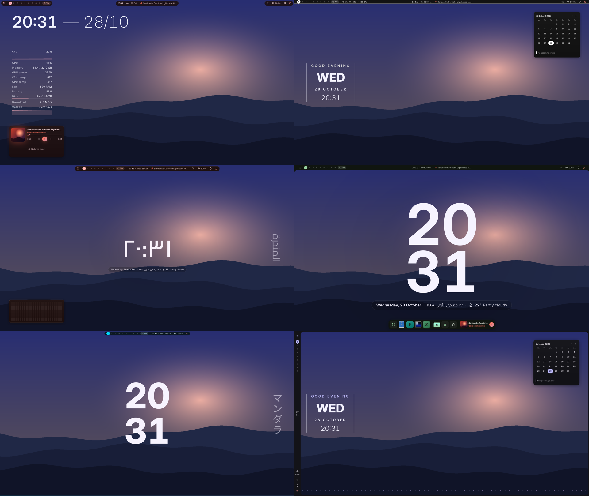
  <br/>
  <sub>The six Looks, one click each in Studio → Themes.</sub>
</p>

- **Looks:** six original one-click desktop looks in Studio → Themes, right under
  the live preview of your current theme:
  *Corniche Dusk*, *Pharos Ink*, *Montaza Crimson*, *Qaitbay Forest*,
  *Anfushi Wave* and *Night Frame*. Each sets the bar style, widgets,
  palette (generated by Mandara's HCT/OKLCH engine), typography and radii
  together. Your own setup is saved first, and **Restore my look** brings it
  back in one click. Switching looks also switches off the plugins the last
  look turned on (never ones you had on). Looks never change your wallpaper;
  *Use my wallpaper's colors* keeps its palette.
  `mandara msg look list|apply|restore` scripts them.
- **Cursor themes:** Studio → Themes → Cursor shows your cursor drawn from
  its own files at its size, every cursor setting (size with 24 / 32 / 48 /
  64 px chips, hide while typing, hide when idle, Hyprland's software cursor
  and hide on touch) and a gallery of the ten most popular ricing cursor
  themes — Bibata Modern, macOS, Qogir, Phinger, Catppuccin, BreezeX, Vimix,
  Banana, Nordzy and Rosé Pine — with author, licence and variants. One
  click downloads the pinned GitHub release, verifies its SHA-256 and
  installs it to `~/.local/share/icons`; Apply changes the cursor live on
  MangoWM, Niri and Hyprland (and X11 apps through `~/.icons/default`);
  Remove only ever deletes what Mandara installed. Nothing is bundled in the
  binary. `mandara msg cursor list|install|apply|remove` scripts it.

<p align="center">
  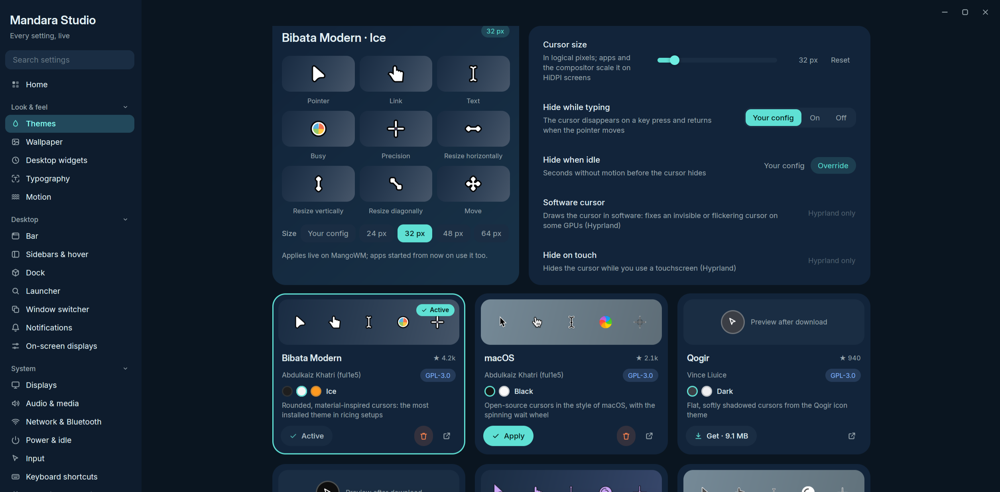
  <br/>
  <sub>Studio → Themes → Cursor: the applied cursor, its settings and the theme gallery.</sub>
</p>

<table>
<tr>
<td width="50%" valign="top">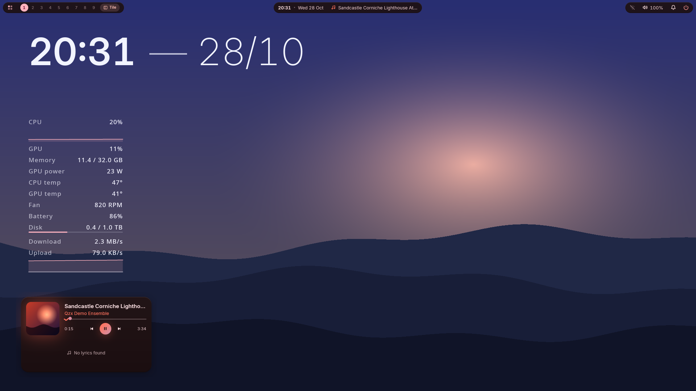<br/><sub><b>Corniche Dusk</b></sub></td>
<td width="50%" valign="top">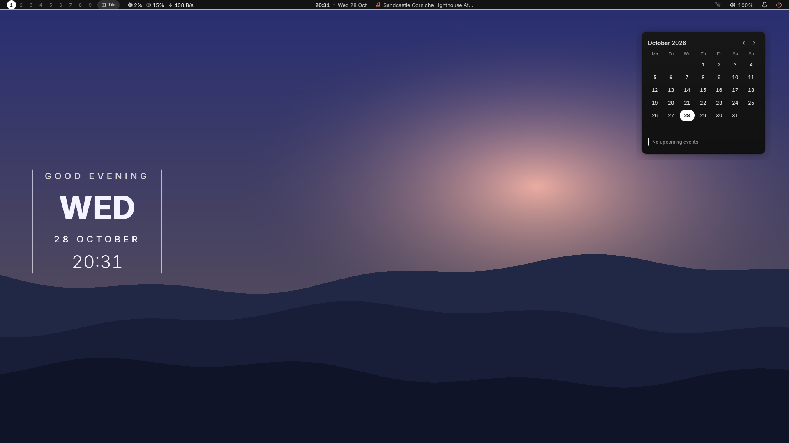<br/><sub><b>Pharos Ink</b></sub></td>
</tr>
<tr>
<td width="50%" valign="top">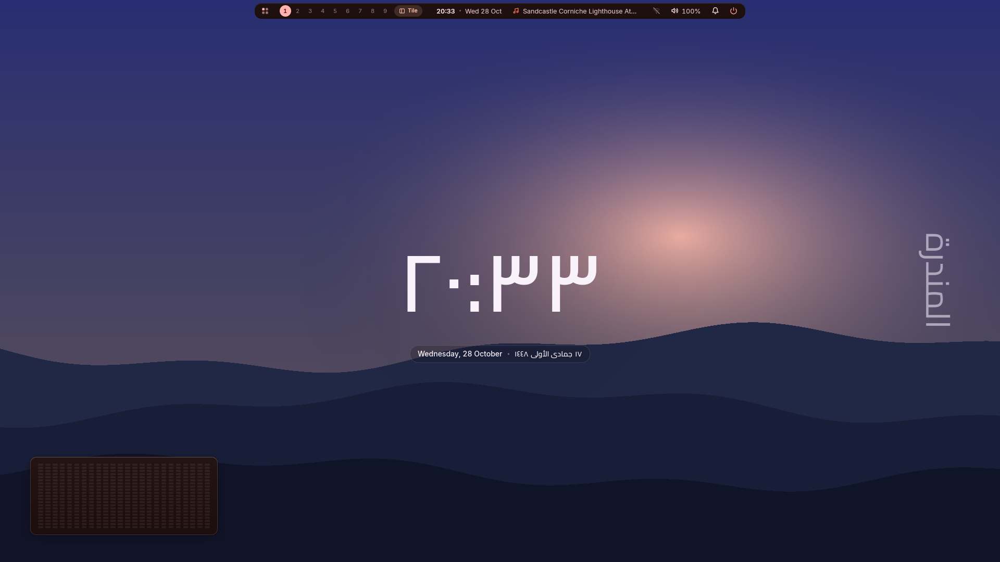<br/><sub><b>Montaza Crimson</b></sub></td>
<td width="50%" valign="top">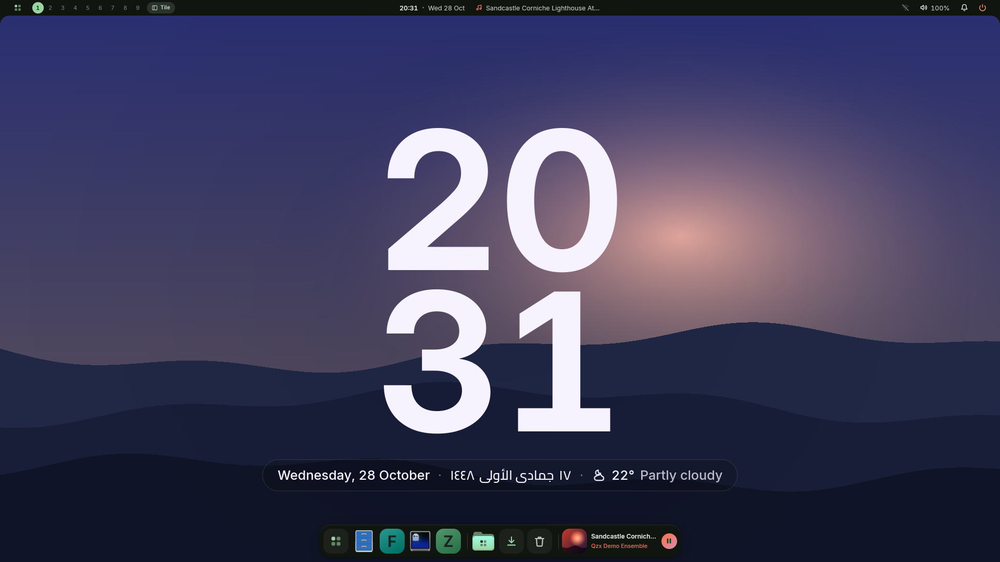<br/><sub><b>Qaitbay Forest</b></sub></td>
</tr>
<tr>
<td width="50%" valign="top">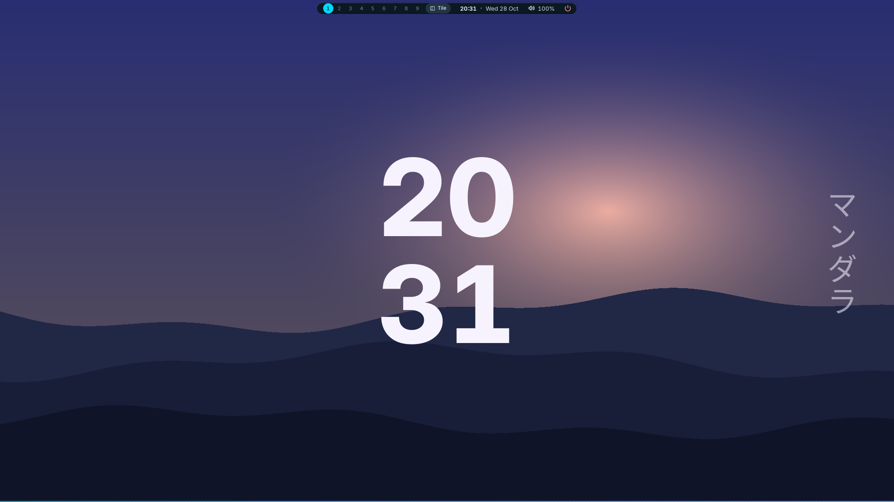<br/><sub><b>Anfushi Wave</b></sub></td>
<td width="50%" valign="top">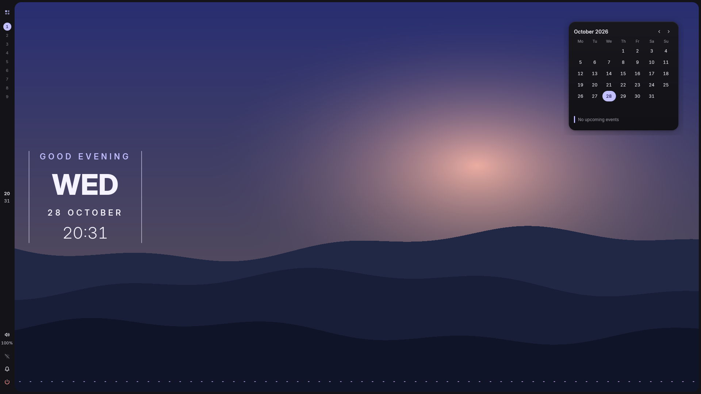<br/><sub><b>Night Frame</b></sub></td>
</tr>
</table>

- **Desktop widgets:** hero clocks (superscript, headline, day block, ring,
  greeting, giant day numeral, minimal), a system-monitor column with live
  graphs, text and shape decorations (discs, stripes, waves, frames, and
  vertical text: kana and CJK stand upright, Arabic and Latin keep their
  joined line turned toward the screen's middle) and an audio visualizer
  that can sit *behind* the wallpaper's subject. Every widget stays fully on
  screen and clear of the bar at any resolution. They're drawn in software
  into small shared-memory layers: no video memory, redrawn only when they
  change, nothing runs until you add one, and a removed widget's layer is
  freed at once.
- **Desktop cards:** a now-playing card (art, wavy progress, synced lyrics)
  and a calendar card, each on its own tiny surface that exists only while
  shown.
- **Visualizers:** a glowing wave along a screen edge, framed bars or a
  mirrored strip. They listen only while music plays and drop to zero CPU
  after a few seconds of silence.

<table>
<tr>
<td width="50%" valign="top">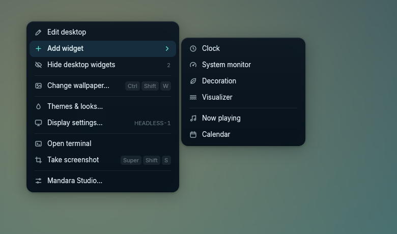<br/><sub><b>Right-click the desktop</b></sub></td>
<td width="50%" valign="top">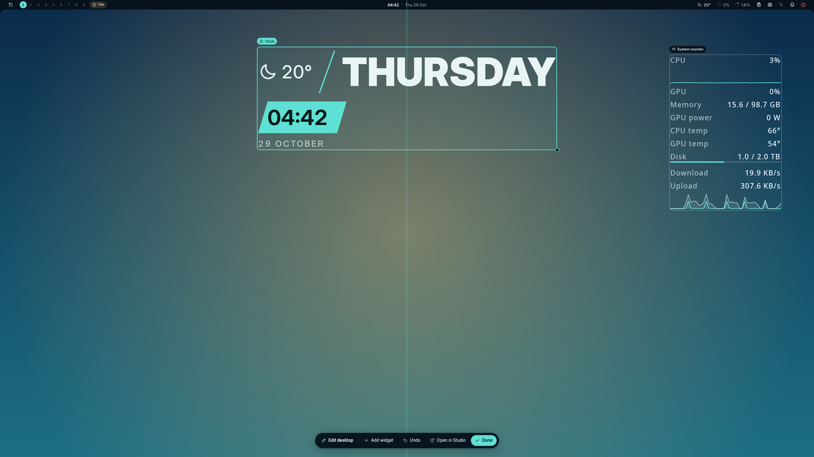<br/><sub><b>Edit the desktop in place</b></sub></td>
</tr>
</table>

- **Right-click the desktop** for a glass menu: Edit desktop, Add widget ▸
  (clock, system monitor, decoration, visualizer, now-playing or calendar
  card), show / hide widgets, change or skip the wallpaper, Themes & looks,
  display settings, a terminal, a screenshot and Studio.
- **Edit the desktop in place:** every widget gets an outline and its name.
  Drag to move it, pull the corner to resize, and it snaps to the screen's
  edges and centre lines. The × on a widget's name removes it in one click;
  right-click it to duplicate or hide it. A floating toolbar has Add widget,
  Undo, Open in Studio and Done. New widgets start in front of the
  wallpaper's subject and on a free spot, so they show the moment you add
  them. Nothing of it stays in memory once you're done. The same widgets
  are in Studio → Desktop widgets, with a live preview; tiles already on the
  desktop are ticked, and *Remove duplicates* clears exact copies.
- A now-playing chip can also ride at the end of the dock.

### Every value is a setting

Everything you can see or feel is a setting in Mandara Studio: sizes,
radii, colours, fonts, springs, delays, refresh intervals, list lengths and
alert thresholds. Each has a default, a bounded range and a reset, and
applies live. Plugin options (refresh rates, rows shown, warning levels)
live in each plugin's settings window, and
[docs/configuration.md](docs/configuration.md) lists every setting by Studio
page. A test keeps new hard-coded sizes and timings out of the shell:
anything that must stay fixed is a named, documented constant.

### Dock and launcher

<p align="center">
  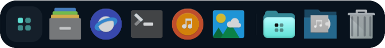
  <br/>
  <sub><b>Dock</b>: pinned and running apps, the Applications folder, Downloads and the Trash.</sub>
</p>

<table>
<tr>
<td width="33%" valign="top">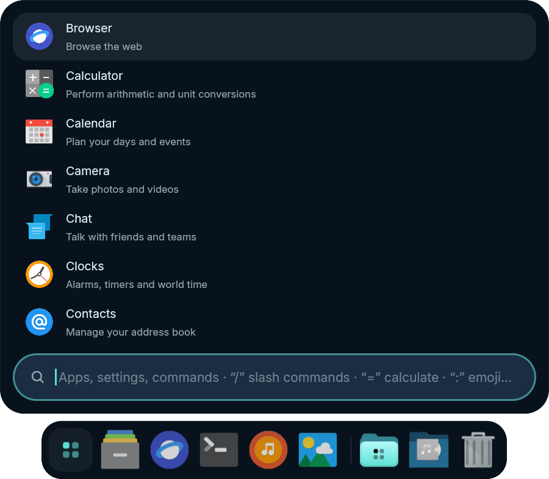<br/><sub><b>Launcher</b>, attached above the dock</sub></td>
<td width="33%" valign="top">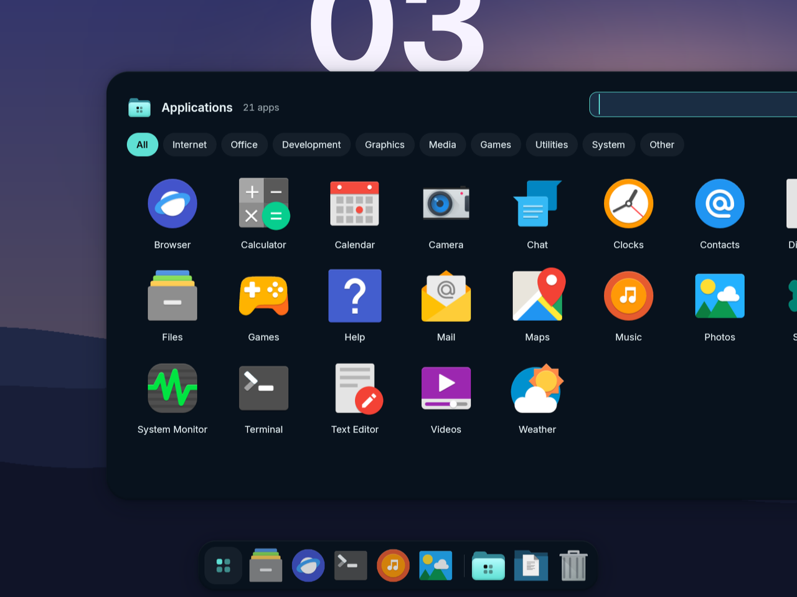<br/><sub><b>Applications folder</b></sub></td>
<td width="33%" valign="top">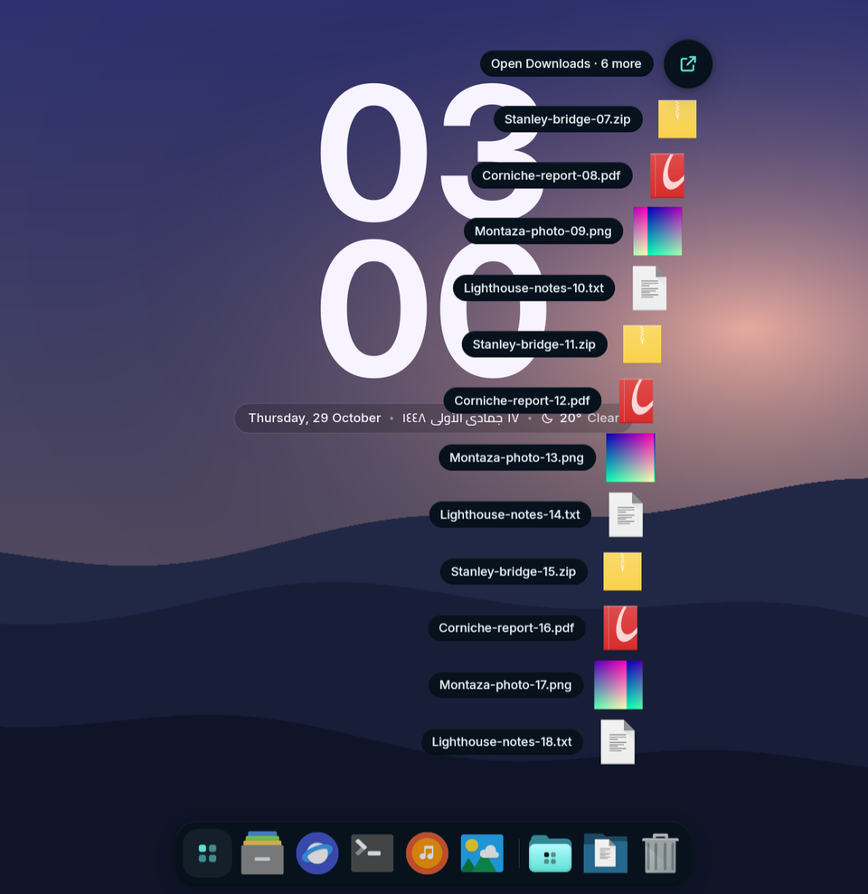<br/><sub><b>Downloads fan</b></sub></td>
</tr>
</table>

- **Dock** (opt-in), modelled on the macOS Dock: pinned, running and recent
  apps on a chromatic-glass strip at the bottom, left or right of each
  display, with spring magnification, open-app dots, notification and
  progress badges, and launch and attention bounces.
  - **Right-click any icon** for its windows, New Window and the app's own
    actions, **Options ▸ Keep in Dock ✓ · Open at Login ✓ · Show in
    Files**, Show All Windows, Hide and Quit / Force Quit. Unpinning a
    running app keeps its icon until it quits.
  - **Add app…** (Studio → Dock, or right-click the dock) searches your
    installed apps. Drag icons to reorder, drag a running app in to keep
    it, or drag one away from the dock to remove it with a poof.
  - **Applications folder:** a dock folder beside Downloads opens a
    Launchpad-style grid of every app (search, category chips, A–Z / Most
    used / Categories, right-click Keep in Dock / Open at Login /
    Uninstall…) and installs any app you drop on it, with a progress ring on
    the new icon.
  - **macOS stacks:** Downloads and any folder you add open as a fan of the
    newest files on an arc that pops up out of the icon as one piece, with
    *Open Downloads · N more* on top for the rest; or as a glass grid with
    keyboard navigation, type-to-filter and a right-click menu. The
    **Trash** takes dropped files.
  - **The dock stays put** while a stack, menu or the Applications grid is
    open, and auto-hide resumes cleanly when you close it.
  - **Auto-hide** (off, on, or only when a window overlaps) reveals at the
    screen edge; every setting is live in Studio → Dock, and
    `mandara msg dock pin|unpin|toggle-pin|move <app>`, `dock add`,
    `dock stack add|open <folder>`, `dock applications open` and
    `dock trash` script it.
- **Launcher** (Super+Space): fuzzy search over apps, settings, every plugin
  and command, a calculator, **slash commands** (`/g`, `/yt`, `/wiki`,
  `/gh`, `/todo`, `/note` and your own) and **skills** (named routines).
  **Providers** with their own prefixes: `:` emoji (English or Arabic
  names), `@` open windows, `#` clipboard history, `*` wallpapers, `~` files.
  It learns what you open (frecency, kept on this computer), shows pinned
  and recent apps first, and lists desktop actions (*New Private Window*).
  **Put it anywhere:** float it in the middle of the screen or attach it to
  the top or bottom edge at the left, middle or right. On the bar's edge it
  grows out of the bar like a panel (flares on the edge frame, a floating
  card under pills or the island), optionally out of the launcher button
  itself. Pick the spot on a screen diagram in Studio → Launcher, or run
  `mandara msg launcher placement top-left`.
- **They share the edge.** With the dock on, the bottom edge belongs to the
  dock: the launcher stops opening on hover, opens by click or keybind only,
  and floats above the dock instead of covering it.
- **Alt-Tab window switcher** with live window previews
  (`ext-image-copy-capture`), most-recently-used order and switch-on-release;
  started from a click or a script, it stays open until you choose.

### Sidebar tabs, to-do lists and Markdown notes

- **Your own sidebar tabs:** create tabs, name them, pick an icon and put any
  widget (Mandara's or a third-party plugin's) on any of them, the same
  widget on several if you like. Edit them in Studio → Sidebars & hover →
  **Tabs**, right-click a tab in the shell, or use
  `mandara msg sidebar tab …`. The sidebar reopens on the tab you used last,
  and Ctrl+Tab / Ctrl+1–9 switch tabs. The **+** button stays pinned while
  the tabs scroll sideways (wheel, touchpad or drag) under edge fades, and
  idle tabs shrink to icons only when their labels don't fit.
- **To-do lists:** tasks grouped into coloured lists with an Inbox, a chip
  switcher with counts, drag a task onto a list to move it, and completed
  tasks folded away per list. `/todo #Work send the report` in the launcher
  files a task in one step.
- **Markdown notes:** every note is a real `.md` file and every topic a
  folder (point it at a synced folder or an Obsidian vault; outside edits
  show up live). Notes render natively with clickable task lists, code
  blocks (always monospace), tables, quotes and right-to-left Arabic. The
  editor has a real caret (arrows, word jumps, Shift-selection, click and
  drag, copy / cut / paste), continues lists and applies Ctrl+B / Ctrl+I /
  Ctrl+K to the selection; search is fuzzy, and
  `/note #Topic …` adds one from the launcher.

### Notifications

<table>
<tr>
<td width="50%" valign="top">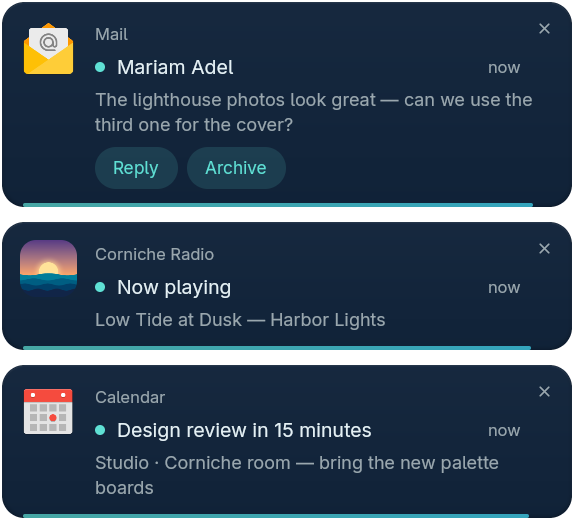<br/><sub><b>Notification cards</b> with actions</sub></td>
<td width="50%" valign="top">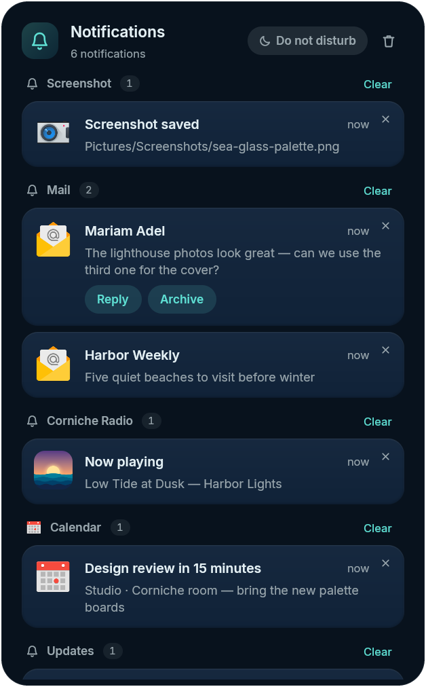<br/><sub><b>Notification center</b></sub></td>
</tr>
</table>

- **Notification cards** spring in from their corner on their own layer
  surface, close the gap smoothly when one leaves, pause while you hover them
  and draw a thin countdown line. Only the cards take clicks; the rest of the
  surface passes them through to your windows.
- Cards carry the app icon, rich text (bold, italic, links), images,
  progress bars, **action buttons** and **inline replies**, and group by app.
- The **notification center** keeps a history you size. **Per-app rules**
  block, silence, keep out of the history, change urgency or let an app
  through **do not disturb**, which can switch itself on while you share your
  screen, for fullscreen apps, on a schedule (**quiet hours**) or for a while
  (`notifications dnd on 1h`).

### Wallpaper picker and engine

<table>
<tr>
<td width="50%" valign="top">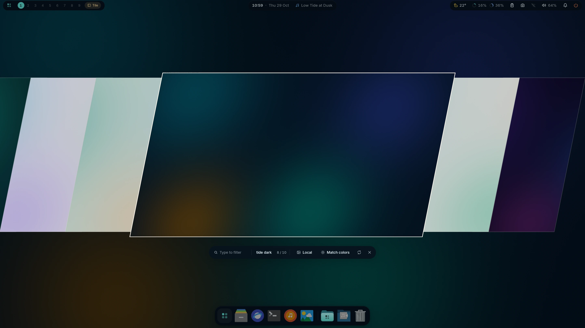<br/><sub><b>Picker</b>: slanted slices</sub></td>
<td width="50%" valign="top">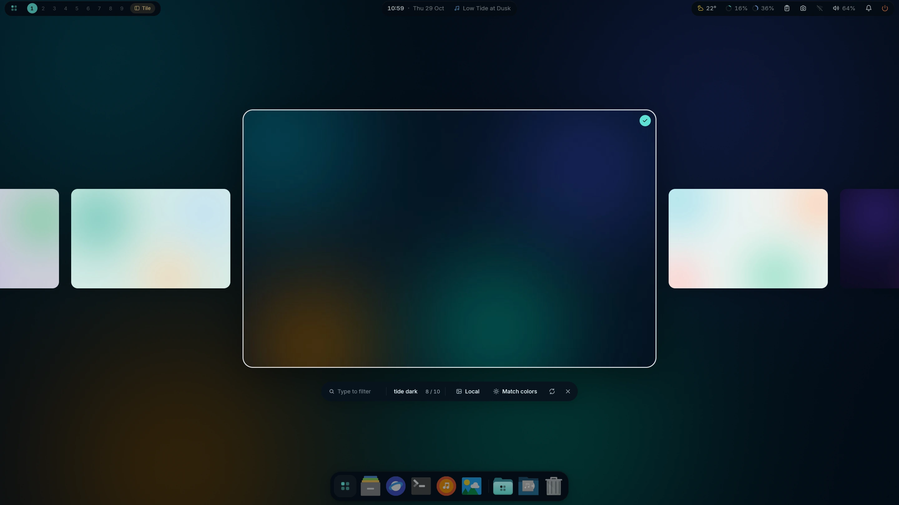<br/><sub><b>Picker</b>: carousel</sub></td>
</tr>
</table>

- **Picker** (Ctrl+Shift+W): slanted slices or a floating carousel, type to
  filter, **Match colors** to theme the whole desktop from the wallpaper, and
  **Wallhaven** browsing when your folder is empty.
- **Engine**: fill / fit / stretch / center / tile, fade / wipe / grow
  transitions, separate **light and dark wallpapers**, **per-display
  wallpapers** and a **slideshow** (interval, random or alphabetical, paused
  during fullscreen).
- **Video wallpapers**: AV1 clips (`.webm`, `.mkv`, `.ivf`) loop seamlessly
  behind the clock and widgets, decoded in pure Rust once per clip for every
  display showing it, and converted straight into the wallpaper's buffers.
  They pause (no decoding, no timers) behind windows, while locked, with the
  screens off and on battery; the picker marks them with a badge, and Match
  colors themes the desktop from a frame of the clip.
- **Depth desktop clock**: a big Alexandria / Cairo clock, a Gregorian +
  Hijri date pill and a ring that moves with your music, drawn *behind* the
  wallpaper's subject. Mandara finds the subject itself (pure Rust, skipped
  when unsure) or uses your own mask.

### Wallpaper generator

<table>
<tr>
<td width="33%"><br/><sub><b>Corniche · Mandara Corniche</b></sub></td>
<td width="33%"><br/><sub><b>Dunes · Sunset</b></sub></td>
<td width="33%">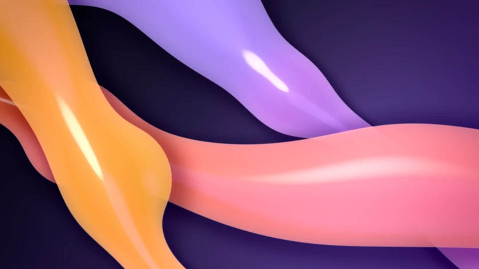<br/><sub><b>Liquid · Montaza Twilight</b></sub></td>
</tr>
<tr>
<td width="33%"><br/><sub><b>Aurora · Mandara Corniche</b></sub></td>
<td width="33%">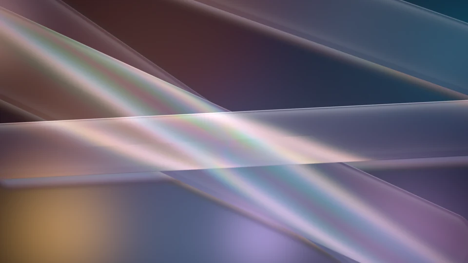<br/><sub><b>Glass · Rosé Pine</b></sub></td>
<td width="33%">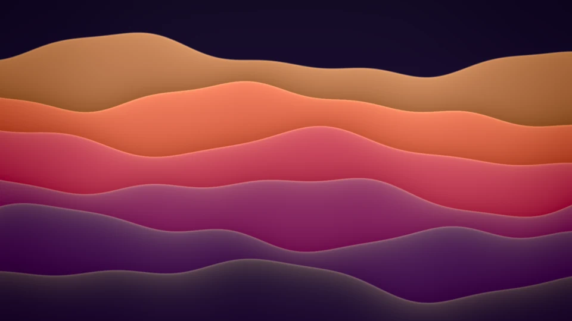<br/><sub><b>Waves · Sunset</b></sub></td>
</tr>
<tr>
<td width="33%"><br/><sub><b>Landscape · Kanagawa</b></sub></td>
<td width="33%">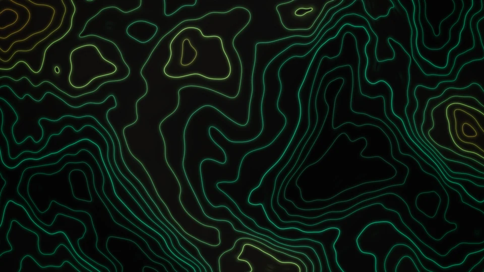<br/><sub><b>Contours · Mandara Obsidian</b></sub></td>
<td width="33%"><br/><sub><b>Bokeh · Montaza Twilight</b></sub></td>
</tr>
</table>

<sub>Every image above came out of the generator as is, at default settings with a palette and seed picked; shown here at 960 × 540.</sub>

Make your own wallpapers on your machine, in pure Rust: twelve styles (mesh
gradients, landscapes, the Corniche, aurora, dunes, silk flow, contours,
bokeh, low poly, liquid, waves and glass), the curated palettes, your theme's
colors or your own, and every variable on a slider. An opt-in plugin
(*Studio → Plugins*).

- **Designed in Studio**: a live preview that follows your sliders, a style
  gallery in your palette, clickable variations, a seed you can shuffle or
  lock, light or dark to follow the theme.
- **Any size, small files**: 1080p, 2K, 4K, 5K, 8K, ultrawide, portrait or
  your display's exact shape, saved lossless in the smallest file (WebP or
  PNG, whichever comes out smaller for the picture; or pick WebP, PNG or
  JPEG) with the expected size shown before you generate.
- **Video loops**: seamless AV1 loops that play as video wallpapers.
- **Remix anything**: each file remembers its recipe, so you can reopen it,
  vary it or re-render it bigger.
- **In the picker**: a Generate button, a marker on generated wallpapers
  and Remix.
- **On a schedule, if you want**: off until you turn it on; a fresh
  wallpaper every few hours, old ones cleaned up, missed runs never piling up.
- **Agent-ready**: `mandara msg wallgen generate aurora --size 8k`, and the
  rest of `wallgen …` in [the commands guide](docs/commands.md#wallpaper-generator).

<table>
<tr>
<td width="58%" valign="top">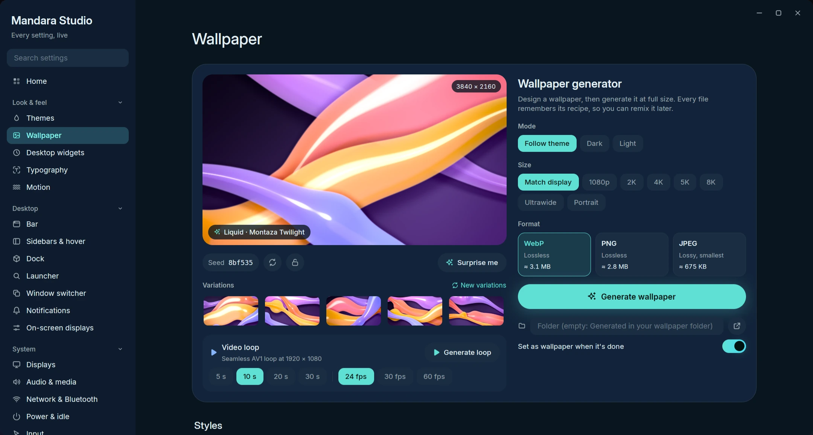<br/><sub><b>Studio</b>: preview, variations, size and format</sub></td>
<td width="42%" valign="top">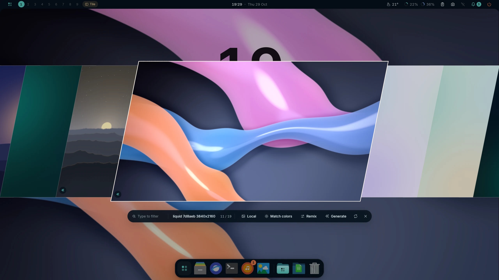<br/><sub><b>Picker</b>: Generate and Remix</sub></td>
</tr>
</table>

### Sound

- **Mute all**: one switch (sound panel, quick settings, middle-click on the
  bar's sound icon, `audio mute-all toggle`) mutes every output, hardware and
  virtual sinks such as EasyEffects', and every app. New sounds stay muted
  while it's on, it survives a shell restart, and it restores exactly what
  you had muted yourself.
- **Per-app volume**: every app playing sound gets a row with its icon,
  what it's playing, a volume slider (to 150 %), mute and a button that moves
  it to another output. Several streams of one app fold into one row.
- **Shell sounds** from your freedesktop sound theme, decoded in pure Rust,
  quiet while media plays.

### Keyboard shortcut cards

<p align="center">
  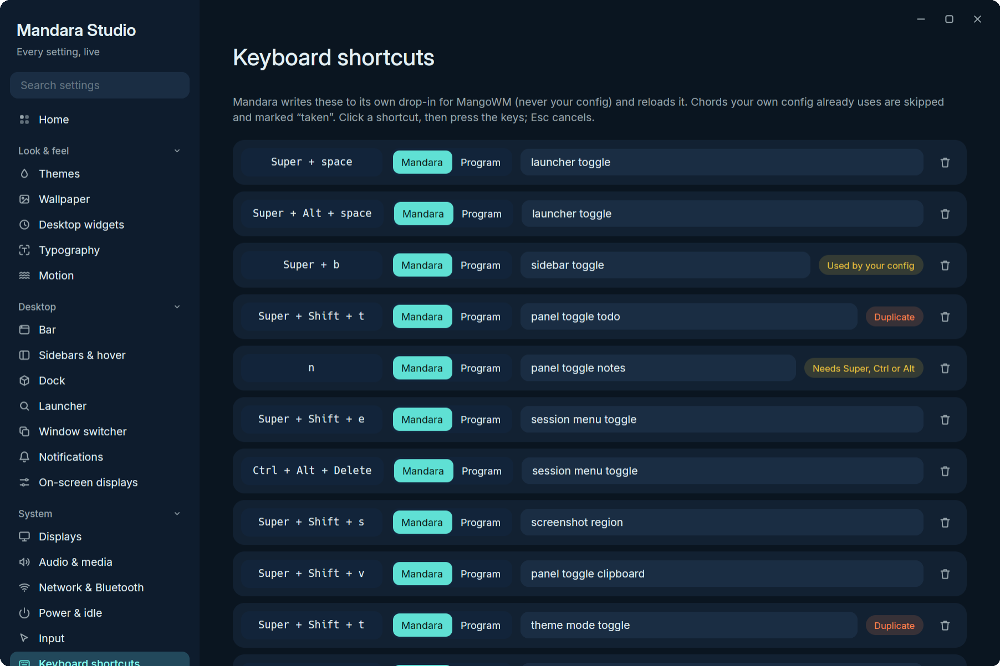
  <br/>
  <sub>Studio → Keyboard shortcuts: <b>Used by your config</b>, <b>Duplicate</b> and <b>Needs Super, Ctrl or Alt</b> badges.</sub>
</p>

Studio → Keyboard shortcuts shows every binding as a card. Click the keycap
chip and press the keys to record a new chord. Each card checks itself as
you type: **Duplicate** when two Mandara binds share a chord, **Needs
Super, Ctrl or Alt** when a bind would swallow plain typing, and **Used by
your config** with the exact file and line when your own compositor config
already has that chord. Mandara never overrides a key you already use; its
binds go into its own drop-in file for MangoWM, Niri or Hyprland.

### App Installer: drag, drop, done

Install apps the way you would on a Mac: drop the file on the **dock** or on
**Studio → Applications**, or pick it with **Install app…**
(`mandara msg apps install <file>` works too). App Installer is a Mandara
plugin, so you can switch it off or remove it like any other.

| You drop | What happens | Password? |
|---|---|---|
| **AppImage** | read without running it; its icon, name and launcher are extracted; installed in your home folder | no |
| **Flatpak** (`.flatpak`, `.flatpakref`) | `flatpak install --user` | no |
| **Portable app** (`.tar.gz`, `.zip`, …) | unpacked safely, main program and icon found, launcher created | no |
| **Native package** (`.deb`, `.rpm`, `.pkg.tar.zst`, `.apk`, `.xbps`) | your own package manager installs it, after showing what else it would pull in | yes, through the polkit dialog |

- **A proper installer sheet:** the app's icon, version, developer,
  summary, description and up to three screenshots from inside the package,
  size and category chips, a format badge that explains itself, Flatpak
  permissions as plain rows (broad ones highlighted), native dependencies on
  request, and clear warnings (wrong CPU, older than the installed version).
  Already installed? Choose Update, Reinstall or Keep both.
- **Feedback all the way:** a "Drop to install" glow while you drag, a queue
  when you drop several files, a progress ring with its steps and elapsed
  time, a spring bounce with Open / Keep in Dock / Show in Applications when
  it's ready, and failure cards that explain what went wrong and offer a fix
  (for example "Not enough space" with Open folder, or "Find it on Flathub"
  for a package built for another distribution).
- **In Studio → Applications:** a drop card ("Drop an app here, or choose a
  file") and an *Installed by Mandara* history with source file, date, size,
  Show in Files and Uninstall.
- **On your `$PATH` too, if you like:** a `~/.local/bin/<name>` link (or a
  two-line `flatpak run` wrapper), never overwriting anything of yours.
- **Where things go:** AppImages and portable apps live in
  `~/.local/share/mandara/apps/` with a launcher entry and icon; nothing
  needs root except a native package.
- **Scriptable:** `mandara msg apps install <file…> [--yes] [--dry-run]`,
  `apps jobs` (progress, `apps jobs cancel <id>`) and
  `apps installed --by-mandara`.
- **Clean removal:** Mandara records every file it installs, so dragging the
  app off the dock or choosing **Uninstall…** removes exactly those files,
  with the same optional leftover cleanup as the uninstaller below.
- **Safe by design:** a dropped file is never run during installation,
  installs are staged and rolled back if anything fails, and a package built
  for another distribution gets a clear explanation instead of a workaround.

### Applications and the uninstaller

Studio → Applications has four tabs (`mandara studio applications --tab
installed|defaults|startup|launching`):

- **Installed**: search every app, see where it came from (pacman, APT,
  DNF / Zypper, XBPS, APK, Portage, eopkg, Nix, Flatpak, Snap, AppImage or a
  local entry), and open, hide, rename or uninstall it.
- **Defaults**, **Startup** (apps at login) and **Launching** (wrapper,
  systemd scope, terminal for terminal apps).

The **uninstaller works on any distribution**. Mandara asks the package
managers that are actually installed who owns the app, then shows the exact
command and everything else the package manager would remove before you
confirm. System packages are removed through polkit (never sudo), with
essential packages, your compositor and Mandara itself refused; Flatpak and
Snap use their own tools, and AppImages and local entries go to the Trash.
**Leftover cleanup is optional**: the settings, data and cache folders the
app left in your home folder are listed with their sizes, all unchecked, and
whatever you tick moves to the Trash; nothing is deleted outright. It's
scriptable too: `mandara msg apps owner <id>` and
`mandara msg apps uninstall <id> [--purge-data] [--dry-run]`.

### Updates by binary patch

- **Smart updates.** Studio → About (or `mandara update apply`) checks
  GitHub for a new release and downloads only a **binary patch** from your
  version to the new one: in our measurements 7–16 MB instead of a 42–50 MB
  download. The patch is verified, the rebuilt binary is checked byte for
  byte against the published SHA-256, and it is swapped in atomically before
  the shell restarts. If a patch can't be used for any reason, Mandara falls
  back to the full download, verified the same way; `mandara update rollback`
  restores the previous version.
- **Plugins too.** Mandara's own plugins are built in and update with the
  shell. Marketplace plugins update the same way, patch first with a full
  fallback (`mandara update plugins`, or **Update all** in Studio), reload
  live and stay enabled. Plugin authors get patches generated by the release
  template in [PLUGINS.md](PLUGINS.md).
- **Polite.** Each new version is announced once, background checks respect
  offline mode, and installs owned by a package manager (pacman, apt, dnf)
  are left to it.

### Lock screen and Mandara Login

<table>
<tr>
<td width="50%" valign="top">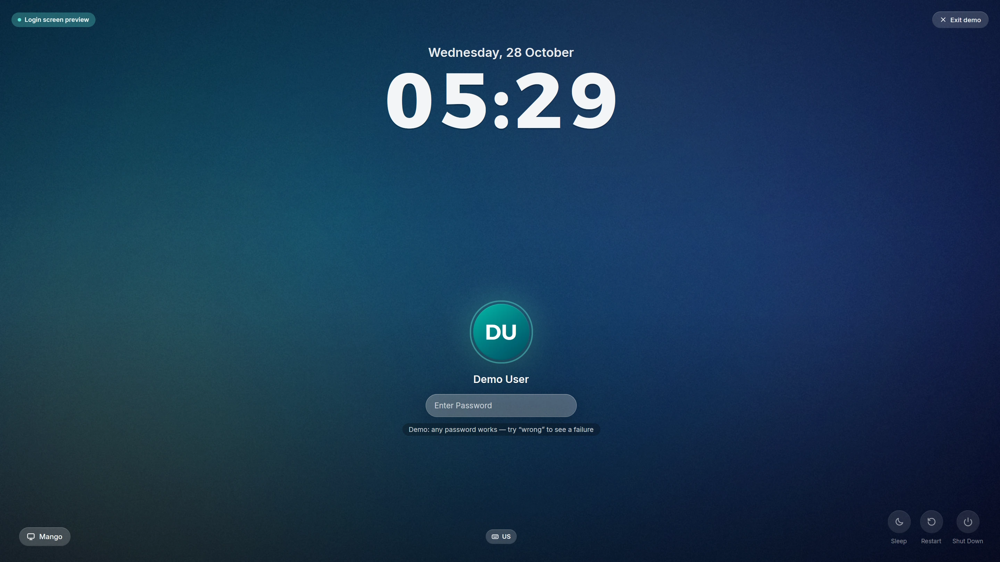<br/><sub><b>Mandara Login</b>, the login manager</sub></td>
<td width="50%" valign="top">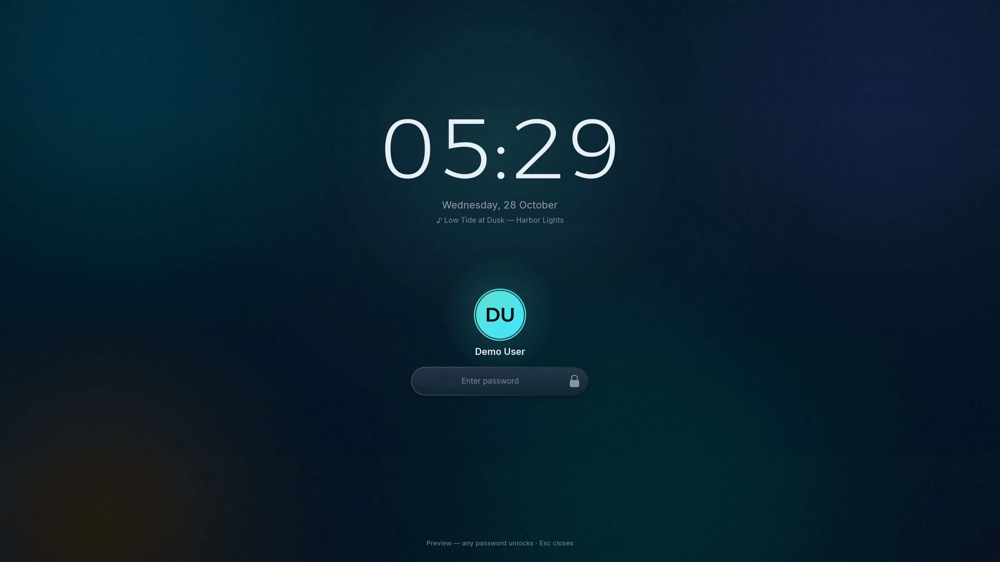<br/><sub><b>Lock screen</b></sub></td>
</tr>
</table>

- **Mandara Login** is a complete login manager: a
  [greetd](https://sr.ht/~kennylevinsen/greetd/) greeter in the same binary.
  Backgrounds are AV1 video clips decoded in pure Rust (no ffmpeg or
  GStreamer), a slow-zoom slideshow or a generated OKLCH aurora. It has a
  rolling clock, springy entrances, a breathing avatar ring, typing ripples,
  a shake on a wrong password and a cinematic zoom into your session.
- **Design it in Studio**: drag every element on a live, smooth preview in
  Studio → Login screen (below).
- **Try it safely**: `mandara greeter --demo` runs it on your session
  without logging you out. `sudo mandara greeter install` prints its plan,
  keeps backups and switches display managers only when you add `--apply`.
  → [docs/login-manager.md](docs/login-manager.md)
- **Your login screen by default**: the installer asks once, installs
  greetd and cage, and switches to Mandara Login with a backup
  (`--no-greeter` skips it; undo with `sudo mandara greeter restore latest`).
- **Switch login screens any time**: Studio → Login screen → **Login
  manager** lists Mandara Login, tuigreet, ReGreet, gtkgreet, nwg-hello,
  QtGreet, agreety, SDDM, GDM, LightDM, Ly and LXDM. One that isn't installed
  gets **Install & use**, which installs it with what it needs (greetd, cage,
  LightDM's greeter) through your package manager, then switches. From a
  terminal: `mandara greeter list` and `sudo mandara greeter use <name>
  --apply --install`.
  Every switch prints its plan first, changes only greetd's `command` line or
  `display-manager.service`, keeps timestamped backups and never stops your
  running session: it takes effect at the next boot.
- **Keyring unlock prompts**: Mandara is gnome-keyring's system prompter,
  so unlocking a keyring or choosing a new keyring's password opens a native
  Mandara dialog (show / hide, Caps Lock hint, strength meter, "unlock
  automatically" choice) instead of a separate GTK window. The password
  reaches gnome-keyring through gcr's encrypted secret exchange, never in
  clear text on the bus. If GNOME Shell or another prompter is already
  running, Mandara waits its turn; turn it off in Studio → General, and
  preview it with `mandara msg keyring-prompt demo`.
- **Keyrings unlock at login**: with Mandara Login,
  `sudo mandara greeter keyring-unlock --apply` (or Studio → General →
  Keyrings & passwords) adds the GNOME Keyring and KWallet PAM modules to
  greetd's login rules, only the ones installed, between clear markers and
  with a backup (`--remove` undoes it). A password login then opens your
  keyrings with no prompt at all. It doesn't apply to autologin, and each
  keyring's password must match your login password.
- **KeePassXC**: unlock a database in Mandara's own dialog (database picker,
  key file, Caps Lock hint) from quick settings, the launcher or
  `mandara msg keepassxc unlock`, optionally asked once at login. Mandara
  confirms the database really unlocked. The password reaches KeePassXC in
  clear text on your session bus (only your own programs can read it), and
  databases protected by a hardware key open in KeePassXC's own window.
- **Lock screen**: `ext-session-lock-v1` on every display, your password
  checked through PAM, a big clock, avatar, now playing, weather,
  notification count and battery, with classic, stacked or compact layouts
  and black secondary displays for OLED care. Anything that runs
  `loginctl lock-session` locks it; preview it with `mandara lock --demo`.

<p align="center">
  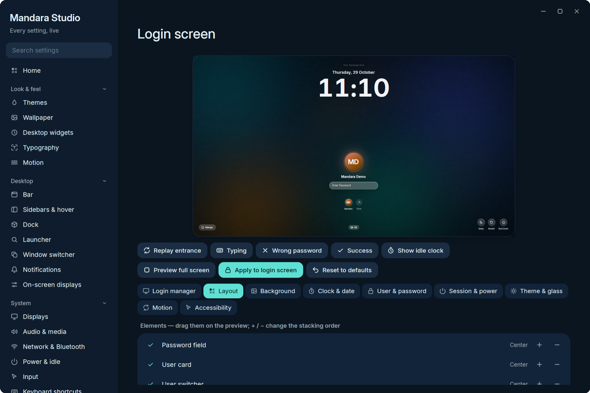
  <br/>
  <sub>Studio → Login screen: the designer with a live preview.</sub>
</p>

### Everything else

<table>
<tr>
<td width="33%" valign="top">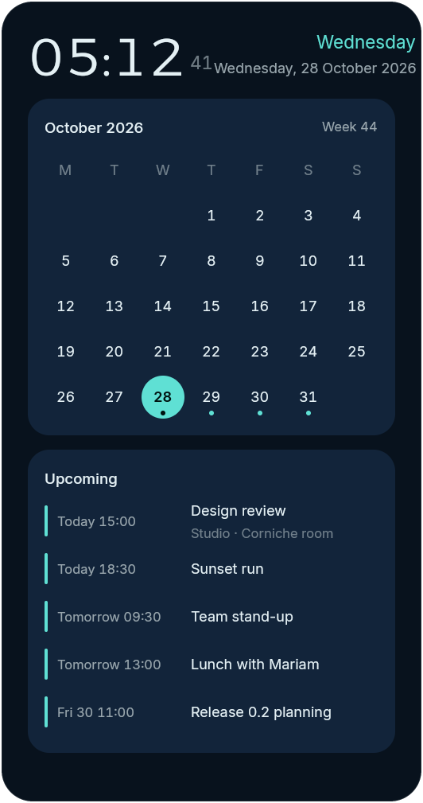<br/><sub><b>Clock and calendar</b> with ICS feeds and an agenda</sub></td>
<td width="33%" valign="top">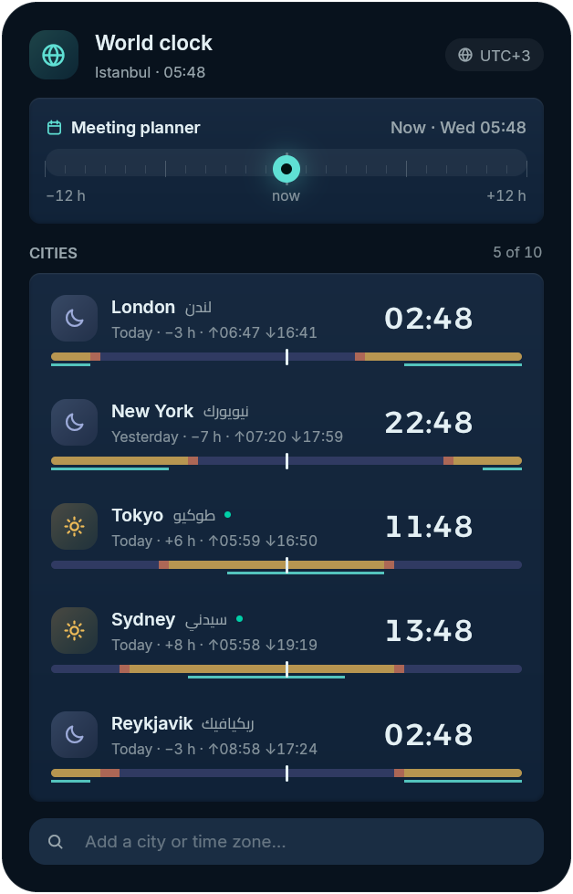<br/><sub><b>World clock</b> and meeting planner</sub></td>
<td width="33%" valign="top">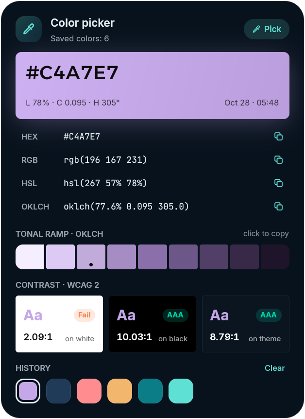<br/><sub><b>Color picker</b> with OKLCH ramps and WCAG contrast</sub></td>
</tr>
</table>

- **Top or bottom**: every bar style (see [Shape it your way](#shape-it-your-way))
  can sit at the **top or bottom** of the screen; at the bottom, panels
  spring upward.
- **Panels that morph** out of their pill, with clean concentric corners,
  a 1px specular rim and anti-banding grain.
- **Sidebar** with Overview and Notifications tabs, quick settings, weather
  (animated sky), media, Pomodoro, to-do, notes, sound and more. It opens on
  hover or Super+B and sits left or right (the power dock takes the opposite
  edge). Three modes: **Float** over your windows (the smoothest: opening it
  never re-tiles them), **Push** windows aside while it's open and give the
  space back when it closes, or **Pinned** open with its space reserved.
- **Clipboard history** with pins that survive clears, size and image
  limits, per-app exclusions (password managers), clear on lock / after N
  hours, and keep-copies-from-closed-apps.
- **On-screen displays** for volume, microphone, output device, brightness,
  keyboard backlight, layout, Caps / Num / Scroll Lock, power mode, do not
  disturb, night light, now playing, privacy and your own scripts
  (`osd show`), each switchable, horizontal or vertical, scaled and offset.
- **Privacy indicators**: a bar chip and a pill when an app uses the
  microphone, camera or shares the screen, with the apps listed.
- **Bar behaviour**: auto-hide (always, while a window covers it, or only for
  fullscreen) with a spring reveal from the screen edge and a peek on
  workspace switches; click-through empty space; per-display bars; optional
  overlay layer so it stays above fullscreen apps.
- **Hot corners** (launcher, overview, sidebar, power menu, notifications,
  wallpapers, lock or any command, with a dwell delay) and **rounded screen
  corners**, drawn on the existing shell surface (no extra GPU surfaces).
  A corner fires once per visit, never on a fly-by, a drag or a click, and
  not over fullscreen apps unless you ask; closing the launcher it opened
  with the pointer still there doesn't reopen it. While they're on, the
  compositor's own hot corner (MangoWM's hot area, Niri's overview corner)
  is switched off in the drop-in so the two never fight.
- **Calendar events**: subscribe to ICS feeds (`https://` / `webcal://`) or
  local `.ics` files and folders; events show as dots and an agenda in the
  clock panel, with **reminders** as notifications (the events' own alarms
  or a lead time). Pure-Rust RFC 5545 parser with recurring events.
- **Date & time formats**: custom strftime patterns for the bar and lock
  screen, leading zeros, ISO week numbers, a separate date-name locale.
- **One location** for weather and prayer times: typed, looked up by city
  name, or found on request via GeoClue or one IP lookup (never on its own).
  Weather refresh interval, wind unit and bar extras are configurable.
- **Synced lyrics** in the media panel from lrclib.net: karaoke glow in the
  album-art colors, Arabic lines right-to-left, cached offline. The panel
  keeps one size while lyrics load, are missing or fail, so its controls
  never move under the pointer.
- **Screenshot studio**: region, window or screen; arrows, boxes and
  circles; copy, save or clipboard-only; **copy text (OCR)**, offline and pure
  Rust (PP-OCRv5); and **screen recording** to AV1/WebM. **Esc pauses
  snipping without closing the tool**: the frozen frame goes away and a
  compact toolbar stays, so you can open a bar panel first, then pick
  **Capture now** or **Capture in 3 s** (a countdown that is never in the
  frame; Esc cancels it). The toolbar moves between the top and bottom edge
  with one click (or M), and `mandara msg screenshot region --delay 3` does
  the same from a keybind.
- **Process hunter**: find any process by name, command line or PID, and end
  or force-kill it.
- **Drives**: UDisks2 storage panel with usage rings, filesystem and
  encryption badges, mount / unmount, open in the file manager, LUKS unlock
  from an inline passphrase sheet and one-click *Safely remove* (unmount →
  lock → eject or power off), all through the polkit dialog. The chip pulses
  and a notification appears when a drive is plugged in.
- **Containers**: Docker and Podman over their Unix-socket APIs (a small
  pure-Rust HTTP/1.1 client): running count in the bar; compose projects
  grouped, live CPU and memory, uptime, ports and health; start, stop,
  restart, pause and a logs view.
- **Services**: systemd units of the system and your session: a coral badge
  when units have failed, search and filters, state pills, start / stop /
  restart / enable / disable (system units ask through polkit) and each
  unit's recent journal (read with `journalctl`).
- **Power**: power-profiles-daemon cards (Performance / Balanced / Power
  saver) with drivers, holds and the "performance degraded" reason; battery
  health (full vs design capacity), cycles, rate in watts, time estimates,
  charge limit and a charge-history sparkline from UPower; peripheral
  batteries. Desktops simply show *No battery*. Right-click the chip to cycle
  profiles. Low and critical battery alerts (notification and/or OSD, once
  per discharge), a critical action (sleep, hibernate or shut down after a
  warning; plugging in cancels), peripheral warnings with per-device
  thresholds, a profile per power source plus power-saver at low battery,
  "fully charged" notices and a coral pulse on the chip while critical.
- **Idle & sleep** (Studio → Power & idle, opt-in): fade → lock → screens off
  → sleep with separate mains and battery timeouts, read from the
  compositor (`ext-idle-notify-v1`, so a fullscreen video's inhibitor
  counts) and switched with `wlr-output-power-management` (Niri / Hyprland
  IPC as fallback). Playing media and *Keep awake* (also for N minutes) hold
  it back; screens go dark sooner on the lock screen; your own commands run
  after N idle seconds with a resume command. Lock before sleeping (a logind
  delay inhibitor waits until the lock is really up), on lid close, at
  login, with an optional grace period after automatic locks. Sleep can be
  suspend, hibernate, suspend-then-hibernate or hybrid.
- **Power menu editor**: pick and order the entries (lock, log out, sleep,
  hibernate, restart, shut down, soft restart, firmware setup, any
  boot-loader entry, restart Mandara, your own commands), rename them, show
  them as the edge dock or a grid, number-key shortcuts and hold-to-confirm
  for everything that ends the session.
- **Hooks**: run a command when something happens — started, wallpaper /
  colors / light-dark changed, app themes written, locked / unlocked, idle /
  resumed, screens off / on, before sleep / logout / restart / shutdown,
  plugged in / unplugged, battery level / low / critical / full, power
  profile, Wi-Fi and Bluetooth on / off. Commands run directly (no shell
  unless you write `sh -c`), with event details only in `MANDARA_*`
  environment variables and a time limit; `mandara:<command>` and
  `skill:<name>` run Mandara commands and launcher skills. Per-template
  post-hooks run after app theme files are written.
- **Offline mode** (Studio → Privacy): Mandara makes no network
  requests of its own (weather, lyrics, album art, Wallhaven, marketplace,
  public IP, update news, downloads).
- **Updates**: pacman (`checkupdates`), the AUR (paru / yay), APT, DNF,
  Zypper and Flatpak checked read-only every few hours (3 h by default) with a
  count badge, old → new versions by source and the latest Arch news.
  *Update now* opens your terminal with the right command; Mandara never runs
  privileged updates itself.
- **Resources**: CPU, memory and every GPU (load, VRAM, temperature, clock),
  plus component temperatures in °C or °F, set by the global *Units* setting
  that the weather follows too.
- **Color picker**: an eyedropper over a frozen frame of the screen with a
  magnifier loupe (pixel grid, crosshair, live HEX; arrows nudge a pixel,
  scroll zooms). Picked colors keep a history of swatches with HEX, RGB,
  HSL and OKLCH (one click copies), an OKLCH tonal ramp and WCAG contrast
  against white, black and your theme surface.
- **Soundscapes**: an ambient mixer synthesized live in Rust, with no audio
  files: Corniche sea waves, rain, wind, café murmur, a crackling fireplace
  and white / pink / brown noise. Each layer has its own volume, plus master,
  presets (*Corniche night*, *Rainy study*, *Deep focus*, *Fireside*) and a
  sleep timer that fades out. It plays as "Mandara Soundscapes" in your
  mixer, and its audio thread runs only while sound is playing.
- **World clock**: cities from a curated list (with Arabic names: الإسكندرية,
  القاهرة, مكة المكرمة…) or any IANA time zone, with offsets, sunrise /
  sunset and a 24-hour daylight strip. A meeting planner slides every clock
  together and underlines each city's working hours.
- **Network speed**: live download / upload in the bar, sampled only while it
  is on screen. The panel adds 60 s and 10 min graphs, per-interface rates,
  local and public IPs, session totals, and an optional Cloudflare speed test
  that runs only when you press its button.
- **Authenticator**: TOTP / HOTP 2FA codes (SHA-1 / 256 / 512) kept in your
  keyring through the Secret Service, never in plaintext on disk. Add an
  account by pasting an `otpauth://` link or scanning a QR code from part of
  the screen. Codes show countdown rings; click one to copy it. The copy is
  hidden from clipboard history and cleared after 30 s.
- **Language switcher & keyboard layout** in the bar.
- **Authentication dialogs**: a built-in polkit agent asks for your password
  when an app needs administrator rights. If another agent is already
  running, Mandara leaves it alone. You can turn it off in Studio → General.
  Preview with `mandara msg polkit demo`.
- **System tray**: Mandara is the StatusNotifierWatcher (or a host of an
  existing one); app icons sit in the bar and their menus open as styled
  panels with submenus, check and radio items. Left-click activates,
  middle-click is the secondary action, the wheel scrolls.
- **Brightness keys** can call `mandara msg brightness up|down` (logind, no
  root needed); external monitors follow over DDC/CI.
- **Displays & night light**: arrange monitors, change modes with a
  keep-or-revert countdown, save profiles that switch on hotplug, choose
  which displays show the bar, dock, OSDs, notifications and wallpaper, and
  warm the screens from sunset to sunrise (`mandara msg nightlight toggle`).
- **Screen time** (opt-in): charts your days per app, with gentle limits.

### Color science

- **Material You** palettes (HCT/CAM16: Tonal Spot, Vibrant, Expressive,
  Fidelity, Fruit Salad, Monochrome) from your wallpaper. Seeds are re-ranked
  so vivid colors lead, never a grey sky.
- **Mandara presets** inspired by Alexandria: *Mandara Corniche*, *Montaza
  Twilight*, *Mandara Obsidian*, *Qaitbay Citadel*, *Pharos Night* and
  *Stanley Sunset*. Community favorites are included too: Catppuccin, Rosé
  Pine, Kanagawa, Tokyo Night, Nord, Gruvbox, Eldritch and Vesper.
- **OKLCH tweening**: theme changes crossfade without passing through muddy
  greys.
- **Light and dark** switch manually, **follow the system**, or run on a
  **daily schedule**.
- **Cross-app theming**: Ghostty, GTK 3/4, Qt5/Qt6 (qt5ct/qt6ct), Kvantum,
  Zed, Fuzzel, btop, kitty, foot, Alacritty, WezTerm, Helix, Neovim,
  Vesktop / Vencord and KDE colour schemes follow Mandara live, written
  non-destructively: Mandara only writes its own theme files. Select them
  once: kitty `include themes/mandara.conf`, foot
  `include=~/.cache/mandara/themes/foot.ini`, Alacritty
  `general.import = ["~/.cache/mandara/themes/alacritty.toml"]`, WezTerm
  `color_scheme = "Mandara"`, Helix `theme = "mandara"`, Neovim
  `:colorscheme mandara`, KDE *Colors → Mandara*.
  **Firefox / Zen** (opt-in): `~/.cache/mandara/themes/firefox/colors.json`
  is pywal-format (point Pywalfox at it, e.g. symlink it to
  `~/.cache/wal/colors.json` if you don't use pywal) and `userChrome.css`
  there can be `@import`ed from your profile's `chrome/userChrome.css`.
- **Accessibility & style**: high-contrast mode (WCAG AAA text on every
  surface), corner roundness, shadows, panel edges, backdrop dim, text
  weight and a global animation-speed multiplier.

### Mandara Studio

<p align="center">
  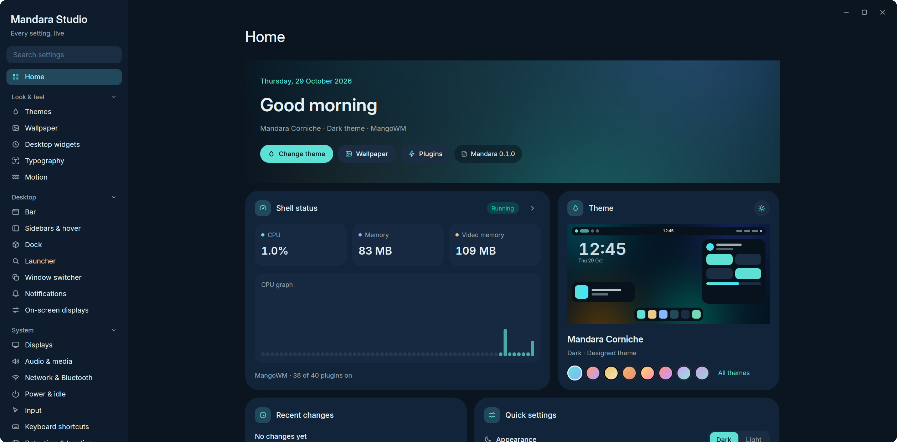
  <br/><sub><b>Home</b>: a widget dashboard with live shell status, the current theme and its one-click switches, quick settings and recent changes</sub>
</p>

<p align="center">
  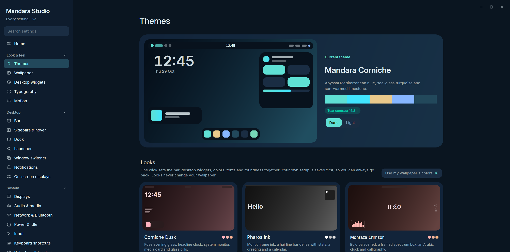
  <br/><sub><b>Themes</b>: a live preview of the shell in the current theme, its palette and contrast, light / dark, then the Looks, designed themes, wallpaper colors and cursors</sub>
</p>

<table>
<tr>
<td width="50%" valign="top">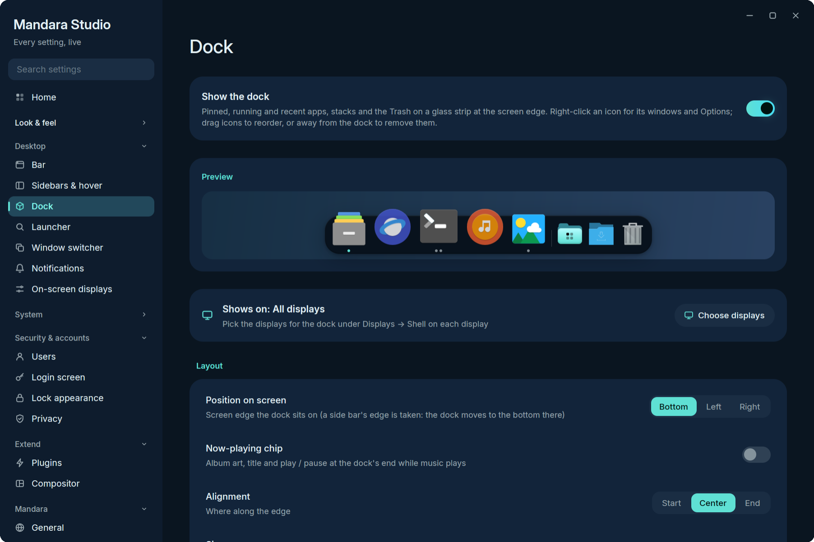<br/><sub><b>Navigation</b>: grouped, collapsible, searchable</sub></td>
<td width="50%" valign="top">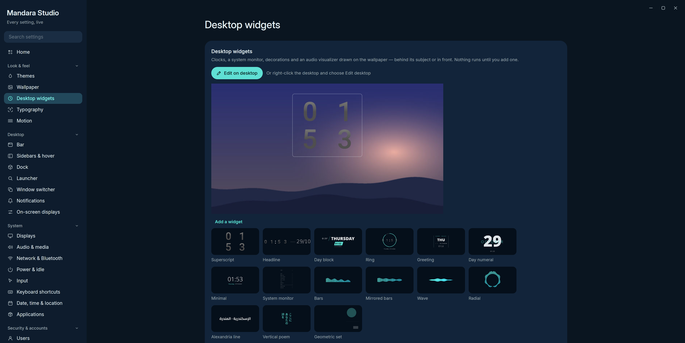<br/><sub><b>Desktop widgets</b>: live preview and gallery</sub></td>
</tr>
<tr>
<td width="50%" valign="top">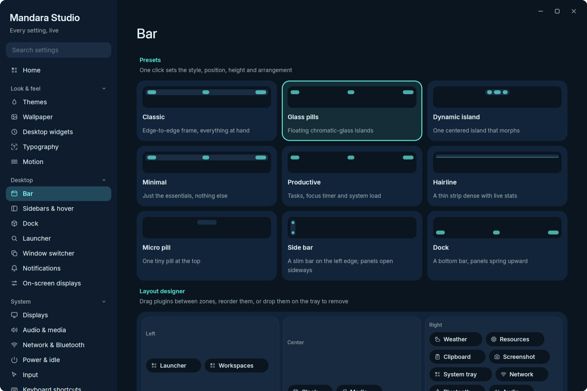<br/><sub><b>Bar</b>: presets and the layout designer</sub></td>
<td width="50%" valign="top">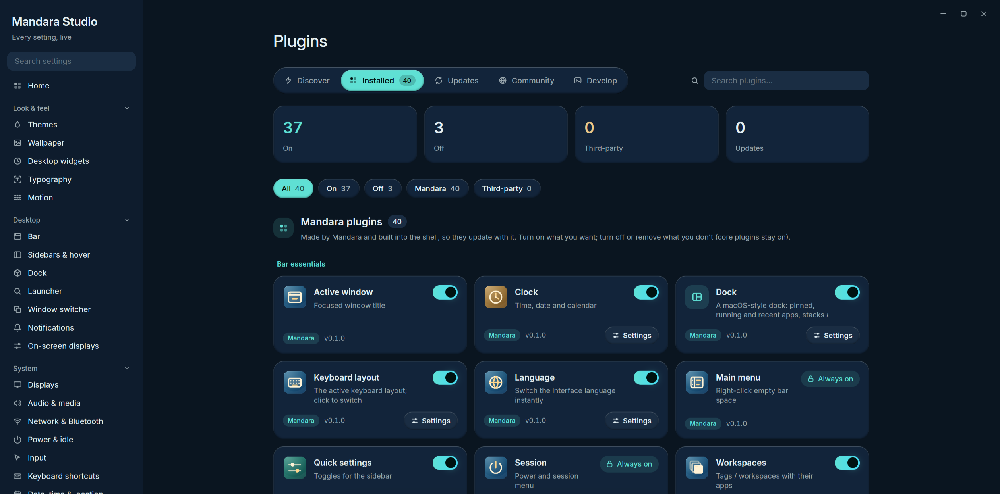<br/><sub><b>Plugins → Installed</b></sub></td>
</tr>
<tr>
<td width="50%" valign="top">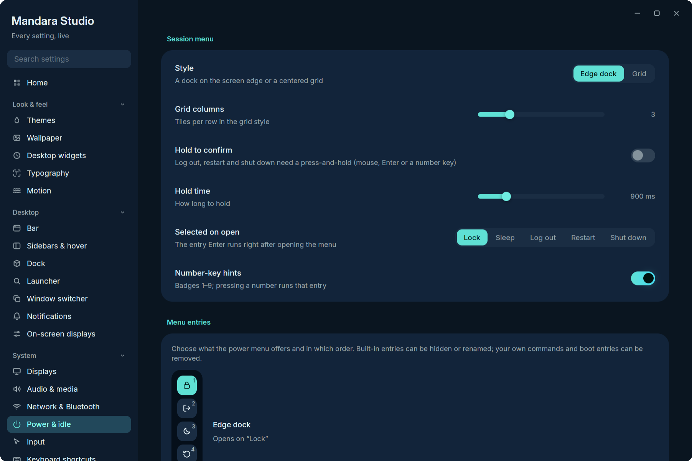<br/><sub><b>Power &amp; idle</b>: the session menu editor</sub></td>
<td width="50%" valign="top">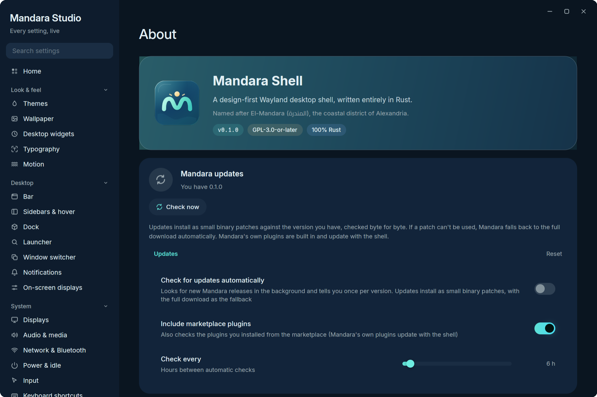<br/><sub><b>About</b>: version and binary-patch updates</sub></td>
</tr>
<tr>
<td colspan="2" align="center">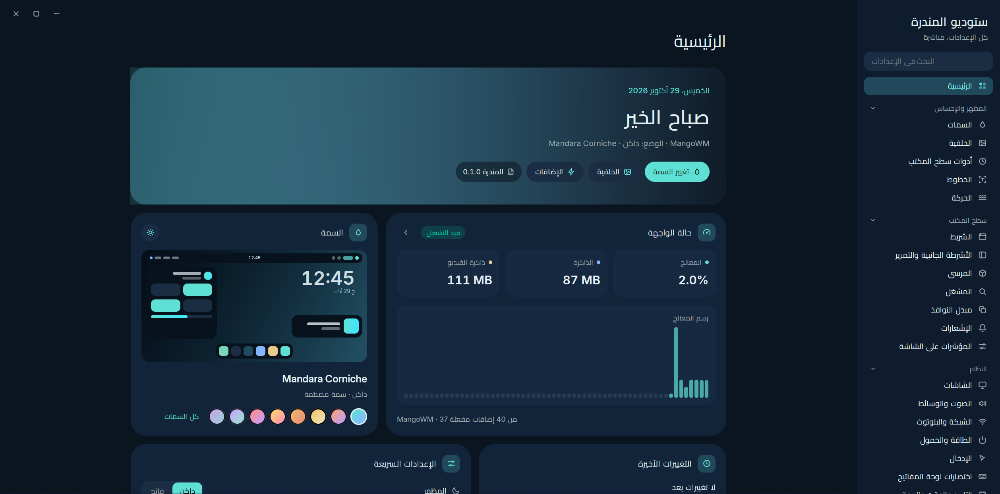<br/><sub><b>العربية</b>: every page mirrored right to left, «ستوديو المندرة»</sub></td>
</tr>
</table>

Every setting is live: drag a slider and the bar changes at 144 Hz. Studio
opens on **Home**, a widget dashboard (a greeting over your wallpaper, live
shell CPU / memory / VRAM, the theme with one-click switching, quick toggles,
recent changes with Undo, and a card per group), and
its sidebar groups 31 pages into **Look & feel**, **Desktop**, **System**,
**Security & accounts**, **Extend** and **Mandara**: collapsible, searchable
across every setting, keyboard-driven (Ctrl+F, Alt+↑/↓) and mirrored for
Arabic. Every page is responsive, from an icon rail and one column to
ultra-wide.

- **Look & feel**: appearance and palette tuning, themes with live mock-ups,
  cursor themes (download, preview, apply),
  wallpaper (per display, light / dark, slideshow, depth clock),
  typography, motion (spring tuning, reduce motion).
- **Desktop**: a drag-and-drop **layout designer** with one-click presets,
  bar behaviour, sidebar and hot corners, dock, launcher, Alt-Tab switcher,
  notifications (rules, quiet hours) and on-screen displays.
- **System**: displays and night light, audio (per-app mixer and outputs,
  device names, shell sounds), network (VPN, hotspot, saved networks,
  static IP) and Bluetooth pairing, power and idle (timeouts, battery
  alerts, power-menu editor, event hooks), input devices, keyboard
  shortcuts with conflict detection, date / time / location and calendars,
  default and startup apps.
- **Security & accounts**: users (AccountsService, photos, passwords),
  Mandara Login with a live preview, the lock screen's look, privacy
  indicators and offline mode.
- **Extend**: a plugin store (featured hero, curated shelves, search,
  one-click Get / On, product pages, installed library, updates, the GitHub
  marketplace, a local authoring handbook and validator, per-plugin settings) and compositor control for
  MangoWM, Niri and Hyprland written to `~/.config/mandara/generated/*`;
  **your own config only gets one include line** (with a backup).
- **Mandara**: language, profiles with undo / export / import, performance,
  maintenance (health checks, repair, factory reset) and about.

Open any page directly: `mandara studio displays`,
`mandara studio plugins --plugin weather --settings`.
→ **[Every page, keyboard shortcuts and deep links](docs/studio.md)**

### Languages

English · العربية · Español · Français · Deutsch · Türkçe · Русский · हिन्दी · 简体中文 · 日本語

The whole interface is translated. Right-to-left paragraphs wrap correctly
everywhere (dialogs, notifications, notes, Studio help and plugin
descriptions), each line ordered on its own. Arabic is laid out right to left: Studio
mirrors every page (sidebar, rows, sliders, switches, chevrons), while code,
clock times and screen arrangements stay left to right. In Arabic the brand
reads «ستوديو المندرة». Dates are localized, and Arabic text renders in your
Arabic font (Cairo by default, then Alexandria or Noto Sans Arabic) at every
weight, including the variable `wght` axis of Alexandria and Inter. Plugins
carry their own translations, and the shell translates their views
automatically.

## Plugins

Everything in Mandara is a plugin: every bar item, panel and sidebar card.
Studio keeps the two kinds apart: **Mandara plugins** are first-party,
bundled and updated with the shell; **third-party plugins** come from the
marketplace, your own folders or your distribution, and run sandboxed.

Studio → Plugins is a store: **Discover** opens on a featured hero over the
plugins' cover art and curated shelves (Essentials, For your desk,
Productivity, Media & capture, System tools, New & updated, Community
picks), with one search and filter chips; every card has a one-click
**Get / On** button. Each plugin has a product page with its art, what it
may access, its settings and where it fits. **Installed**, **Updates**,
**Community** (the GitHub marketplace) and **Develop** (the authoring
handbook) sit beside it.

<table>
<tr>
<td width="50%" valign="top">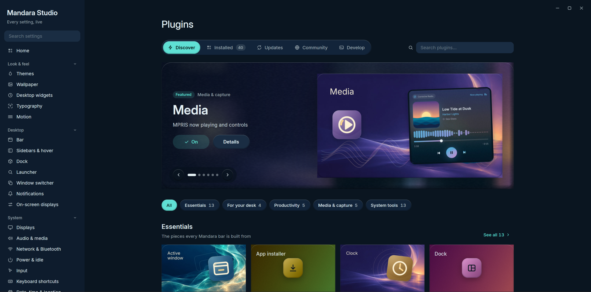<br/><sub><b>Discover</b>: featured hero and curated shelves</sub></td>
<td width="50%" valign="top"><br/><sub><b>Product page</b>: art, permissions and settings</sub></td>
</tr>
</table>

The 41 first-party plugins:

| Plugin | What it does |
|---|---|
| **Session** | Power and session menu |
| **Launcher** | Application launcher (Super+Space) |
| **Workspaces** | Tags / workspaces with their apps |
| **Active window** | Focused window title |
| **Clock** | Time, date and calendar |
| **Keyboard layout** | The active keyboard layout; click to switch |
| **Language** | Switch the interface language instantly |
| **Media** | MPRIS now playing and controls |
| **Prayer times** | Islamic daily prayer times and countdown *(opt-in)* |
| **Resources** | CPU, memory and disk usage |
| **Mini stats** | CPU, memory, network, temperature and battery as compact numbers in the bar *(opt-in)* |
| **Process hunter** | Find running processes by name or PID and end them |
| **Drives** | Mounted filesystems and removable drives: mount, unlock and safely remove |
| **Containers** | Docker and Podman containers: status, live usage, logs and controls |
| **Services** | systemd units: failed alerts, start, stop, enable and journal |
| **Power** | Power profiles, battery health and charge history |
| **Updates** | Pending package updates from pacman, the AUR, APT, DNF, Zypper and Flatpak |
| **Network** | Wi-Fi and wired connectivity |
| **Bluetooth** | Bluetooth devices |
| **Audio** | Volume and microphone |
| **Quick settings** | Toggles for the sidebar |
| **Screenshot** | Region, window and screen capture |
| **Clipboard** | Clipboard history with images |
| **Main menu** | Right-click empty bar space |
| **Notifications** | Notification center with history and do-not-disturb |
| **Privacy** | Shows when apps use your microphone, camera or screen |
| **To-do** | Tasks grouped into lists, for the sidebar and bar |
| **Notes** | Markdown notes in topics, saved as .md files |
| **Pomodoro** | Focus timer with breaks and session tracking |
| **Weather** | Animated current conditions, hourly and 5-day forecast |
| **Wallpaper** | Wallpaper picker and desktop background |
| **Wallpaper generator** | Procedural wallpapers and seamless AV1 video loops at any size up to 8K: twelve styles, every variable adjustable, on a schedule if you want *(opt-in)* |
| **System tray** | Status icons and menus of background apps |
| **World clock** | Cities around the world with daylight and a meeting planner |
| **Network speed** | Live upload and download rates, public IP and a speed test |
| **Color picker** | Pick colors from the screen, with formats, tonal ramps and contrast |
| **Authenticator** | Two-factor codes (TOTP / HOTP) stored in your keyring |
| **Soundscapes** | Ambient sea, rain, wind, café, fire and noise — synthesized live |
| **Dock** | A macOS-style dock: pinned, running and recent apps, stacks and the Trash, with magnification and auto-hide *(opt-in)* |
| **App installer** | Install apps by dropping AppImages, Flatpaks, archives or packages on the dock or Studio |
| **Screen time** | How long you spend in each app, per day, with limits *(opt-in)* |

Every Mandara plugin can be **switched off**, which stops everything it
runs (bar item, sidebar card, launcher entries and any background polling),
or **removed**: taken out of the bar and sidebar and parked under
*Studio → Plugins → Removed Mandara plugins* until you restore it to where it
was (`mandara msg plugins disable|enable|remove|restore <id>`). The
launcher, session menu and main menu are core and stay on. The dock, mini
stats, screen time, prayer times and the wallpaper generator ship switched off;
turn them on in Studio → Plugins.

### The plugin system

- **Written in Rust, run as WebAssembly.** Third-party plugins compile to a
  WebAssembly component (`wasm32-wasip2`) against a small WIT contract and
  run inside `wasmtime`.
- **Sandboxed.** No files, no network, no environment and no subprocesses.
  Each call has a time budget (100 ms, 1 s for `init`). A plugin that traps
  or runs over its budget is switched off; the shell keeps running.
- **Native look for free.** A plugin returns a declarative view tree (rows,
  columns, cards, text, icons, buttons, meters) and Mandara draws it
  with the current theme in every palette, light or dark, right to left in
  Arabic.
- **Settings and permissions.** A plugin declares its settings in
  `plugin.toml`, and Studio builds its settings modal from them. The only
  permission, `commands`, lets it run Mandara commands; Studio shows it in
  the plugin's detail modal.
- **Live.** Drop a folder in, rebuild, edit a translation or delete it, and
  Mandara reloads it within about half a second.
- **Translated.** Plugins ship their own locale files; the shell picks the
  right language and translates their views.

### Shipping a plugin

There are two ways to get a plugin to people.

**1. The marketplace (GitHub).** There is no account, server or review queue:

1. Put the plugin in a **public GitHub repository**.
2. Add the repository topic **`mandara-plugin`** (repository → About → ⚙ →
   Topics). That topic is the only thing the marketplace searches for.
3. Publish a **release** with one asset named **`<id>.mandara.tar.gz`**: a
   folder holding `plugin.toml`, `plugin.wasm` and, optionally, `locales/`,
   `icon.png` and `cover.png`.

That's all. Your plugin is listed in **Studio → Plugins → Community**
(and Discover's *Community picks*), ranked by stars, as soon as GitHub's search picks up the topic.
One click installs it, switches it on and loads it live; updating and
removing are one click too. Forks and pre-release-only repositories count,
and the archive may hold the plugin folder or just its files. Archives are
checked before anything is unpacked: no paths outside the plugin folder, no
links or device files, at most 64 MB, and the id comes from `plugin.toml`.
Every release then passes a compliance check in the sandbox (well under a
second): a broken, malicious or placeholder one doesn't install, and Studio
marks that version with the reason while still letting you install it
anyway. Run it before you publish with `mandara msg plugins vet <dir>`
([PLUGINS.md](PLUGINS.md#before-you-publish-compliance-check)).

**2. A local folder.** Copy the plugin folder onto the machine:

| Folder | For | Starts |
|---|---|---|
| `~/.local/share/mandara/plugins-dev/<id>/` | plugins you are writing | enabled |
| `~/.local/share/mandara/plugins/<id>/` | plugins you install by hand (and marketplace installs) | off until you enable it |
| `/usr/share/mandara/plugins/<id>/` (any `$XDG_DATA_DIRS`) | distribution packages | off until you enable it |

It appears in Studio → Plugins within a second, no restart needed.
Studio → Plugins → **Develop** shows these folders resolved on your system,
the format and contract of your build, and a **Validate** list explaining
exactly why a plugin didn't load.

→ **[The plugin guide](PLUGINS.md)**: quick start, the WIT API, views,
settings, translations and a GitHub Actions release workflow.

## What you can build on it

Mandara is a platform as much as a shell:

- **Script everything.** Every action the UI can take is a documented
  command (`mandara commands --json`): bind it to a key, call it from a
  script, or let an AI agent drive your desktop through it.
- **React to your desktop.** Hooks run your commands on 27 events (locked,
  idle, plugged in, battery low, wallpaper or colors changed, before sleep…),
  with details in environment variables.
- **Name routines.** Launcher *skills* chain commands into one named step,
  and slash commands (`/g`, `/yt`, `/todo`, your own) turn the launcher into
  a command line.
- **Theme everything.** One palette drives the shell, your terminal,
  editors, GTK and Qt apps, browsers and compositor borders.
- **Extend it safely.** Sandboxed plugins can add bar items, panels and
  sidebar cards, and reach users through the marketplace the day you tag a
  release.

## Install

One command, from any shell (bash, zsh or fish). It downloads the release
for your CPU, unpacks it in a temporary folder and runs the installer,
which is the Mandara binary itself:

```bash
sh -c 'cd "$(mktemp -d)" && curl -fsSL "https://github.com/theHamdiz/mandara/releases/latest/download/mandara-$(uname -m)-linux-gnu.tar.gz" | tar xz && exec ./mandara-*/bin/mandara install'
```

Nothing is piped into a shell interpreter: `curl` feeds `tar`, and the only
program that runs is the release binary, which checks its own SHA-256
before it installs anything. Add installer options at the end (for example
`… mandara install --dry-run` to see the plan first).

Or step by step:

```bash
curl -LO https://github.com/theHamdiz/mandara/releases/latest/download/mandara-x86_64-linux-gnu.tar.gz
tar xf mandara-x86_64-linux-gnu.tar.gz
./mandara-*/bin/mandara install
```

Pick the tarball that fits (or grab it from the
[Releases page](https://github.com/theHamdiz/mandara/releases/latest) in a
browser): `mandara-x86_64-linux-gnu-x86-64-v3` (AVX2-era CPUs, fastest),
`mandara-x86_64-linux-gnu`, `mandara-aarch64-linux-gnu`, or the `-musl`
builds for Alpine, Void musl and Chimera. `SHA256SUMS` sits next to them
(`sha256sum -c SHA256SUMS --ignore-missing` checks a download by hand).

`mandara install` copies itself to `~/.local/bin`, after **checking its own
SHA-256** against the release's published checksums. Then it installs the
runtime packages your distribution needs (asking for sudo, doas, run0 or
pkexec only for that), hooks into your compositor non-destructively and, if
you agree, starts Mandara with it, switches your login screen to Mandara
Login (greetd + cage, backed up and reversible) and unlocks GNOME Keyring /
KWallet with your login password. Updates come later by binary patch
(`mandara update`).

It works on **Arch, Debian/Ubuntu, Fedora, openSUSE, Void, Alpine, Gentoo
and Solus**, and prints the configuration to add on NixOS. Besides the
runtime libraries it installs, one by one so a missing package never stops
it, fonts and colour emoji, Papirus icons, `xdg-utils`, the desktop portals
of your compositors, and the services Studio talks to: PipeWire and
WirePlumber (sound), NetworkManager and its OpenVPN plugin (Network panel,
`.ovpn` import), BlueZ (Bluetooth, enabled for you), polkit, GNOME Keyring
with its PAM module, AccountsService (Users), GeoClue (location), UDisks2
(drives), UPower and power-profiles-daemon (battery, profiles), i2c-tools
(DDC/CI monitor brightness) and the freedesktop sound theme (event sounds).

| Option | Meaning |
|---|---|
| `--latest` | Download and install the latest release instead of this binary |
| `--version X.Y.Z` | Download and install that release instead of this binary |
| `--from-source` | Build from source (installs Rust and build tools) |
| `--prefix DIR` | Install into `DIR/bin` (default `~/.local`) |
| `--no-deps` | Skip system packages |
| `--no-autostart` | Don't start Mandara with the compositor |
| `--no-greeter` | Keep your login screen |
| `--compositor mango\|niri\|hyprland` | Pick the compositor to integrate with |
| `--repo OWNER/NAME` | Releases and sources from another repository |
| `--dry-run` | Show everything that would happen, change nothing |
| `--yes` | Don't ask; take every default |
| `--no-verify` | Install even if this binary doesn't match its published checksum |

`mandara uninstall` removes the binary and desktop entry and empties the
compositor drop-ins; your settings are kept.

### Arch Linux

Three package recipes, pick one:

| Package | What you get |
|---|---|
| `mandara-shell-bin` | the prebuilt release binary (fastest; x86_64 and aarch64) |
| `mandara-shell` | the same release, built from source on your machine |
| `mandara-shell-git` | the latest `main`, built from source |

They are on their way to the **AUR** (new AUR accounts are paused right
now; once the packages are published, `paru -S mandara-shell-bin` or
`yay -S mandara-shell-bin` will do). Until then, build the same recipes
from this repository with nothing but `git` and `base-devel`:

```bash
git clone https://github.com/theHamdiz/mandara.git
```

```bash
cd mandara/packaging/aur/mandara-shell-bin && makepkg -si
```

Every [release](https://github.com/theHamdiz/mandara/releases) also
attaches a ready `PKGBUILD` for `mandara-shell-bin` with its checksums
filled in: download it into an empty folder and run `makepkg -si`.

The package installs the `mandara` binary, the Studio desktop entry and
icon, and the lock screen's PAM file (`/etc/pam.d/mandara-lock`). Then hook
Mandara into your compositor (non-destructive: one include line, with a
backup) and start it:

```bash
mandara setup
```

The recipes live in [`packaging/aur/`](packaging/aur) and follow the
[AUR submission guidelines](https://wiki.archlinux.org/title/AUR_submission_guidelines).

### MangoWM, Niri and Hyprland

`mandara setup` (run by the installer) hooks Mandara into your compositor
with **one include line** in your own config, writes everything else to
`~/.config/mandara/generated/`, starts Mandara at login with an absolute
path, and checks the result with the compositor's own validator
(`mango -p`, `niri validate`, `Hyprland --verify-config`), rolling back if
it objects.

| | Include line in your config | Autostart |
|---|---|---|
| **MangoWM** | `source_optional=~/.config/mandara/generated/mango.conf` | `exec_once=` |
| **Niri** 25.11+ | `include optional=true "…/mandara/generated/niri.kdl"` (plain `include` before 26.04) | `spawn-at-startup` |
| **Hyprland 0.57+** (Lua only) | `pcall(dofile, "…/mandara/generated/hyprland.lua")` in `hyprland.lua` | `hl.on("hyprland.start", …)` |
| **Hyprland ≤ 0.56** | `source = ~/.config/mandara/generated/hyprland.conf` | `exec-once =` |

Mandara detects the installed version and speaks its dialect, including
Hyprland 0.57's Lua dispatches. On Niri the drop-in makes workspace
backgrounds transparent so the wallpaper shows outside the Overview; night
light needs a real Niri session on a tty (a nested Niri has no gamma
control).

### Coming from another setup

Mandara never rewrites your compositor config; it only adds one include
line. Leftovers from a previous setup can still fight it:

- an old launcher or wallpaper switcher on Super+Space or Ctrl+Shift+W;
- another bar (waybar, ironbar, Quickshell shells, AGS…);
- another notification daemon (mako, dunst, swaync);
- another wallpaper daemon (swww, hyprpaper, swaybg).

The installer finds them in your config **and every file it sources or
includes**, for MangoWM, Niri and Hyprland (`.conf` and `.lua`).

```bash
mandara setup --check            # list conflicts, change nothing
mandara setup --fix-conflicts    # retire them
mandara setup --restore latest   # undo
```

What `--fix-conflicts` does:

- Each conflicting line is commented out with a `mandara-retired:` marker,
  after a timestamped backup of every file it touches.
- Keys an old tool used (an extra launcher shortcut, say) are re-bound to the
  Mandara equivalent.
- The compositor then validates the result (`mango -p`, `niri validate`,
  `Hyprland --verify-config`). If it objects, everything is rolled back.

Binds that are yours, like quitting the compositor or launching your VPN,
are never touched; Mandara skips its own shortcut on those keys. Studio →
Maintenance shows the same check with a one-click fix.

### Packages

Every [release](https://github.com/theHamdiz/mandara/releases) is built by
CI for each distribution family and CPU, with build provenance
attestations:

| | x86_64 | x86_64-v3 (AVX2-era CPUs) | aarch64 (ARM64) |
|---|---|---|---|
| Any glibc distribution (tarball) | ✓ | ✓ | ✓ |
| Alpine, Void musl, Chimera (musl tarball) | ✓ | | ✓ |
| Debian, Ubuntu, Mint, Pop!_OS (`.deb`) | ✓ | | ✓ |
| Fedora, openSUSE, RHEL family (`.rpm`) | ✓ | | ✓ |
| Arch, Manjaro, EndeavourOS, CachyOS (`PKGBUILD`) | ✓ | | ✓ |

Plus the bundled plugins, a build manifest per binary (source fingerprint,
toolchain, SHA-256, lines of code), binary patches from the previous
release for [smart updates](#updates-by-binary-patch), `update.json` and
`SHA256SUMS`. The installer picks the right build for your system (glibc or
musl, x86-64-v3 when your CPU supports it); Gentoo, Solus, NixOS and other
glibc systems use the tarball.

From a clone, `cargo xtask build && target/release/mandara install`
installs that checkout (or `mandara install --from-source` builds it).

**Requirements:** Linux with a Wayland compositor (MangoWM, Niri or
Hyprland), a Vulkan-capable GPU, and PipeWire or PulseAudio for sound
features.

### Versioning

Every crate, plugin and the shell carry their own semantic version, tracked by
content hash. Each push to `main` bumps exactly the components whose build
changed: Conventional Commits pick patch, minor or major. When the shell's
version changes, CI builds and publishes a release. `mandara --version` shows
the exact build. Details are in [docs/releasing.md](docs/releasing.md).

## Usage

```bash
mandara                 # start (with crash-restart supervisor)
mandara studio          # settings & design studio (opens on Home)
mandara studio displays # straight to a page (docs/studio.md lists them)
mandara studio plugins --plugin weather --settings   # straight to a plugin's settings
mandara setup           # (re)write compositor integration
mandara install --dry-run   # what a (re)install would do: packages, compositor, login screen
mandara --version       # exact build: version, git revision, content hash
mandara msg <command>   # control the running shell
mandara commands        # every command, with arguments and examples
```

### Commands

Everything the UI can do is a documented command (`mandara commands
--json`), usable from scripts, keybinds and AI agents. A few:

```bash
mandara msg launcher toggle
mandara msg theme set mandara-corniche
mandara msg look apply corniche-dusk
mandara msg desktop edit
mandara msg bar position left
mandara msg wallpaper picker toggle
mandara msg screenshot region
mandara msg notifications dnd on 45m
mandara msg nightlight toggle
mandara msg display profile save Desk
mandara msg idle status
mandara msg network vpn up Office
mandara msg studio displays
```

→ **[The full command tour](docs/commands.md)**, grouped by area.

### Default shortcuts

| Keys | Action |
|---|---|
| Super+Space | Launcher |
| Ctrl+Shift+W | Wallpaper picker |
| Super+B | Sidebar |
| Super+Shift+S | Screenshot (region) |
| Super+Shift+V | Clipboard history |
| Super+Shift+T | Light / dark |
| Super+Shift+E · Ctrl+Alt+Delete | Power menu |
| Alt+Tab · Alt+Shift+Tab | Window switcher (new installs; Studio → Window switcher → Bind Alt+Tab) |

Shortcuts can be changed in Studio → Keyboard shortcuts. Keys you already
use in your compositor are never overridden.

The color picker has no default key, so it can't clash with your binds. One
suggestion is Super+Shift+C running `mandara msg color-picker pick` (MangoWM:
`bind=SUPER+SHIFT,c,spawn,mandara msg color-picker pick`).

## Configuration

`~/.config/mandara/config.toml` is watched live, and Studio writes the same
file. Generated compositor drop-ins live in `~/.config/mandara/generated/`.
Plugins live in `~/.local/share/mandara/plugins/` (installed) and
`plugins-dev/` (your own).

## Building from source

```bash
cargo build --release -p mandara-app      # → target/release/mandara
cargo test --workspace
cargo xtask build                         # release build + fingerprint, hashes and line count
```

**Contributing**, by hand or with a coding agent: [AGENTS.md](AGENTS.md)
covers the repository map, the checks to run, the hard rules (all-Rust,
every string translated, no magic numbers, non-destructive dotfiles), the
design principles and how to add a plugin, setting, command or compositor
feature. [docs/development.md](docs/development.md) has the demo sandbox.

Or let cargo fetch and build it, then install the result like a release
(packages, compositor, login screen):

```bash
cargo install --locked --git https://github.com/theHamdiz/mandara mandara-app
mandara install
```

`cargo xtask build` is the full build recipe. It fingerprints every build
input (SHA-256 over the sources, lock file, toolchain, target, profile and
features; no git or timestamps involved), builds the release binary with
that fingerprint embedded (`mandara --version` shows it), hashes the
binary, counts the lines of code, writes a build manifest next to it and
refreshes the [build fingerprint](#build-fingerprint) table below.

### Build options: memory allocator

The `mandara` binary picks its global allocator at build time with exactly
one `alloc-*` feature of `mandara-app`:

| Feature | Allocator | Notes |
|---|---|---|
| `alloc-system-tuned` (default) | glibc malloc, tuned | no C allocator: at most 2 arenas, `malloc_trim(0)` every 30 s |
| `alloc-jemalloc` | jemalloc | C (`tikv-jemallocator`); background purge thread, 2 arenas, short decay |
| `alloc-mimalloc` | mimalloc v3 | C, vendored by the `mimalloc` crate |
| `alloc-mimalloc-v2` | mimalloc v2 | the previous mimalloc line |
| `alloc-system` | glibc malloc | untouched, for comparison |

```bash
# the default (tuned system allocator)
cargo build --release -p mandara-app
# jemalloc instead (needs a C compiler)
cargo build --release -p mandara-app --no-default-features --features alloc-jemalloc
```

The allocator only serves Rust allocations; the C libraries the shell loads
(Mesa, FreeType, fontconfig) keep using glibc malloc. The startup log names
the allocator (`config: … (allocator: …)`). The measurements behind the
default are in [docs/releasing.md](docs/releasing.md#memory-allocator).

The workspace contains these crates:

| Crate | Role |
|---|---|
| `mandara-app` | binary, CLI, IPC, supervisor, setup |
| `mandara-core` | layer-shell surfaces, input masking, springs, OKLCH |
| `mandara-config` | reactive config store, compositor emitters |
| `mandara-theme` | HCT + OKLCH engine, presets, app theme templates |
| `mandara-compositor` | MangoWM, Niri and Hyprland drivers |
| `mandara-services` | D-Bus services, audio, spectrum, OCR, screenshots, recording, Wallhaven, marketplace |
| `mandara-plugins` | plugin registry, commands, WebAssembly host |
| `mandara-i18n` | localization |
| `mandara-version` | build identity: per-component versions and content hashes |
| `xtask` | dev and release tooling: `cargo xtask status / bump / verify / dist`, `resource-check`, the demo `sandbox` ([development.md](docs/development.md)) |
| `mandara-ui` | the shell's views and built-in plugins |
| `mandara-studio` | Mandara Studio |

`vendor/gpui_wgpu` is GPUI's wgpu renderer with Mandara's video-memory
patches, applied through `[patch]` in the workspace manifest; its
`MANDARA-PATCHES.md` lists each change and its measurements. `vendor/gpui`
is GPUI itself with rounded content masks, so a rounded card that hides its
overflow clips covers and art to its corners
([`MANDARA-PATCHES.md`](vendor/gpui/MANDARA-PATCHES.md)).

## Supporting Mandara

Mandara is free, open source and always will be. If it makes your desktop a
little nicer and you'd like to say thanks, you can chip in toward the AI
credits and developer time that go into it:

[](https://ko-fi.com/thehamdiz)

☕ **[ko-fi.com/thehamdiz](https://ko-fi.com/thehamdiz)**

It's entirely optional. Using Mandara, telling a friend, writing a plugin
or reporting a bug helps just as much. Thank you! The same link lives in
Studio → About.

## Build fingerprint

The last `cargo xtask build`: source fingerprint, toolchain, binary hashes and
lines of code ([`docs/releasing.md`](docs/releasing.md#build-fingerprint)).

<!-- build-info:start -->
<!-- Generated by `cargo xtask build`; edits here are overwritten. -->
| Build | |
|---|---|
| Version | `0.1.0` |
| Source fingerprint | `aaecce37fdb5` |
| Toolchain | `rustc 1.99.1 (58cf8f9c3 2026-10-13)`, LLVM 23.1.1 |
| Target · profile | `x86_64-unknown-linux-gnu` · `release` |
| Features | `alloc-system-tuned` (default) |
| `mandara` SHA-256 | `84b3fb54688e0204…` |
| Rust | 177,066 code · 22,447 comments · 14,589 blank · 14 crates · 424 files |
| Vendored Rust | 6,044 code · 431 comments · 588 blank · 6 files |
| Plugin examples | 235 code · 31 comments · 34 blank · 1 file |
| Locales · WIT | 48,344 lines in 18 catalogs · 60 lines in 1 WIT file |
| Built | 2026-10-29 09:25:37 UTC |

<details><summary>Full hashes and lines per crate</summary>

```text
source fingerprint  aaecce37fdb5505a6d92018aad30c989f7a780e0c67abf331cc98466161c4404
mandara             84b3fb54688e02045176ef3e74f124394af3252ea77d7168e21aa660dcec8b41
```

| Crate | Files | Code | Comments | Blank |
|---|---:|---:|---:|---:|
| `mandara-app` | 6 | 1,278 | 310 | 94 |
| `mandara-compositor` | 6 | 1,457 | 160 | 185 |
| `mandara-config` | 22 | 11,912 | 2,442 | 1,212 |
| `mandara-core` | 12 | 3,355 | 612 | 342 |
| `mandara-greeter` | 29 | 8,999 | 1,106 | 800 |
| `mandara-i18n` | 2 | 374 | 55 | 43 |
| `mandara-install` | 11 | 2,546 | 364 | 277 |
| `mandara-plugins` | 8 | 1,890 | 318 | 239 |
| `mandara-services` | 100 | 34,346 | 4,531 | 3,427 |
| `mandara-studio` | 53 | 26,482 | 2,513 | 1,488 |
| `mandara-theme` | 8 | 2,802 | 330 | 266 |
| `mandara-ui` | 150 | 76,817 | 9,037 | 5,725 |
| `mandara-version` | 3 | 470 | 99 | 50 |
| `xtask` | 14 | 4,338 | 570 | 441 |
| **Total** | **424** | **177,066** | **22,447** | **14,589** |

</details>
<!-- build-info:end -->

## License

Mandara Shell is free software under the **GNU General Public License,
version 3 or later** ([LICENSE.md](LICENSE.md), notice in
[COPYRIGHT.md](COPYRIGHT.md)). Vendored code keeps the
license in its folder, and fonts and models downloaded on demand keep their
own: OFL for Google Fonts, Apache-2.0 for the PaddleOCR models.
