# Your desktop: bar, looks and widgets

How Mandara looks and feels, and how much of it you can shape.

  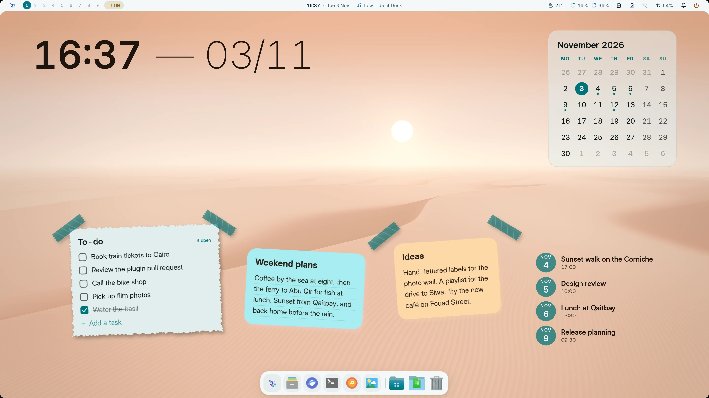
   
  The demo desktop in light mode (<code>mandara msg theme mode light</code>).

## Shape it your way

- **Every corner, one dial.** Corner roundness scales every radius in the
  shell (bar, panels, sidebar, cards, chips, launcher, OSD, dock), keeps
  nested corners concentric, and updates live, open panels included.
- **Bar, your way:** edge frame (flush or floating), glass pills, island, a
  24 px **hairline** dense with live stats, a single **micro pill**, a
  **notch** that hangs from the top edge on curved shoulders, or a slim
  **side bar** on the left or right edge with an optional screen frame
  (panels open sideways from it). Each style has its own radius, item padding
  and spacing, separators, group or item capsules (soft, card-toned or
  accent, with an optional outline), center-group alignment, accent tint,
  glass rim, shadow, text and icon size, text weight and a hover highlight
  you can switch off. Keep extra space between the bar and your windows,
  and choose what right-clicking, middle-clicking and scrolling on empty
  bar space do (main menu or desktop menu; any hot-corner action;
  workspaces or volume). `mandara msg bar hide` / `show` / `toggle` puts
  the bar away until you want it back.
- **Bar items show what you want:** workspace pills with numbers, short
  names or dots, with or without app icons, and empty ones hidden; the
  active window as its app, its title or both, up to a width you pick; the
  volume and battery with or without their numbers; the track title or
  just the music icon, hidden while paused if you like. The bar's three
  groups never overlap: a group gets the room up to its neighbour, a long
  window title ends in an ellipsis there, and on a very narrow bar the
  items nearest the middle make way first.
- **Side bars of icons and pills:** turn on a slim bar on the left and
  right edges (Studio → Bars → Side bars) and fill its top, middle and
  bottom groups with any plugins; their panels pour out sideways. By
  default the top bar and both side bars join into one frame with curved
  corners; or let them float apart as glass pills, an island or a slab with
  their own opacity, accent tint, frosted glass, rim light and shadow. Pin
  each side so windows tile beside it, or let it slide away until your
  pointer rests on its edge. Width, item size, padding, spacing and style,
  corners, curves, the middle group's place and an accent colour per side
  are all yours. They take over the widget sidebar's edge while they're on.
  [Details](configuration.md#side-bars-side_bars)
- **Sidebars fit like puzzle pieces:** a flush sidebar takes the bar's
  material and meets it with the same concave curves: it hangs from the
  edge frame, turns the hairline's accent line down its edge, merges into
  the notch, and continues a side bar's strip. Beside floating styles it
  floats too.
- **Panels you can shape:** drop-down panels get width, maximum height,
  padding, gap to the bar, anchoring, opacity, shadow, an open animation
  (morph, fade and slide, or none) and their own spring; the sidebar and
  power dock sit flush or float, with their own radius, card styling,
  header layout and tab position.
- **Studio explains itself:** every page reads like a short table of
  contents. Related settings sit together in collapsible sections, each
  with a one-line preview of what's inside and how many you've changed.
  Controls that don't apply to your current layout say why, and every
  section has a one-click Reset.

<table>
<tr>
<td width="50%" valign="top">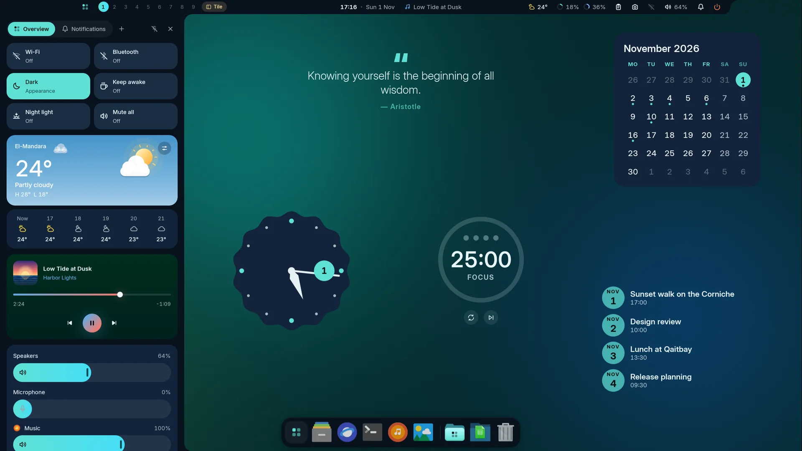 <b>Notch</b>: the flush sidebar merges into it</td>
<td width="50%" valign="top">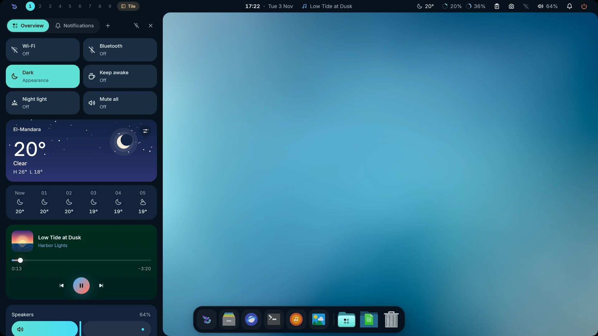 <b>Edge frame</b>: the sidebar hangs from the frame</td>
</tr>
</table>

  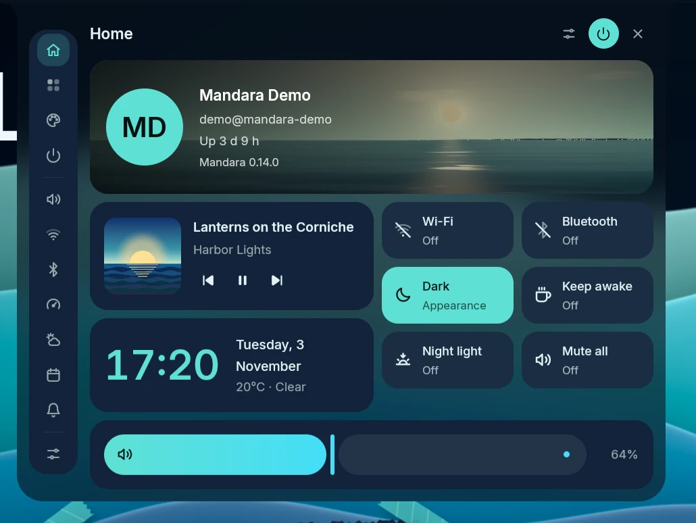
   
  Right-click empty bar space for the <b>main menu</b>.

The rail on its side switches the menu's own pages (**Home**, **Apps &
tools** and **Look**). Below a divider, under **Panels** in the full rail,
come shortcuts that open Sound, Network, Bluetooth, the system monitor,
weather, the calendar or notifications in the menu's place. Studio and the
power menu are the buttons at the top, so the rail doesn't repeat them;
**Reload config** is on Apps & tools. **Rail** (Studio → Bars → Drop-down
panels, under Main menu) shows each entry's name or icons only.

Open **Look** in the main menu to pick a theme. The cards fill the
available height; longer catalogs use compact scrolling rows. Built-in
names follow your language in the menu and Studio, while custom theme
names stay as you wrote them.

## Looks

  <picture>
    <source media="(prefers-color-scheme: dark)" srcset="screenshots/looks-dark.webp"/>
    <source media="(prefers-color-scheme: light)" srcset="screenshots/looks-light.webp"/>
    
  </picture>
   
  The six Looks, one click each in Studio → Themes.

- **Looks:** six original one-click desktop looks in Studio → Themes, right under
  the live preview of your current theme:
  *Corniche Dusk*, *Pharos Ink*, *Montaza Crimson*, *Qaitbay Forest*,
  *Anfushi Wave* and *Night Frame*. Each sets the bar style, widgets,
  palette (generated by Mandara's HCT/OKLCH engine), typography and radii
  together. Your own setup is saved first, and **Restore my look** brings it
  back in one click. Switching looks also switches off the plugins the last
  look turned on (never ones you had on). Looks never change your wallpaper;
  *Use my wallpaper's colors* keeps its palette.
  `mandara msg look list|apply|restore` scripts them.
- **Cursor themes** (opt-in plugin, `cursors`): switched off, Mandara
  leaves your cursor configuration alone entirely and Studio → Themes shows
  a one-line card to turn it on. Switched on, Studio → Themes → Cursor shows your cursor drawn from
  its own files at its size, every cursor setting (size with 24 / 32 / 48 /
  64 px chips, hide while typing, hide when idle, the software cursor of
  Hyprland and Umbriel and Hyprland's hide on touch) and a gallery of the
  ten most popular ricing cursor
  themes — Bibata Modern, macOS, Qogir, Phinger, Catppuccin, BreezeX, Vimix,
  Banana, Nordzy and Rosé Pine — with author, licence and variants. One
  click downloads the pinned GitHub release, verifies its SHA-256 and
  installs it to `~/.local/share/icons`; Apply changes the cursor live on
  MangoWM, Niri, Hyprland, Umbriel, Sway and River (and X11 apps through `~/.icons/default`);
  Remove only ever deletes what Mandara installed. Nothing is bundled in the
  binary. `mandara msg cursor list|install|apply|remove` scripts it.

  
   
  Studio → Themes → Cursor: the applied cursor, its settings and the theme gallery.

<table>
<tr>
<td width="50%" valign="top"><picture><source media="(prefers-color-scheme: light)" srcset="screenshots/look-corniche-dusk-light.webp"/>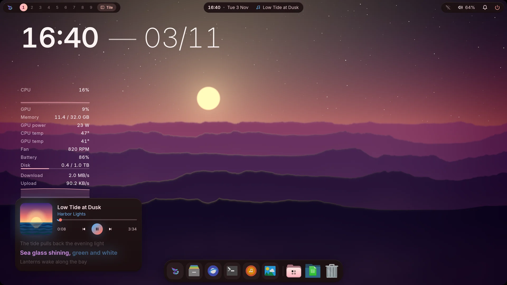</picture> <b>Corniche Dusk</b></td>
<td width="50%" valign="top"><picture><source media="(prefers-color-scheme: light)" srcset="screenshots/look-pharos-ink-light.webp"/>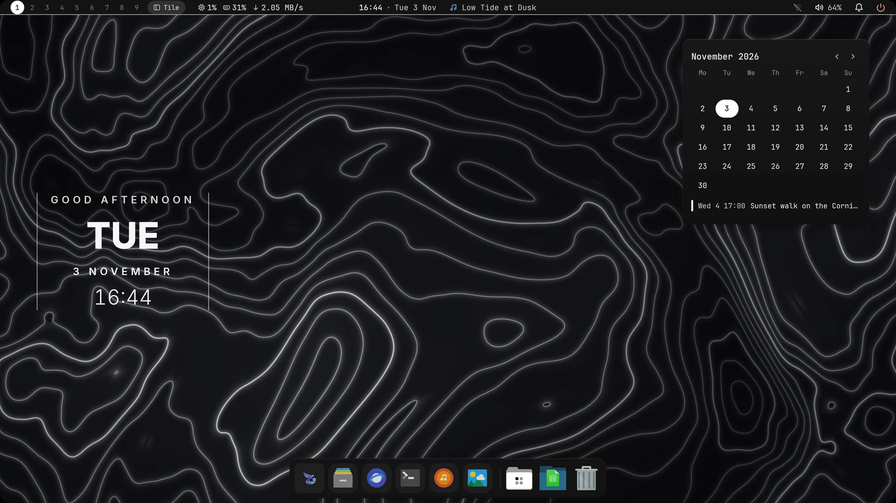</picture> <b>Pharos Ink</b></td>
</tr>
<tr>
<td width="50%" valign="top"><picture><source media="(prefers-color-scheme: light)" srcset="screenshots/look-montaza-crimson-light.webp"/>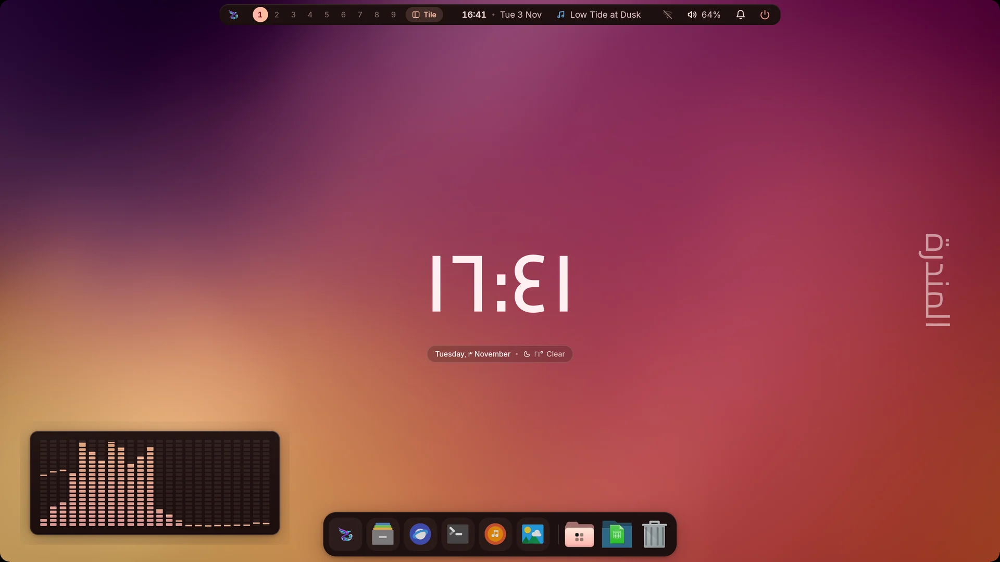</picture> <b>Montaza Crimson</b></td>
<td width="50%" valign="top"><picture><source media="(prefers-color-scheme: light)" srcset="screenshots/look-qaitbay-forest-light.webp"/>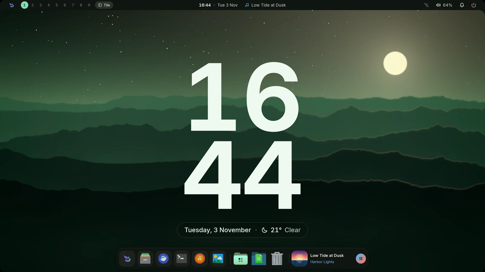</picture> <b>Qaitbay Forest</b></td>
</tr>
<tr>
<td width="50%" valign="top"><picture><source media="(prefers-color-scheme: light)" srcset="screenshots/look-anfushi-wave-light.webp"/>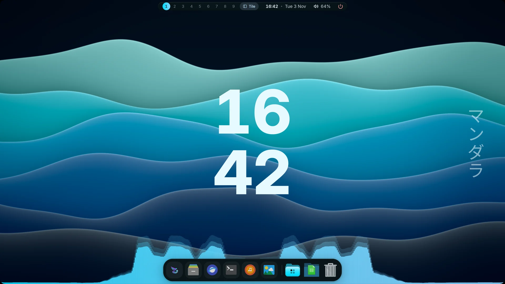</picture> <b>Anfushi Wave</b></td>
<td width="50%" valign="top"><picture><source media="(prefers-color-scheme: light)" srcset="screenshots/look-night-frame-light.webp"/>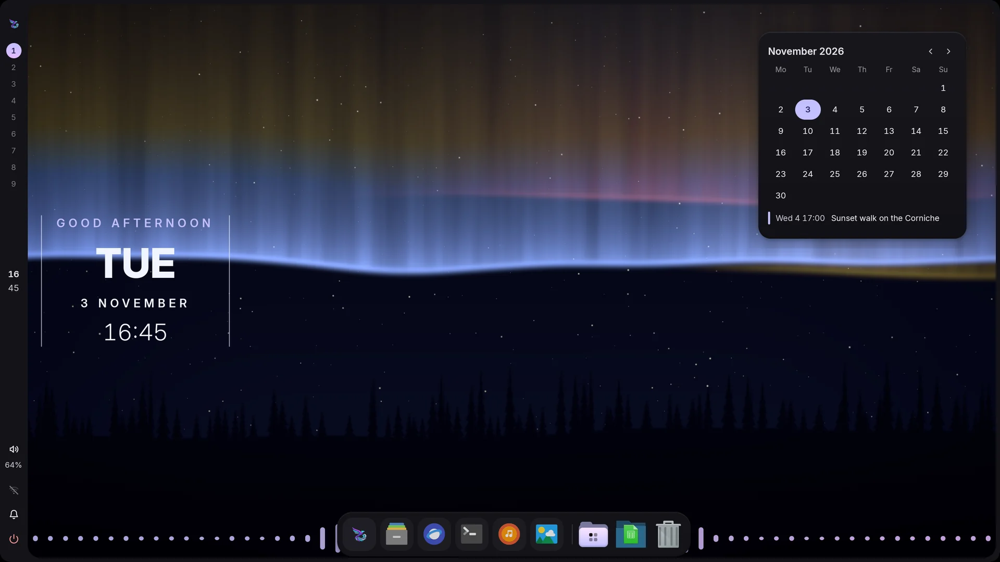</picture> <b>Night Frame</b></td>
</tr>
</table>

## Desktop widgets

Ten new designs extend the existing families:

| Family | Designs |
|---|---|
| Desktop clocks → Digital | Word clock, Split-flap clock, Glass tube clock, Binary clock |
| Calendar card | Date ticket, Perpetual calendar, Moon calendar |
| Desktop weather | Weather ribbon, Thermometer, Humidity rose |

The word clock gives the nearest five-minute phrase with the exact time
underneath. Binary columns encode the four displayed decimal digits. The
moon calendar follows the civil month, including leap years, and calculates
each day's phase. The thermometer uses today's reported range; missing
weather produces an unavailable state rather than a sample reading.

Add them in **Studio → Desktop widgets → Add a widget**. Clock families
have a **Style** choice; weather and date widgets have a **Layout** choice.
Their size, colour, font, plate and placement use the same editor as the
existing widgets. Eligible kinds can also be added to
[login and lock screens](lock-and-login.md#widgets-on-login-and-lock-screens).

<table>
<tr>
<td width="50%" valign="top"> <b>Productivity</b>: a to-do list you tick, a sticky note, the focus timer, calendars</td>
<td width="50%" valign="top"> <b>Now playing</b>, an LED meter and the desk cat</td>
</tr>
<tr>
<td width="50%" valign="top"> <b>Sky and weather</b>: the sun's arc, the moon, a globe, a disc and an hourly curve</td>
<td width="50%" valign="top">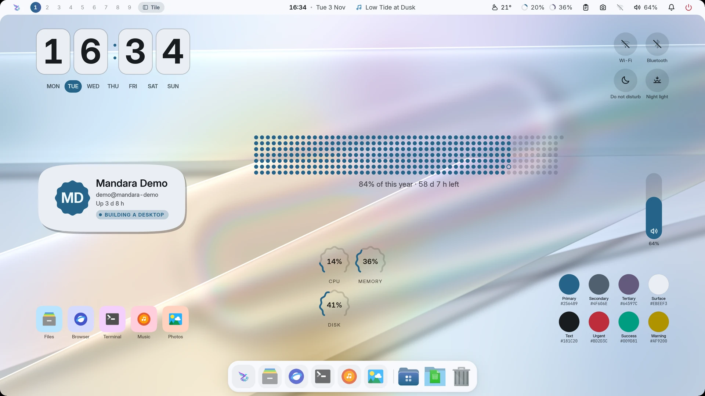 <b>You and your shortcuts</b>: a profile card, toggles, sliders and the palette</td>
</tr>
<tr>
<td colspan="2" align="center"> <b>Numerals, calendars and language</b>: Eastern Arabic digits, the Hijri month and Arabic day names</td>
</tr>
</table>

- **Desktop widgets:** hero clocks (superscript, headline, day block, ring,
  greeting, giant day numeral, minimal, and an analog dial with an optional
  seconds hand), a system monitor as a column with live graphs or as ring
  gauges, the weather with the days ahead, a world clock, a countdown to a
  date, text and shape decorations (discs, stripes, waves, frames, and
  vertical text: kana and CJK stand upright, Arabic and Latin keep their
  joined line turned toward the screen's middle) and an audio visualizer
  that can sit *behind* the wallpaper's subject. Every widget stays fully on
  screen and clear of the bar at any resolution. They're drawn in software
  into small shared-memory layers: no video memory, redrawn only when they
  change, nothing runs until you add one, and a removed widget's layer is
  freed at once. Moving one only moves its layer: it is painted again once,
  where you drop it.
- **Many more widgets:** nine more clock faces (a stacked card, the time
  in a shape, dot-matrix and pixel digits, a digit in each box, a slanted
  HUD, hands over giant numerals, an orbit, and text lines you write from
  placeholders; in Studio's gallery the look-alike faces share one tile
  per family, *Stacked*, *Analog*, *Digital*, *Text*, each with a
  **Style** choice), day / week / month / year progress, a to-do list you tick
  on the desktop, a sticky note, the focus timer, a quote card, notebook
  tabs, painted month / week / agenda / date-tile calendars, the sun on its
  arc, the moon's phase, a day-and-night globe, the weather as a sentence,
  a disc or an hourly chart, a profile card, app and folder shortcuts,
  quick toggles whose tiles change shape when switched, volume and
  brightness sliders, the theme's palette, a desk cat, bubbles, a photo
  frame, stickers, what plays on a turning record, a pocket player, a
  shaped or halftone cover, a side pill or as lyrics, an LED meter,
  system meters, bars and thermals, a machine card, screen time, prayer
  times, a search field, an "at a glance" line, your GitHub contribution
  year, exchange rates, Claude Code's token use and your Steam games.
  Clicks work on the desktop itself (tick, toggle, start, open, copy,
  play), and `mandara msg desktop widgets press <id> <action>` does the
  same from a script. Clocks and calendars redraw once a minute; only the
  cat, the bubbles, a playing record and a seconds hand animate, and only
  while the desktop is in sight. GitHub and exchange rates go online only
  once you switch that on, and the AI usage widget reads its logs only
  once you allow it.
- **Any shape, any frame:** every painted widget can sit on a circle, a
  squircle, a scalloped cookie, a flower, a pentagon, chamfered corners, a
  slanted card or torn paper, with an outline, a soft or hard directional
  shadow, a header line, and a frame (a classic window title bar, washi
  tape or a polaroid). Any widget can be turned and mirrored. The same
  shapes are offered wherever a widget draws a check box, a cell, a cover
  or a marker, so a widget can look like the original you have in mind or
  like nothing seen before. Studio → Desktop widgets → Shape and frame.

  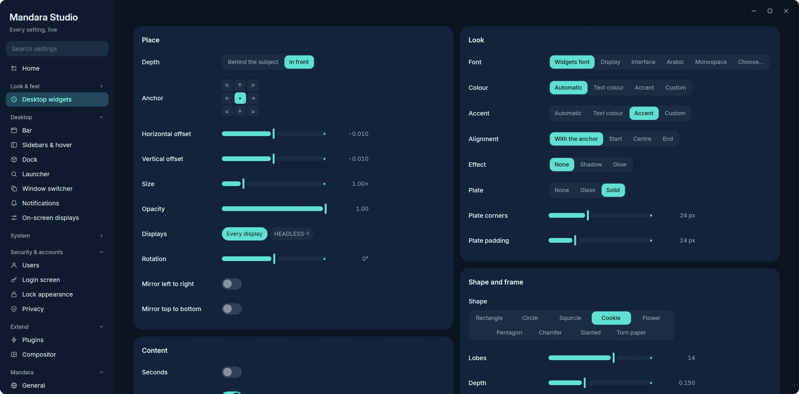
   
  Studio → Desktop widgets: the plate, <b>Shape and frame</b>, outline, shadow, chrome and header of one widget.

- **Each widget, your way:** size, opacity, colour and accent (automatic
  over the wallpaper, the theme's, or your own `#rrggbb` / `oklch(…)`),
  alignment, a shadow or glow and its strength, and a frosted glass or
  solid plate behind it with its own opacity, corners and padding. Fonts
  follow Typography → Desktop widgets (the display face until you choose
  one), and any widget can take another role or its own family from the
  searchable font list.
- **Numbers, dates and language:** every widget that writes numbers or
  dates has its own numerals (from the language, Western `123` or Eastern
  Arabic `١٢٣`), calendar (Gregorian, Hijri, both or none; the Hijri day
  begins at sunset and follows the Prayer times correction), the Hijri
  date in Arabic or in the widget's language, and a language for day and
  month names (it also sets the reading direction). Widgets made before
  these options keep what they showed.
- **Widgets are plugins:** each kind comes from a first-party plugin in
  Studio → Plugins → Desktop widgets (*Desktop clocks*, *System monitor*,
  *Desktop decorations*, *Desktop visualizers*, *Now playing card*,
  *Calendar card*, *Desktop weather*, *Desktop world clock*, *Countdown*,
  *Desktop productivity*, *Desktop sky*, *Desktop shortcuts and you*, *Desktop fun*,
  *Desktop info*).
  Switching one off hides its widgets without removing them and takes it
  out of the Add widget menus. Third-party WebAssembly plugins can offer
  desktop widgets too ([PLUGINS.md](../PLUGINS.md#desktop-widgets)).
- **Desktop cards:** a now-playing card (art, wavy progress, synced lyrics)
  and a calendar card, each on its own tiny surface that exists only while
  shown.
- **Visualizers:** a glowing wave along a screen edge, framed bars or a
  mirrored strip. They listen only while music plays and drop to zero CPU
  after a few seconds of silence.

<table>
<tr>
<td width="34%" valign="top">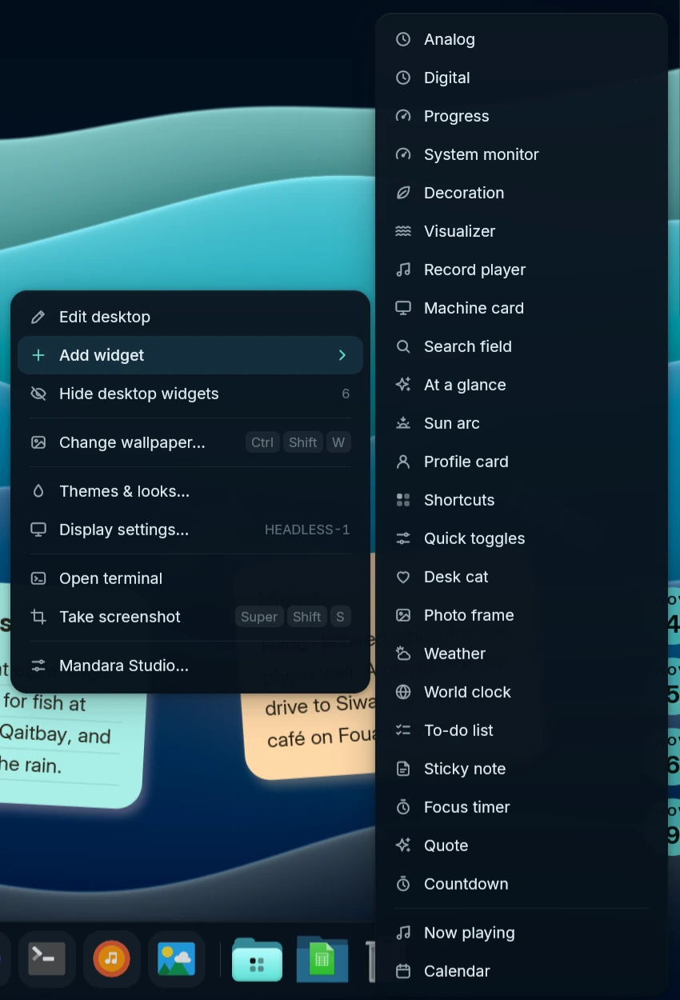 <b>Right-click the desktop</b></td>
<td width="66%" valign="top">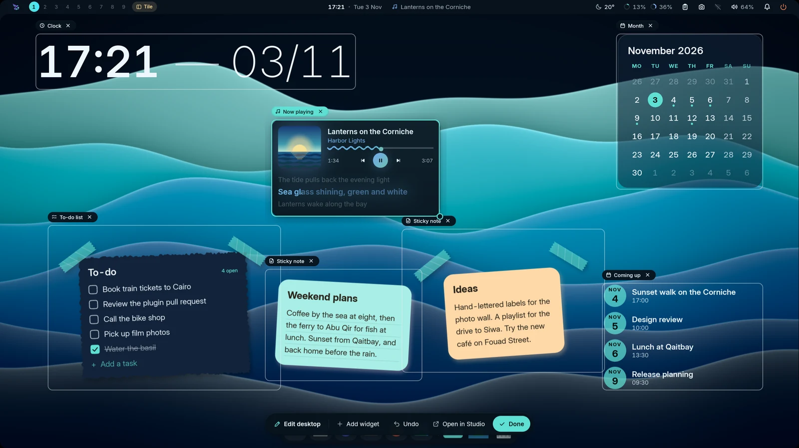 <b>Edit the desktop in place</b></td>
</tr>
</table>

- **Right-click the desktop** for a glass menu: Edit desktop, Add widget ▸
  (a few widgets from every desktop widget plugin that's on: clocks, day
  progress, the system monitor or gauges, a decoration, a visualizer, the
  record player, a machine card, a search field, an "at a glance" line, the
  sun's arc, a profile card, shortcuts, quick toggles, the desk cat, a
  photo frame, weather, a world clock, a to-do list, a sticky note, the
  focus timer, a quote, a countdown, the now-playing and calendar cards and
  any third-party plugin's widgets; Studio has the rest), show / hide widgets, change or skip the wallpaper, Themes & looks,
  display settings, a terminal, a screenshot and Studio.
- **Edit the desktop in place:** every widget gets an outline and its name.
  Drag to move it, pull the corner to resize, and it snaps to the screen's
  edges and centre lines. The × on a widget's name removes it in one click;
  right-click it to duplicate or hide it. With more than one monitor, the
  same menu keeps a widget **Only on this display** (or shows it on every
  display again), and a widget you add goes on the monitor you added it on,
  so each screen can have its own set. Studio → Desktop widgets → Displays
  picks them too. A floating toolbar has Add widget,
  Undo, Open in Studio and Done. New widgets start in front of the
  wallpaper's subject and on a free spot, so they show the moment you add
  them. Nothing of it stays in memory once you're done. The same widgets
  are in Studio → Desktop widgets, with a live preview; tiles already on the
  desktop are ticked, and *Remove duplicates* clears exact copies.
- A now-playing chip can also ride at the end of the dock.

## Every value is a setting

Everything you can see or feel is a setting in Mandara Studio: sizes,
radii, colours, fonts, springs, delays, refresh intervals, list lengths and
alert thresholds. Each has a default, a bounded range and a reset, and
applies live. Plugin options (refresh rates, rows shown, warning levels)
live in each plugin's settings window, and
[docs/configuration.md](configuration.md) lists every setting by Studio
page. A test keeps new hard-coded sizes and timings out of the shell:
anything that must stay fixed is a named, documented constant.

## Sound

- **Mute all**: one switch (sound panel, quick settings, middle-click on the
  bar's sound icon, `audio mute-all toggle`) mutes every output, hardware and
  virtual sinks such as EasyEffects', and every app. New sounds stay muted
  while it's on, it survives a shell restart, and it restores exactly what
  you had muted yourself.
- **Per-app volume**: every app playing sound gets a row with its icon,
  what it's playing, a volume slider (to 150 %), mute and a button that moves
  it to another output. Several streams of one app fold into one row.
- **Shell sounds** from your freedesktop sound theme, decoded in pure Rust,
  quiet while media plays.

## Keyboard shortcut cards

  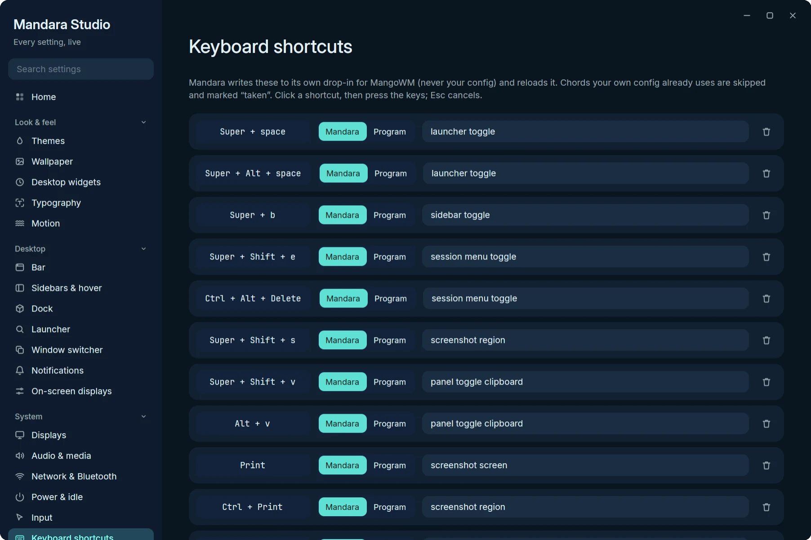
   
  Studio → Keyboard shortcuts: Alt+V for the clipboard, Print for screenshots, and the <b>Used by your config</b>, <b>Duplicate</b> and <b>Needs Super, Ctrl or Alt</b> badges.

Studio → Keyboard shortcuts shows every binding as a card. Click the keycap
chip and press the keys to record a new chord. Each card checks itself as
you type: **Duplicate** when two Mandara binds share a chord, **Needs
Super, Ctrl or Alt** when a bind would swallow plain typing, and **Used by
your config** with the exact file and line when your own compositor config
already has that chord. Mandara never overrides a key you already use; its
binds go into its own drop-in file for MangoWM, Niri, Hyprland, Umbriel or Sway,
and on River are sent as `map` commands (keys your `init` maps stay yours).
## Display reconnection

The shell follows displays as they connect, disconnect or change logical
size. A monitor returning through a display switch gets its bar and dock
back automatically. Choices in Studio → Displays, including Main display
and individual connector names, remain saved while a display is away.

Taped notes attach their corner strips to the note’s own sheet, using the
same frame decoration as the to-do list. A separate header stays above the
paper without moving the strips away from it.

Write directly on the desktop: click a to-do's words to edit them, its
checkbox to change completion, or **Add a task** to create one. Click a
sticky note or notebook tab to edit the full Markdown note at that widget.
**Done** saves; Enter saves a task, and Ctrl+Enter saves a multiline note.
Escape or the close button cancels. Clicking elsewhere saves before leaving.
The editor uses the same lists and Markdown files as the plugins, so changes
appear in every surface. Conflicting edits and failed saves keep your draft
visible rather than overwrite newer text.

The editor stays open while the save finishes. File writes, note renames and
task JSON writes run in the background; a disk error leaves the draft ready
to retry. A note whose text saved before its filename or index failed keeps
the same id on retry. A list tag alone, such as `#Work`, needs task text after it.
Unreadable files stay read-only while their drafts remain available; other
notes stay usable. Recovery scans wait for save capacity and check Notes
plugin drafts against the recovered file. An unchanged file lets the plugin
draft retry; a change found by that scan stays a conflict. For a draft in the
desktop editor, make the file readable and press **Done** again.

Changing the notes folder waits for pending saves; retained conflicts are
available when you return. Desktop note saves compare the file with the text
the editor opened. Ordinary Notes plugin body saves do not make that comparison
and may replace external edits; recovery scans check retained baselines separately.
None of these operations locks out another editor. Even a desktop save can
replace an edit made after its comparison.

The widget gallery fits each preview to its card and renders at the display’s
pixel density, with larger calendar and sky miniatures. Media previews use a
clearly labelled sample track and cover; they do not need a running player
or read your listening history. Quick toggles and sliders show sample states,
and the palette tile uses your current theme colours. The desktop still shows
only real media and control states.

The bar preset thumbnails show each centered layout’s actual proportions.
Micro pill uses a shorter bar, tighter spacing and no empty side-group gaps;
Dynamic island keeps a taller shared island with roomier groups. Both remain
available in **Studio → Bars → Bar → Presets**.

With weather enabled, a desktop weather widget keeps its forecast active
without a weather item in the bar or sidebar. Weather cards follow the
widget’s chosen language and reading direction.
