# Your desktop: bar, looks and widgets

How Mandara looks and feels, and how much of it you can shape.

  
   
  The demo desktop in light mode (<code>mandara msg theme mode light</code>).

## Shape it your way

- **Every corner, one dial.** Corner roundness scales every radius in the
  shell (bar, panels, sidebar, cards, chips, launcher, OSD, dock), keeps
  nested corners concentric, and updates live, open panels included.
- **Bar, your way:** edge frame (flush or floating), glass pills, island, a
  24 px **hairline** dense with live stats, a single **micro pill**, a
  **notch** that hangs from the top edge on curved shoulders, or a slim
  **side bar** on the left or right edge with an optional screen frame
  (panels open sideways from it). Each style has its own radius, item padding
  and spacing, separators, group capsules, center-group alignment, accent
  tint, glass rim, shadow, and text and icon size.
- **Panels you can shape:** drop-down panels get width, maximum height,
  padding, gap to the bar, anchoring, opacity, shadow, an open animation
  (morph, fade and slide, or none) and their own spring; the sidebar and
  power dock sit flush or float, with their own radius, card styling,
  header layout and tab position.
- **Studio explains itself:** every page reads like a short table of
  contents. Related settings sit together in collapsible sections, each
  with a one-line preview of what's inside and how many you've changed.
  Controls that don't apply to your current layout say why, and every
  section has a one-click Reset.

## Looks and desktop widgets

  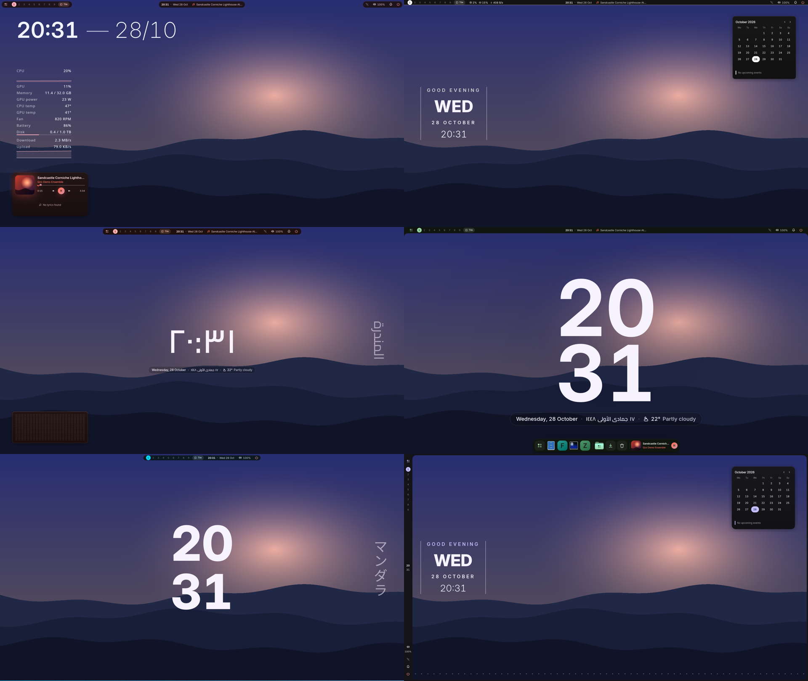
   
  The six Looks, one click each in Studio → Themes.

- **Looks:** six original one-click desktop looks in Studio → Themes, right under
  the live preview of your current theme:
  *Corniche Dusk*, *Pharos Ink*, *Montaza Crimson*, *Qaitbay Forest*,
  *Anfushi Wave* and *Night Frame*. Each sets the bar style, widgets,
  palette (generated by Mandara's HCT/OKLCH engine), typography and radii
  together. Your own setup is saved first, and **Restore my look** brings it
  back in one click. Switching looks also switches off the plugins the last
  look turned on (never ones you had on). Looks never change your wallpaper;
  *Use my wallpaper's colors* keeps its palette.
  `mandara msg look list|apply|restore` scripts them.
- **Cursor themes** (opt-in plugin, `cursors`): switched off, Mandara
  leaves your cursor configuration alone entirely and Studio → Themes shows
  a one-line card to turn it on. Switched on, Studio → Themes → Cursor shows your cursor drawn from
  its own files at its size, every cursor setting (size with 24 / 32 / 48 /
  64 px chips, hide while typing, hide when idle, Hyprland's software cursor
  and hide on touch) and a gallery of the ten most popular ricing cursor
  themes — Bibata Modern, macOS, Qogir, Phinger, Catppuccin, BreezeX, Vimix,
  Banana, Nordzy and Rosé Pine — with author, licence and variants. One
  click downloads the pinned GitHub release, verifies its SHA-256 and
  installs it to `~/.local/share/icons`; Apply changes the cursor live on
  MangoWM, Niri and Hyprland (and X11 apps through `~/.icons/default`);
  Remove only ever deletes what Mandara installed. Nothing is bundled in the
  binary. `mandara msg cursor list|install|apply|remove` scripts it.

  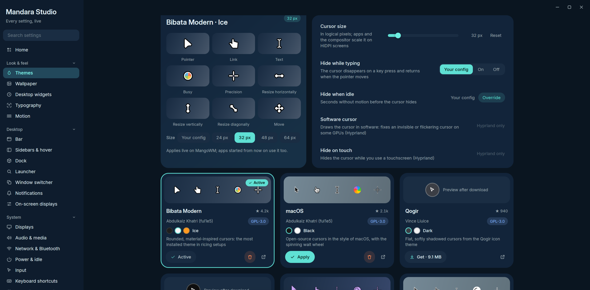
   
  Studio → Themes → Cursor: the applied cursor, its settings and the theme gallery.

<table>
<tr>
<td width="50%" valign="top">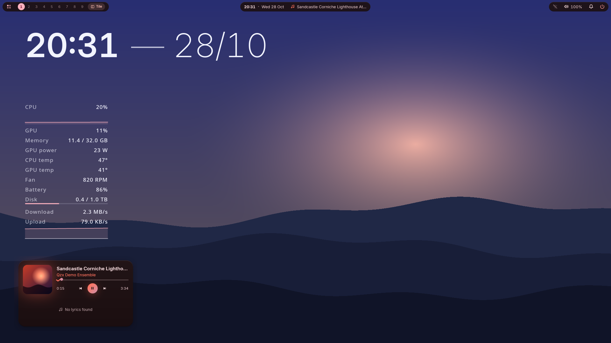 <b>Corniche Dusk</b></td>
<td width="50%" valign="top">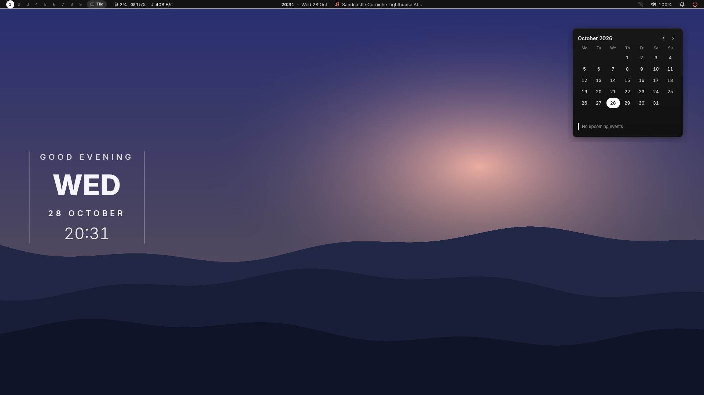 <b>Pharos Ink</b></td>
</tr>
<tr>
<td width="50%" valign="top">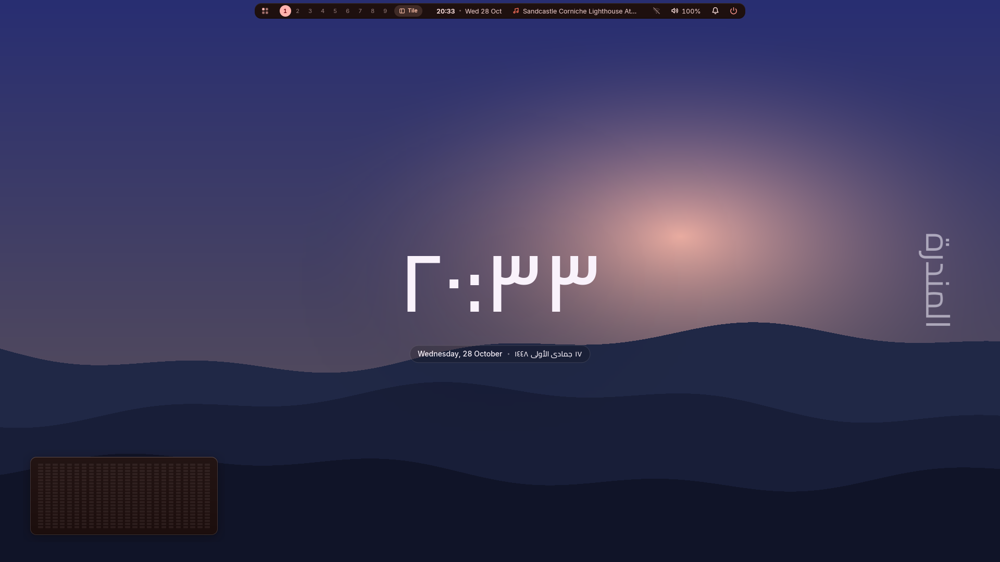 <b>Montaza Crimson</b></td>
<td width="50%" valign="top">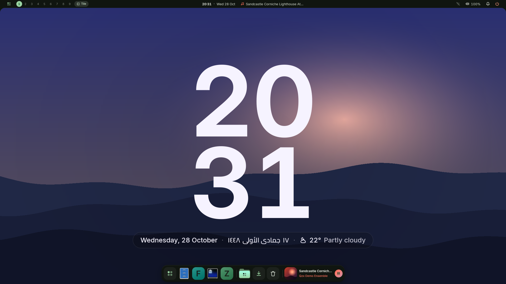 <b>Qaitbay Forest</b></td>
</tr>
<tr>
<td width="50%" valign="top">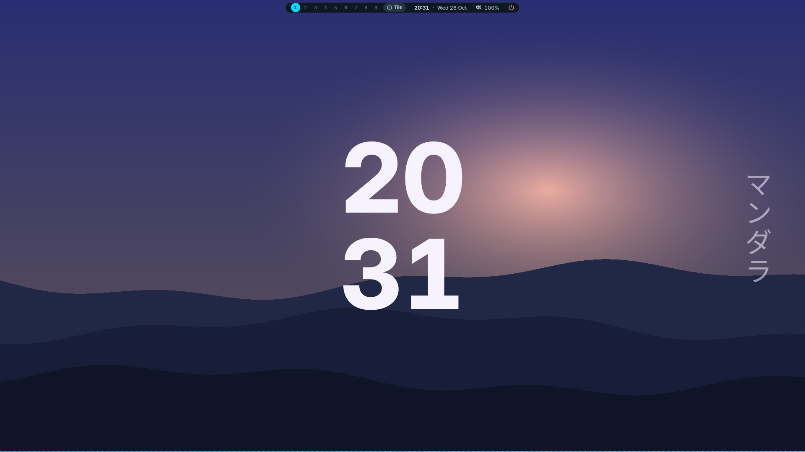 <b>Anfushi Wave</b></td>
<td width="50%" valign="top">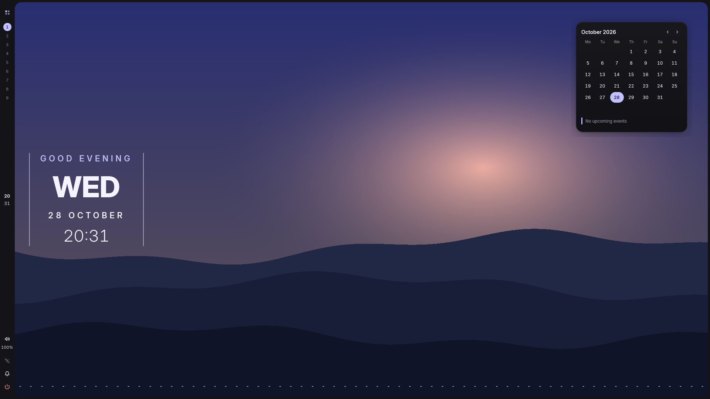 <b>Night Frame</b></td>
</tr>
</table>

- **Desktop widgets:** hero clocks (superscript, headline, day block, ring,
  greeting, giant day numeral, minimal), a system-monitor column with live
  graphs, text and shape decorations (discs, stripes, waves, frames, and
  vertical text: kana and CJK stand upright, Arabic and Latin keep their
  joined line turned toward the screen's middle) and an audio visualizer
  that can sit *behind* the wallpaper's subject. Every widget stays fully on
  screen and clear of the bar at any resolution. They're drawn in software
  into small shared-memory layers: no video memory, redrawn only when they
  change, nothing runs until you add one, and a removed widget's layer is
  freed at once.
- **Desktop cards:** a now-playing card (art, wavy progress, synced lyrics)
  and a calendar card, each on its own tiny surface that exists only while
  shown.
- **Visualizers:** a glowing wave along a screen edge, framed bars or a
  mirrored strip. They listen only while music plays and drop to zero CPU
  after a few seconds of silence.

<table>
<tr>
<td width="50%" valign="top">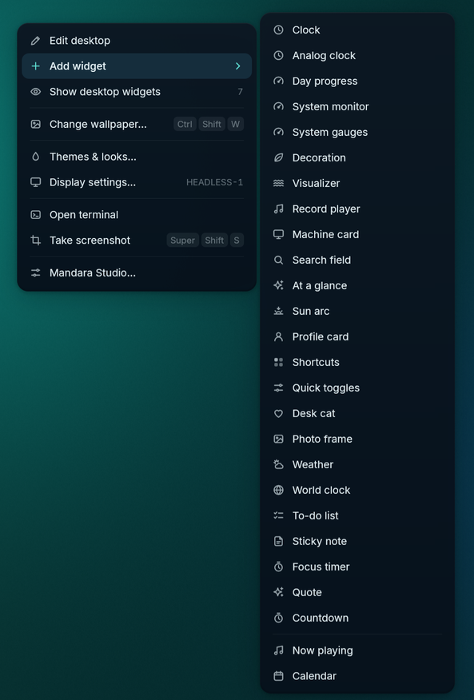 <b>Right-click the desktop</b></td>
<td width="50%" valign="top">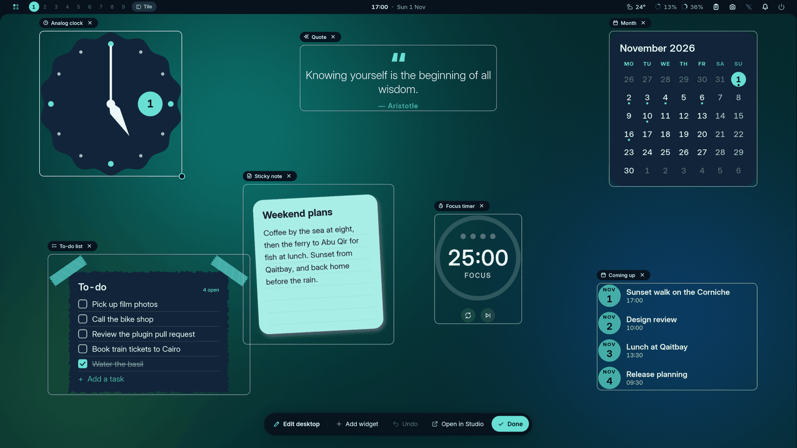 <b>Edit the desktop in place</b></td>
</tr>
</table>

- **Right-click the desktop** for a glass menu: Edit desktop, Add widget ▸
  (clock, system monitor, decoration, visualizer, now-playing or calendar
  card), show / hide widgets, change or skip the wallpaper, Themes & looks,
  display settings, a terminal, a screenshot and Studio.
- **Edit the desktop in place:** every widget gets an outline and its name.
  Drag to move it, pull the corner to resize, and it snaps to the screen's
  edges and centre lines. The × on a widget's name removes it in one click;
  right-click it to duplicate or hide it. A floating toolbar has Add widget,
  Undo, Open in Studio and Done. New widgets start in front of the
  wallpaper's subject and on a free spot, so they show the moment you add
  them. Nothing of it stays in memory once you're done. The same widgets
  are in Studio → Desktop widgets, with a live preview; tiles already on the
  desktop are ticked, and *Remove duplicates* clears exact copies.
- A now-playing chip can also ride at the end of the dock.

## Every value is a setting

Everything you can see or feel is a setting in Mandara Studio: sizes,
radii, colours, fonts, springs, delays, refresh intervals, list lengths and
alert thresholds. Each has a default, a bounded range and a reset, and
applies live. Plugin options (refresh rates, rows shown, warning levels)
live in each plugin's settings window, and
[docs/configuration.md](configuration.md) lists every setting by Studio
page. A test keeps new hard-coded sizes and timings out of the shell:
anything that must stay fixed is a named, documented constant.

## Sound

- **Mute all**: one switch (sound panel, quick settings, middle-click on the
  bar's sound icon, `audio mute-all toggle`) mutes every output, hardware and
  virtual sinks such as EasyEffects', and every app. New sounds stay muted
  while it's on, it survives a shell restart, and it restores exactly what
  you had muted yourself.
- **Per-app volume**: every app playing sound gets a row with its icon,
  what it's playing, a volume slider (to 150 %), mute and a button that moves
  it to another output. Several streams of one app fold into one row.
- **Shell sounds** from your freedesktop sound theme, decoded in pure Rust,
  quiet while media plays.

## Keyboard shortcut cards

  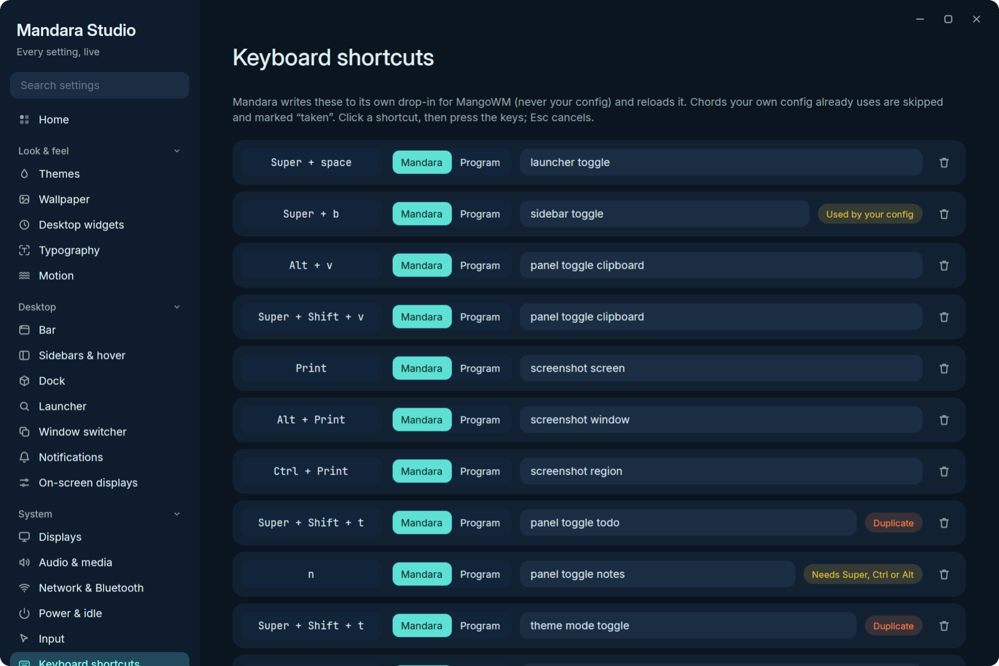
   
  Studio → Keyboard shortcuts: <b>Used by your config</b>, <b>Duplicate</b> and <b>Needs Super, Ctrl or Alt</b> badges.

Studio → Keyboard shortcuts shows every binding as a card. Click the keycap
chip and press the keys to record a new chord. Each card checks itself as
you type: **Duplicate** when two Mandara binds share a chord, **Needs
Super, Ctrl or Alt** when a bind would swallow plain typing, and **Used by
your config** with the exact file and line when your own compositor config
already has that chord. Mandara never overrides a key you already use; its
binds go into its own drop-in file for MangoWM, Niri or Hyprland.
