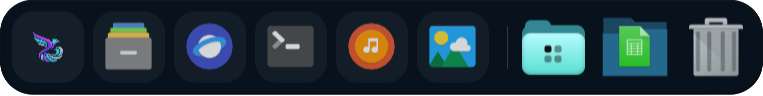
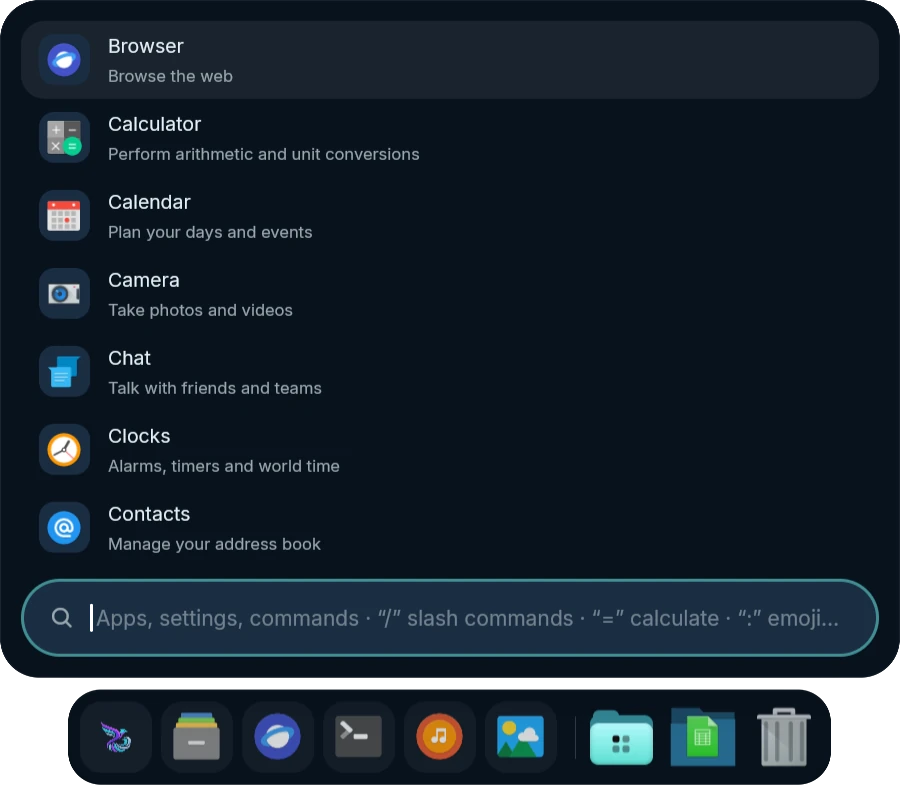
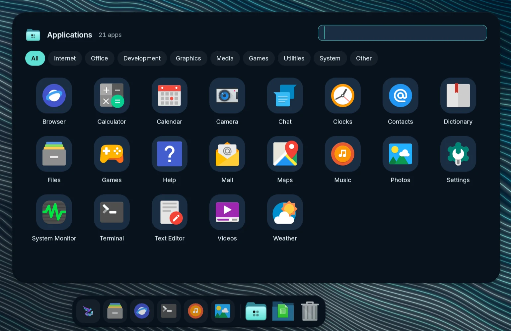
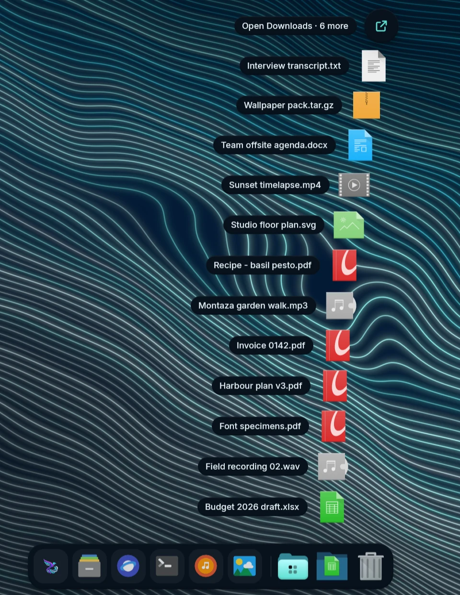

# Dock and launcher

  
   
  <b>Dock</b>: pinned and running apps, the Applications folder, Downloads and the Trash.

<table>
<tr>
<td width="33%" valign="top"> <b>Launcher</b>, attached above the dock</td>
<td width="33%" valign="top"> <b>Applications folder</b></td>
<td width="33%" valign="top"> <b>Downloads fan</b></td>
</tr>
</table>

- **Dock** (opt-in), modelled on the macOS Dock: pinned, running and recent
  apps on a chromatic-glass strip at the bottom, left or right of each
  display, with spring magnification, open-app dots, notification and
  progress badges, and launch and attention bounces.
  - **Right-click any icon** for its windows, New Window and the app's own
    actions, **Options ▸ Keep in Dock ✓ · Open at Login ✓ · Show in
    Files**, Show All Windows, Hide and Quit / Force Quit. Unpinning a
    running app keeps its icon until it quits.
  - **Add app…** (Studio → Dock, or right-click the dock) searches your
    installed apps. Drag icons to reorder, drag a running app in to keep
    it, or drag one away from the dock to remove it with a poof.
  - **The launcher button** is kept like a pinned app: first by default,
    drag it anywhere among your pinned apps (or `mandara msg dock move
    launcher 2`), remove it from its right-click menu or by dragging it
    away, and bring it back with **Keep the launcher in the Dock** in the
    dock's own right-click menu or **Add the launcher** in Studio → Dock.
    It opens the launcher and wears the bar's launcher icon. Docks from
    before 0.23 keep their button where it was (first, or after the pinned
    apps when it sat at the end).
  - **Applications folder:** a dock folder beside Downloads opens a
    Launchpad-style grid of every app (search, category chips, A–Z / Most
    used / Categories, right-click Keep in Dock / Open at Login /
    Uninstall…) and installs any app you drop on it, with a progress ring on
    the new icon.
  - **macOS stacks:** Downloads and any folder you add open as a fan of the
    newest files on an arc that pops up out of the icon as one piece, with
    *Open Downloads · N more* on top for the rest; or as a glass grid with
    keyboard navigation, type-to-filter and a right-click menu. The
    **Trash** takes dropped files.
  - **The dock stays put** while a stack, menu or the Applications grid is
    open, and auto-hide resumes cleanly when you close it.
  - **Auto-hide** (off, on, or only when a window overlaps) reveals at the
    screen edge; every setting is live in Studio → Dock, and
    `mandara msg dock pin|unpin|toggle-pin|move <app>`, `dock add`,
    `dock stack add|open <folder>`, `dock applications open` and
    `dock trash` script it.
- **Launcher** (Super+Space): fuzzy search over apps, settings, every plugin
  and command, a calculator, **slash commands** (`/g`, `/yt`, `/wiki`,
  `/gh`, `/todo`, `/note` and your own) and **skills** (named routines).
  **Providers** with their own prefixes: `:` emoji (English or Arabic
  names), `@` open windows, `#` clipboard history, `*` wallpapers, `~` files.
  The empty search field lists what a query can start with, the same in
  every look: `/`, `=`, the AI Shell Agent's `!` while it is switched on
  ([Local shell commands](command-agent.md)), then each provider that is on
  with the prefix you gave it. It follows Studio while the launcher is open.
  It learns what you open (frecency, kept on this computer), shows pinned
  and recent apps first, and lists desktop actions (*New Private Window*).
  **Put it anywhere:** float it in the middle of the screen or attach it to
  the top or bottom edge at the left, middle or right. On the bar's edge it
  grows out of the bar like a panel (flares on the edge frame, a floating
  card under pills or the island), optionally out of the launcher button
  itself. Pick the spot on a screen diagram in Studio → Launcher, or run
  `mandara msg launcher placement top-left`. The launcher button in the bar
  shows Mandara's logo in colour; Studio → Launcher → Button icon swaps it
  for a bundled icon, your distribution's logo, any icon from your theme or
  your own image (`[appearance] launcher_icon`). Every app icon in the
  launcher, the dock and its Applications drawer sits on one shape, a
  squircle by default, so icons themes draw as squares, circles or free
  shapes read as one set; pick Circle, or Theme's own to keep each icon as
  drawn (Studio → Launcher → App icon shape, `[appearance] app_icon_shape`).
  **Three looks, one click each** (Studio → Launcher → Launcher looks, or
  `mandara msg launcher look classic|grid|beacon`; `launcher looks` lists
  them): **Classic** is the list drawer above (the default). **Grid** shows
  every app as a large icon with its name, in as many columns as fit, with
  All / Pinned / category chips on top; arrows move in two dimensions,
  Tab switches the category, and the tiles reflow with a spring as you
  type. **Beacon** is a centred glass search bar in the upper part of the
  screen, in the style of macOS Spotlight: round mode buttons beside it
  (Apps, Files, Actions, Clipboard, or Ctrl+1–4) and the results under it,
  grouped under a Top hit and headings by kind, once you type. Any look's
  settings (grid icon size, grouping, keyboard hints, the bar's width and
  height on the screen) can be changed afterwards. The launcher keeps only
  the icons it shows decoded (8 MiB at most) and frees them all when it
  closes.
- **They share the edge.** With the dock on, the bottom edge belongs to the
  dock: the launcher stops opening on hover, opens by click or keybind only,
  and floats above the dock instead of covering it.
- **Alt-Tab window switcher** with live window previews
  (`ext-image-copy-capture`), most-recently-used order and switch-on-release;
  started from a click or a script, it stays open until you choose.
