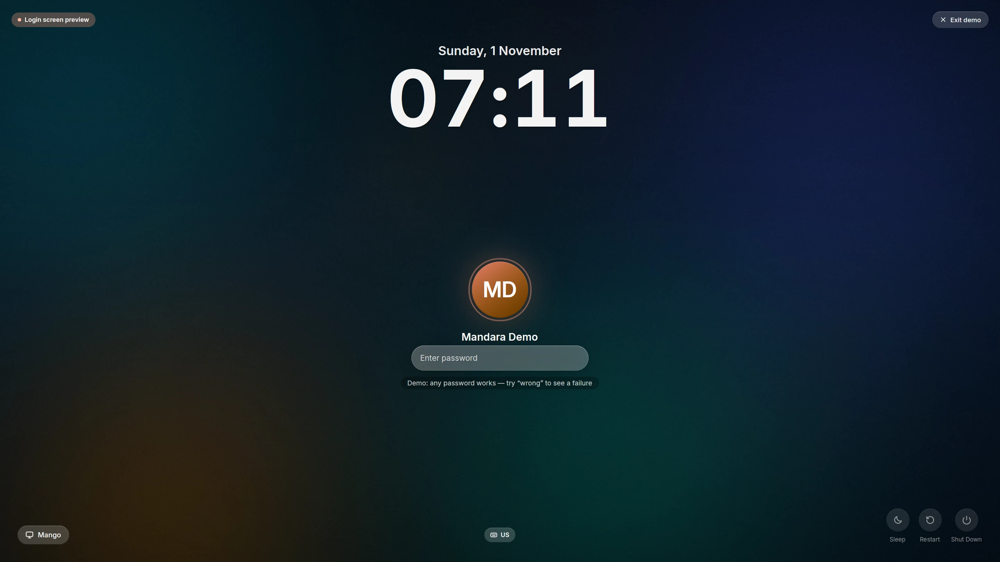
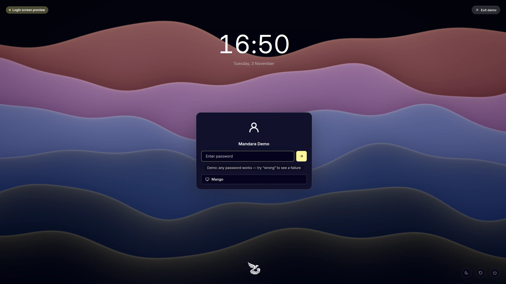
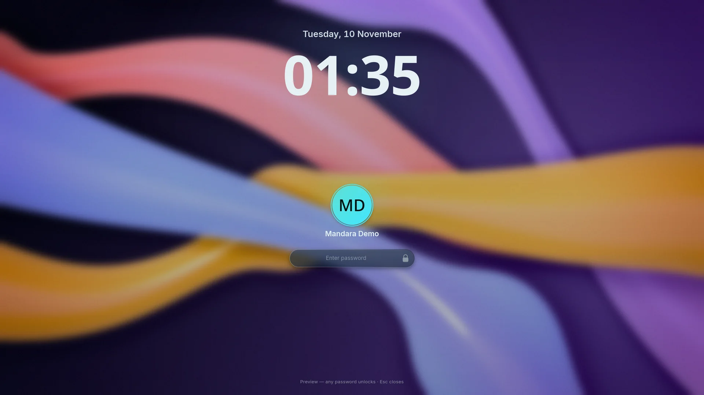
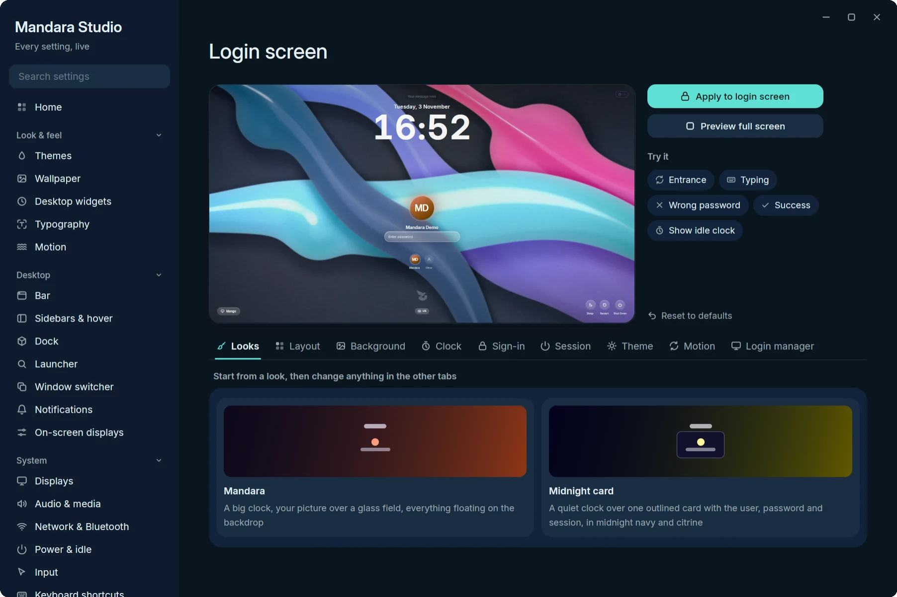

# Lock screen and Mandara Login

<table>
<tr>
<td width="50%" valign="top"> <b>Mandara Login</b>, the login manager: the <b>Mandara</b> design</td>
<td width="50%" valign="top"> The <b>Midnight card</b> design</td>
</tr>
<tr>
<td colspan="2" align="center"> <b>Lock screen</b></td>
</tr>
</table>

- **Mandara Login** is a complete login manager: a
  [greetd](https://sr.ht/~kennylevinsen/greetd/) greeter in the same binary.
  Backgrounds are AV1 video clips decoded in pure Rust (no ffmpeg or
  GStreamer), a slow-zoom slideshow or a generated OKLCH aurora. It has a
  rolling clock, springy entrances, a breathing avatar ring, typing ripples,
  a shake on a wrong password and a cinematic zoom into your session.
- **Design it in Studio**: drag every element on a live, smooth preview in
  Studio → Login screen (below).
- **Try it safely**: `mandara greeter --demo` runs it on your session
  without logging you out. `sudo mandara greeter install` prints its plan,
  keeps backups and switches display managers only when you add `--apply`.
  → [docs/login-manager.md](login-manager.md)
- **Your login screen by default**: the installer asks once, installs
  greetd and cage, and switches to Mandara Login with a backup
  (`--no-greeter` skips it; undo with `sudo mandara greeter restore latest`).
- **Switch login screens any time**: Studio → Login screen → **Login
  manager** lists Mandara Login, tuigreet, ReGreet, gtkgreet, nwg-hello,
  QtGreet, agreety, SDDM, GDM, LightDM, Ly and LXDM. One that isn't installed
  gets **Install & use**, which installs it with what it needs (greetd, cage,
  LightDM's greeter) through your package manager, then switches. From a
  terminal: `mandara greeter list` and `sudo mandara greeter use <name>
  --apply --install`.
  Every switch prints its plan first, changes only greetd's `command` line or
  `display-manager.service`, keeps timestamped backups and never stops your
  running session: it takes effect at the next boot.
- **Keyring unlock prompts**: Mandara is gnome-keyring's system prompter,
  so unlocking a keyring or choosing a new keyring's password opens a native
  Mandara dialog (show / hide, Caps Lock hint, strength meter, "unlock
  automatically" choice) instead of a separate GTK window. The password
  reaches gnome-keyring through gcr's encrypted secret exchange, never in
  clear text on the bus. If GNOME Shell or another prompter is already
  running, Mandara waits its turn; turn it off in Studio → General, and
  preview it with `mandara msg keyring-prompt demo`.
- **Keyrings unlock at login**: with Mandara Login,
  `sudo mandara greeter keyring-unlock --apply` (or Studio → General →
  Keyrings & passwords) adds the GNOME Keyring and KWallet PAM modules to
  greetd's login rules, only the ones installed, between clear markers and
  with a backup (`--remove` undoes it). A password login then opens your
  keyrings with no prompt at all. It doesn't apply to autologin, and each
  keyring's password must match your login password.
- **KeePassXC**: unlock a database in Mandara's own dialog (database picker,
  key file, Caps Lock hint) from quick settings, the launcher or
  `mandara msg keepassxc unlock`, optionally asked once at login. Mandara
  confirms the database really unlocked. The password reaches KeePassXC in
  clear text on your session bus (only your own programs can read it), and
  databases protected by a hardware key open in KeePassXC's own window.
- **Lock screen**: `ext-session-lock-v1` on every display, your password
  checked through PAM, a big clock, avatar, now playing, weather,
  notification count and battery, with classic, stacked or compact layouts
  and black secondary displays for OLED care. Anything that runs
  `loginctl lock-session` locks it; preview it with `mandara lock --demo`.

  
   
  Studio → Login screen: the designer with a live preview.

On **Plasma Wayland / KWin**, lock requests use Plasma’s secure locker.
Mandara waits for its confirmation before reporting a successful lock; the
Mandara lock-screen preview is still available. KWin does not expose the
lock-surface protocol used by Mandara’s own locker.
