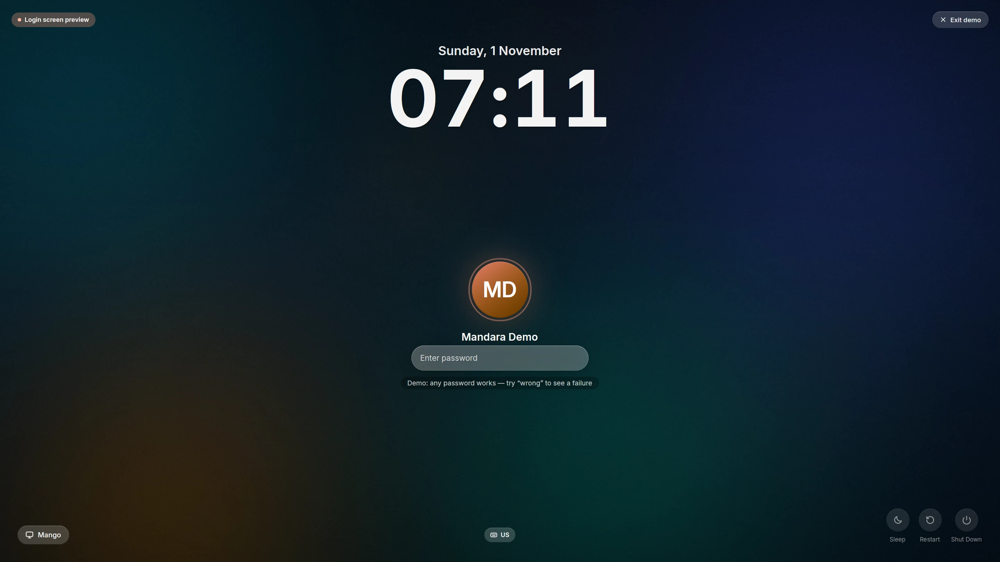
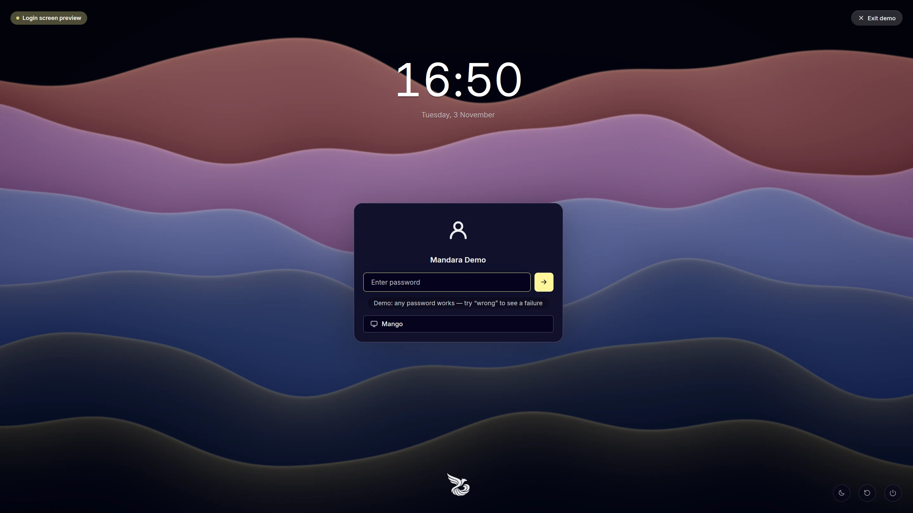
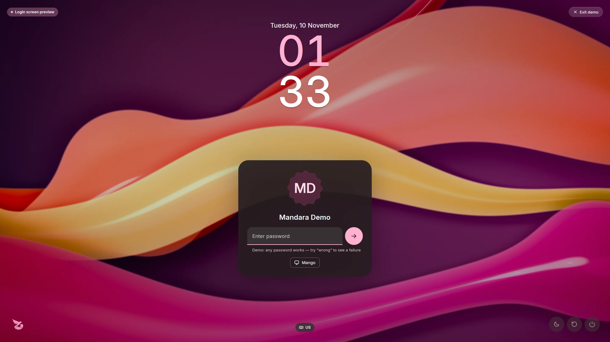

# Mandara Login — the login screen

Mandara Login is a [greetd](https://sr.ht/~kennylevinsen/greetd/) greeter
written in pure Rust on GPUI: a full-screen, spring-animated login screen
with AV1 video backgrounds decoded in pure Rust (no ffmpeg, GStreamer or C
libraries), a Ken Burns slideshow or a generated OKLCH aurora when there are
no videos, and a complete visual editor in Mandara Studio.

```
mandara greeter                  # the real greeter (started by greetd)
mandara greeter --demo           # preview on your running session (safe)
mandara greeter list             # the active login screen and every choice
mandara greeter use [NAME]       # switch the login screen (default: Mandara Login)
mandara greeter restore latest   # undo the last switch (sudo)
mandara greeter install          # register it as the login manager (sudo)
mandara greeter apply-config     # install your Studio draft system-wide (sudo)
mandara greeter uninstall        # restore the previous setup (sudo)
```

## Try it without logging out

```sh
mandara greeter --demo
```

The demo opens as an overlay on your current session. Nothing is real:

* greetd is never contacted, the password is **not** checked against the
  system (any non-empty password "works"; type `wrong` to see the failure
  animation), no session is started;
* Sleep / Restart / Shut Down are disabled (they never call logind);
* **Esc Esc** or the **Exit demo** button closes it; a "successful login"
  plays the zoom-and-dissolve transition and closes it.

Options: `--lang ar`, `--theme mandara-obsidian`, `--background
aurora|stills|video|solid`, `--look mandara|midnight-card|material-you`
(starts from that look, as Studio's Looks tab would). The demo reads your Studio draft
(`~/.config/mandara/greeter.toml`), your own clips in
`~/.local/share/mandara/login/videos/` and your wallpapers in
`~/Pictures/Wallpapers`.

## Install it as your login manager

The installer does this for you: after installing Mandara it asks **"Use
Mandara Login as your login screen?"** (default yes; `--yes` accepts),
installs `greetd` and `cage` with your distribution's package manager if
they're missing (not with `--no-deps`) and runs
`sudo mandara greeter use mandara --apply`. `--no-greeter` skips the step,
`--dry-run` only prints the plan. On upgrades it refreshes the installed
greeter binary when it's out of date. You can switch back any time with
Studio → Login screen → **Login manager** or `sudo mandara greeter restore
latest`.

## Switch login screens: `greeter list` / `use` / `restore`

```sh
mandara greeter list                     # what's active, what's installed
mandara greeter use tuigreet --dry-run   # print the plan only
sudo mandara greeter use tuigreet        # write files (backed up) only
sudo mandara greeter use sddm --apply    # …and switch display-manager.service
sudo mandara greeter restore latest      # undo the last switch (--apply: units too)
```

Choices: **Mandara Login** (`mandara`, the default and recommended one) and
the greetd greeters `tuigreet`, `regreet`, `gtkgreet`, `nwg-hello`,
`qtgreet` and `agreety`, or the display managers `sddm`, `plasmalogin`
(Plasma Login Manager), `gdm`, `lightdm`, `ly` and `lxdm`.

Detection reads `display-manager.service` under `/etc/systemd/system` (which
display manager is enabled) and, for greetd, the `[default_session] command`
in `/etc/greetd/config.toml` (which greeter it runs, looking through `cage -s
--` and similar wrappers). A choice is available when its pieces are
installed: greetd (unit or binary) plus the greeter binary and `cage` for the
greetd greeters that run in it; the systemd unit for display managers.
Missing pieces are named with their package for your distribution.

`use` always prints its plan first, e.g.:

```
Login screen — switch plan

  Now:    SDDM
  Target: Mandara Login (greetd greeter)

  Files (each one backed up first to /var/lib/mandara-greeter/backups/<timestamp>/):
    install  /usr/local/lib/mandara/mandara-greeter (copy of ~/.local/bin/mandara), media folders, state dir
    update   /etc/greetd/config.toml
        - command = "agreety --cmd /bin/sh"
        + command = "cage -s -m last -- /usr/local/lib/mandara/mandara-greeter greeter"
        (every other line is kept; user = "greeter")

  Services (run with --apply; nothing is started or stopped):
    systemctl disable sddm.service
    systemctl enable greetd.service

  Takes effect at the next boot (or the next time the login screen starts); the running session is not touched.
  Undo: sudo mandara greeter restore latest
```

* **greetd greeters**: only the `command` line of `[default_session]`
  changes — comments, `user` (`greeter`, `_greetd`, …), `[terminal]` and
  `[initial_session]` stay exactly as they were. The rewrite is checked
  (it must parse and differ only in that key) and a config that doesn't
  parse is never touched. Mandara Login runs in `cage` like `install` does
  (`--compositor niri|hyprland` for the others) and its runtime files are
  put in place too.
* **Display managers**: the current one is disabled and the chosen one
  enabled (`systemctl disable/enable`, never `--now`).
* It refuses without root, validates first (binary installed, unit present,
  config parses), keeps a timestamped backup with a `manifest.toml` per
  switch, and rolls back files and units if a step fails.
* `restore latest` (or a backup id) puts the backed-up files back, removes
  files the switch created, and with `--apply` moves `display-manager.service`
  back if the switch had moved it.
* `MANDARA_GREETER_DRY_RUN=1` turns `use` and `restore` (and Studio's
  switch) into plan-only runs.

Changes take effect the next time the login screen starts — normally the
next boot. Your running session is never stopped.

## Install it by hand: `greeter install`

Requirements: `greetd` and a minimal kiosk compositor — `cage` is
recommended (Niri and Hyprland work too).

```sh
# Arch: sudo pacman -S greetd cage     Fedora: sudo dnf install greetd cage
# Debian/Ubuntu: sudo apt install greetd cage

mandara greeter install                 # 1. read the plan (changes nothing)
sudo mandara greeter install            # 2. install files, keep backups
sudo mandara greeter install --apply    # 3. …and switch display managers
```

What `install` does (it prints all of this first, refuses without root, and
never runs on its own):

1. copies the running `mandara` binary to `/usr/local/lib/mandara/mandara-greeter`
   (the greeter user can't run binaries from your home directory);
2. creates `/usr/share/mandara/login/{videos,backgrounds}` for clips and images;
3. creates `/var/lib/mandara-greeter` (owned by the greeter user) to remember
   the last user and their session;
4. writes `/etc/mandara/greeter.toml` with defaults if it doesn't exist;
5. backs up `/etc/greetd/config.toml` to `config.toml.mandara-backup` and
   writes a new one (keeping your `[terminal]` and `[initial_session]`):

   ```toml
   [default_session]
   command = "cage -s -m last -- /usr/local/lib/mandara/mandara-greeter greeter"
   user = "greeter"
   ```
6. detects the enabled display manager (`display-manager.service` → sddm,
   plasmalogin, gdm, lightdm, ly, …) and prints the switch commands; with `--apply` it
   runs them:

   ```sh
   systemctl disable sddm.service
   systemctl enable greetd.service
   ```

Services are never stopped or started — your current session keeps running
and Mandara Login appears at the next boot.

Other kiosk compositors: `sudo mandara greeter install --compositor niri`
(writes `/etc/mandara/greeter-niri.kdl` and runs `niri -c …`) or
`--compositor hyprland` (writes `/etc/mandara/greeter-hyprland.conf`, or
`/etc/mandara/greeter-hyprland.lua` when the installed Hyprland is 0.57 or
newer — that version reads only Lua configs).

### Uninstall

```sh
sudo mandara greeter uninstall           # restore the greetd config, remove the binary
sudo mandara greeter uninstall --apply   # …and re-enable the previous display manager
```

The previous display manager is recorded at install time in
`/var/lib/mandara-greeter/previous-dm`. Without it, re-enable yours by hand,
e.g. `sudo systemctl disable greetd && sudo systemctl enable sddm`.

## FreeBSD

Mandara Login runs on FreeBSD under greetd and `cage` like anywhere else;
only the plumbing differs:

* **greetd isn't packaged for FreeBSD yet** (a port is under review), and
  upstream greetd builds only on Linux. Build its FreeBSD branch (it adds
  FreeBSD's VTs, an rc script and a PAM sample), as root:

  ```sh
  pkg install git rust cage seatd
  git clone -b feature/freebsd-support https://github.com/adamretter/greetd
  cd greetd && cargo build --release
  install -m 755 target/release/greetd target/release/agreety /usr/local/bin/
  install -m 555 greetd.rc /usr/local/etc/rc.d/greetd
  mkdir -p /usr/local/etc/greetd && cp config.toml /usr/local/etc/greetd/
  cp greetd.pam.freebsd.sample /usr/local/etc/pam.d/greetd
  pw useradd greeter -d /nonexistent -s /usr/sbin/nologin -c "greetd greeter"
  pw groupmod video -m greeter
  sysrc seatd_enable=YES && service seatd start
  ```

  Then `sudo mandara greeter use mandara --apply` (or Studio → Login
  screen → Login manager) points greetd at Mandara Login.
* **Config:** `/usr/local/etc/greetd/config.toml` (greetd's FreeBSD
  build reads it before `/etc/greetd/config.toml`). A config Mandara
  writes from scratch uses VT 8 (`/dev/ttyv8`, past the eight gettys of
  `/etc/ttys`).
* **Switching** uses rc.conf instead of systemd: the active login screen is
  the one with `<name>_enable="YES"` (`greetd`, `sddm`, `gdm`, `lightdm`…,
  rc scripts in `/usr/local/etc/rc.d` and `/etc/rc.d`), and `--apply` runs
  `sysrc sddm_enable=NO` and `sysrc greetd_enable=YES`; `greeter restore`
  turns them back. Nothing is started or stopped.
* **PAM:** FreeBSD reads `/etc/pam.d` before ports' `/usr/local/etc/pam.d`.
  `keyring-unlock` copies greetd's file from `/usr/local/etc/pam.d` into
  `/etc/pam.d` and adds its lines there (modules from `/usr/lib` and
  `/usr/local/lib`: `gnome-keyring`, `plasma6-kwallet-pam`). FreeBSD 14's
  PAM rejects the whole file over Linux's `-auth` prefix, so the lines are
  written without it, and only for modules that are installed. greetd's
  sample file checks the password with `auth sufficient pam_unix.so`,
  which ends the stack before a keyring line can run: the plan says so,
  and `auth required pam_unix.so` fixes it.
* **Password prompts** (polkit) need a ConsoleKit2 session for apps other
  than the shell: add `session optional pam_ck_connector.so` to
  `/usr/local/etc/pam.d/greetd`. Without one, Mandara's agent still answers
  everything the shell asks (the Updates panel, the admin helper).

## Unlock your keyrings at login: `greeter keyring-unlock`

GNOME Keyring and KWallet can open with the password you type at the login
screen, so apps find their saved secrets without a second prompt. Neither
keyring accepts a password over D-Bus; this works through their PAM modules
(`pam_gnome_keyring.so`, `pam_kwallet5.so` — KWallet 6 keeps that name),
which Mandara adds to greetd's PAM service file:

```sh
mandara greeter keyring-unlock                 # status + the plan (changes nothing)
sudo mandara greeter keyring-unlock --apply    # add the lines (backed up first)
sudo mandara greeter keyring-unlock --remove   # take Mandara's lines out again
```

* Only installed modules are added: the module directories of every
  distribution are searched (`/usr/lib/security`, `/usr/lib64/security`,
  `/lib/x86_64-linux-gnu/security`, `/usr/lib/aarch64-linux-gnu/security`,
  …). Packages: Arch `gnome-keyring` / `kwallet-pam`; Debian and Ubuntu
  `libpam-gnome-keyring` / `libpam-kwallet5`; Fedora `gnome-keyring-pam` /
  `pam-kwallet`; openSUSE `gnome-keyring-pam` / `pam_kwallet6`.
* A module the stack already runs — wired by the distribution (openSUSE's
  `pam-config` puts gnome-keyring in `common-auth`) or by hand — is left
  alone: includes and substacks are followed.
* The `auth` lines go right after the stack that checks your password (the
  last `include` / `substack` / `@include` that runs `pam_unix` or similar —
  on Fedora before `auth include postlogin`, like GDM's file), the `session`
  lines after the last session line. They are `optional` and start with
  `-`, so a login never fails because of them, and each group is wrapped in
  `# mandara-keyring begin` / `# mandara-keyring end` markers:

  ```
  # mandara-keyring begin — added by `mandara greeter keyring-unlock`; --remove takes it out
  -auth      optional     pam_gnome_keyring.so
  -auth      optional     pam_kwallet5.so force_run
  # mandara-keyring end
  ```

  `pam_kwallet5.so` gets `force_run` (and `auto_start` for the session):
  greetd sets `XDG_SESSION_TYPE` only after authentication, so the module
  would otherwise skip the login as "not graphical".
* The file is `/etc/pam.d/greetd` (or the service named by greetd's
  `[general] service`). When only the distribution's `/usr/lib/pam.d/greetd`
  exists (openSUSE), a copy goes to `/etc/pam.d`, which takes precedence,
  and `--remove` deletes it again.
* It refuses without root, backs the file up under
  `/var/lib/mandara-greeter/backups/<timestamp>/` (so `greeter restore
  latest` undoes it too), checks that nothing outside its markers changes,
  verifies the write and rolls back on any error. Running it twice changes
  nothing; a module installed later is added on the next run.
  `MANDARA_GREETER_DRY_RUN=1` turns it into a plan-only run.
* `sudo mandara greeter install --apply` sets this up by default
  (`--no-keyring-unlock` skips it), and `mandara install` offers it after
  switching to Mandara Login.

It only works when you **log in with your password through Mandara Login**:
autologin (`[initial_session]`) has no password to hand over, and each
keyring's password must be **the same as your login password** (change a
keyring's password in Seahorse or KWalletManager to match). Studio shows
the state under General → Keyrings & passwords → Unlock at login.

KeePassXC has no PAM module; Mandara has its own unlock dialog for it
instead (see [commands.md](commands.md#keyrings-and-passwords)).

## Design it in Mandara Studio

`mandara studio "login screen"` (or Studio → **Login screen**) edits every
setting with a **live preview** — the real greeter view, rendering your draft.

The first tab, **Looks**, applies a whole design in one click: **Mandara**
(the default: everything floats on the backdrop, with Mandara's emblem above
the keyboard pill), **Midnight card** (a regular-weight clock with the date under
it, and one outlined card holding a frameless user icon, an inset field with
an accent border and a sign-in button beside it, and a full-width session
field; outlined power buttons, a logo and a colour scheme switcher; the
Night Citrine theme) or **Material You** (Material 3 Expressive: colours
made from the picture behind the screen, a big stacked clock whose hours take
a tone of the accent and whose weight grows from thin as the screen wakes,
and one tonal card with your picture in Material's scalloped twelve-sided
shape, a filled password field with a round button beside it that squares
off while held, and the session as a chip with a menu; other people as
chips, tonal power buttons and the emblem in the accent colour). The
scalloped avatar turns a little with each key and morphs into a circle while
the password is checked; reduced motion holds it still. Who is listed, sessions, folders, language and
accessibility stay as they are, and every part stays editable in the other
tabs: Layout, Background, Clock & date, Sign-in (card, user, password
field), Session, power & extras (logo, scheme switcher, language), Theme &
glass, and Motion & accessibility.

<table>
<tr>
<td width="33%" valign="top"><br/><sub><b>Mandara</b>: everything floats on the backdrop</sub></td>
<td width="33%" valign="top"><br/><sub><b>Midnight card</b>: one outlined card in navy and citrine</sub></td>
<td width="33%" valign="top"><br/><sub><b>Material You</b>: colours from the wallpaper, one tonal card</sub></td>
</tr>
</table>

**Dynamic colour** (`theme.from_wallpaper`, *Colours from the wallpaper* in
Theme & glass) builds Material's dark tonal scheme from the leading colour of
the still behind the login screen: the picked person's shared wallpaper or
your slideshow. It is picked from a small copy while the still is decoded,
off the screen's thread. Clips and the aurora have no picture to take it
from, so the theme preset is used with them.

The last tab, **Login manager**, shows the active login screen (name, icon,
kind) and every choice, with Mandara Login marked **Recommended · default**.
**Use** runs `mandara greeter use <name> --dry-run` and shows that plan in a
confirm card; **Switch** then runs `pkexec <admin> greeter use <name> --apply`
(no shell involved) and reports the result — the change shows the next time
you log in or restart. Choices that aren't installed are disabled with what's
missing and the package to install (e.g. "greetd isn't installed — install it
first (package greetd)"). With `MANDARA_GREETER_DRY_RUN=1` Studio's switch is
a dry run.

* **Drag elements on the preview.** They snap to the nearest of nine anchors
  (corners, edges, center) and keep their offset; guides show while you
  drag. Click an element to edit its anchor, offset, scale and visibility;
  `+` / `−` in the element list change the stacking order.
* Groups: Login manager · Layout · Background · Clock & date · User & password · Session &
  power · Theme & glass · Motion · Accessibility.
* Preview buttons play the entrance, typing, a wrong password, the success
  transition, or the idle clock.
* **Preview full screen** runs `mandara greeter --demo` with the draft.
* **Apply to login screen** runs `pkexec <admin> greeter apply-config`
  (validates the draft and installs it as `/etc/mandara/greeter.toml`; the
  previous file is kept as `.bak`).

`<admin>` is always a copy of Mandara that only root can change, never the
one in your home (which your account, or malware in it, could replace before
an administrator approves the prompt): a package's `mandara`, the admin
helper `/usr/local/lib/mandara/mandara-admin` that `mandara install` puts in
place, or the login screen's own `/usr/local/lib/mandara/mandara-greeter`.
Studio checks that root owns the file and every folder above it. Without
one yet, the first such action installs the helper from your binary (`pkexec
install -D -o root -g root -m 0755 …`, one more approval), and after that your
own copy never runs as root.


## Public widgets

**Studio → Login screen → Layout → Widgets** adds passive widgets from the
built-in gallery or copies one from the desktop. Position each copy with
its anchor, offsets, scale and opacity; later desktop edits do not change
it. **Apply to login screen** installs this draft through the existing
administrator flow. Nothing is added during installation.

The same widget schema is used by the desktop, Mandara Login and the
native lock screen. This minimal `greeter.toml` example adds a word clock:

```toml
# Public login widgets
[[widgets.items]]
id = "welcome-word"
kind = "clock"
face = "word"

[widgets.items.place]
anchor = "top-left"
x = 0.04
y = 0.04
scale = 0.65
```

The optional `[widgets.weather]` table holds explicitly public `latitude`,
`longitude` and `place` values. Studio shows the chosen coordinates before
copying them; the preview does not fetch weather. Personal files, messages,
calendar events and account data are not available to these widgets.
[Eligible kinds and lock-screen support](lock-and-login.md#widgets-on-login-and-lock-screens).

## Configuration reference

`/etc/mandara/greeter.toml` (real greeter) / `~/.config/mandara/greeter.toml`
(draft, demo). Every key is optional. Sizes and offsets are pixels on a
1080-pixel-tall reference screen and scale with the output.

```toml
language = "auto"                # or en, ar, fa, ur, es, pt, fr, de, tr, ru, hi, mr, bn, te, id, sw, vi, zh, ja, ko

[background]
user_wallpaper = true            # the picked person's own wallpaper, when shared
mode = "auto"                    # auto | video | stills | aurora | solid
video = "auto"                   # auto | lite | off (decoding)
video_dirs = ["/usr/share/mandara/login/videos"]
image_dirs = ["/usr/share/mandara/login/backgrounds"]
shuffle = true
playlist = []                    # file names in order (optional)
clip_seconds = 30                # with several clips, each plays at least this long
crossfade_ms = 1400
still_seconds = 16
still_fade_ms = 2600
ken_burns = 0.12                 # zoom range of the slideshow
playback_rate = 1.0              # 0.5 = dreamy slow motion
dim = 0.08
vignette = 0.4
grain = 1.0
blur = 0.0                       # stills blurred; videos at reduced resolution
tint = ""                        # "#rrggbb"
tint_strength = 0.0
solid = ""                       # color for mode = "solid"
orbs = true                      # drifting light orbs
orb_intensity = 0.5
parallax = 14.0                  # pointer parallax depth (px)

[clock]
format_24h = true
seconds = false
font = ""                        # empty = display font (Alexandria)
size = 150.0
weight = 700
idle_weight = 0                  # weight of the big idle clock (0 = the same)
opacity = 0.95
roll_digits = true
stacked = false                  # hours over minutes
tint = false                     # hours in a tone of the accent

[date]
format = ""                      # strftime; empty = the language's default
font = ""
size = 24.0
weight = 600
opacity = 0.9

[user]
list = "all"                     # all | last-user | manual
avatar_shape = "circle"          # circle | squircle | rounded | bare (no frame) | cookie (scalloped)
avatar_source = "auto"           # auto (AccountsService / ~/.face) | monogram | icon
avatar_size = 108.0
glow_ring = true                 # breathing accent ring
show_name = true
name_size = 20.0
hidden = []                      # login names never listed
switcher = "faces"               # faces | chips (the other people)

[password]
style = "glass"                  # glass | solid | inset | outline | underline | filled
submit = "inside"                # inside | beside | hidden (Enter signs in)
mask = "dots"                    # dots | shapes (a varied shape per character)
accent_border = false            # accent border while focused
text_size = 15.0
width = 340.0
height = 48.0
placeholder = ""
caps_hint = true
reveal_toggle = true
keystroke_ripple = true
glow = true

[session]
default = ""                     # e.g. "niri"; a user's last choice wins
x11 = true
style = "pill"                   # pill | field (full width) | chip (with a menu)

[power]
suspend = true
reboot = true
poweroff = true
labels = true
style = "soft"                   # soft | outlined | tonal
size = 44.0

[card]                           # user, password and session on one card
enabled = false
width = 460.0
padding = 22.0
radius = 22.0
fill = ""                        # #rrggbb, empty = the theme's surface
opacity = 1.0
border = 1.0
border_color = ""                # #rrggbb, empty = the theme's outline
back_button = true               # back to the user switcher
session_inside = true

[logo]                           # shown with the "logo" layout element
path = ""                        # PNG / SVG, empty = Mandara's emblem
size = 56.0
opacity = 0.9
accent = false                   # the emblem in a tone of the accent

[keyboard]
layout = ""                      # empty = detected

[banner]
text = ""                        # e.g. "Authorized use only"
size = 14.0

[theme]
preset = "montaza-twilight"      # `mandara themes`
accent = ""                      # "#rrggbb" override
glass = 0.18
rim = 0.6
roundness = 1.0
switcher = []                    # schemes the "themes" element offers (ids)
from_wallpaper = false           # colours from the picture behind (dynamic colour)

[motion]
entrance = true
stagger_ms = 70
entrance_spring = { stiffness = 120.0, damping = 17.0 }
pop_spring = { stiffness = 260.0, damping = 13.0 }
shake = true
shake_strength = 1.0
shake_spring = { stiffness = 1100.0, damping = 16.0 }
success_spring = { stiffness = 55.0, damping = 15.0 }
success_zoom = 0.10
idle_seconds = 30                # back to the big idle clock (0 = never)
start_idle = true
idle_spring = { stiffness = 140.0, damping = 22.0 }

[accessibility]
reduced_motion = false           # springs snap, nothing drifts or rolls
large_text = false
high_contrast = false

# Layout: one entry per element (clock, date, user, password, users,
# session, power, keyboard, banner, logo, themes — the colour scheme
# switcher).
# With the card on, the user element places the whole card.
[[layout]]
element = "clock"
anchor = "top"                   # top-left … bottom-right, center
x = 0.0
y = 108.0
scale = 1.0
visible = true
z = 1
```

## Video backgrounds

Drop clips into `/usr/share/mandara/login/videos/` (the greeter user can
only read system folders; the demo also reads
`~/.local/share/mandara/login/videos/`). Several clips play in order (or
shuffled) with crossfades; a single clip loops seamlessly.

**Format:** AV1 video in WebM / MKV (`.webm`, `.mkv`) or IVF (`.ivf`), 8- or
10-bit 4:2:0. Audio is ignored (strip it). H.264/HEVC/VP9 are not supported —
convert them:

```sh
ffmpeg -i in.mp4 -c:v libsvtav1 -crf 35 -preset 6 -an out.webm
# smaller / easier to decode: scale to 1440p or 1080p and cap the frame rate
ffmpeg -i in.mp4 -vf "scale=-2:1440,fps=30" -c:v libsvtav1 -crf 35 -preset 6 -an out.webm
```

**Recommended:** 1080p or 1440p at 24–30 fps, 10–60 s, seamless loops.
4K plays where the CPU allows; clips at least twice the screen size are
converted at half resolution automatically.

How playback works: a decode thread (pure-Rust `rav1d`, the Rust port of
dav1d, built without assembly) feeds a conversion thread (BT.709 / BT.601 /
BT.2020, limited or full range → BGRA) through a small queue; the UI shows
the newest frame that is due and drops late ones, so it never waits on the
decoder. If decoding falls behind for a sustained period the clock pauses
instead of jumping, then it switches to *lite* decoding (CDEF and loop
restoration off, no film grain, half-resolution conversion above 1080p),
and if that still can't keep up it falls back to the slideshow / aurora.

Measured on a Ryzen 9 9950X (16 cores), synthetic textured AV1 clips
(`crates/mandara-media/examples/make_test_clip.rs`), release-optimized decoder:

| clip | decode | decode + convert (pipelined) | in the greeter |
| --- | --- | --- | --- |
| 1080p | 83–97 fps (114 lite) | ~70–90 fps | 24/24 fps, 0 dropped, ~5–7 ms per frame |
| 2160p | 41 fps (all cores), 21 fps (4 threads), 10 fps (2 threads) | ~34–41 fps | — |

Real footage is heavier than the synthetic clips; on 4-core machines prefer
1080p/1440p. Measure your own clip:

```sh
cargo run --release -p mandara-media --example decode_bench -- clip.webm
```

Make a synthetic test clip (pure Rust, rav1e):

```sh
cargo run -p mandara-media --example make_test_clip -- test.webm 1920x1080 120 24
```

> **Developer note:** rav1d's debug assertions make it ~300× slower in an
> unoptimized-assertions (`dev`) build (≈0.3 fps at 1080p), so video falls
> back to stills there. Release builds are unaffected. For fast video in dev
> builds add to the workspace `Cargo.toml`:
>
> ```toml
> [profile.dev.package.rav1d]
> debug-assertions = false
> overflow-checks = false
> ```
>
> or build with `--config profile.dev.package.rav1d.debug-assertions=false
> --config profile.dev.package.rav1d.overflow-checks=false`.

## Each person's own wallpaper

When someone is picked, the login screen shows their desktop wallpaper.
Their Mandara session shares a copy (at most 2560×1600, JPEG) in
`/var/lib/mandara-login/wallpapers/<user>.jpg` whenever the wallpaper
changes (Studio → Wallpaper → "Show on the login screen"). The folder is
sticky like `/tmp`: anyone can add their own file and nobody can change
someone else's, and the login screen only shows a regular file owned by the
picked account, so nobody can put a picture under another person's name.
`greeter install` creates the folder, and so does applying the login screen
settings in Studio (for installs from before it existed). People without a
shared wallpaper, and `user_wallpaper = false`, get the backdrop below. The
demo and Studio's preview show your own current wallpaper.

## Stills and the aurora

Without clips, images from `/usr/share/mandara/login/backgrounds/` play as a
Ken Burns slideshow (slow zoom and pan with crossfades). With nothing at
all, a generated aurora — the theme's hues at vivid OKLCH lightness,
drifting slowly — keeps the screen alive.

## Keyboard

Enter submits · Esc clears (Esc Esc exits the demo) · Tab / Shift+Tab move
between password, session picker and user switcher · arrows change the
session or user · Ctrl+Backspace / Ctrl+U clear the field · the first key or
pointer move wakes the idle clock (the key is also typed). Caps Lock shows a
hint. Multi-step PAM conversations work: info and error messages appear
under the field, follow-up prompts (OTP codes, "new password") reuse it.

## Troubleshooting

* **Black screen / greetd falls back to a text prompt** — check
  `journalctl -u greetd -b`. Make sure `cage` is installed and that
  `/usr/local/lib/mandara/mandara-greeter greeter` exists and is executable.
* **"GREETD_SOCK is not set"** — `mandara greeter` without `--demo` only runs
  under greetd.
* **No avatar** — the greeter user can't read `~/.face`; set a picture in
  your desktop's user settings (AccountsService,
  `/var/lib/AccountsService/icons/<user>`).
* **Videos don't play** — only AV1 is supported; check the log for the clip's
  error and convert it as above. Clips in your home folder aren't readable
  by the greeter user: copy them to `/usr/share/mandara/login/videos/`.
* **Wrong language / layout** — set `language` and `[keyboard] layout` in
  `/etc/mandara/greeter.toml`. Translations use the selected version's external
  `.mlang` pack in `/usr/local/share/mandara/locales/<version>/` (or the package's
  system data directory). Installing or applying the login configuration prepares
  that pack. Login wording shares the shell's pack under separate `greeter:` keys;
  neither catalog is embedded in the executable. The login process never downloads
  languages and falls back to English if its pack is missing.
* **Go back to your old display manager** — `sudo mandara greeter uninstall --apply`.
