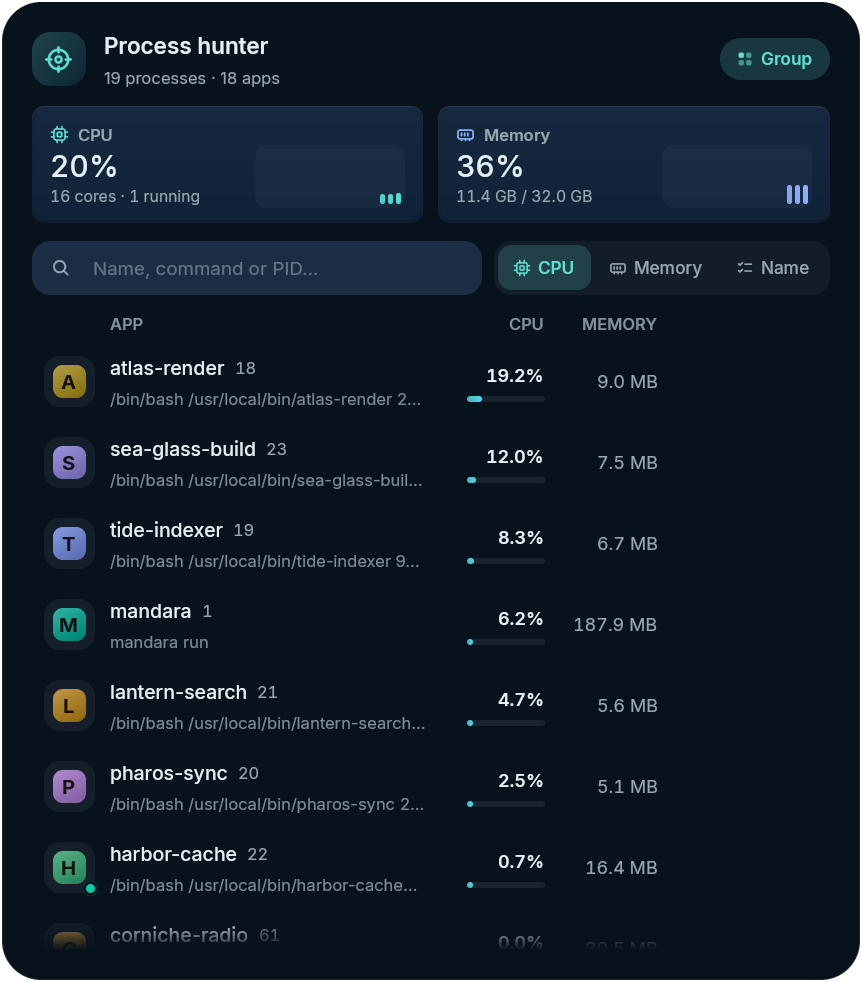
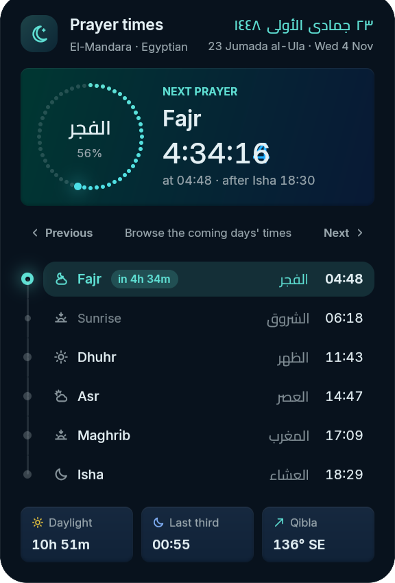
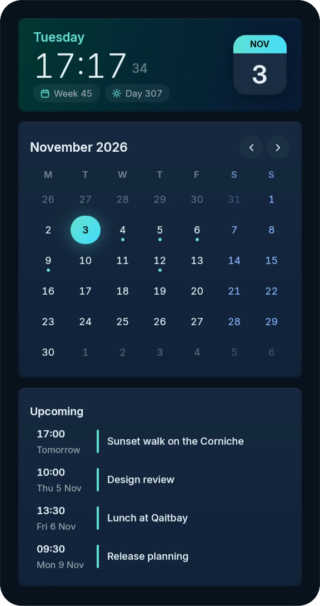
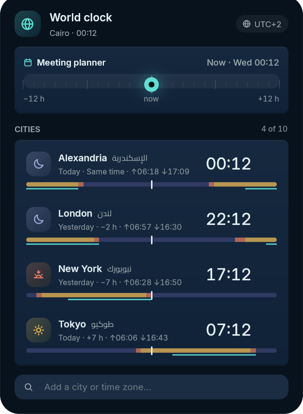
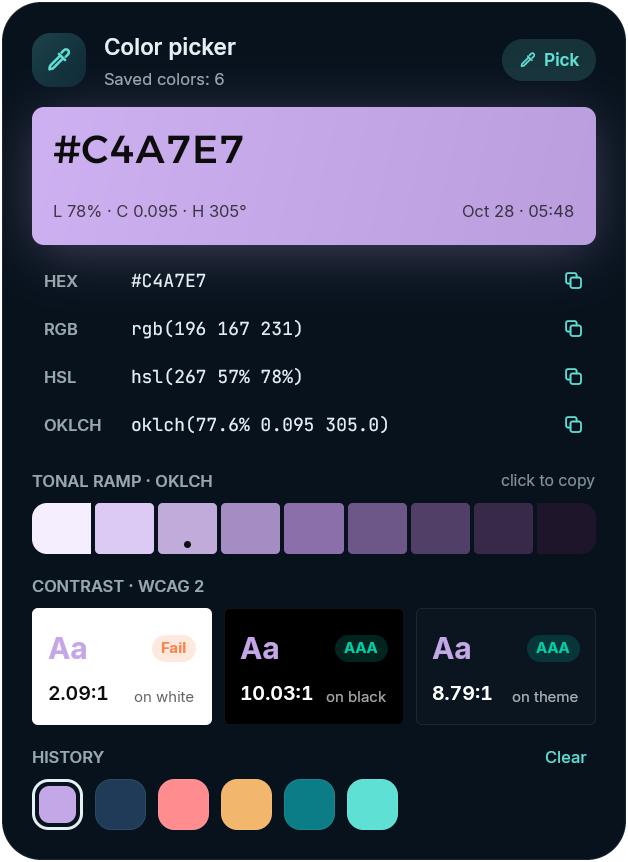
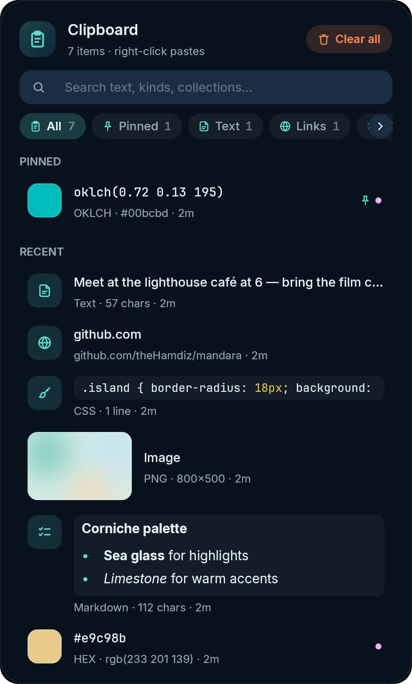
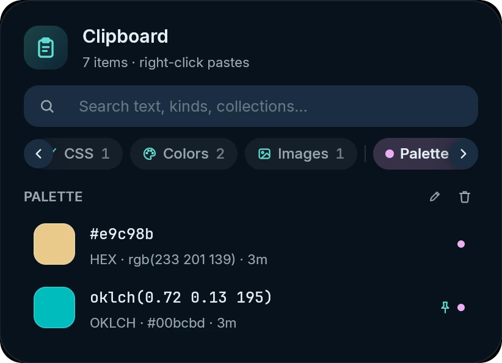

# Everything else

The rest of what's built in.

<table>
<tr>
<td width="50%" valign="top"> <b>Process hunter</b>: live CPU and memory, apps grouped, search by name, command or PID, end or force-kill.</td>
<td width="50%" valign="top"> <b>Prayer times</b> (opt-in): next-prayer countdown ring, day timeline, Hijri date and Qibla.</td>
</tr>
</table>

<table>
<tr>
<td width="33%" valign="top"> <b>Clock and calendar</b> with ICS feeds, Hijri dates and an agenda</td>
<td width="33%" valign="top"> <b>World clock</b> and meeting planner</td>
<td width="33%" valign="top"> <b>Color picker</b> with OKLCH ramps and WCAG contrast</td>
</tr>
</table>

- **Top or bottom**: every bar style (see [Shape it your way](desktop.md#shape-it-your-way))
  can sit at the **top or bottom** of the screen; at the bottom, panels
  spring upward.
- **Panels that morph** out of their pill, with clean concentric corners,
  a 1px specular rim and anti-banding grain.
- **Liquid tag pills**: every active tag or workspace gets its own indicator
  that stretches as it travels. Neighbouring tags viewed together on MangoWM
  (right-click, `toggleview`) melt into one shape with a soft waist (a
  smooth minimum of their distance fields), and one Oklab gradient runs
  across them all (River's tags work the same way). Next to them, MangoWM
  shows the tag's layout, Umbriel the active workspace's own layout, Sway
  its container layout and River its layout generator (click to cycle),
  plus a badge for a non-default keymode, keybind submap or binding mode.
- **Sidebar** with Overview and Notifications tabs, quick settings, weather
  (animated sky), media, Pomodoro, to-do, notes, sound and more. It opens on
  hover or Super+B and sits left or right (the power dock takes the opposite
  edge). Three modes: **Float** over your windows (the smoothest: opening it
  never re-tiles them), **Push** windows aside while it's open and give the
  space back when it closes, or **Pinned** open with its space reserved.
- **Clipboard history** with pins that survive clears, size and image
  limits, per-app exclusions (password managers), clear on lock / after N
  hours, and keep-copies-from-closed-apps.
  - **Sorted by kind as you copy.** Each copy is recognised once, off the
    UI thread, and the kind is saved with it: plain text, links (shown by
    their site), Markdown (rendered), code with a best-guess language
    (Rust, Python, JavaScript, TypeScript, Go, C, C++, Java, Kotlin, C#,
    PHP, Ruby, Lua, Nix, shell, PowerShell, Dockerfile, SQL, JSON, YAML,
    TOML, HTML, XML, diffs), CSS rules and declarations, colour values
    (`#hex`, `rgb()`, `hsl()`, `hwb()`, `lab()`, `lch()`, `oklab()`,
    `oklch()` and Hyprland's `rgba(rrggbbaa)`, drawn as a swatch), images
    (screenshots told apart by their size, the tool that made them or the
    app you copied from) and files copied in a file manager (icon, name
    and folder; pasting them back works in file managers too). Short
    all-digit hex like `#123` stays text, since it's usually an issue
    number.
  - **Chips, search and collections.** Chips filter by kind, pins or a
    collection; the search box matches text, kinds, languages, sites, apps
    and collection names. Collections are your own groups: the folder
    button on an entry adds it to one (or makes a new one), a right-click
    on a collection's chip renames it, and the pencil and trash next to its
    title rename or delete it (its entries stay in the history). Collected
    entries survive clears like pinned ones; collections are saved in
    `~/.cache/mandara/clipboard/collections.json`, even when the history
    itself is kept in memory only.
  - **Settings** (Studio → Plugins → Clipboard): *Filter by kind* (the
    chips), *Preview lines* (lines of code, CSS and Markdown a row shows,
    0 = one line) and *Entries in collections* (how many are kept).
  - **Alt+V** opens it (as does Super+Shift+V).

<table>
<tr>
<td width="50%" valign="top"> <b>Clipboard</b>: every kind shown the way it looks best</td>
<td width="50%" valign="top"> <b>Collections</b>: a palette kept together, with rename and delete</td>
</tr>
</table>

- **On-screen displays** for volume, microphone, output device, brightness,
  keyboard backlight, layout, Caps / Num / Scroll Lock, power mode, do not
  disturb, night light, now playing, privacy and your own scripts
  (`osd show`), each switchable, horizontal or vertical, scaled and offset.
- **Privacy indicators**: a bar chip and a pill when an app uses the
  microphone, camera or shares the screen, with the apps listed.
- **Bar behaviour**: auto-hide (always, while a window covers it, or only for
  fullscreen) with a spring reveal from the screen edge and a peek on
  workspace switches; click-through empty space; per-display bars; optional
  overlay layer so it stays above fullscreen apps.
- **Hot corners** (launcher, overview, sidebar, power menu, notifications,
  wallpapers, lock or any command, with a dwell delay) and **rounded screen
  corners**, drawn on the existing shell surface (no extra GPU surfaces).
  A corner fires once per visit, never on a fly-by, a drag or a click, and
  not over fullscreen apps unless you ask; closing the launcher it opened
  with the pointer still there doesn't reopen it. While they're on, the
  compositor's own hot corner (MangoWM's hot area, Niri's overview corner)
  is switched off in the drop-in so the two never fight.
- **Calendar**: the clock panel pairs the time and a page-a-day tile with a
  month you can page through: the arrows, **Today**, the scroll wheel, a
  click on any day, or the keyboard (arrows by day and week, Page Up / Down
  by month, Shift for a year, Home for today). Months slide in on a spring;
  today is filled, the selected day ringed, weekends and the neighbouring
  months' days set apart. Pick a day to see its events; today shows what's
  coming up, with the event in progress marked. Optional ISO week numbers,
  Hijri dates (with Prayer times' adjustment), Eastern Arabic numerals and
  your weekend days (Studio → Date, time & location); the whole panel
  mirrors in Arabic. `calendar goto` and `calendar day` do the same from a
  script.
- **Calendar events**: subscribe to ICS feeds (`https://` / `webcal://`) or
  local `.ics` files and folders; events show as dots in each calendar's
  colour and in the clock panel's agenda, with **reminders** as
  notifications (the events' own alarms or a lead time). Pure-Rust RFC 5545
  parser with recurring events.
- **Date & time formats**: custom strftime patterns for the bar and lock
  screen, leading zeros, ISO week numbers, a separate date-name locale.
- **One location** for weather and prayer times: typed, looked up by city
  name, or found on request via GeoClue or one IP lookup (never on its own).
  They follow it unless you give one of them its own place. Weather refresh
  interval, wind unit and bar extras are configurable.
- **Time zone and internet time**: Studio → Date, time & location sets the
  system time zone and switches network time on or off (it asks for your
  password). If your clock's time zone doesn't match your location's, it
  tells you and fixes it in one click, since a wrong zone puts the bar, the
  lock screen and prayer times off by an hour.
- **Synced lyrics** in the media panel from lrclib.net: karaoke glow in the
  album-art colors, Arabic lines right-to-left, cached offline. The panel
  keeps one size while lyrics load, are missing or fail, so its controls
  never move under the pointer.
- **Screenshot studio**: region, window or screen; arrows, boxes and
  circles; copy, save or clipboard-only; **copy text (OCR)**, offline and pure
  Rust (PP-OCRv5); and **screen recording** (below). **Esc pauses
  snipping without closing the tool**: the frozen frame goes away and a
  compact toolbar stays, so you can open a bar panel first, then pick
  **Capture now** or **Capture in 3 s** (a countdown that is never in the
  frame; Esc cancels it). The toolbar moves between the top and bottom edge
  with one click (or M), and `mandara msg screenshot region --delay 3` does
  the same from a keybind.
- **Screen recorder**: the screenshot panel records the screen (the display
  with the focused window, or one you pick), an area or the focused window.
  It records with **GPU Screen Recorder** (encoded on the graphics card) or
  **wf-recorder** when one is installed, and otherwise with Mandara's
  built-in encoder (AV1 in WebM, no sound). Studio → Plugins → Screenshot
  shows which recorders are installed and what each can do, and sets the
  resolution (native, 1080p, 1440p, 4K), frame rate (24–120), codec (H.264,
  HEVC, AV1), quality (low, medium, high or a custom bitrate), format (MP4,
  MKV, WebM), sound (system, microphone or both, from the devices you
  choose), a countdown (off, 3, 5 or 10 s; Esc cancels), the folder, the
  file name pattern and whether the folder opens afterwards. A choice the
  recorder in use can't do is greyed out with the reason. While recording,
  the bar shows a red dot and the time (a pause sign while paused): click
  it to stop, right-click it for pause / resume and muting the microphone
  (GPU Screen Recorder and the built-in encoder can pause, wf-recorder
  can't). The panel lists your last recordings with their length and size
  to play, show in the folder or move to the Trash. Every action is a
  command (`record toggle`, `record pause-toggle`, `record window`, …) you
  can bind to keys in Studio → Keyboard shortcuts.
- **Process hunter**: find any process by name, command line or PID, and end
  or force-kill it.
- **Drives**: UDisks2 storage panel with usage rings, filesystem and
  encryption badges, mount / unmount, open in the file manager, LUKS unlock
  from an inline passphrase sheet and one-click *Safely remove* (unmount →
  lock → eject or power off), all through the polkit dialog. The chip pulses
  and a notification appears when a drive is plugged in.
- **Containers**: Docker and Podman over their Unix-socket APIs (a small
  pure-Rust HTTP/1.1 client): running count in the bar; compose projects
  grouped, live CPU and memory, uptime, ports and health; start, stop,
  restart, pause and a logs view.
- **Services**: systemd units of the system and your session: a coral badge
  when units have failed, search and filters, state pills, start / stop /
  restart / enable / disable (system units ask through polkit) and each
  unit's recent journal (read with `journalctl`).
- **Power**: two panel styles (Studio → Power & idle → *Power panel
  style*). **Classic**, the default, shows the power-profiles-daemon
  profiles as cards (Performance / Balanced / Power saver, each with a
  one-line description), the apps holding a profile and the "performance
  degraded" reason, then each battery as a card: a dotted charge ring,
  state, rate in watts and the time estimate, health (full vs design
  capacity), cycles and capacity (a dash where UPower doesn't report
  them), the temperature when reported, charge-history bars
  from UPower and the charge limit (a switch where UPower can change it,
  read-only otherwise). **Modern** leads with each battery: a large charge
  gauge (the percentage and its state inside), the time left, then
  health, capacity against the design capacity and the chemistry when
  UPower reports them, and a charge-history graph (hidden when UPower
  keeps no history). Below the graph, the profiles your daemon offers
  form one segmented switch, followed by the charge-limit switch (only
  where UPower can change it); the technical readouts UPower reports
  (rate, energy, voltage, cycles, temperature, the CPU scaling and
  platform drivers, a charge limit set by the firmware) wait in a collapsed
  *Details* fold. Classic names no CPU driver at all. Both read the
  charge history only while the panel is open, list peripheral batteries,
  scroll on short screens, and on desktops show *No battery* beside the
  profiles. Right-click the chip
  to cycle profiles. The chip breathes gently while the battery charges
  (Studio → Power & idle → *Pulse the battery while charging*; never with
  Reduce motion). Low and critical battery alerts (notification and/or OSD,
  once per discharge), a critical action (sleep, hibernate or shut down
  after a warning; plugging in cancels), peripheral warnings with
  per-device thresholds, a profile per power source plus power-saver at low
  battery, "fully charged" notices and a coral pulse on the chip while
  critical.
- **Idle & sleep** (Studio → Power & idle, opt-in): fade → lock → screens off
  → sleep with separate mains and battery timeouts, read from the
  compositor (`ext-idle-notify-v1`, so a fullscreen video's inhibitor
  counts) and switched with `wlr-output-power-management` (Niri / Hyprland / Umbriel / Sway
  IPC as fallback). Playing media and *Keep awake* (also for N minutes) hold
  it back; screens go dark sooner on the lock screen; your own commands run
  after N idle seconds with a resume command. Lock before sleeping (a logind
  delay inhibitor waits until the lock is really up), on lid close, at
  login, with an optional grace period after automatic locks. Sleep can be
  suspend, hibernate, suspend-then-hibernate or hybrid.
- **Power menu editor**: pick and order the entries (lock, log out, sleep,
  hibernate, restart, shut down, soft restart, firmware setup, any
  boot-loader entry, restart Mandara, your own commands), rename them, show
  them as the edge dock or a grid, number-key shortcuts and hold-to-confirm
  for everything that ends the session. The dock opens on either screen side
  (by default the one opposite the sidebar) or at the top or bottom center,
  where it hangs from the bar as one piece with it, like the drop-down
  panels (`session_menu.position`).
- **Hooks**: run a command when something happens — started, wallpaper /
  colors / light-dark changed, app themes written, locked / unlocked, idle /
  resumed, screens off / on, before sleep / logout / restart / shutdown,
  plugged in / unplugged, battery level / low / critical / full, power
  profile, Wi-Fi and Bluetooth on / off. Commands run directly (no shell
  unless you write `sh -c`), with event details only in `MANDARA_*`
  environment variables and a time limit; `mandara:<command>` and
  `skill:<name>` run Mandara commands and launcher skills. Per-template
  post-hooks run after app theme files are written.
- **Offline mode** (Studio → Privacy): Mandara makes no network
  requests of its own (weather, lyrics, album art, Wallhaven, marketplace,
  public IP, update news, downloads).
- **Updates**: pacman (`checkupdates`), the AUR (paru / yay), APT, DNF,
  Zypper and Flatpak checked read-only every few hours (3 h by default) with a
  count badge, old → new versions by source and the latest Arch news.
  *Update now* opens your terminal with the right command; Mandara never runs
  privileged updates itself.
- **Resources**: CPU, memory and every GPU (load, VRAM, temperature, clock),
  plus component temperatures in °C or °F, set by the global *Units* setting
  that the weather follows too.
- **Color picker**: an eyedropper over a frozen frame of the screen with a
  magnifier loupe (pixel grid, crosshair, live HEX; arrows nudge a pixel,
  scroll zooms). Picked colors keep a history of swatches with HEX, RGB,
  HSL and OKLCH (one click copies), an OKLCH tonal ramp and WCAG contrast
  against white, black and your theme surface.
- **Soundscapes**: an ambient mixer synthesized live in Rust, with no audio
  files: Corniche sea waves, rain, wind, café murmur, a crackling fireplace
  and white / pink / brown noise. Each layer has its own volume, plus master,
  presets (*Corniche night*, *Rainy study*, *Deep focus*, *Fireside*) and a
  sleep timer that fades out. It plays as "Mandara Soundscapes" in your
  mixer, and its audio thread runs only while sound is playing.
- **World clock**: cities from a curated list (with Arabic names: الإسكندرية,
  القاهرة, مكة المكرمة…) or any IANA time zone, with offsets, sunrise /
  sunset and a 24-hour daylight strip. A meeting planner slides every clock
  together and underlines each city's working hours.
- **Network speed**: live download / upload in the bar, sampled only while it
  is on screen. The panel adds 60 s and 10 min graphs, per-interface rates,
  local and public IPs, session totals, and an optional Cloudflare speed test
  that runs only when you press its button.
- **Authenticator**: TOTP / HOTP 2FA codes (SHA-1 / 256 / 512) kept in your
  keyring through the Secret Service, never in plaintext on disk. Add an
  account by pasting an `otpauth://` link or scanning a QR code from part of
  the screen. Codes show countdown rings; click one to copy it. The copy is
  hidden from clipboard history and cleared after 30 s.
- **Language switcher & keyboard layout** in the bar.
- **Authentication dialogs**: a built-in polkit agent asks for your password
  when an app needs administrator rights. If another agent is already
  running, Mandara leaves it alone. You can turn it off in Studio → General.
  Preview with `mandara msg polkit demo`.
- **System tray**: Mandara is the StatusNotifierWatcher (or a host of an
  existing one); app icons sit in the bar and their menus open as styled
  panels with submenus, check and radio items. Left-click activates,
  middle-click is the secondary action, the wheel scrolls.
- **Brightness**: a slider in the sidebar's quick settings, and the laptop
  brightness keys work out of the box (`mandara msg brightness up|down`
  through logind, no root needed; a key your compositor config already
  binds is left alone). External monitors follow over DDC/CI.
- **Displays & night light**: arrange monitors, change modes with a
  keep-or-revert countdown, save profiles that switch on hotplug, choose
  which displays show the bar, dock, OSDs, notifications and wallpaper, and
  warm the screens from sunset to sunrise (`mandara msg nightlight toggle`).
- **Screen time** (opt-in): charts your days per app, with gentle limits.
