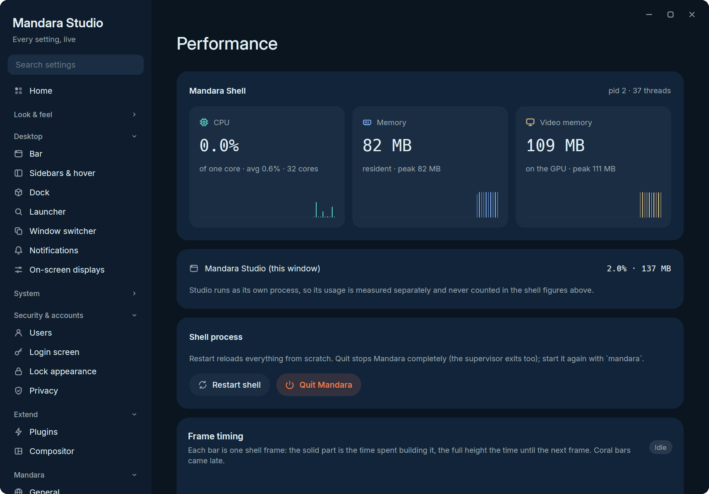

# Performance

A desktop shell runs all day, so Mandara treats memory and power like a
feature. Measured on the optimized release build, on a 4K display at scale
1.5 under MangoWM, with the bar, sidebar, notifications, wallpaper and depth
clock running, once the shell has settled (it hands freed memory back to the
system every 30 seconds, the program code it only needed to start 8 seconds
after it starts, and code it hasn't touched lately every 10 minutes):

| Resident memory (RSS) | Video memory | Idle CPU | Threads |
|---|---|---|---|
| **72–78 MiB** (about 26 MiB of it the shell's own memory; the rest is program code and shared libraries) | **170–185 MiB** | ~0.1 % of one core | 31 |

Opening a panel hits every frame at 144 Hz on that 4K display (release
build, measured: 0 late frames, a median of 6.06 ms per frame).
Studio → Performance shows the shell's own CPU, memory, video memory and
frame times live, so you can check these numbers on your machine (Studio
runs as its own process and is measured separately):

  
   
  Studio → Performance in the demo session the screenshots are taken in.

That's a whole GPU-rendered, spring-animated desktop (bar, dock, launcher,
sidebar, notifications, wallpaper and widgets) in less memory than a single
browser tab, without trading away speed. It took deliberate work at every layer:

- **Hand-tuned glibc malloc.** We benchmarked mimalloc v2 and v3, jemalloc
  and glibc on the real shell. Tuned glibc won: at most 2 malloc arenas
  (`M_ARENA_MAX`) instead of one per thread, and a `malloc_trim(0)` every 30
  seconds that hands freed pages back to the kernel. It needs no C
  allocator in the build. The other allocators stay one cargo feature away
  ([numbers](releasing.md#memory-allocator)).
- **A patched GPUI renderer.** `vendor/gpui_wgpu` is GPUI's wgpu renderer
  with six Mandara patches ([details and measurements](../vendor/gpui_wgpu/MANDARA-PATCHES.md)):
  path and anti-aliasing textures allocated lazily and sized to what is
  actually drawn (stock GPUI reserves ~166 MiB for a 4K surface that may
  never draw a path), configurable MSAA, small initial glyph/icon atlases
  that grow on demand, GPU suballocation blocks capped at 16 MiB instead
  of 64 MiB kept forever, and shaders and render pipelines built once and
  shared by every window instead of once per window. A full-screen shell
  surface needs about half the video memory of stock GPUI.
- **A wallpaper that costs no video memory.** The desktop background is
  painted in software on a separate thread into shared-memory buffers.
  Crossfades run inside the compositor (`wp_alpha_modifier_v1`), and once
  the compositor has the pixels, the shell keeps no copy. That removed a GPU
  window per display, about 130 MiB of swapchain at 4K.
- **A lean start.** The code and driver pages only start-up needs are
  let go 8 seconds after the shell starts instead of 45, the fallback fonts
  for other scripts load one face each until text in that script appears
  (2 font files at start instead of 52 for an English desktop), and a
  wallpaper is placed on screen without full-size copies of itself
  ([numbers](releasing.md#start-up-memory)). A wallpaper or depth mask
  smaller than the screen is scaled up one row at a time, not through a
  full-size float copy: a wallpaper switch on a 4K display peaks 80 MiB
  lower ([numbers](releasing.md#settled-memory-video-memory-and-residue)).
- **Few threads.** All D-Bus, network and audio services share one tokio
  runtime with two workers, and GPUI's worker pool is capped at four.
- **Nothing ticks off screen.** Spectrum, graphs, timers and network
  sampling run only while you can see them.
- **Optimized releases.** Fat LTO, one codegen unit, stripped symbols, and
  `cargo native` for your exact CPU.

## Wallpaper depth model

The depth clock's *Model* mode ([details](plugins.md#wallpaper-depth)) runs
Depth Anything V2 Small once per wallpaper, in a helper process the shell
starts and forgets, so none of its memory is ever the shell's. Measured on a
Ryzen 9 9950X while the machine was busy compiling (load around 50), with
the optimized development build in the demo sandbox; the release build's
in-process model run took about 2.2 s per 4K wallpaper:

| | 4K JPEG | 8K PNG |
|---|---|---|
| Helper CPU time (one core, decode + model + write) | under 6 s | under 7 s |
| Helper wall time at idle priority | 4–17 s | 35 s |
| Helper peak memory | under 220 MiB | under 360 MiB |
| Shell after the run | no new threads, no helper left, resident memory back under its level before the run | same |

The wall time is mostly waiting: at `SCHED_IDLE` the helper only gets CPU
time nothing else wants. The download is 27 MB, once. A cached mask makes
every later start and wallpaper switch free; changing the clock depth
re-cuts the cached depth map without running the model.
