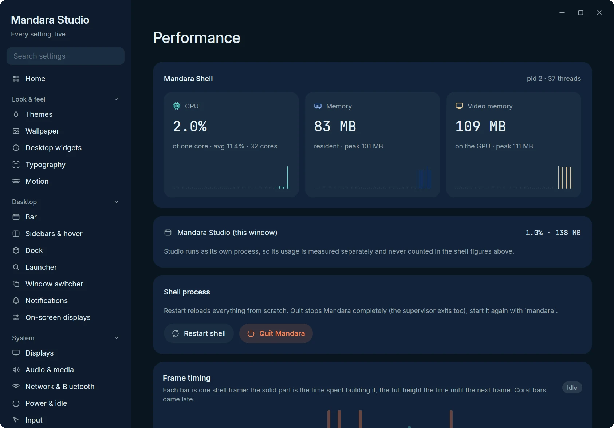

# Performance

Mandara's resource use depends on the display size, graphics driver, widgets
and open panels. Settled memory and startup peaks are different measurements.
The goal of staying below 100 MiB throughout startup is not met yet.

## Current release-profile measurements

Measured on 2026-11-06 with source `4b60bd5e4541` (the code merged for
v0.19.0), the normal optimized release profile, fat LTO and the tuned system
allocator. Each run used a fresh private home and the same warm shader cache.
The headless output was 3840 × 2160 at scale 1.5, with 23 active plugins out
of 77 registered. The fixture exercised the bar, sidebar, selected panels,
twenty notification-history entries and theme edits. The private session ran
offline with its system bus disabled, so real network, power and Bluetooth
services were not exercised. Integrations had no configured accounts or feeds;
this does not measure every plugin or an active video wallpaper.

| Measurement | Result |
|---|---|
| Startup peak RSS, three runs | Under 175 MiB |
| Settled bar RSS | Under 50 MiB |
| RSS after the panel and theme workload | Under 100 MiB |
| Video memory after that workload | Under 210 MiB |
| Threads after that workload | 27 |
| Typical sampled frame-build time | About 0.1 ms |

These figures include program code and shared libraries resident in the shell
process. Studio runs separately. The headless output was configured for
144 Hz; this is not verification on a physical 144 Hz display. Frame-build
timing measures CPU work and does not establish a display refresh-rate limit.
The stricter resource-check limits for RSS and anonymous memory still fail
after this workload; thread and idle-CPU checks pass.

## Earlier desktop measurement

The 2026-10-29 optimized build measured under 80 MiB RSS and under 190 MiB
video memory, about 0.1% idle CPU and 31 threads on a 4K MangoWM desktop at scale
1.5 with wallpaper, depth clock, bar, sidebar and notifications. Its sampled
frame builds were typically 0.10 ms and 0.22 ms at the 95th percentile.
That is a historical result from a different build and setup, not evidence
of an improvement or a current upper bound.

Studio → Performance shows the shell's own CPU, memory, video memory and
frame times live, so you can check these numbers on your machine (Studio
runs as its own process and is measured separately):

  
   
  Studio → Performance in the demo session the screenshots are taken in.

The bar, dock, launcher, sidebar, notifications, wallpaper and widgets share
resources through these controls:

- **Hand-tuned glibc malloc.** We benchmarked mimalloc v2 and v3, jemalloc
  and glibc on the real shell. Tuned glibc won: at most 2 malloc arenas
  (`M_ARENA_MAX`) instead of one per thread, and a `malloc_trim(0)` every 30
  seconds that hands freed pages back to the kernel. It needs no C
  allocator in the build. The other allocators stay one cargo feature away
  ([numbers](releasing.md#memory-allocator)).
- **A patched GPUI renderer.** `vendor/gpui_wgpu` is GPUI's wgpu renderer
  with six Mandara patches ([details and measurements](../vendor/gpui_wgpu/MANDARA-PATCHES.md)):
  path and anti-aliasing textures allocated lazily and sized to what is
  actually drawn (stock GPUI reserves ~166 MiB for a 4K surface that may
  never draw a path), configurable MSAA, small initial glyph/icon atlases
  that grow on demand, GPU suballocation blocks capped at 16 MiB instead
  of 64 MiB kept forever, and shaders and render pipelines built once and
  shared by every window instead of once per window. A full-screen shell
  surface needs about half the video memory of stock GPUI.
- **A wallpaper that costs no video memory.** The desktop background is
  painted in software on a separate thread into shared-memory buffers.
  Crossfades run inside the compositor (`wp_alpha_modifier_v1`), and once
  the compositor has the pixels, the shell keeps no copy. That removed a GPU
  window per display, about 130 MiB of swapchain at 4K.
- **A lean start.** The code and driver pages only start-up needs are
  let go 8 seconds after the shell starts instead of 45, the fallback fonts
  for other scripts load one face each until text in that script appears
  (2 font files at start instead of 52 for an English desktop), and a
  wallpaper is placed on screen without full-size copies of itself
  ([numbers](releasing.md#start-up-memory)). A wallpaper or depth mask
  smaller than the screen is scaled up one row at a time, not through a
  full-size float copy: a wallpaper switch on a 4K display peaks 80 MiB
  lower ([numbers](releasing.md#settled-memory-video-memory-and-residue)).
- **Few threads.** D-Bus, network and audio services share one service
  runtime with two workers, and GPUI's worker pool is capped at four.
- **Nothing ticks off screen.** Spectrum, graphs, timers and network
  sampling run only while you can see them.
- **Optimized releases.** Fat LTO, one codegen unit, stripped symbols, and
  `cargo native` for your exact CPU.

## Wallpaper depth model

The depth clock's *Model* mode ([details](plugins.md#wallpaper-depth)) runs
Depth Anything V2 Small once per wallpaper, in a helper process the shell
starts and forgets, so none of its memory is ever the shell's. Measured on a
Ryzen 9 9950X while the machine was busy compiling (load around 50), with
the optimized development build in the demo sandbox; the release build's
in-process model run took about 2.2 s per 4K wallpaper:

| | 4K JPEG | 8K PNG |
|---|---|---|
| Helper CPU time (one core, decode + model + write) | under 6 s | under 7 s |
| Helper wall time at idle priority | 4–17 s | 35 s |
| Helper peak memory | under 220 MiB | under 360 MiB |
| Shell after the run | no new threads, no helper left, resident memory back under its level before the run | same |

The wall time is mostly waiting: at `SCHED_IDLE` the helper only gets CPU
time nothing else wants. The download is 27 MB, once. A cached mask makes
every later start and wallpaper switch free; changing the clock depth
re-cuts the cached depth map without running the model.

Clipboard snapshots share immutable history between the service, panels and
launcher. Editing history creates a private copy; simply opening a panel does
not duplicate its text. Window previews transfer their pixel buffers to the
renderer and release closed-window images on the existing window-list events.

Snipping and eyedropper overlays reuse the captured frame instead of retaining
both RGBA and BGRA copies. Public login widgets similarly keep one painted CPU
buffer. GPUI uploads borrow those pixels directly until wgpu copies them into
its own staging storage. Native renderer features select Vulkan and GLES;
browser shader translation is excluded from Linux builds. These changes keep
the existing image resolution and rendering quality.

## Plugin view allocations

Clipboard rendering uses one layout for row previews and keyboard selection. Its search cache compares
borrowed keys and reuses index storage tied to the immutable history snapshot;
row event handlers clone their target and shared UI handle.
Media seek controls retain their geometry with the gesture state, separately for
panel and sidebar views. Network charts borrow the sampler's history rather
than copying its samples when labels change. Prayer times keep six time
labels in an array and resolve settings once per config, language or UTC-offset
change; selecting the surrounding prayers traverses the existing schedules.
Album art, sharing thumbnails and dock previews consume resized image buffers;
their dimensions, filters and pixel output stay the same. Temperature rows
borrow paired reading and label slices, including the partial last row.

`cargo test -p mandara-ui --test plugin_allocations -- --nocapture` compares
the former temporary expressions with warm state reuse on the test thread.
It reports allocation calls and requested bytes, not process RSS. Frame and
interaction speed still need matched release measurements before describing a
performance improvement.
