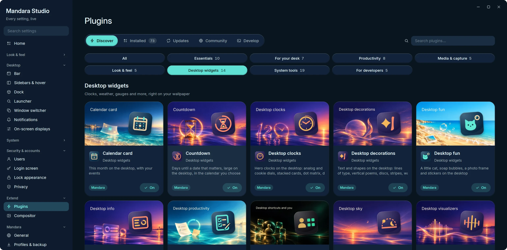
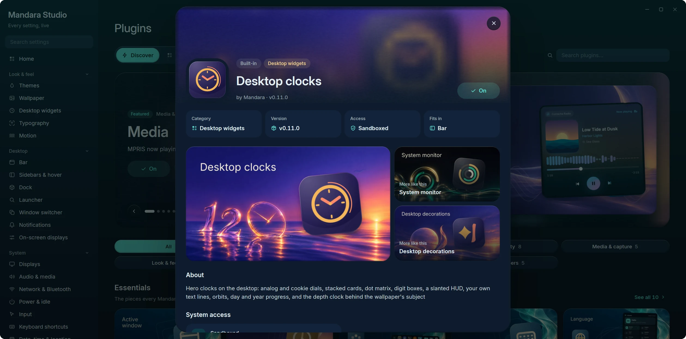

# Plugins

Everything in Mandara is a plugin: every bar item, panel and sidebar card.
Studio keeps the two kinds apart: **Mandara plugins** are first-party,
bundled and updated with the shell; **third-party plugins** come from the
marketplace, your own folders or your distribution, and run sandboxed.

Studio → Plugins is a store: **Discover** opens on a featured hero over the
plugins' cover art and curated shelves (Essentials, For your desk,
Productivity, Media & capture, System tools, New & updated, Community
picks), with one search and filter chips; every card has a one-click
**Get / On** button. Each plugin has a product page with its art, what it
may access, its settings and where it fits. **Installed**, **Updates**,
**Community** (the GitHub marketplace) and **Develop** (the authoring
handbook) sit beside it.

Home Assistant and Phone Connect keep their data cached while enabled; Feeds
keeps only unread counts and loads its history while its panel is open.
Reddit keeps posts and comments only while its panel is open and for a
minute and a half after it closes; its pictures go as soon as it closes.
Switching one off clears its snapshots, and a late refresh cannot restore them.
Article read history stays on disk. An explicit home or device action already
running can finish; disabling the plugin prevents a follow-up refresh.

<table>
<tr>
<td width="50%" valign="top"> <b>Discover</b>: the desktop widget plugins and their painted covers</td>
<td width="50%" valign="top"> <b>Product page</b>: art, more like this, permissions and settings</td>
</tr>
</table>

The 81 first-party plugins (45 of them ship switched off, marked *opt-in*):

| Plugin | What it does |
|---|---|
| **Session** | Power and session menu |
| **Launcher** | Application launcher (Super+Space) |
| **Workspaces** | Tags / workspaces with their apps |
| **Active window** | Focused window title |
| **Clock** | Time, date and calendar |
| **Keyboard layout** | The active keyboard layout; click to switch |
| **Language** | Switch the interface language instantly |
| **Media** | MPRIS now playing and controls |
| **Prayer times** | Islamic daily prayer times and countdown *(opt-in)* |
| **Jannah** | A gentle daily reminder of Jannah: verses of the Qur'an and hadith from Sahih al-Bukhari and Sahih Muslim, their meaning in your language, and one good step for today, in the bar, the sidebar or on the desktop *(opt-in)* |
| **Qur'an** | Read the whole Qur'an with its meaning in your language and listen to it recited ayah by ayah, keep your place, your bookmarks and your khatm; the text downloads only once you turn it on *(opt-in)* |
| **Hadith** | A library of the hadith collections (Bukhari and Muslim, and the Sunan when you want them) with grades, a hadith of the day, search and bookmarks; collections download only once you turn it on *(opt-in)* |
| **Resources** | CPU, memory and disk usage |
| **Mini stats** | CPU, memory, network, temperature and battery as compact numbers in the bar *(opt-in)* |
| **Process hunter** | Find running processes by name or PID and end them | *(opt-in)*
| **Drives** | Mounted filesystems and removable drives: mount, unlock and safely remove | *(opt-in)*
| **Containers** | Docker and Podman containers: status, live usage, logs and controls | *(opt-in)*
| **Services** | systemd units: failed alerts, start, stop, enable and journal | *(opt-in)*
| **Power** | Power profiles, battery health and charge history |
| **Updates** | Pending package updates from pacman, the AUR, APT, DNF, Zypper and Flatpak | *(opt-in)*
| **Network** | Wi-Fi and wired connectivity |
| **Bluetooth** | Bluetooth devices |
| **Audio** | Output/input selection, volume and microphone |
| **Quick settings** | Toggles for the sidebar |
| **Screenshot** | Region, window and screen capture, and screen recording (GPU Screen Recorder, wf-recorder or the built-in AV1 encoder) with pause, sound and recent recordings |
| **Clipboard** | Clipboard history sorted by kind, with collections |
| **Main menu** | Right-click empty bar space |
| **Notifications** | Notification center with history and do-not-disturb |
| **Privacy** | Shows when apps use your microphone, camera or screen | *(opt-in)*
| **To-do** | Tasks grouped into lists, for the sidebar and bar | *(opt-in)*
| **Notes** | Markdown notes in topics, saved as .md files | *(opt-in)*
| **Pomodoro** | Focus timer with breaks and session tracking | *(opt-in)*
| **Sudoku** | The number puzzle at four levels, with notes, highlights, hints, undo and a timer, in the bar and on the desktop *(opt-in)* |
| **2048** | Slide and merge tiles to 2048 on a 3 × 3 to 6 × 6 board, with smooth tiles, best scores and undo, in the bar and on the desktop *(opt-in)* |
| **Weather** | Animated current conditions, hourly and 5-day forecast |
| **Wallpaper** | Wallpaper picker and desktop background |
| **Wallpaper depth** | Draws the wallpaper's subject over the desktop clock and widgets: hand-tuned, or with a small depth model downloaded on demand *(core)* |
| **Wallhaven** | Search and download wallpapers from wallhaven.cc right in the wallpaper picker *(opt-in)* |
| **Wallpaper generator** | Procedural wallpapers and seamless AV1 video loops at any size up to 8K: twelve styles, every variable adjustable, on a schedule if you want *(opt-in)* |
| **System tray** | Status icons and menus of background apps |
| **World clock** | Cities around the world with daylight and a meeting planner | *(opt-in)*
| **Network speed** | Live upload and download rates, public IP and a speed test | *(opt-in)*
| **Color picker** | Pick colors from the screen, with formats, tonal ramps and contrast | *(opt-in)*
| **Authenticator** | Two-factor codes (TOTP / HOTP) stored in your keyring | *(opt-in)*
| **Soundscapes** | Ambient sea, rain, wind, café, fire and noise — synthesized live | *(opt-in)*
| **Radio** | Internet radio: curated stations by genre, your own stations and favourites, with live now-playing *(opt-in)* |
| **Dock** | A macOS-style dock: pinned, running and recent apps, stacks and the Trash, with magnification and auto-hide *(opt-in)* |
| **App installer** | Install apps by dropping AppImages, Flatpaks, archives or packages on the dock or Studio | *(opt-in)*
| **Screen time** | How long you spend in each app, per day, with limits *(opt-in)* |
| **Cursor themes** | Install, preview and apply cursor themes, live, with size and hiding options *(opt-in)* |
| **Shortcuts cheatsheet** | Every keyboard shortcut, Mandara's and your compositor's, in one searchable sheet (`mandara msg keybinds toggle`) *(opt-in)* |
| **Task progress** | A bar ring that scripts, long builds and AI agents report progress to (`mandara msg progress set build 40%`) *(opt-in)* |
| **Eye breaks** | Gentle 20-20-20 reminders that count only active time and wait while a fullscreen app has focus *(opt-in)* |
| **Presentation mode** | One switch for talks and screen sharing: do not disturb, keep awake and hidden desktop widgets, all put back afterwards *(opt-in)* |
| **Translator** | Translate text with DeepL or your own LibreTranslate server; text is sent only when you ask *(opt-in)* |
| **Phone Connect** | Paired KDE Connect devices: battery, ring, ping and explicitly send clipboard text *(opt-in)* |
| **Feeds** | A reader for RSS, Atom and JSON feeds: one timeline, folders, saved articles, search, a clean reader view, starter feeds and OPML, and a sidebar card with your newest unread articles *(opt-in)* |
| **Reddit** | Browse your communities, posts and comment threads in a panel (cards, compact or grid) and a sidebar card: limited mode on Reddit's public feeds out of the box, full mode with your own installed-app client id; NSFW hidden and spoilers covered by default *(opt-in)* |
| **Home Assistant** | Your real home states and favourites, with controls for lights, switches, fans, scenes, scripts and buttons *(opt-in)* |
| **Share to phone** | Clipboard text, a screenshot or a file, served once on your network behind a QR code *(opt-in)* |
| **Tailscale** | Your tailnet: this device, peers, direct or relayed paths, exit nodes, connect and disconnect *(opt-in)* |
| **Uptime monitor** | Watches your sites and services (HTTP or TCP) and tells you when one goes down *(opt-in)* |
| **Local AI** | Ollama models in memory and on disk: GPU memory, unload timers, load and unload *(opt-in)* |
| **Listening ports** | Which apps listen on which ports, who can reach them, open in the browser or end them *(opt-in)* |
| **Git repositories** | Your local repositories: branch, uncommitted changes and unpushed commits, with a terminal a click away *(opt-in)* |
| **CI status** | GitHub Actions runs of your repositories, with a notification when a run finishes *(opt-in)* |
| **Crash reports** | Apps that crashed this week (systemd-coredump), with the report and a debugger a click away *(opt-in)* |
| **Desktop clocks** | Hero clocks on the desktop: analog and cookie dials, stacked cards, dot matrix, digit boxes, a slanted HUD, your own text lines, orbits, day and year progress, and the depth clock |
| **System monitor** | Live readings on the desktop as a column with graphs, ring or wavy gauges, segmented meters, tall bars or thermal arcs |
| **Desktop decorations** | Text and shapes on the desktop: lines of type, vertical poems, discs, stripes, waves and frames |
| **Desktop visualizers** | Audio visualizers on the desktop (bars, a mirrored strip, a wave, a ring or an LED meter), even behind the wallpaper's subject |
| **Now playing card** | Album art, progress and synced lyrics on the desktop while music plays, plus a turning record, a pocket player, a shaped or halftone cover, a side pill and lyrics |
| **Calendar card** | This month on the desktop, with your events, plus a painted month, a week strip, what's coming up and a date tile |
| **Desktop weather** | The weather and the days ahead on the desktop, a sentence about the sky, a disc and an hourly curve |
| **Desktop world clock** | The time in other cities on the desktop |
| **Countdown** | Days until (or since) a date, on the desktop |
| **Desktop productivity** | Your to-dos, a sticky note, the focus timer, a quote and notebook tabs on the desktop; tick tasks and run the timer right there |
| **Desktop sky** | The sun's arc from sunrise to sunset, tonight's moon and a globe lit where the sun is now |
| **Desktop shortcuts and you** | A profile card, launch tiles for apps, folders and links, quick toggles, volume and brightness sliders and your theme's palette |
| **Desktop fun** | A little cat, soap bubbles, a photo frame and stickers on the desktop |
| **Desktop info** | A machine card, screen time, the next prayer, a search field, an "at a glance" line, your GitHub year, exchange rates, AI usage and your Steam games (the online ones fetch only once you switch that on) |

See [Connected plugins](integrations.md) for setup, API keys and privacy.

The desktop widget plugins draw nothing until you place one of their
widgets (Studio → Desktop widgets, or right-click the desktop → Add
widget); switching one off hides its widgets until you switch it back on.
Each has its own logo and a painted store cover; screenshots of the
widgets themselves are in [Your desktop](desktop.md#desktop-widgets).

**Sidebar cards** come from Quick settings, Weather, Notifications, Media,
Audio, Resources, To-do, Notes, Pomodoro, Prayer times, Jannah, the Qur'an,
Hadith, Radio, Feeds, Reddit, Sudoku and 2048 (and any third-party plugin).
Every one of them is in Studio → Bars → Sidebars → **Tabs** → *Add a widget*,
under *Add to sidebar* on its page in Studio → Plugins, and in
`mandara msg sidebar tab widget add <tab> <id>`. Placing a card switches its
plugin on; switching a plugin off hides its card, which stays on its tab
and comes back when you switch the plugin on again. Switching a plugin on
by itself doesn't add its card to a tab, so you choose where it goes.

Every Mandara plugin can be **switched off**, which stops everything it
runs (bar item, sidebar card, launcher entries and any background polling),
or **removed**: taken out of the bar and sidebar and parked under
*Studio → Plugins → Removed Mandara plugins* until you restore it to where it
was (`mandara msg plugins disable|enable|remove|restore <id>`). The
launcher, session menu, main menu and wallpaper depth are core and stay on
(the depth effect itself has its own switch in Studio → Wallpaper).

Mandara is **composable, not minimal**: a fresh install turns on a calm,
complete desktop (workspaces, active window, clock, keyboard layout and
language, network, Bluetooth, audio, tray, notifications, power, resources,
quick settings, media, weather, wallpaper, screenshot and clipboard, plus
the core launcher, session and main menus) and everything else ships
switched off: the dock, mini stats, screen time, prayer times, the wallpaper
generator, Wallhaven, cursor themes, containers, services, drives, updates,
the process hunter, the authenticator, soundscapes, the radio, world clock, network
speed, the color picker, Pomodoro, notes, to-do, privacy, the app
installer, the shortcuts cheatsheet, task progress, eye breaks,
presentation mode, share to phone, Tailscale, the uptime monitor, local
AI, listening ports, Git repositories, CI status, crash reports, Reddit, Sudoku, 2048, Jannah, the Qur'an and Hadith.
Turn any of them on in Studio → Plugins or with
`mandara msg plugins enable <id>`. **Upgrading from 0.1 changes nothing you
had:** a config written before these defaults keeps every plugin it had on
(the upgrade writes them into `[plugins] enabled`), Wallhaven stays on if it
was, and cursor themes stay on if you had picked a cursor.

## Games: Sudoku and 2048

Two opt-in games (Studio → Plugins, `mandara msg plugins enable sudoku` /
`2048`, or type *sudoku*, *2048*, *games* or *puzzle* in the launcher and
pick **Turn on**). Each has a bar item with a drop-down panel (put it
in a bar group from its page in Studio → Plugins), a playable sidebar card
(Studio → Bars → Sidebars, or `mandara msg sidebar tab widget add Overview
sudoku`) and a desktop widget (Studio → Desktop widgets → Add, or
right-click the desktop → Add widget) that you play right on the desktop:
click the board to give it the keyboard, click a window or the desktop to
give it back, and Escape lets go too. One game is shared by the panel, the
sidebar card and the widget, on every display.

- **Sudoku** deals a puzzle with exactly one solution at Easy, Medium,
  Hard or Expert. Levels follow the techniques a puzzle needs: Easy needs
  only singles, Medium also pointing and claiming, Hard pairs and triples,
  Expert more than that. The same seed always deals the same puzzle
  (`mandara msg sudoku new hard 42`). Arrows move, 1–9 write, Shift+digit
  or **N** switches to pencil marks, Backspace erases, **H** gives a hint,
  Ctrl+Z / Ctrl+Y undo and redo; the mouse and touch work with the number
  pad and tools under the board. The timer counts only while the panel is
  open, or while you play on the widget or the sidebar card (it stops after
  a minute and a half without a key or click there, or when the widget lets
  go of the keyboard). Settings: level, highlights (row,
  column and box; the same digit), conflicts, the mistake counter, timer,
  hints, clearing notes automatically, the accent colour and the time in
  the bar.
- **2048** slides with the arrows or WASD, a mouse drag or a finger swipe;
  U or Ctrl+Z takes back one move. Tiles glide and pop on the shell's
  springs only while they move (they jump with reduced motion or
  Animations off). Reach 2048 to win, then keep going or start again.
  Settings: board size (3–6, used for the next game), animations, undo,
  the accent colour and the score in the bar.

Both keep the game in progress (with Sudoku's notes and undo history),
your best times, scores and statistics in
`~/.local/state/mandara/games/`, written a moment after you play, never on
every move. A file that can't be read is moved aside as `*.corrupt` and
the game starts fresh. Nothing runs while neither game is on screen; the
widgets use the cards' small surfaces and draw only when something
changes. `mandara msg sudoku status|new|select|digit|note|erase|hint|undo|redo`
and `mandara msg 2048 status|new|move|undo|continue` play them from a
script.

## Jannah, Qur'an, Hadith and Prayer times

These four opt-in plugins share these things (the last two are for Jannah, the Qur'an and Hadith):

- **Their own language.** Each has a *Language* setting in Studio →
  Plugins (`language`: *Follow Mandara*, or one of Mandara's twenty
  languages; `mandara msg <jannah|quran|hadith|prayer> language ar`). Its
  panel, bar item, sidebar card and desktop widgets, the meanings and
  prayer names it shows, and its reading direction (Arabic reads right to
  left) follow it, while the rest of the shell keeps its own. A meaning
  missing in that language downloads the way it always does (the Qur'an's
  translation, a hadith collection's meaning); what was downloaded for
  another language stays.
- **A peek.** *Previous* / *Next* under today's item shows another one
  without marking anything: the coming days' Jannah steps (only today's
  step can be marked done), the Qur'an's ayah of the day and the ayahs
  after your place (your place and khatm don't move), Hadith's coming
  hadith (nothing is marked read), and Prayer times' other days. *Back to
  today* returns; a peek is forgotten when the shell restarts. From the
  command line: `jannah step peek`, `quran peek`, `hadith peek`,
  `prayer peek`.
- **A fresh Jannah reminder every time you open it.** Each time the
  Jannah panel or the sidebar opens, it shows a verse or hadith picked at
  random from the ones you chose (Studio → Plugins → Jannah → *Reminders
  from*); a panel and a sidebar card open together show the same one.
  *Next* on the reminder shows another fresh one, and *Previous* goes back
  through the ones you saw (`jannah next`, `jannah prev`; `jannah peek`
  looks at another without changing it, `jannah peek -1` at the one
  before). The reminder shows its own number among the ones it is drawn
  from, such as *#104 of 230*: the same verse or hadith always has the
  same number (`jannah today` reports it as `number` and `of`). The
  desktop widgets keep theirs for the day (or the hour, with *New
  reminder*). Today's step stays one step a day.
- **Nothing you just read comes straight back.** *Next* never shows the
  item you were on. A fresh Jannah reminder is never one of the last 16
  you saw (a third of the items for a very small choice; two items simply
  alternate, one stays), and Jannah remembers them in
  `~/.local/state/mandara/jannah-recent.json`, so a restart doesn't bring
  them back either. Its desktop widgets, which skip items too long for
  them, avoid those too. Hadith's rotation walks every hadith once per
  round in a shuffled order, and a new round never starts with any of the
  previous round's last eight. The Jannah and Hadith readers stop at
  either end of a list instead of wrapping round.
- **Every word, one click away.** The sidebar cards, the Hadith panel's
  hadith of the day and Jannah's step evidence fold long text to a few
  lines, ending after a whole word (never inside one, never between a
  letter and its vowel marks). *Read more*, or a click on the text,
  unfolds the card in place, and *Show less* folds it back; both work from
  the keyboard (Tab, then Enter or Space). *Open in the reader* opens the
  item itself, with a hadith's chain and grades. On the desktop, a widget
  that had to shorten its item says *Read more*, and a click opens that
  item in its plugin's reader (`mandara msg desktop widgets press <widget>
  read:<jannah|quran|hadith>:<ref>` does the same).

**Copy a complete card.** In Qur’an, Hadith and Jannah, the **Image** button
beside text copy puts the current entry on the clipboard as a PNG, using its
colours, ornaments and configured fonts. It includes every word, the reference,
and any meaning or chain currently shown, even when you have to scroll to read
it in the panel. Text copy remains a separate action. The success message
appears only after the clipboard accepts the image; oversized entries report an
error instead of being cropped. Closing the panel cancels unfinished preparation.

The same action is available as `quran copy-image 2:255`,
`hadith copy-image bukhari 1` and `jannah copy-image 89:30`. These explicit
references export the entry using the plugin’s reading settings; the Qur’an
command includes its meaning in Study mode. No screenshot or other desktop
content is copied.
**Qur'an recitation.** Studio → Plugins → Qur'an → *Reciter* includes
Yasser Al-Dossary, Abdulrashid Sufi and Abdul Basit Abdul Samad. All three
recordings use Hafs from Asim, matching the reader's text. Yasser is the
default; a saved Alafasy or Al-Ajamy choice falls back to Yasser without
rewriting your settings. The other available choices stay as you selected
them.

Yasser's and Abdul Basit's ayahs come from
[EveryAyah](https://everyayah.com/recitations_ayat.html), using its 128 kbit/s
Yasser and 192 kbit/s Abdul Basit Murattal recordings.
Sufi uses [MP3Quran's Hafs recording and official ayah timings](https://www.mp3quran.net/eng/timing-api):
the whole surah downloads before its first ayah plays, with progress in
the panel. A long surah takes more disk space and time to download than
one ayah. Pause or stop cancels an unfinished download; completed files
stay available offline. Chapters decode one packet at a time, and moving
to the next ayah reuses the open chapter. Offline playback needs both the
recording and its timing table. *Remove* removes the text, meanings
and cached recitations as before.

**The adhan.** Prayer times can play the call to prayer at each of the
five prayers (Studio → Plugins → Prayer times → *Adhan at prayer times*,
off by default). Nothing ships with Mandara: turning it on downloads the
recording once into `~/.local/share/mandara/prayer/adhan/` (about 1.8 MB,
with progress and *Try again*); turning it off keeps it, and *Remove*
(`mandara msg prayer adhan remove`) deletes it. It plays on its own stream
at the system volume, once per prayer and only on time (a prayer missed
while the computer slept is never played late), stays silent during do
not disturb and presentation mode, and stops from its notification, the
panel or `mandara msg prayer adhan stop`. The recording is
["Beautiful adhan"](https://commons.wikimedia.org/wiki/File:Beautiful_adhan.ogg)
by Adam-synagda, released into the public domain (CC0 1.0) on Wikimedia
Commons, fetched as Commons' MP3 rendering; the same recording plays at
Fajr.

## Radio

The **Radio** plugin (opt-in) plays internet radio in pure Rust: MP3, AAC
and Ogg Vorbis streams, `.pls` and `.m3u` playlists and redirects, with the
song title the station sends (ICY metadata). It plays to your sound server
as "Mandara Radio" and offers itself to media keys, the media panel and
other apps' controls (MPRIS), so the media island and the lock screen show
what plays.

- **Stations.** It ships about seventy stations on thirteen shelves (News,
  Talk, Pop, Rock, Jazz, Classical, Electronic, Lo-fi & chill, Ambient,
  World, Arabic, Qur'an recitation and Kids). Every one is a public, free
  stream, and each was checked to connect and play on the date in the
  source (`mandara-services/src/radio/station.rs`). Search them by name,
  shelf, country or language, tap the heart to keep favourites (reorder
  them with *Reorder*), and add your own by address in the *Add* tab:
  Mandara listens for a moment first, so a station that wouldn't play is
  never saved.
- **The panel.** A large now-playing card (the station's art, a live
  badge, the title, format, bitrate and buffer health, and a level meter),
  previous / play / next, a favourite button, a sleep timer that fades the
  sound out, and the volume slider in your chosen slider design.
- **The bar** shows the station's art, a live dot and the title, which
  scrolls only when it doesn't fit and stays still with reduced motion.
  Right-click it to play or pause.
- **The sidebar card** is a compact player: the station's art, what plays
  with a live dot, a favourite heart, previous / play / next through your
  favourites and the volume in your slider design. Put it on any sidebar tab
  in Studio → Bars → Sidebars → **Tabs** (or
  `mandara msg sidebar tab …`).
- **The directory** (off until you switch it on) searches
  [radio-browser.info](https://www.radio-browser.info) from the *Stations*
  tab. Nothing is sent until you press its search button; results are kept
  for ten minutes, then forgotten.
- **When it drops.** A stream that drops reconnects on its own, waiting a
  little longer each time, up to the number of tries you set; a wrong
  address or an unsupported stream says why instead of retrying.
- **Resources.** Nothing runs until you press play. While a station plays,
  two threads stream and decode it through a buffer of a few seconds
  (sized from the station's bitrate, so it never grows); pausing or
  stopping ends them and frees the buffer. HLS (`.m3u8`) and Opus streams
  aren't supported yet.

Its settings (Studio → Plugins → Radio) cover the usual station and
resuming at login, volume per station, reconnecting and the buffer, the
sleep timer's length, notifications when the song changes, media keys, the
bar item's style, the scrolling title's speed and width, the station art's
colours, the level meter and stream details, which shelves appear, and the
directory. Your favourites and stations live in
`~/.local/state/mandara/radio.toml`. Commands: `mandara msg radio …`
([commands](commands.md)).

## Wallpaper depth

The depth clock's subject (the part of your wallpaper drawn *over* the
clock and the widgets behind it) comes from the core **Wallpaper depth**
plugin, in one of two modes (Studio → Wallpaper → Depth clock, or
`[wallpaper.depth] mode`):

- **Hand-tuned** (the default): Mandara's own sky / subject finder, pure
  Rust, no download. It is conservative and skips wallpapers it isn't sure
  about.
- **Model**: [Depth Anything V2 Small](https://huggingface.co/onnx-community/depth-anything-v2-small)
  (Apache-2.0), a 27 MB quantized ONNX file run by the pure-Rust `tract`
  engine. It is downloaded once, checksum-verified, into
  `~/.local/share/mandara/models/` when you pick this mode (or press
  Download, or run `mandara msg depth download`); the binary never ships
  it. It orders the whole picture from far to near, so it also lets you
  choose how deep the clock sits: automatically per wallpaper (where the
  far backdrop ends), or with the **Clock depth** slider.

Picking one turns the other off. A mask you make yourself
(`~/.local/share/mandara/depth_masks/<wallpaper name>.png`) wins over both.
**Place the clock** (`mandara msg depth place-clock`) moves the clock to
where the subject rises into its digits.

The model never runs inside the shell. For each new wallpaper the shell
starts a short-lived helper (`mandara depth-worker`) at idle priority
(`SCHED_IDLE`, nice 19), single-threaded, with a 1 GiB data cap, a 45 s
CPU budget for the model run, a 60 s CPU cap and a 5-minute wall-clock
limit (at idle priority a busy machine only stretches the run); it runs once on a
518 × 518 downscale, writes a small depth map to
`~/.cache/mandara/depth_masks/` and exits, so its memory goes back to the
system at once. Masks and depth maps are reused until the wallpaper file
changes; nothing runs at idle and nothing polls. Measurements are in
[performance](performance.md#wallpaper-depth-model).

## The plugin system

- **Written in Rust, run as WebAssembly.** Third-party plugins compile to a
  WebAssembly component (`wasm32-wasip2`) against a small WIT contract and
  run inside `wasmtime`.
- **Sandboxed.** No files, no network, no environment and no subprocesses.
  Each call has a time budget (100 ms, 1 s for `init`), a plugin can't
  block or sleep, its memory is capped at 64 MiB and its views are capped
  in size. A plugin that traps or crosses a limit is switched off; the
  shell keeps running.
- **Native look for free.** A plugin returns a declarative view tree (rows,
  columns, cards, text, icons, buttons, meters) and Mandara draws it
  with the current theme in every palette, light or dark, right to left in
  Arabic.
- **Settings and permissions.** A plugin declares its settings in
  `plugin.toml`, and Studio builds its settings modal from them. The only
  permission, `commands`, lets it use Mandara's interface (open panels,
  control media and volume, post notifications, add notes and to-dos),
  never commands that run programs or change settings; Studio shows it in
  the plugin's detail modal.
- **Live.** Drop a folder in, rebuild, edit a translation or delete it, and
  Mandara reloads it within about half a second.
- **Translated.** Plugins ship their own locale files; the shell picks the
  right language and translates their views.

## Shipping a plugin

There are two ways to get a plugin to people.

**1. The marketplace (GitHub).** There is no account, server or review queue:

1. Put the plugin in a **public GitHub repository**.
2. Add the repository topic **`mandara-plugin`** (repository → About → ⚙ →
   Topics). That topic is the only thing the marketplace searches for.
3. Publish a **release** with one asset named **`<id>.mandara.tar.gz`**: a
   folder holding `plugin.toml`, `plugin.wasm` and, optionally, `locales/`,
   `icon.png` and `cover.png`.

If the store policy permits it, your plugin is listed in **Studio → Plugins → Community**
(and Discover's *Community picks*), ranked by stars, as soon as GitHub's search picks up the topic.
One click installs it, switches it on and loads it live; updating and
removing are one click too. Forks and pre-release-only repositories count,
and the archive may hold the plugin folder or just its files. Archives are
checked before anything is unpacked: they must match the release's
`SHA256SUMS` when it publishes one, with no paths outside the plugin
folder, no links or device files, at most 64 MB, and the id comes from
`plugin.toml`. A plugin stays with the repository it came from: if that
repository is renamed or handed to another owner, Mandara won't follow it.
Every release then passes a compliance check in the sandbox (well under a
second): a broken, malicious or placeholder one doesn't install, and Studio
marks that version with the reason while still letting you install it
anyway. Run it before you publish with `mandara msg plugins vet <dir>`
([PLUGINS.md](../PLUGINS.md#before-you-publish-compliance-check)).

Community listings also follow the maintained
[store policy](https://github.com/theHamdiz/mandara-store-policy). Rules can
hide an account's plugins or one repository, and can block new installs
and updates. These rules update independently of Mandara releases. They
also apply to direct repository installs and cached update plans;
**Install anyway** only overrides a release's compliance warning.
Installed plugins keep running, and built-in plugins and local folders
are unaffected.

The policy is checked on community browsing and before installs and
updates, with up to a minute of caching and no background polling. If
verification fails, Mandara keeps its last valid rules; after 24 hours
without verification, installs and updates pause. The same limits apply when
another process holds the refresh lock too long; using the cache does not
renew its verification time. If it has never loaded
a valid policy, community browsing pauses too. An empty policy is valid
and allows all repositories. See [Store moderation](../PLUGINS.md#store-moderation)
for the format and cache behavior.

**2. A local folder.** Copy the plugin folder onto the machine:

| Folder | For | Starts |
|---|---|---|
| `~/.local/share/mandara/plugins-dev/<id>/` | plugins you are writing | enabled |
| `~/.local/share/mandara/plugins/<id>/` | plugins you install by hand (and marketplace installs) | off until you enable it |
| `/usr/share/mandara/plugins/<id>/` (any `$XDG_DATA_DIRS`) | distribution packages | off until you enable it |

It appears in Studio → Plugins within a second, no restart needed.
Studio → Plugins → **Develop** shows these folders resolved on your system,
the format and contract of your build, and a **Validate** list explaining
exactly why a plugin didn't load.

→ **[The plugin guide](../PLUGINS.md)**: quick start, the WIT API, views,
settings, translations and a GitHub Actions release workflow.
