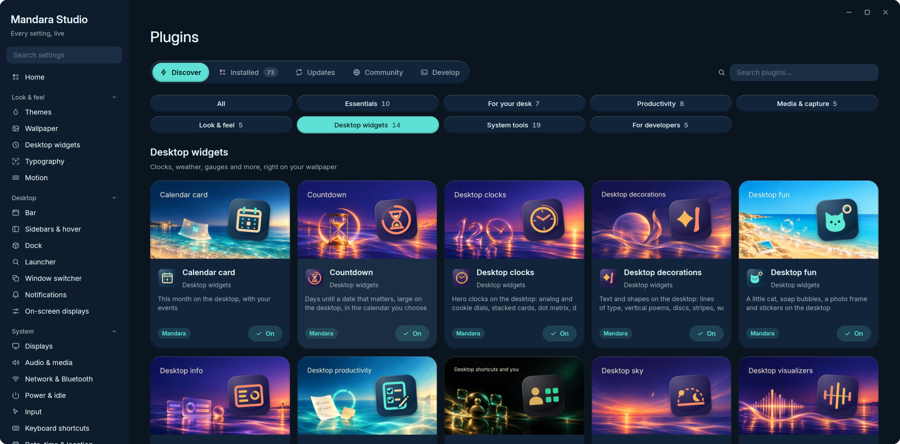
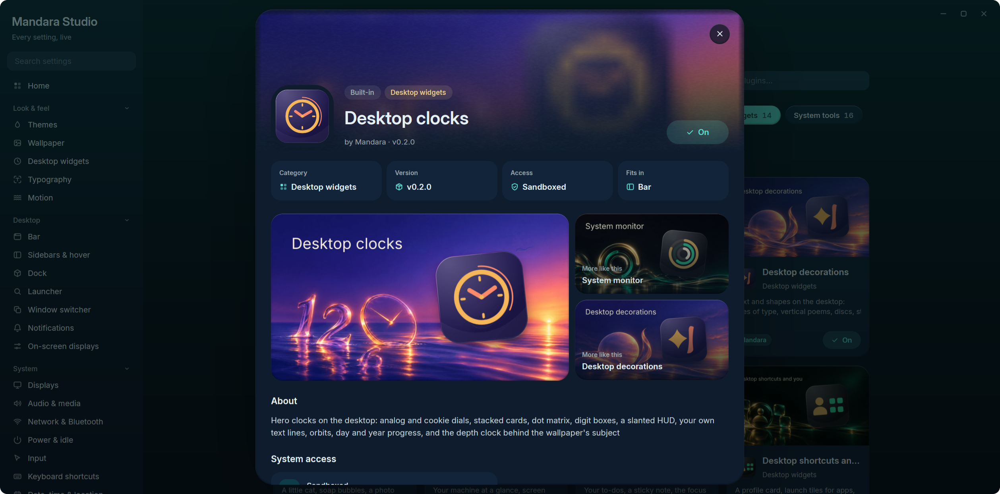

# Plugins

Everything in Mandara is a plugin: every bar item, panel and sidebar card.
Studio keeps the two kinds apart: **Mandara plugins** are first-party,
bundled and updated with the shell; **third-party plugins** come from the
marketplace, your own folders or your distribution, and run sandboxed.

Studio → Plugins is a store: **Discover** opens on a featured hero over the
plugins' cover art and curated shelves (Essentials, For your desk,
Productivity, Media & capture, System tools, New & updated, Community
picks), with one search and filter chips; every card has a one-click
**Get / On** button. Each plugin has a product page with its art, what it
may access, its settings and where it fits. **Installed**, **Updates**,
**Community** (the GitHub marketplace) and **Develop** (the authoring
handbook) sit beside it.

<table>
<tr>
<td width="50%" valign="top"> <b>Discover</b>: featured hero and curated shelves</td>
<td width="50%" valign="top"> <b>Product page</b>: art, permissions and settings</td>
</tr>
</table>

The 43 first-party plugins (22 of them ship switched off, marked *opt-in*):

| Plugin | What it does |
|---|---|
| **Session** | Power and session menu |
| **Launcher** | Application launcher (Super+Space) |
| **Workspaces** | Tags / workspaces with their apps |
| **Active window** | Focused window title |
| **Clock** | Time, date and calendar |
| **Keyboard layout** | The active keyboard layout; click to switch |
| **Language** | Switch the interface language instantly |
| **Media** | MPRIS now playing and controls |
| **Prayer times** | Islamic daily prayer times and countdown *(opt-in)* |
| **Resources** | CPU, memory and disk usage |
| **Mini stats** | CPU, memory, network, temperature and battery as compact numbers in the bar *(opt-in)* |
| **Process hunter** | Find running processes by name or PID and end them | *(opt-in)*
| **Drives** | Mounted filesystems and removable drives: mount, unlock and safely remove | *(opt-in)*
| **Containers** | Docker and Podman containers: status, live usage, logs and controls | *(opt-in)*
| **Services** | systemd units: failed alerts, start, stop, enable and journal | *(opt-in)*
| **Power** | Power profiles, battery health and charge history |
| **Updates** | Pending package updates from pacman, the AUR, APT, DNF, Zypper and Flatpak | *(opt-in)*
| **Network** | Wi-Fi and wired connectivity |
| **Bluetooth** | Bluetooth devices |
| **Audio** | Volume and microphone |
| **Quick settings** | Toggles for the sidebar |
| **Screenshot** | Region, window and screen capture |
| **Clipboard** | Clipboard history with images |
| **Main menu** | Right-click empty bar space |
| **Notifications** | Notification center with history and do-not-disturb |
| **Privacy** | Shows when apps use your microphone, camera or screen | *(opt-in)*
| **To-do** | Tasks grouped into lists, for the sidebar and bar | *(opt-in)*
| **Notes** | Markdown notes in topics, saved as .md files | *(opt-in)*
| **Pomodoro** | Focus timer with breaks and session tracking | *(opt-in)*
| **Weather** | Animated current conditions, hourly and 5-day forecast |
| **Wallpaper** | Wallpaper picker and desktop background |
| **Wallhaven** | Search and download wallpapers from wallhaven.cc right in the wallpaper picker *(opt-in)* |
| **Wallpaper generator** | Procedural wallpapers and seamless AV1 video loops at any size up to 8K: twelve styles, every variable adjustable, on a schedule if you want *(opt-in)* |
| **System tray** | Status icons and menus of background apps |
| **World clock** | Cities around the world with daylight and a meeting planner | *(opt-in)*
| **Network speed** | Live upload and download rates, public IP and a speed test | *(opt-in)*
| **Color picker** | Pick colors from the screen, with formats, tonal ramps and contrast | *(opt-in)*
| **Authenticator** | Two-factor codes (TOTP / HOTP) stored in your keyring | *(opt-in)*
| **Soundscapes** | Ambient sea, rain, wind, café, fire and noise — synthesized live | *(opt-in)*
| **Dock** | A macOS-style dock: pinned, running and recent apps, stacks and the Trash, with magnification and auto-hide *(opt-in)* |
| **App installer** | Install apps by dropping AppImages, Flatpaks, archives or packages on the dock or Studio | *(opt-in)*
| **Screen time** | How long you spend in each app, per day, with limits *(opt-in)* |
| **Cursor themes** | Install, preview and apply cursor themes, live, with size and hiding options *(opt-in)* |

Every Mandara plugin can be **switched off**, which stops everything it
runs (bar item, sidebar card, launcher entries and any background polling),
or **removed**: taken out of the bar and sidebar and parked under
*Studio → Plugins → Removed Mandara plugins* until you restore it to where it
was (`mandara msg plugins disable|enable|remove|restore <id>`). The
launcher, session menu and main menu are core and stay on.

Mandara is **composable, not minimal**: a fresh install turns on a calm,
complete desktop (workspaces, active window, clock, keyboard layout and
language, network, Bluetooth, audio, tray, notifications, power, resources,
quick settings, media, weather, wallpaper, screenshot and clipboard, plus
the core launcher, session and main menus) and everything else ships
switched off: the dock, mini stats, screen time, prayer times, the wallpaper
generator, Wallhaven, cursor themes, containers, services, drives, updates,
the process hunter, the authenticator, soundscapes, world clock, network
speed, the color picker, Pomodoro, notes, to-do, privacy and the app
installer. Turn any of them on in Studio → Plugins or with
`mandara msg plugins enable <id>`. **Upgrading from 0.1 changes nothing you
had:** a config written before these defaults keeps every plugin it had on
(the upgrade writes them into `[plugins] enabled`), Wallhaven stays on if it
was, and cursor themes stay on if you had picked a cursor.

## The plugin system

- **Written in Rust, run as WebAssembly.** Third-party plugins compile to a
  WebAssembly component (`wasm32-wasip2`) against a small WIT contract and
  run inside `wasmtime`.
- **Sandboxed.** No files, no network, no environment and no subprocesses.
  Each call has a time budget (100 ms, 1 s for `init`), a plugin can't
  block or sleep, its memory is capped at 64 MiB and its views are capped
  in size. A plugin that traps or crosses a limit is switched off; the
  shell keeps running.
- **Native look for free.** A plugin returns a declarative view tree (rows,
  columns, cards, text, icons, buttons, meters) and Mandara draws it
  with the current theme in every palette, light or dark, right to left in
  Arabic.
- **Settings and permissions.** A plugin declares its settings in
  `plugin.toml`, and Studio builds its settings modal from them. The only
  permission, `commands`, lets it use Mandara's interface (open panels,
  control media and volume, post notifications, add notes and to-dos),
  never commands that run programs or change settings; Studio shows it in
  the plugin's detail modal.
- **Live.** Drop a folder in, rebuild, edit a translation or delete it, and
  Mandara reloads it within about half a second.
- **Translated.** Plugins ship their own locale files; the shell picks the
  right language and translates their views.

## Shipping a plugin

There are two ways to get a plugin to people.

**1. The marketplace (GitHub).** There is no account, server or review queue:

1. Put the plugin in a **public GitHub repository**.
2. Add the repository topic **`mandara-plugin`** (repository → About → ⚙ →
   Topics). That topic is the only thing the marketplace searches for.
3. Publish a **release** with one asset named **`<id>.mandara.tar.gz`**: a
   folder holding `plugin.toml`, `plugin.wasm` and, optionally, `locales/`,
   `icon.png` and `cover.png`.

That's all. Your plugin is listed in **Studio → Plugins → Community**
(and Discover's *Community picks*), ranked by stars, as soon as GitHub's search picks up the topic.
One click installs it, switches it on and loads it live; updating and
removing are one click too. Forks and pre-release-only repositories count,
and the archive may hold the plugin folder or just its files. Archives are
checked before anything is unpacked: they must match the release's
`SHA256SUMS` when it publishes one, with no paths outside the plugin
folder, no links or device files, at most 64 MB, and the id comes from
`plugin.toml`. A plugin stays with the repository it came from: if that
repository is renamed or handed to another owner, Mandara won't follow it.
Every release then passes a compliance check in the sandbox (well under a
second): a broken, malicious or placeholder one doesn't install, and Studio
marks that version with the reason while still letting you install it
anyway. Run it before you publish with `mandara msg plugins vet <dir>`
([PLUGINS.md](../PLUGINS.md#before-you-publish-compliance-check)).

**2. A local folder.** Copy the plugin folder onto the machine:

| Folder | For | Starts |
|---|---|---|
| `~/.local/share/mandara/plugins-dev/<id>/` | plugins you are writing | enabled |
| `~/.local/share/mandara/plugins/<id>/` | plugins you install by hand (and marketplace installs) | off until you enable it |
| `/usr/share/mandara/plugins/<id>/` (any `$XDG_DATA_DIRS`) | distribution packages | off until you enable it |

It appears in Studio → Plugins within a second, no restart needed.
Studio → Plugins → **Develop** shows these folders resolved on your system,
the format and contract of your build, and a **Validate** list explaining
exactly why a plugin didn't load.

→ **[The plugin guide](../PLUGINS.md)**: quick start, the WIT API, views,
settings, translations and a GitHub Actions release workflow.
