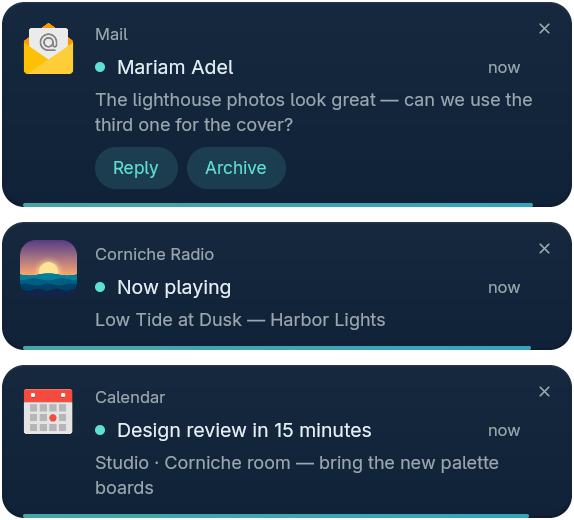
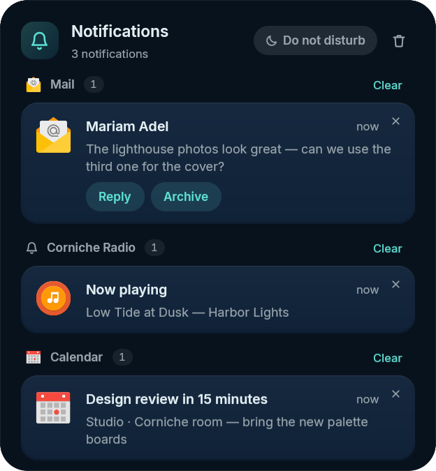

# Sidebar, notes and notifications

## Sidebar tabs, to-do lists and Markdown notes

- **Your own sidebar tabs:** create tabs, name them, pick an icon and put any
  widget (Mandara's or a third-party plugin's) on any of them, the same
  widget on several if you like. Edit them in Studio → Sidebars & hover →
  **Tabs**, right-click a tab in the shell, or use
  `mandara msg sidebar tab …`. The sidebar reopens on the tab you used last,
  and Ctrl+Tab / Ctrl+1–9 switch tabs. The **+** button stays pinned while
  the tabs scroll sideways (wheel, touchpad or drag) under edge fades, and
  idle tabs shrink to icons only when their labels don't fit.
- **To-do lists:** tasks grouped into coloured lists with an Inbox, a chip
  switcher with counts, drag a task onto a list to move it, and completed
  tasks folded away per list. `/todo #Work send the report` in the launcher
  files a task in one step.
- **Markdown notes:** every note is a real `.md` file and every topic a
  folder (point it at a synced folder or an Obsidian vault; outside edits
  show up live). Notes render natively with clickable task lists, code
  blocks (always monospace), tables, quotes and right-to-left Arabic. The
  editor has a real caret (arrows, word jumps, Shift-selection, click and
  drag, copy / cut / paste), continues lists and applies Ctrl+B / Ctrl+I /
  Ctrl+K to the selection; search is fuzzy, and
  `/note #Topic …` adds one from the launcher.

## Notifications

<table>
<tr>
<td width="50%" valign="top"> <b>Notification cards</b> with actions</td>
<td width="50%" valign="top"> <b>Notification center</b></td>
</tr>
</table>

- **Notification cards** spring in from their corner on their own layer
  surface, close the gap smoothly when one leaves, pause while you hover them
  and draw a thin countdown line. Swipe a card sideways to send it away:
  it leaves the screen but stays in the notification center (× dismisses it
  for good). Only the cards take clicks; the rest of the surface passes them
  through to your windows.
- **Joined to the bar** (Studio → Notifications → Popups → **Join the
  bar**, `notifications.joined`, off by default): the cards drop out of the
  bar in one drawer of the bar's own colour, with curved corners where it
  meets the bar, so bar and notifications read as one piece. Cards still
  spring in, pause under the pointer, swipe away, close with × and count
  down. How it joins depends on the bar:
  - **Edge frame and hairline:** out of the bar's lower edge (its upper
    edge for a bottom bar), clear of the bar's curved screen corners.
  - **Floating frame:** out of the floating bar, on its straight part.
  - **Notch:** out of the notch, even for cards at a corner (it spans most
    of the edge, so they hang from its end).
  - **On the edge without the bar** (cards at the bottom under a top bar,
    or beside a side bar): out of the bare screen edge, or out of the screen
    frame's strip around a side bar.
  - **Glass pills, island and micro pill** on the cards' edge have no edge
    to hang from, and a dock holds the bottom edge: cards there stay
    floating cards, and Studio shows why.
  - When the bar hides itself, the drawer slides with it and hangs from the
    screen edge until the bar comes back.
- Opening the notification center (its panel or the sidebar tab) moves the
  cards on screen into it, and new notifications go straight into the list
  until you close it, so cards never cover the center.
- Cards carry the app icon, rich text (bold, italic, links), images,
  progress bars, **action buttons** and **inline replies**, and group by app.
- The **notification center** keeps a history you size. **Per-app rules**
  block, silence, keep out of the history, change urgency or let an app
  through **do not disturb**, which can switch itself on while you share your
  screen, for fullscreen apps, on a schedule (**quiet hours**) or for a while
  (`notifications dnd on 1h`).
