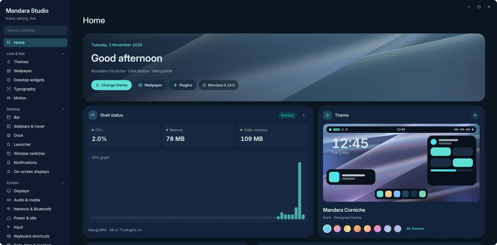
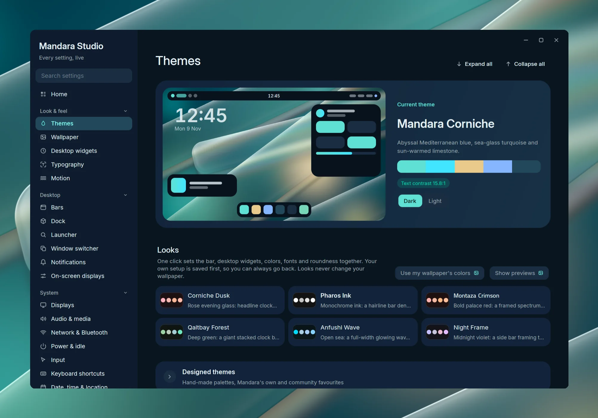
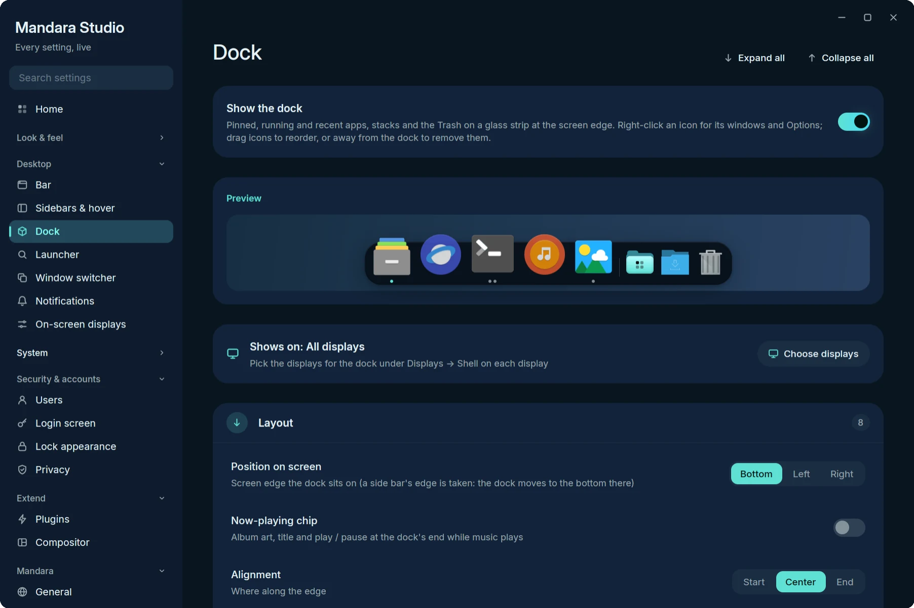
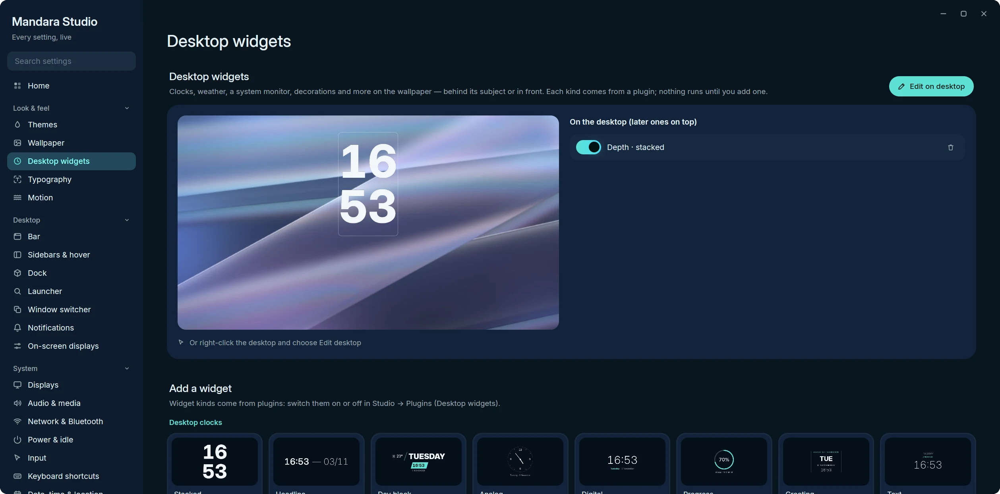
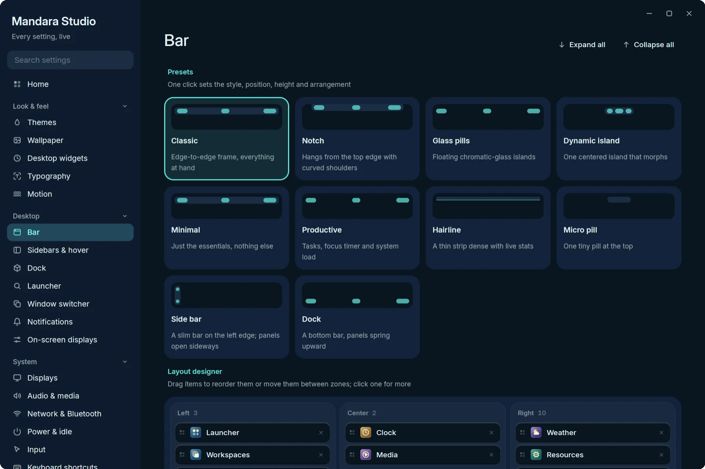
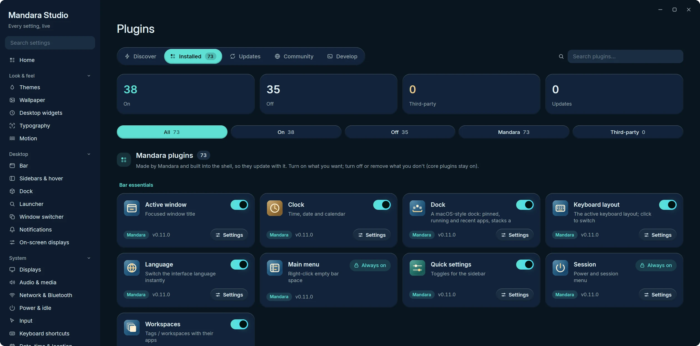
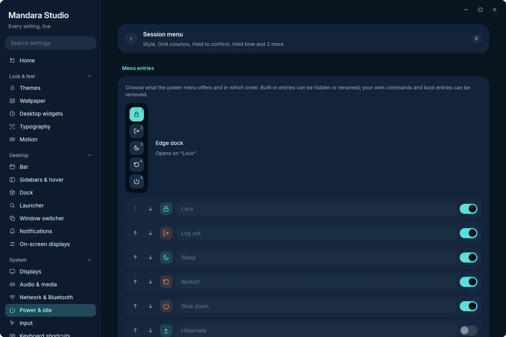
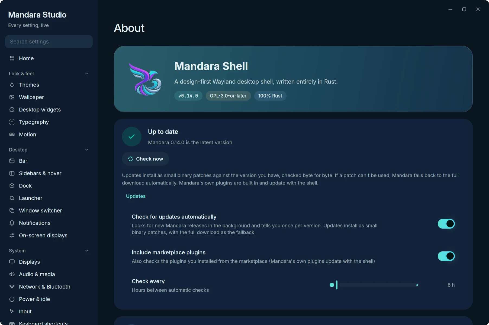
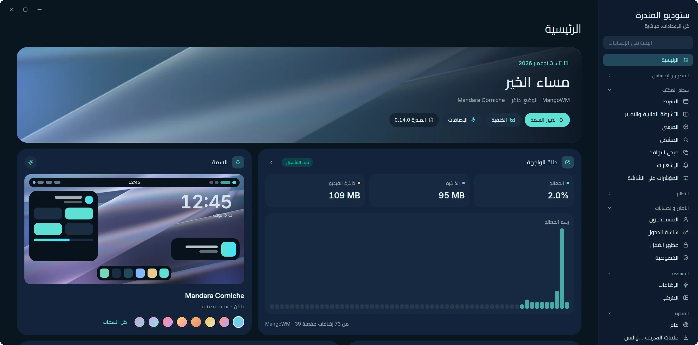
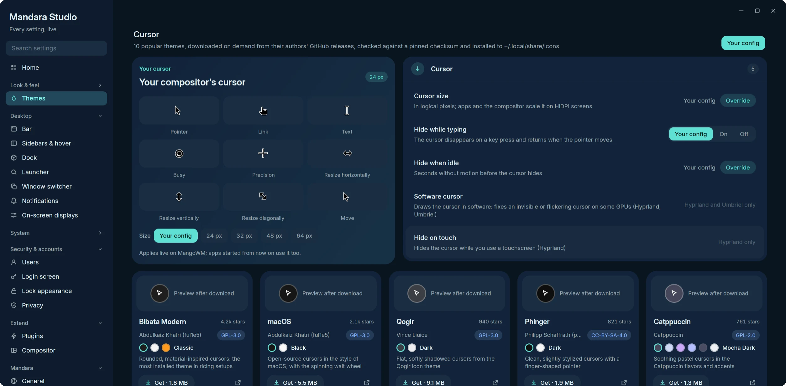

# Mandara Studio

Mandara Studio (`mandara studio`, app id `org.mandara.studio`) is the one
place where Mandara is configured. It runs as its own process, so its CPU and
memory never count against the shell, and every change is mirrored to the
running shell over IPC: drag a slider and the bar follows on the very next frame.
Settings never live in bar dropdowns.

Studio draws its own title bar. If KWin requires native window
decorations, Studio uses those controls so there is only one set of buttons.

<p align="center">
  
  <br/><sub><b>Home</b>: a widget dashboard with live shell status, the current theme and its one-click switches, quick settings and recent changes</sub>
</p>

<p align="center">
  
  <br/><sub><b>Themes</b>: a live preview of the shell in the current theme, its palette and contrast, light / dark, then the Looks, designed themes, wallpaper colors and cursors</sub>
</p>

<table>
<tr>
<td width="50%" valign="top"><br/><sub><b>Navigation</b>: grouped, collapsible, searchable</sub></td>
<td width="50%" valign="top"><br/><sub><b>Desktop widgets</b>: the preview, your widgets and the gallery</sub></td>
</tr>
<tr>
<td width="50%" valign="top"><br/><sub><b>Bar</b>: shape, appearance and item capsules</sub></td>
<td width="50%" valign="top"><br/><sub><b>Plugins → Installed</b></sub></td>
</tr>
<tr>
<td width="50%" valign="top"><br/><sub><b>Power &amp; idle</b>: the session menu editor</sub></td>
<td width="50%" valign="top"><br/><sub><b>About</b>: version and binary-patch updates</sub></td>
</tr>
<tr>
<td colspan="2" align="center"><br/><sub><b>العربية</b>: every page mirrored right to left, «ستوديو المندرة»</sub></td>
</tr>
</table>

Every setting is live: drag a slider and the bar changes on the very next frame. The
slider's handle and its value bubble follow the pointer on the next frame;
the setting is applied at most once a frame and saved to disk once it rests.
Changes that make the compositor re-tile your windows (the bar's height and
the space it reserves, compositor gaps and borders) wait until the slider
rests, so windows move once instead of on every step. Studio
opens on **Home**, a widget dashboard (a greeting over your wallpaper, live
shell CPU / memory / VRAM, the theme with one-click switching, quick toggles,
recent changes with Undo, and a card per group), and
its sidebar groups 31 pages into **Look & feel**, **Desktop**, **System**,
**Security & accounts**, **Extend** and **Mandara**: collapsible, searchable
across every setting, keyboard-driven (Ctrl+F, Alt+↑/↓) and mirrored for
Arabic, Persian and Urdu. Every page is responsive, from an icon rail and one column to
ultra-wide.

- **Look & feel**: appearance and palette tuning, themes with live mock-ups,
  cursor themes (download, preview, apply),
  wallpaper (per display, light / dark, slideshow, depth clock),
  typography, motion (spring tuning, reduce motion).
- **Desktop**: a drag-and-drop **layout designer** with one-click presets,
  bar behaviour, sidebar and hot corners, dock, launcher, Alt-Tab switcher,
  notifications (rules, quiet hours) and on-screen displays.
- **System**: displays and night light, audio (per-app mixer and outputs,
  device names, shell sounds), network (VPN, hotspot, saved networks,
  static IP) and Bluetooth pairing, power and idle (timeouts, battery
  alerts, power-menu editor, event hooks), input devices, keyboard
  shortcuts with conflict detection, date / time / location and calendars,
  default and startup apps.
- **Security & accounts**: users (AccountsService, photos, passwords),
  Mandara Login with a live preview, the lock screen's look, privacy
  indicators and offline mode.
- **Extend**: a plugin store (featured hero, curated shelves, search,
  one-click Get / On, product pages, installed library, updates, the GitHub
  marketplace, a local authoring handbook and validator, per-plugin settings) and compositor control for
  MangoWM, Niri, Hyprland, Umbriel, Sway and River written to `~/.config/mandara/generated/*` (sent over River's protocol on River);
  **your own config only gets one include line** (with a backup).
- **Mandara**: language, profiles with undo / export / import, performance,
  maintenance (health checks, repair, factory reset) and about.

Open any page directly: `mandara studio displays`,
`mandara studio plugins --plugin weather --settings`.

Studio uses the window it gets. On wide windows pages grow (up to about
1840 px), card grids gain columns, a page's settings groups sit in two
columns, and filter chips spread over the width in even rows; on narrow
windows the chips become a strip you scroll with the wheel, a drag or its
arrows. Text keeps a comfortable line length either way.

## Navigation

The sidebar starts with **Home**, then groups every page by what it shapes.
Groups collapse with a click on their header; Studio remembers which ones
you closed in `$XDG_STATE_HOME/mandara/studio-ui.toml` (not in
`config.toml`, so it isn't synced, exported or reset with your settings).
A collapsed group still shows the page you're on. The list is compact
enough to fit with every group open on a 1440 px tall screen, and it
scrolls when it doesn't. Every scrolling area (the sidebar, the page, long
lists and dialogs) has a slim overlay scroll bar on its end edge: it shows
while you scroll or point at the edge, widens under the pointer, can be
dragged or clicked to jump, and fades out after a moment (at once with
reduced motion). Under 900 px of window width it becomes an icon
rail. In Arabic, Persian and Urdu the whole frame mirrors: the sidebar moves to the right and
chevrons point the other way.

## Sections

Every page is a short list of collapsible sections: related settings sit
together (the bar's spacing, its screen frame, how panels animate; a
popup's look and what it shows). A closed section shows a one-line preview
of what's inside and how many settings it holds, or how many you've
changed, and its **Reset** works without opening it. The first settings
section on a page starts open; the long extras (designed themes, the tag
studio, each display's shell surfaces, sound previews) start closed.
**Expand all** / **Collapse all** sit next to the title of pages with
several sections, search results open everything, and Studio remembers
what you opened per page (in the same `studio-ui.toml`).

**Search** (top of the sidebar) looks through every setting of every page,
in English and in your language, and also finds pages by topic ("vpn",
"cursor", "autostart"). While you search, every group opens, each page shows
how many of its settings match, and pages without matches fade.

**Keyboard**

| Keys | Action |
|---|---|
| Ctrl+F · Ctrl+K | Focus search |
| Alt+↑ / Alt+↓ · Ctrl+PgUp / Ctrl+PgDn | Previous / next page, from anywhere |
| Ctrl+L | Focus the sidebar |
| ↑ / ↓ (sidebar focused) | Previous / next page |
| Home / End (sidebar focused) | Home / last page |
| ← / → (sidebar focused; mirrored in RTL) | Collapse / expand the current group |
| Enter · Space (sidebar focused) | Toggle the current group |
| Esc (sidebar focused) | Leave the sidebar |


## Pages

### Home

The landing page, laid out like a widget dashboard:

* **Greeting** — good morning / afternoon / evening and today's date over
  your live wallpaper with an accent wash, the theme, mode and compositor,
  the version, and shortcuts to Themes, Wallpaper and Plugins.
* **Shell status** — running or not, live CPU (with the last minute as a
  sparkline), memory and video memory, sampled once a second only while Home
  is on screen, plus the compositor and how many plugins are on. The arrow
  opens Performance.
* **Theme** — a live mock of the shell in the current palette over your
  wallpaper, a sun / moon button that flips light and dark, and swatches of
  the designed themes: one click switches. *All themes* opens Themes.
* **Quick settings** — light / dark and bar style as choices, then night
  light, reduce motion and high contrast as tiles (the whole tile flips it;
  a tile that can't apply in your setup says why).
* **Recent changes** — the newest edits made in Studio with how long ago and
  an Undo, the number of saved profiles and shortcuts to Profiles & backup.
* **Browse settings** — a card per group with its icon, summary and a pill
  for each of its pages.

The two rows of widgets sit side by side on wide windows and stack on
narrow ones; everything mirrors for right-to-left languages.

### Look & feel

| Page | What it covers |
|---|---|
| **Themes** | Every color and shape choice on one page, laid out like a theme store. At the top a **live preview**: a large mock of the shell (bar, desktop clock, a panel, a media card and the dock) in the current palette over your wallpaper, beside the theme's name and description, its palette strip, the text contrast ratio and the light / dark switch. Then **Looks**: six original one-click looks (Corniche Dusk, Pharos Ink, Montaza Crimson, Qaitbay Forest, Anfushi Wave, Night Frame) as a compact list — a swatch of the look's palette, its name in its own display face and one line, the current one checked, a live mock of it on hover — or, with **Show previews**, as big cards with that mock (Studio remembers the choice in `studio-ui.toml`); a click sets bar style, desktop widgets and cards, colors, fonts and roundness together after saving your setup, *Use my wallpaper's colors* keeps the look but takes the palette from your wallpaper, *Restore my look* brings your setup back (looks never touch the wallpaper). Then **Designed themes**: every built-in and user theme as a compact row (a swatch of its surface and accents, its name and description, the active one checked, a mock of the shell in it on hover), or with **Show previews** as cards with a mock in the current mode, the other mode inset in its corner, a palette strip and its description. Then **Colors from your wallpaper**: on / off, the wallpaper, its lead colors and every Material You scheme style drawn as the palette it would make. Then **Other apps**: the apps Mandara can theme as a grid of small tiles grouped into desktop toolkits (GTK, Qt, Kvantum, KDE), terminals (Ghostty, kitty, foot, Alacritty, WezTerm), editors (Zed, Helix, Neovim) and apps (Fuzzel, btop, Firefox, Vesktop), each with a switch and a chevron that opens a card with where its theme goes and how to select it (Kvantum's also holds *Use the Kvantum theme*). Every app is off until you switch it on: Mandara writes nothing to other apps before that, and switching one off takes back exactly what it changed and restores any file it replaced. Then **Cursor** (the opt-in *Cursor themes* plugin; off, a one-line card offers it; see *Cursor themes* below): your cursor drawn from its own files at its size, every cursor setting, and a gallery of the ten most popular ricing cursor themes to download, apply and remove. Below them, under **Fine-tune**: automatic light / dark and its schedule, palette tuning (accent vividness, hue, lightness, specular rim), theme crossfade, style (corner roundness, shadows, panel edges, backdrop dim, slider handle: *Line* for the upright handle between a slider's fill and its track, or *None* for the fill's rounded end alone), icons and high contrast. `mandara studio appearance` and `mandara studio looks` still open it. |
| **Wallpaper** | Opens on the **Wallpaper** tab, always: the wallpaper on your desktop shown large at its own shape, with its file name, resolution and aspect, size, folder (click to open it), its colours as the theme engine reads them (*Use for my theme* turns on Match colors) and quick actions (*Change folder*, *Open folder*, *Surprise me*, *Show on the login screen*). Below it, **In this folder**: every image and video in your wallpaper folder as a grid of cached thumbnails, decoded at the size they're drawn and loaded one page at a time (it opens on the page with your wallpaper, which is marked *Current*). Click a wallpaper or move with the arrow keys, Home / End and Page Up / Down and press Enter to switch (with the desktop's transition); filter by name; hover a tile and press **+** to add it to the slideshow playlist. The picker's settings follow, and while the generator or Wallhaven plugins are off, one-line cards offer them. **Slideshow**: an on / off switch with the next change's time (or why it's paused), *Previous* and *Next wallpaper*, interval presets from 5 minutes to a day plus *Custom* (`45`, `90m`, `2h`, `1d`, up to a week) and the order (shuffle without repeats, random, by name, newest first); then folds for the **source** (your wallpaper folder, another folder, all sub-folders, separate light- and dark-theme folders, or the **playlist**, shown as thumbnails with remove buttons), **when to change** (at login, pause during fullscreen / on battery / while locked, only between two times), the **slideshow transition** (the desktop's, or fade / wipe / grow / none with its own length) and **displays** (the same wallpaper everywhere or a different one on each display). A fixed light or dark wallpaper, which would hide the slideshow in that mode, is pointed out with a button to clear it. **Fit & effects**: drawing the wallpaper, crossfade, fill mode and colour, transition, sharing with the login screen, light / dark wallpapers, video wallpapers (pause behind windows / on battery, frame-rate limit, first frame only) and the depth clock: the depth effect, how the subject is found (Hand-tuned or Model), the model's automatic split or Clock depth slider, Download, Regenerate and Place the clock; any new wallpaper setting lands here unless another tab claims it. **Generator** (with the wallpaper generator plugin on): a large live preview of the recipe (re-rendered off the UI thread as you drag, the last picture kept until the next is ready), the seed (shuffle, lock, *Surprise me*), five clickable **variations**, light / dark, the size (1080p to 8K, ultrawide, portrait or *Match display*) and format (WebP, PNG, JPEG, each with its expected file size), **Generate wallpaper** and **Generate loop** (seconds, fps) with progress and cancel, then the result with *Set as wallpaper*, *Show in folder* and *Remix*. Below: a **style gallery** previewing your palette and seed, the **palette** tiles (curated, *Match theme*, *Custom* with 2–8 hex stops), **Fine-tune** sliders built from the engine's parameters (the style's own, then tone, light, texture and layout, each group with a reset), **Recent** generated files (Remix, Set, Delete twice to confirm) and the opt-in **schedule** (interval, what to make, still or loop, keep N, apply, next run). **Online** (with the opt-in **Wallhaven** plugin on): *Browse in the picker*, the default search and sort order; off, the picker has no Wallhaven source. `mandara studio wallpaper --tab slideshow` opens a tab directly. |
| **Desktop widgets** | **Edit on desktop**, then **Widgets** (clocks incl. the depth clock, system monitor, decorations, plane visualizer: add from the gallery, one tile per family of look-alike widgets, then pick its **Style** — a new widget starts in front of the wallpaper's subject on a free spot, and a tile already on the desktop is ticked and selects it instead of adding a copy — drag on the live preview, style each one; repeats are numbered, *Remove duplicates* takes exact copies away) and **Desktop cards & visualizers** — now playing, calendar, glowing wave, framed bars, mirrored bars: on / off and where each sits (nine anchors; top or bottom edge for the strips); each lives on its own small surface only while it shows. `mandara studio desktop-widgets` opens it. |
| **Typography** | Interface, display, Arabic and monospace fonts, size and weight; a font per surface (bar, panels & plugins, desktop widgets, lock screen and its clock, Studio). Every font button opens a floating, searchable list of installed fonts, each in its own face, under the button (or above it near the bottom of the window) without moving anything around it: type to search, Up / Down, Page Up / Page Down, Home / End and Enter to pick, Esc or a click elsewhere to close; any typed name works too (*Use “…”*). |
| **Motion** | Spring stiffness, damping and mass, animation speed, reduce motion. |

### Desktop

| Page | What it covers |
|---|---|
| **Bar** | Layout designer (the zones as columns of stacked items — drag to reorder or move, × to take off, click for a menu —, the side bars' top / middle / bottom groups while they're on, and every plugin in a searchable grid by category: click to add to a zone or drag it there), presets (incl. Notch, Hairline, Micro pill and Side bar); **Layout** (style — edge frame, glass pills, island, hairline, micro pill, notch —, notch width, position on any edge, height, compact height and accent line for the hairline / micro pill, side bar width and screen frame with its thickness, gaps, floating edge frame, center-group alignment, item padding / spacing, separators); **Shape** (bar radius, flare radius); **Appearance** (opacity, accent tint, group capsules, glass rim width / intensity, shadow, text and icon size); **Main menu** (what right-clicking empty bar space opens — the bar's main menu or the desktop's menu —, glass menu and its opacity, the rail's names / icons-only style, tile patterns, Kufic calligraphy on the app and tool tiles, tile surface — flat (the default), 3D, glass — and tile shadow); **Drop-down panels** (radius, width, maximum height, inner padding, gap to the bar, horizontal position, opacity, shadow, open animation, custom spring, close delay after the pointer leaves, how long action messages stay); **Side bars** (on / off, joined with the bar or separate, each side on / off, pinned or sliding away with its reveal and hide delays, an accent per side); **Side bar shape** (width, separate shape — pills, island, slab —, edge gap, corner radius, curves, middle group); **Side bar items** (icons, pills or islands, item size, padding, spacing, wash strength); **Side bar material** (opacity, accent tint, frosted glass, rim light and intensity, shadow); auto-hide, click-through, over fullscreen. Which displays show it is set under Displays. |
| **Sidebars & hover** | Sidebar side, mode (Float over windows, Push them aside while open, or Pinned with its space reserved); **Tabs** (always open on the first tab, the "+" new-tab button) and the **tab editor**: your tabs on the left (click to edit, rename in place, drag to reorder, delete asks once) and, for the selected tab, its icon (Mandara's icon set), its widgets top to bottom (drag to reorder, drop on another tab to move, × to take off) and a searchable picker of every widget with its plugin art and description — any plugin with a sidebar card, first- or third-party; off or removed ones are greyed with *Turn on*; a widget may sit on several tabs; **Layout** (width, flush or floating with a margin — beside a floating bar such as glass pills, the island, the micro pill or the notch the side panels always float, since there is no edge frame to join; it opens at the top of its tab every time — header position and size) and **Appearance** (corner radius, opacity, card radius / padding / spacing) shared by the sidebar and the power dock, and its slide spring; edge hover triggers (the launcher's bottom edge is click-only while the dock is on); hot corners (action or command per corner, delay, trigger size, over fullscreen apps); rounded screen corners (on by default) and their radius. |
| **Dock** | A macOS-style dock. On / off (a hint and *Show it now* when auto-hide keeps it out of sight), live preview, then six groups with their own Reset: **Layout** (position, alignment, size, magnification and its size / spread, only this display's windows), **Behaviour** (automatically hide and show — off / on / when a window overlaps — reveal and hide delays, slide speed, keep windows clear, above fullscreen, animate opening applications, bounce for attention, minimize windows into application icon, names on hover), **Apps** (the apps kept in the dock with icons: drag to reorder, × to remove, **Add app…** opens a searchable picker of installed apps with pinned ones checked; running apps, open-app indicators, recent apps and how many, notification badges, progress bars, window count, most apps, launcher button, the **now-playing chip** — album art, title and play / pause at the dock's end while music plays), **Applications folder** (on / off — a folder on the right of the dock that opens a Launchpad-style grid of your apps, with search, category chips and a right-click menu, and installs apps dropped on it — view as Grid / List, order A–Z / Most used / Categories, icon size), **Stacks & Trash** (each folder with View as Automatic / Fan / Grid / List, Sort by date added / modified / name / kind, Display as Stack / Folder, add a folder; Trash, files per stack, files in a fan — Automatic always fans the newest that many files, however big the folder — and show file names) and **Appearance** (glass opacity and accent tint, corner radius, padding, icon spacing, distance from the edge, shadow, specular rim, separators, not-running opacity). Which displays show it is set under Displays. On the dock itself: right-click an icon for its windows, New Window and the app's actions, **Options ▸ Keep in Dock ✓ / Open at Login ✓ / Show in Files** (and Uninstall… for apps Mandara installed), Show All Windows, Hide and Quit (Force Quit once a quit didn't take, or with Alt held); right-click empty dock space for Add app…, auto-hide and magnification; drag icons to reorder, a running app into the pinned ones to keep it, or away from the dock to remove it; drop files on an app to open them with it, on the Trash to trash them, and installable apps on the dock or the Applications folder to install them. Click a stack for its fan (the newest files on an arc that pops up out of the icon as one piece, names in pills, *Open Downloads · N more* (the folder in your file manager) at the top) or its grid (arrow keys, Enter, type to filter, right-click for Open / Show in Files / Move to Trash); the dock stays out while a stack, the Applications grid or a menu is open. |
| **Launcher** | Sections in setup order. **Launcher looks**: Classic, Grid and Beacon as three cards of exactly the same size (a miniature, the name, a two-to-three-line description and tags for the layout and placement), a click applies one; **Preview** opens the launcher. **Placement**: a small screen diagram with the bar along its edge and seven clickable spots — top left / middle / right, the center of the screen, bottom left / middle / right (the screen's own sides, also in right-to-left languages) — the chosen one highlighted, a line on how it looks with your bar (grows out of the bar like its panels, a floating card under floating pills, or "the bar is on the other edge" when it opens from the bare screen edge; a note when the dock makes it float above the dock, click only), and **Preview** to open it, with **Size & placement** under it (align to the launcher button, search field, width / height when attached and in the center). **Launcher button**: its icon picker. **Search & results**: style, layout, visible results, app icons, the grid and the Beacon bar, providers and prefixes, ranking, and what the ranking has learnt. **Behaviour**: on / off, dim, keyboard only, remembering the last search, launch prefix and systemd scopes. **Apps**: pinned and hidden apps and your own names and icons. Then slash commands and skills. |
| **Window switcher** | Alt+Tab style and scope, previews, screen time. |
| **Notifications** | Popup placement, size and timeouts per urgency, rules per app, do not disturb and quiet hours, history limits. |
| **On-screen displays** | Every OSD kind, orientation, scale and offset. |

### System

| Page | What it covers |
|---|---|
| **Displays** | **Arrangement**: the canvas, a card per display under it with two or more (also one that's off), Apply / Reset with a keep-or-revert countdown, and the selected display's power, resolution, refresh rate, scale, rotation and adaptive sync in aligned rows; **Shell on each display** (bar, dock, OSDs, launcher & pop-ups, notifications, wallpaper); **Profiles** as same-size cards (Apply, Delete, *Connected*), *Save as profile*, keep after restart and the revert / auto-profile settings; **Monitor brightness** (DDC/CI); **Night light**. |
| **Audio & media** | Per-app mixer and outputs, default devices (rename, hide), volume step and ceiling, ignored players, shell sounds, visualizer and lyrics. |
| **Network & Bluetooth** | Connection details, VPNs (WireGuard / OpenVPN import), hotspot with QR, saved networks, static IP / DNS; Bluetooth devices, pairing dialog, auto-connect, adapter. |
| **Power & idle** | Status, idle timeouts (mains / battery), lock behaviour, idle commands, battery alerts (the Power panel's style, Classic or Modern, and the bar battery's pulses: coral while critical, a gentle breath while charging) and profiles, the power menu editor (entries, style, and the dock's **Position**: opposite the sidebar, left, right, top center or bottom center — at the top or bottom it hangs from the bar there, one piece with it in the edge-frame styles and a card next to a floating bar, or from the screen edge when the bar is elsewhere, which the preview says; the grid always opens in the middle), event hooks. |
| **Input** | Keyboard layouts and labels, repeat, Num Lock; mouse and touchpad; focus follows mouse. The cursor lives on Themes → Cursor (a card here links there). |
| **Keyboard shortcuts** | Mandara's compositor binds with chord capture and conflict detection. |
| **Date, time & location** | The system clock (time zone with search, set time automatically, and a one-click fix when it doesn't match your location's time zone), clock and date formats, the calendar's week numbers, weekend days, Hijri dates and Eastern Arabic numerals, calendar subscriptions and reminders, the shared location (weather and prayer times follow it unless they have their own), weather. |
| **Applications** | Installed apps (search, hide, rename, install from files by picker or drag and drop, uninstall with optional leftover cleanup), default apps, apps at login, how apps are launched. |

### Security & accounts

| Page | What it covers |
|---|---|
| **Users** | AccountsService accounts: create, edit, delete, photos, passwords. |
| **Login screen** | Mandara Login (greetd greeter) with a live, draggable preview; beside it Apply to login screen, Preview full screen and **Try it** (entrance, typing, wrong password, success, idle clock). Tabs: Looks (ready-made designs), Layout, Background, Clock, Sign-in, Session, Theme, Motion; settings that depend on another one show only once it's on. The **Login manager** tab to switch login screens (Mandara Login, other greetd greeters, SDDM, GDM, …): **Use** for an installed one, **Install & use** for one that isn't (it installs the login manager or greeter with greetd, cage or LightDM's greeter through the system's package manager, after showing the plan). |
| **Lock appearance** | Clock style, background, avatar, media, weather, notifications, battery and its low-battery mark, OLED care. |
| **Privacy** | Microphone / camera / screen-share indicators, offline mode. |

### Extend

| Page | What it covers |
|---|---|
| **Plugins** | A plugin store: Discover (featured hero, curated shelves, search with filter chips), Installed, Updates, Community (the GitHub marketplace) and Develop (the authoring handbook and validator); per-plugin product pages and settings modals, which hold each plugin's own options (clipboard history, screenshot, weather, prayer times…) — including refresh intervals, how many rows a list shows and alert thresholds (Resources, Process hunter, Containers, Services, Drives, Network speed, Network, Clock, To-do, Bluetooth, Authenticator). To-do adds its default list, show completed, sort order and what the bar counts; Notes its default topic, the notes folder (point it at a synced folder or an Obsidian vault), preview by default and the editor font and size. [Configuration](configuration.md) lists every setting by page. Every Mandara plugin can be switched off (it then stops everything it runs: bar item, sidebar card, launcher entries, background polling) or **removed** from the detail modal: off, out of the bar and sidebar, and parked under *Removed Mandara plugins* (their store cards offer *Add back*) until **Restore** puts it back where it was. Core plugins (launcher, session menu, main menu) show *Always on*. The dock, mini stats, screen time and prayer times ship off. |
| **Compositor** | The **Config doctor** (your compositor's own checker on your config: problems by file and line, explained, with reversible fixes), then MangoWM / Niri / Hyprland / Umbriel / Sway / River gaps, borders, rounding, blur, rules, tags, layouts; written to `~/.config/mandara/generated/`. KWin uses native Plasma protocols; its compositor settings remain in Plasma System Settings and Studio explains the locked controls. |

### Mandara

| Page | What it covers |
|---|---|
| **General** | Language (a language whose pack is missing downloads it: its card fills with the download, turns green with a check when it's in, or red with the reason and Retry if it fails; see [Languages](languages.md#language-packs)), units, week start, polkit agent, lock routing, keyrings & passwords (GNOME Keyring prompts, KeePassXC dialog, unlock at login), restart after a crash. |
| **Profiles & backup** | Recent changes with undo, named profiles, export / import, reset a page, support report. |
| **Performance** | The shell's own CPU, memory and threads, Studio's separately, frame-time diagnostics, restart / quit. |
| **Maintenance** | Health checks with repair, downloads, cache cleanup, backups, factory reset. |
| **About** | Mandara updates (binary patch first, full download as the fallback; marketplace plugin updates), version, compositor, theme, config path. |

## In depth

- **Desktop widgets** (Wallpaper): a scaled preview of the display — the
  wallpaper's thumbnail with every widget drawn by the shell's own
  software painters — above a gallery that adds a clock (live
  thumbnails), the system monitor, a visualizer shape or a decoration
  preset (*Alexandria line*, *Vertical poem* with placeholder text to
  replace, *Geometric set*). Look-alike widgets share one tile: the clocks
  are *Stacked* (superscript, stacked card, framed HUD), *Headline*, *Day
  block*, *Analog* (classic, cookie, orbit, hands over numerals),
  *Digital* (clock, ring, time in a shape, dot matrix, pixel, digit boxes,
  slanted HUD), *Progress* (day ring, wavy week, month bar, year in
  dots), *Greeting* and *Text* (text lines, divided text, day numeral),
  plus the depth clock; the monitors are *System monitor* (column,
  gauges, meters, bars, wavy gauges) and *Thermals*. A tile adds the
  family's first style, and the widget's **Style** row (a small picture
  of each) switches it to another one in place: it keeps its spot, size
  and displays and the colours, font and digits you chose, unless the
  style sets them itself. A widget you changed since shows its closest
  style marked *changed*. Drag a widget on the preview to move it; on
  release it re-anchors to the nearest of nine anchors and keeps its
  place. Select a widget (preview or list) to edit its depth (behind the
  subject or in front), anchor, offsets, size, opacity and displays, and
  its own settings: clock style, seconds, numerals, weather; monitor rows,
  refresh and width; decoration text, size, weight, letter spacing, shape
  and rotation; visualizer shape, bars, length, height, angle, gap, frame
  rate and silence stop; font, colours (automatic, text, accent or a
  custom `#rrggbb` / `oklch(L C H)`) and shadow / glow. The switch on each
  chip turns a widget off without losing it. Every edit reaches the shell
  at once. Nothing runs while the list is empty.
- **Layout designer** (Bar): the bar's **Left / Center / Right** zones
  (*Top / Middle / Bottom* when the bar stands on a side edge) are columns
  with their plugins stacked in order, side by side on a wide window and
  one under the other on a narrow one; while side bars are on, their top /
  middle / bottom groups flank the screen under them. Drag an item to
  reorder it or move it to another zone, × takes it off, and a click opens
  a menu: *Move up*, *Move down*, *Move to …*, *Remove from bar* and
  *Details*. Under the zones, **All plugins** lists every plugin that can
  sit on the bar in an aligned grid. Desktop-only widgets belong in the
  **Desktop widgets** gallery. The bar items are grouped by category (a category list
  beside the grid on wide windows, chips above it on narrow ones; faith
  plugins have their own *Faith* category), with a search field that
  filters as you type (names and ids that hold what you typed first,
  name starts ahead of the rest; a fuzzy match for typos when nothing
  does; then the category and description). Plugins on the bar show their zone, plugins that are off
  say so. Click one for *Add to Left / Center / Right* (and the side bars
  while they're on) or *Details*, or drag it onto a zone; placing a plugin
  turns it on, and dropping a bar item on the list takes it off the bar.
  Bar presets (System monitor, Classic, Notch, Glass pills, Dynamic island,
  Minimal, Productive, Hairline, Micro pill, Side bar, Dock) apply the style
  in one click and keep your items. Turn on **Replace bar items** to use
  the preset's arrangement too. **Profiles & backup → Bar** saves only
  the bar and side-bar configuration, leaving the theme and desktop widgets alone.
- **Radii, per bar style.** *Bar radius* rounds the glass pills and the
  island; on the edge frame it rounds the hover chips (and the frame's ends
  when *Float the edge frame* is on). *Flare radius* is the concave curve
  where the edge frame meets the screen sides, panels and the sidebar.
  *Panel radius* rounds drop-down panels; *Corner radius* (Sidebars) rounds
  floating or non-edge-frame side panels and the power dock. Themes →
  *Corner roundness* multiplies every one of them and every card, chip,
  button and row radius in the shell (0 = square, 2 = extra round); nested
  corners stay concentric (inner radius = outer − padding, never below 0).
- **Controls that don't apply** to the current setup (flares without the
  edge frame, rims and shadows on the flush edge frame, a margin while side
  panels are flush, spring values while *Custom spring* is off) show why in
  place of their control.
- **Reset** next to a group's title restores that group's defaults; it
  appears once something in the group differs from them.
- **Everything is live**: the bar, open panels, the sidebar, the launcher,
  OSDs and the dock redraw in place on every edit, without reopening.
- **Compositor control** for MangoWM, Niri, Hyprland, Umbriel, Sway and River: gaps, borders,
  rounding, blur, shadows, opacity, window rules and keybinds, one-click
  window-look presets and common window rules, gaps that follow the bar,
  and Hyprland's layout (dwindle / master), border resizing and group tabs.
  Changes go to `~/.config/mandara/generated/*`, and your own config only
  gets one include line (with a backup), appended at the end so Mandara's
  values win:

  | | Include line | Autostart (drop-in) |
  |---|---|---|
  | MangoWM | `source_optional=~/.config/mandara/generated/mango.conf` | `exec_once=/abs/path/mandara` |
  | Niri | `include optional=true "/home/you/.config/mandara/generated/niri.kdl"` (plain `include` before 26.04) | `spawn-at-startup "/abs/path/mandara"` |
  | Hyprland ≤ 0.56 | `source = ~/.config/mandara/generated/hyprland.conf` | `exec-once = /abs/path/mandara` |
  | Hyprland 0.57+ (Lua only) | `pcall(dofile, "/home/you/.config/mandara/generated/hyprland.lua")` in `hyprland.lua` | `hl.on("hyprland.start", …)` |
  | Umbriel | `"/home/you/.config/mandara/generated/umbriel.toml"` in `[include.optional] files` (added to your list if you have one) | `general.autostart = ["/abs/path/mandara"]` |
  | Sway | `include /home/you/.config/mandara/generated/sway.conf` | `exec /abs/path/mandara` |
  | River | none (Mandara never edits `init`; its settings go over `river-control`) | `riverctl spawn /abs/path/mandara`, a line you add to `init` |

  The dialect follows the installed version (`niri --version`,
  `Hyprland --version`); each compositor's own checker (`mango -p`,
  `niri validate`, `Hyprland --verify-config`, `umbriel config validate`,
  `sway --validate`) must accept the result or the include is rolled back.
  Sway has no rounded corners, blur, shadows or animations, and no opacity
  rules that Mandara supports (its `opacity` command isn't a rule): while
  it runs those rows are locked with that reason, and its tab says what
  its drop-in carries (gaps, pixel borders, `client.*` colours, `for_window`
  floating / sticky rules for both Wayland `app_id`s and X11 classes,
  `input` / `seat` settings, `output` lines and `bindsym` keys). River's
  tab says how its settings travel and shows the line to add to `init`;
  gaps (including *Gaps follow the bar*), rounded corners, opacity, blur,
  shadows and animations are locked there. Umbriel is the
  exception to "Mandara's values win": it applies your `config.toml`
  after its includes, so what you set there wins (rules from both files
  are kept), and the Umbriel tab says so. On Niri the drop-in also makes workspace
  backgrounds transparent: Mandara's wallpaper lives in Niri's Overview
  backdrop and would otherwise only show there. On Hyprland 0.57 Mandara's
  workspace clicks and other dispatches are sent as Lua
  (`hl.dsp.focus({ workspace = 3 })`); `mandara msg compositor dispatch`
  translates the common hyprlang dispatchers and passes `hl.…` text through.
- **Config doctor** (top of the Compositor page): the compositor's own
  checker (`mango -p`, `niri validate`, `Hyprland --verify-config`,
  `umbriel config validate`, `sway --validate --verbose`, whose verbose
  output is what reports a key bound twice) run read-only on your
  config and every file it includes, with its verdict in one line ("All good — checked 2 min ago
  with MangoWM 0.18.4"). Problems are grouped by file, your files apart
  from Mandara's drop-in, each with its kind (unknown, removed in this
  update, deprecated, syntax error, invalid value, duplicate keybind,
  missing file, not supported by this version), the line itself, a
  plain-language explanation and the compositor's own message. Fixes:
  **Open in editor** at that line, **Comment out** or **Remove line** (backup
  first, checked again, undone automatically if it made things worse) and
  **Regenerate** for the drop-in (an option this version rejects is left out
  for it from then on). **Check again** re-runs it; **Remind me later**
  quiets the start-up notification until the config or the compositor
  changes. The same is `mandara msg compositor check` / `fix`, and
  `mandara setup --check` / `--fix` without a running shell (see
  [install](install.md#config-doctor)).
- **Notifications, On-screen displays, Privacy**: popup placement (or joined
  to the bar) and timeouts per urgency, a rules editor with one-click rules
  for recent apps, quiet modes, history limits; every OSD kind; indicator
  ignore lists.
- **Audio & media**: per-app mixer, default devices you can rename and
  hide, per-app outputs (calls to the headset, music to speakers), volume
  step and 100 % / 150 % ceiling, ignored media players, shell sounds with
  previews.
- **Displays**: drag monitors on an arrangement canvas (edges snap), pick
  resolution, refresh rate, scale, rotation, adaptive sync and on / off over
  `wlr-output-management` (MangoWM, Niri, Hyprland). Every change applies
  with a 15-second "Keep or revert" countdown; saved profiles switch
  automatically when the same monitors are plugged in (matched by EDID
  make / model / serial), and *Keep after restart* writes monitor lines to
  the compositor drop-in. **Shell on each display** chooses where the bar,
  dock, OSDs, notifications and wallpaper appear (all, the main display, or
  a list); the Bar and Dock pages link there. **Launcher & pop-ups** (the
  launcher, Alt+Tab, the app installer and password prompts) open on the
  display you're on when it is allowed, else on the main display; until
  set, the row follows **On-screen displays**. External monitor brightness
  works over DDC/CI (pure Rust, `/dev/i2c-*`, needs the `i2c` group).
- **Night light**: warm screens from sunset to sunrise (your location),
  fixed times or always, with eased transitions, gamma and night dimming,
  and pauses for fullscreen windows or chosen apps. Pure-Rust
  `wlr-gamma-control` (MangoWM, Hyprland, Sway, and Niri on a real tty
  session — a nested Niri has no gamma, and the tile says so),
  also a quick-settings tile and `mandara msg nightlight toggle`. When a
  screen refuses the warmer colours (another night-light app such as
  wlsunset holds them, or the driver won't), a notification says so and
  names the app it finds.
- **Plugins**: a plugin store with five places and one search. **Discover**
  is the store front: a featured hero that rotates through the plugins'
  cover art (paused under the pointer, stopped whenever Studio or the tab
  isn't on screen), filter chips, and curated shelves built from the
  categories — *Essentials*, *For your desk*, *Productivity*, *Media &
  capture*, *System tools* — plus *New & updated* and *Community picks*
  when there are any, each with *See all*. Every card has its cover art,
  name, one-line pitch, a Mandara / third-party badge and a one-click
  **Get / On** button that shows its state (off, on, removed → *Add back*,
  update available → *Update*, core → *Always on*). **Installed** is the
  library: on / off / third-party / updates counts, filter chips, grouped
  cards with switches and Settings, and the removed built-ins with
  **Restore**. **Updates** checks and applies marketplace plugin updates,
  one by one or all at once. **Community** is the GitHub marketplace as
  store cards (Get, Update, Remove); while it is empty or out of reach it
  suggests Mandara plugins you haven't switched on. **Develop** is the
  authoring handbook, built from your system: your real plugin folders (state,
  counts, precedence), the folder and `plugin.toml` format, the sandbox
  architecture with its real time budgets, the WIT contract, copyable
  quick-start commands, and a validator that lists every local plugin with
  its load status and actual error, and can test-load one. Click a plugin
  for its **product page**: a hero over its blurred cover with the icon,
  name, maker, Get / On and Settings; an info strip (category, version,
  access, where it fits); the cover art with *More like this*; the full
  description; *What's new* when an update waits; what it may access
  (network, D-Bus services, files, compositor, …); its settings; the bar
  zones it fits with add to bar or sidebar; and remove / restore /
  uninstall. Cover art is decoded off the UI thread at the size it is
  drawn, only for cards on screen. Its **settings modal** gathers every setting it
  owns, from its own options to the shell sections it drives (Weather:
  place, units, animation; Prayer times: location, method, Asr school,
  Hijri adjustment; Screenshot: copy, save, timer, countdown, text
  recognition, toolbar position and size, and the screen recorder: which
  recorder (with the installed ones and what each supports), source,
  display, countdown, resolution, frame rate, codec, quality, format,
  sound and devices, folder and file name; choices the recorder in use
  can't do are greyed out with the reason),
  including the `[[settings]]` a third-party plugin declares.
- **Users**: create, edit and delete accounts through AccountsService:
  full name, e-mail, language, administrator or standard, automatic login,
  locking, and passwords (strength meter, hashed with SHA-512 crypt in pure
  Rust, or "choose at first login"). Profile photos are cropped from any
  image (zoom, drag to position) or picked from procedural Mandara presets;
  the lock screen and Mandara Login show the same photo. You can't delete
  yourself or the last administrator, and polkit asks for a password when
  it's needed. Try it safely with fictional accounts:
  `mandara studio users --demo`.
- **Network & Bluetooth**: connection details (addresses, gateway, DNS,
  MAC, speed); VPNs with a connect switch, plus importing WireGuard `.conf`
  / OpenVPN `.ovpn` files into NetworkManager (`.ovpn` needs
  NetworkManager's OpenVPN plugin, which the installer offers); a Wi-Fi
  hotspot with a QR code phones scan to join; saved networks (auto-join,
  priority, forget, static IP / DNS, hidden networks); Bluetooth devices
  with battery, trust, rename, forget and pairing through Mandara's own
  pairing dialog (`org.bluez.Agent1`: passkey compare, PIN, authorize),
  trusted devices reconnecting on power-on, adapter choice and connection
  notifications.
- **Cursor themes** (Themes → Cursor, `mandara studio themes/cursor`; the
  opt-in `cursors` plugin — switched off, Mandara writes no cursor setting
  anywhere, applies none live and leaves `~/.icons/default` alone):
  
  - **Your cursor** draws the applied theme from its own XCursor files —
    pointer, link, text, busy, precision, the three resizes and move — at
    the chosen size, with 24 / 32 / 48 / 64 px chips beside the size
    slider. The rows next to it: *Hide while typing*, *Hide when idle*
    (MangoWM, Niri, Hyprland, Umbriel, Sway, River), *Software cursor* (Hyprland and
    Umbriel) and *Hide on touch* (Hyprland only); where a compositor lacks
    one, the row says so in place of the control.
  - **The gallery**: Bibata Modern, macOS, Qogir, Phinger, Catppuccin,
    BreezeX, Vimix, Banana, Nordzy and Rosé Pine — the ten most-starred
    themes that publish ready-built cursors on GitHub. Each card shows a
    preview strip (or a swatch and "Preview after download"), author,
    licence, GitHub stars, its variants as dots and one action that follows
    its state: **Get · size** → **Installing n % · Cancel** (a progress
    bar) → **Apply** → **Active**, plus **Remove** (press twice) for what
    Mandara installed. A failed download shows its error on the card with
    **Retry**. Tab moves between cards, Enter / Space runs the action,
    ← / → pick a variant (mirrored right-to-left) and Delete removes.
  - **Installing** downloads the pinned release file from the theme's own
    GitHub repository, checks its size and SHA-256, unpacks it with
    pure-Rust readers (gzip, xz, bzip2, zip; paths leaving the folder are
    refused, links pointing outside it dropped) and moves only the theme
    folder (`index.theme` + `cursors/`) to `~/.local/share/icons/<Theme>`.
    Nothing from the archive is run. `~/.local/share/mandara/cursor-themes.json`
    records what Mandara installed: a theme folder you or a package put
    there is never replaced or removed. Nothing is bundled in the binary.
  - **Applying** writes the drop-in (`cursor_theme` / `cursor_size` +
    `env=XCURSOR_*` for MangoWM, `cursor { xcursor-theme … }` for Niri,
    `env = XCURSOR_* / HYPRCURSOR_*` + `cursor {}` and a live `setcursor`
    for Hyprland, `[input.cursor]` for Umbriel, `seat * xcursor_theme` and a
    live `seat` command for Sway, `xcursor-theme` for River) and reloads the compositor, so the cursor changes at
    once. X11 and older toolkit apps follow through
    `~/.icons/default/index.theme`, created only when you have none and
    removed again when you go back to "Your config".
  - **Also installed** lists the other cursor themes on the system.
- **Input**: keyboard layouts (search, variants, order, switch shortcut,
  short bar labels like EN / ع), repeat delay / rate, Num Lock, mouse and
  touchpad (acceleration, speed, natural scrolling, tap-to-click, drag
  lock, disable while typing, scroll and click method, left-handed),
  focus follows the pointer.
  Written to the compositor drop-in (`mango.conf`, `niri.kdl` `input {}`,
  Hyprland `input {}` / `hl.config({ input = … })`, Umbriel `[input.*]`,
  Sway `input type:keyboard|pointer|touchpad …` and `seat * …`, River
  `keyboard-layout`, `set-repeat` and `input pointer-*|*Touchpad* …`
  commands); "Your config" keeps
  your own value. On Niri a touchpad or mouse setting replaces your whole
  `touchpad {}` / `mouse {}` block (Niri merges those blocks as a unit),
  and "focus follows the pointer: off" can't be set from an include —
  remove `focus-follows-mouse` from your `config.kdl` instead.
- **Applications**, in four tabs (the last one is remembered):
  - **Installed**: every app with a launcher entry as a searchable card
    grid with its icon and where it came from (Pacman, APT, DNF, Zypper,
    XBPS, APK, Portage, eopkg, Nix, Flatpak, Snap, AppImage, Local), with
    source filters. Each card opens the app, hides it from the launcher,
    renames it there (`[launcher] hidden` / `overrides`) or uninstalls it.
    **Uninstall** asks the app's own package manager who owns it (detected
    at runtime, no distro assumed) and shows a confirmation with the exact
    command (system packages run through `pkexec`, never `sudo` or a
    shell), what else the package manager would remove (from its own dry
    run), refusals (the shell, compositor, portals, core system packages,
    NixOS-declared apps) and an extra confirmation for your default
    terminal / browser / file manager. Optional cleanup lists leftovers in
    your home folder (`~/.config`, `~/.local/share`, `~/.local/state`,
    `~/.cache`, `~/.var/app/<id>`, `~/snap/<name>`) matched by the app's
    exact id, program, window class or package name, each with its size
    and unchecked; ticked ones move to the Trash (freedesktop spec, with
    `.trashinfo`), nothing is ever deleted. AppImages and local entries go
    to the Trash too. `MANDARA_UNINSTALL_DRY_RUN=1` turns every uninstall
    into a dry run.
    The tab opens on a **drop card** ("Drop an app here, or choose a
    file", with the supported formats); **Choose a file…** / **Install
    app…** open the desktop portal's file picker (filtered to AppImage,
    Flatpak, `.tar.gz`/`.tar.xz`/`.tar.zst`/`.zip`, `.deb`, `.rpm`,
    `.pkg.tar.zst`, `.apk`, `.xbps`), and files dragged onto the tab from
    any file manager glow "Drop to install"; either hands them to the
    shell's **App installer** (the list refreshes when the job finishes).
    Its on-screen **sheet** shows the app's icon large, name, version and
    developer, summary, chips (the format — hover it for what that means
    in plain words — size as file / installed, categories), up to three
    screenshots shipped inside the file (never downloaded), the
    description, where it installs, the PATH command switch, a Flatpak
    bundle's **permissions** as friendly rows (network, files, devices,
    sound, system services — broad ones in amber), a native package's
    dependencies (collapsible) with a clear *Needs your password* row,
    warnings (wrong architecture, an older version than installed,
    package-manager conflicts) and, when the app is already there,
    **Update / Reinstall / Keep both** with installed vs new version.
    Several files dropped at once open a **queue sheet** (each file's
    status; *Install all*, *Review each*, or *Review* one). Installing
    shows a pill with a smooth progress ring, the steps (Inspecting →
    Installing → Adding to apps → Done) and elapsed time; it ends with the
    icon's bounce and a check, **Open**, a **Keep in Dock** switch (on when
    installed from the dock) and **Show in Applications** — or a failure
    card with a plain explanation, a fix where one exists (*Try again*,
    *Open settings*, *Find it on Flathub*), *Show file* and the technical
    detail behind a disclosure. Enter runs the highlighted action, Tab
    moves between actions, Escape cancels or closes. The **Installed by
    Mandara** chip lists what the installer put in place, newest first,
    with the source file, date and size, and Show in Files / Uninstall….
    Apps it installed carry a
    **Mandara** source badge and uninstall exactly the files it recorded
    (`~/.local/share/mandara/apps/registry.toml`), to the Trash. Its
    settings — install location, Add to PATH by default, confirm before
    rootless installs, Flatpak for you or everyone, allow native packages,
    keep or trash the original file, notify when done — are under
    **Plugins → App installer**.
  - **Defaults**: default apps per kind of file or link (edits only those
    keys of `~/.config/mimeapps.list`) and the terminal / file manager /
    browser Mandara opens.
  - **Startup**: apps and commands at login (XDG autostart; disabling only
    sets `Hidden=`) and Mandara's own autostart runner.
  - **Launching**: launch prefix (`uwsm app --`), a systemd scope per app,
    the terminal for terminal apps (the same settings as Launcher → Starting
    apps; it falls back to the preferred terminal), a live example, and
    window → app matches for icons.
- **Security / Keyrings & passwords (General)**: *Authentication dialogs* is Mandara's polkit
  agent; *GNOME Keyring prompts* makes Mandara gnome-keyring's system
  prompter (`org.gnome.keyring.SystemPrompter`), so unlocking a keyring,
  choosing a new keyring's password or confirming unencrypted storage opens
  a Mandara dialog instead of `gcr-prompter`'s GTK window. The password
  reaches gnome-keyring through gcr's encrypted secret exchange (DH +
  AES), never in clear text on the bus. Both follow the switch live, and
  both step aside when another agent or prompter (GNOME Shell) is already
  running. Preview with `mandara msg keyring-prompt demo` (`create`,
  `confirm`). *KeePassXC unlock dialog* (on by default; the quick-settings
  tile and launcher entry appear only when KeePassXC is installed) types a
  KeePassXC database password in Mandara's style; its help text says the
  password reaches KeePassXC in clear text on the session bus (readable only
  by your own programs). *Ask for KeePassXC at login* opens it once per login
  when KeePassXC runs with a locked database. KWallet's own dialog can't be
  replaced (its D-Bus API takes no password), so the **Unlock at login** card
  below shows whether GNOME Keyring and KWallet open with your login
  password through Mandara Login's PAM stack, with *Set up* / *Remove*
  (the `greeter keyring-unlock` plan first, then `pkexec … --apply` through
  the root-owned admin helper, never your own copy;
  `MANDARA_GREETER_DRY_RUN=1` keeps it plan-only), and KeePassXC's state with
  *Unlock now*.
- **Profiles & backup**: recent changes with undo, named profiles (look
  only, or everything), export (only what changed, personal values
  redacted) and import, reset any page to defaults, and a redacted support
  report.
- **Maintenance**: health checks with one-click repair, model and font
  downloads, cache cleanup, backups and factory reset. Its icon-theme check
  flags a missing selected theme; **Themes** opens **Themes → Icons** so
  you can choose another. **Repair all** leaves that choice alone.
- **Performance**: the shell's own CPU, RAM and threads, and a supervisor
  you can turn off.

### Mandara updates (About)

The update card at the top of About is how Mandara updates itself. It shows
your version and either "Up to date" or "Version X available" with a link
to the release notes, and how much the update downloads: **"Smart update:
7.2 MB instead of 42 MB"**, and how the new version's size compares with
yours ("The new version is 9.2 MB smaller"). Binary patches are the main
method:

- **Update now** downloads the patch for your version, checks the installed
  binary and the result byte for byte (SHA-256), and replaces the binary
  atomically. If anything doesn't match, it falls back to the full download
  automatically and says why. The card itself fills with the download as
  it comes in, stays full while the update is applied and checked, then
  turns green with a check (or red with the reason if it didn't install);
  the method used is shown, and a moment later the running shell restarts
  on the new version (reopen Studio to use it there too). The previous binary is kept for `mandara update rollback`.
- **Download full update** skips the patch.
- **What's in it:** when a release is available, the card lists its notes
  (new, improved, fixed) before you install it.
- **Check now** asks GitHub right away. Automatic checks (**Check for
  updates automatically**, every **6 h** by default) reuse the last answer
  in between and announce each new version once with a notification (quiet
  modes apply).
- Installed with a package manager? The card says so ("Installed with
  pacman — update through your package manager") and never touches the
  file.

Mandara's own plugins are built into the shell and update with it.
Marketplace plugins with a newer release are listed on the card, on
**Plugins → Updates** and on Installed ("2 plugin updates · Update all"),
their store cards turn **Get / On** into **Update**, and the product page offers **Update to v1.2 · 48 KB patch**. They use the same method:
a patch for `plugin.wasm` when the plugin's release publishes one, the full
archive otherwise; the plugin hot-reloads and stays enabled.

### What's new (About)

Right under the update card, **What's new** lists every release with its
date and a one-line summary. The version you're running starts open; click
any release to read its notes, grouped as **New**, **Improved**, **Fixed**
and **Under the hood**. The notes come from the `CHANGELOG.md` built into
your binary, so they work offline; `mandara changelog` prints the same in a
terminal.

## Opening a page directly

`mandara studio <page>` opens Studio on a page (or switches a running Studio
to it; Studio is single-instance). The page is its slug below, its English
title in any case (`login-screen`, `"Login screen"`), its translated title or
a title prefix (`sidebar`). The launcher has an entry for every page.

| Group | Slugs |
|---|---|
| — | `home` |
| Look & feel | `appearance` `themes` `wallpaper` `typography` `motion` |
| Desktop | `bar` `sidebar` `dock` `launcher` `window-switcher` `notifications` `on-screen-displays` |
| System | `displays` `audio` `network` `power` `input` `keyboard-shortcuts` `date` `applications` |
| Security & accounts | `users` `login-screen` `lock-appearance` `privacy` |
| Extend | `plugins` `compositor` |
| Mandara | `general` `profiles` `performance` `maintenance` `about` |

Deeper links:

```bash
mandara studio power/hooks                       # status, timeouts, idle, commands, battery, menu, hooks
mandara studio themes/cursor                     # Themes scrolled to the cursor gallery (also `cursor`)
mandara studio plugins --plugin weather          # a plugin's detail modal (plugins/weather)
mandara studio plugins --plugin weather --settings   # its settings (plugins/weather/settings)
mandara studio plugins --tab develop --scroll validate # plugins/develop/validate; tabs: discover, installed, updates, community, develop (also marketplace, local)
mandara studio applications --tab startup        # applications/startup; tabs: installed, defaults, startup, launching
mandara studio wallpaper --tab slideshow         # wallpaper/slideshow; tabs: wallpaper (where it always opens), slideshow, effects, generator, online
mandara studio users --demo                      # fictional accounts, nothing is changed
mandara msg studio displays                      # the same from the running shell (IPC)
```

For screenshots and layout tests, `MANDARA_STUDIO_SIZE=WxH` sets the window
size and `MANDARA_STUDIO_SCROLL=<px>` opens the page scrolled down.
`MANDARA_FRAME_STATS=1` logs Studio's frame pacing every few seconds (frame
interval p50 / p95 / p99 / max, late frames, and the CPU time per frame), plus
the login-screen preview's own pacing on Studio → Login screen.

Performance's frame-timing card measures shell and dock view builds on the
CPU and the intervals between redraws on each surface. It keeps recent
history, but shows no current redraw interval while the shell is idle.
These samples do not measure GPU presentation or the monitor's refresh rate.
Dock → Behaviour also offers **Bounce only while music plays**; launch and
attention bounces then stop during paused or stopped playback. Under
Sidebars & hover → Screen corners, each rounded corner has its own switch,
with an option to hide corners between adjacent displays.

## Sidebar tabs, to-do lists and notes in the shell

- **Sidebar tabs**: the strip shows your tabs, then Notifications, then
  **+** (makes "New tab" with its name field open), which stays pinned
  after the tabs however many there are. When every label doesn't fit the
  sidebar's width, idle tabs show just their icon; past that the tabs
  scroll sideways — mouse wheel, touchpad swipe or click-drag — with soft
  edge fades where more tabs hide (mirrored in Arabic), and the tab you
  switch to scrolls into view (instantly with reduced motion). The default
  sidebar width is 392 px (a saved width is kept). Right-click a
  tab for Rename, Change icon, Move left / right and Delete (asks first).
  Ctrl+Tab / Ctrl+Shift+Tab and Ctrl+1…9 switch tabs while the sidebar has
  focus. Switching slides the cards in from the new tab's side (instant
  with reduced motion; mirrored in Arabic). The last tab and each tab's
  scroll position are remembered; an empty tab offers *Add widgets*.
- **To-do**: chips switch between All and each list (with open counts);
  right-click a chip to rename, recolour, move or delete it (delete asks
  whether its tasks go to the Inbox or are deleted); **+** makes a list.
  Drag a task onto a chip, or right-click it (or its folder button), to
  move it. All groups tasks under their lists; each list's completed
  tasks fold away under *Completed (n)*. Typing `#List text` files a task.
- **Notes**: Markdown notes in topics, the same chips (All, each topic, +),
  and a search button for fuzzy search over every note. A note opens
  rendered (headings, bold / italic / strikethrough, code, lists, quotes,
  links, rules, tables; task boxes are clickable and rewrite the text);
  the pencil switches to the editor: Enter continues lists, Ctrl+B / Ctrl+I
  / Ctrl+K add bold / italic / a link, Ctrl+Shift+8 toggles a bullet,
  Tab / Shift+Tab nest list items. Arabic paragraphs align right; code
  stays left to right.


Login screen → **Layout → Widgets** and **Lock appearance → Widgets**
share the passive widget editor: a gallery, **Copy from desktop**, anchor,
offsets, scale, opacity and a separate public-weather location choice.
Copies stay independent of the desktop; login changes still need **Apply
to login screen**. KWin shows a reason because Plasma owns its secure
locker. [Details](lock-and-login.md#widgets-on-login-and-lock-screens).
