# Wallpapers

The wallpaper picker and engine, and Mandara's own wallpaper generator.

## Wallpaper picker and engine

<table>
<tr>
<td width="50%" valign="top">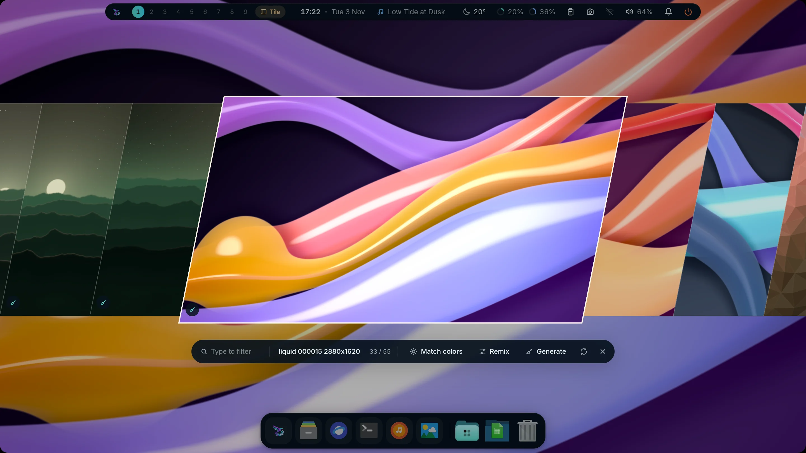 <b>Picker</b>: slanted slices</td>
<td width="50%" valign="top">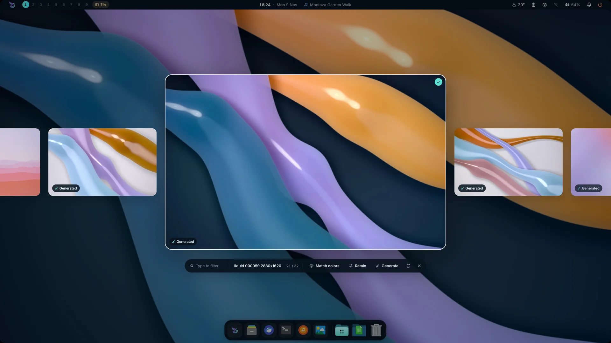 <b>Picker</b>: carousel</td>
</tr>
</table>

- **Picker** (Ctrl+Shift+W): slanted slices or a floating carousel, type to
  filter, **Match colors** to theme the whole desktop from the wallpaper, and
  **Wallhaven** browsing (the opt-in `wallhaven` plugin: switched off, the
  picker has no Wallhaven source and Mandara makes no request to it).
- **Engine**: fill / fit / stretch / center / tile, fade / wipe / grow
  transitions, separate **light and dark wallpapers** and **per-display
  wallpapers**.
- **In Studio** (*Studio → Wallpaper*): the page opens on the wallpaper on
  your desktop, large, with its size, folder and colours, then every
  wallpaper in your folder as a fast, paged grid of thumbnails: click (or
  use the arrow keys and Enter) to switch, filter by name, add to the
  slideshow playlist. Tabs hold the slideshow, *Fit & effects*, and the
  generator and Wallhaven when those plugins are on.

<table>
<tr>
<td width="50%" valign="top">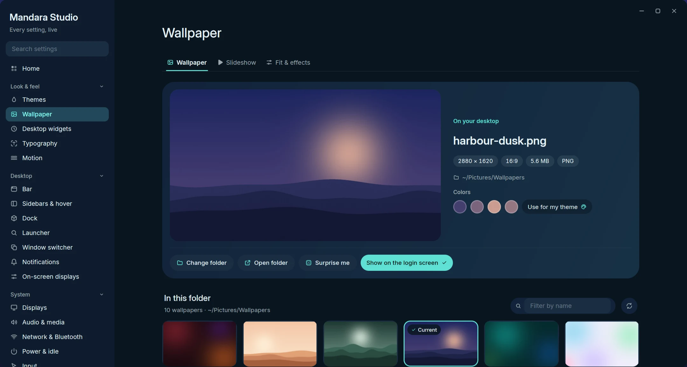 <b>Studio</b>: your wallpaper and its folder</td>
<td width="50%" valign="top">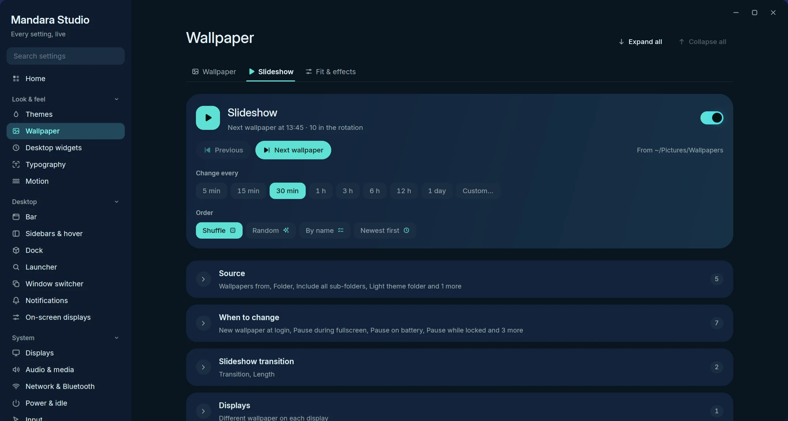 <b>Studio</b>: the slideshow</td>
</tr>
</table>

### Sketch transition

Pick **Sketch** as the transition (*Studio → Wallpaper → Fit & effects*, or
*Studio → Motion → Wallpaper change*) and a new wallpaper's outline is drawn
first, its subject first when Mandara has a depth mask for it, then the image
fills in: fading, bleeding outward from the lines like watercolour, or wiping
along the strokes. Line colour (theme accent, ink black, white or the
wallpaper's own colour), thickness, glow, drawing order, how long drawing
takes against filling, and a faint outline left behind afterwards are its
options; [Motion](motion.md#sketch-wallpaper-transition) lists them. The GPU
wallpaper renderer draws the lines; the default software renderer, reduced
motion and tiled wallpapers fade instead.

## Slideshow

Turn it on in *Studio → Wallpaper → Slideshow* or with
`mandara msg wallpaper slideshow on`. Nothing runs while it is off; while it
is on, one timer sleeps until the next change.

- **How often**: one-click intervals from 5 minutes to a day, or your own
  (`45`, `90m`, `2h`, `1d`, up to a week). *Previous* and *Next* step
  through it by hand.
- **Order**: shuffle (every wallpaper once before any repeats, the default
  for new setups), random, by name or newest first.
- **Which wallpapers**: your wallpaper folder, another folder (optionally
  with all its sub-folders), separate folders for the light and the dark
  theme (it switches when the theme does), or a playlist you pick on the
  Wallpaper tab.
- **When**: optionally a new wallpaper at every login, only between two
  times of day (the window may cross midnight), and paused while a
  fullscreen app is open, on battery or while the screen is locked.
- **How it looks**: the desktop's transition, or the slideshow's own (fade,
  wipe, grow or none) with its own length.
- **Displays**: the same wallpaper on every display, or a different one on
  each.
- **From the terminal**: `mandara msg wallpaper slideshow status` (JSON with
  the next change and any pause), `next`, `previous`, `interval`, `order`,
  `source`, `folder`, `playlist`, `hours`, `transition` and `option`; see
  [the commands guide](commands.md).
- **Video wallpapers**: AV1 clips (`.webm`, `.mkv`, `.ivf`) loop seamlessly
  behind the clock and widgets, decoded in pure Rust once per clip for every
  display showing it, and converted straight into the wallpaper's buffers.
  They pause (no decoding, no timers) behind windows, while locked, with the
  screens off and on battery; the picker marks them with a badge, and Match
  colors themes the desktop from a frame of the clip.
- **Depth desktop clock**: a big Alexandria / Cairo clock, a Gregorian +
  Hijri date pill and a ring that moves with your music, drawn *behind* the
  wallpaper's subject. Mandara finds the subject itself, either with its
  hand-tuned finder (no download, skipped when unsure) or with a small depth
  model downloaded on demand and run once per wallpaper at idle priority,
  or uses your own mask ([details](plugins.md#wallpaper-depth)).
  **Place the clock** moves it to where the subject rises into its digits,
  and the date pill comes to the front whenever anything covers it.

  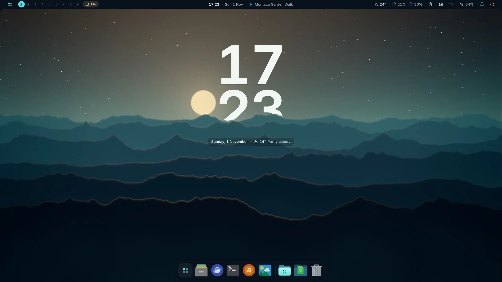
   
  The depth clock: the ridge passes in front of the digits, the date stays readable.

## Wallpaper generator

<table>
<tr>
<td width="33%">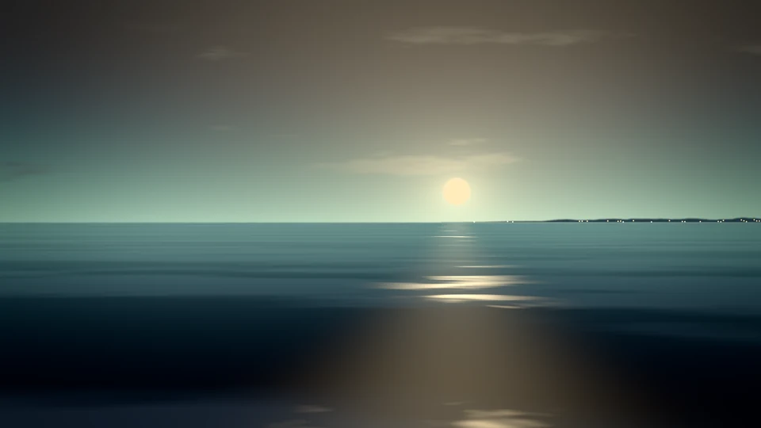 <b>Corniche · Mandara Corniche</b></td>
<td width="33%">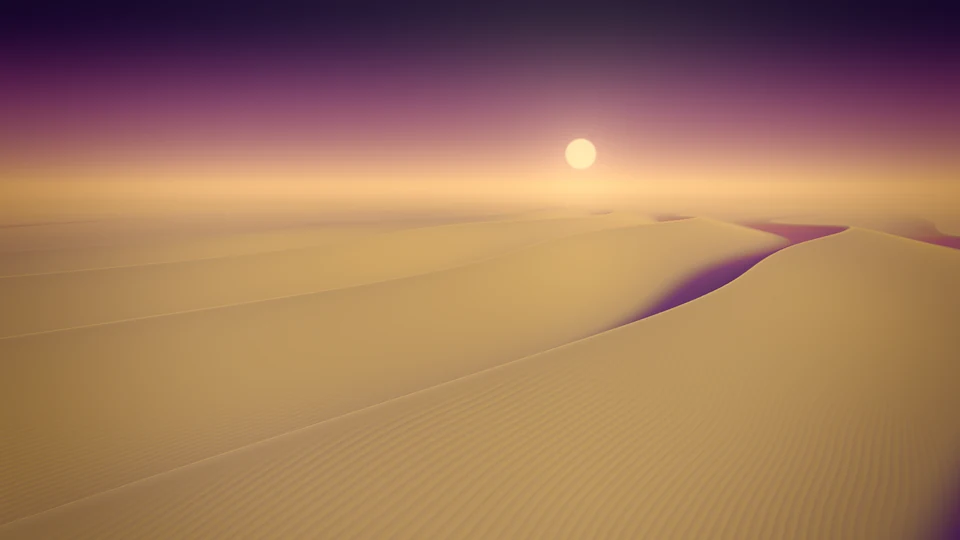 <b>Dunes · Sunset</b></td>
<td width="33%">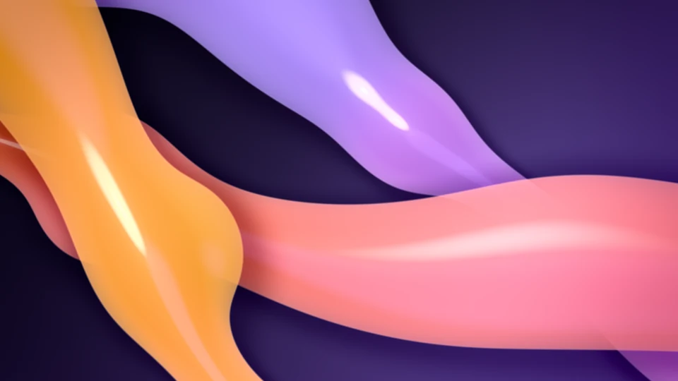 <b>Liquid · Montaza Twilight</b></td>
</tr>
<tr>
<td width="33%">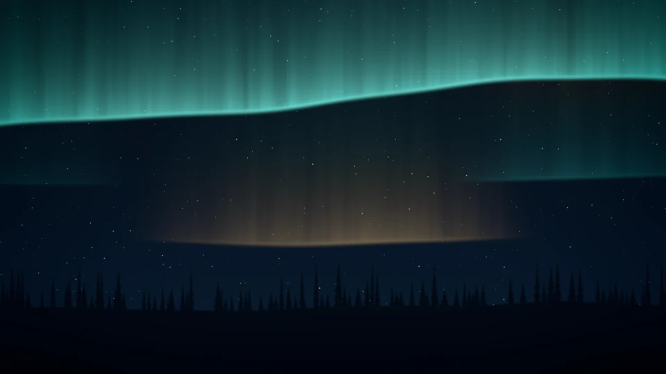 <b>Aurora · Mandara Corniche</b></td>
<td width="33%">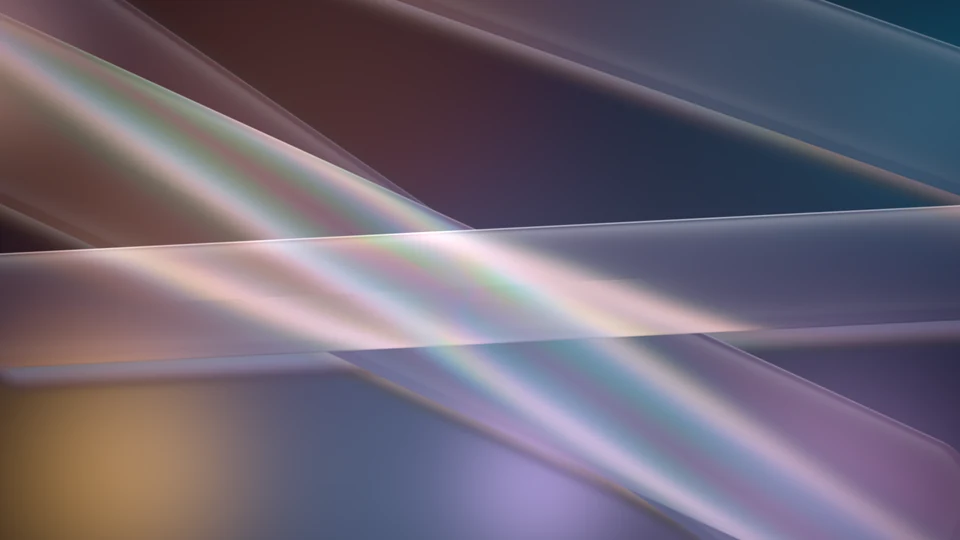 <b>Glass · Rosé Pine</b></td>
<td width="33%">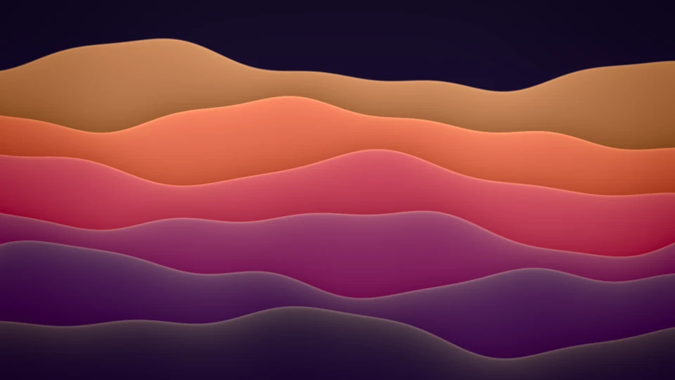 <b>Waves · Sunset</b></td>
</tr>
<tr>
<td width="33%">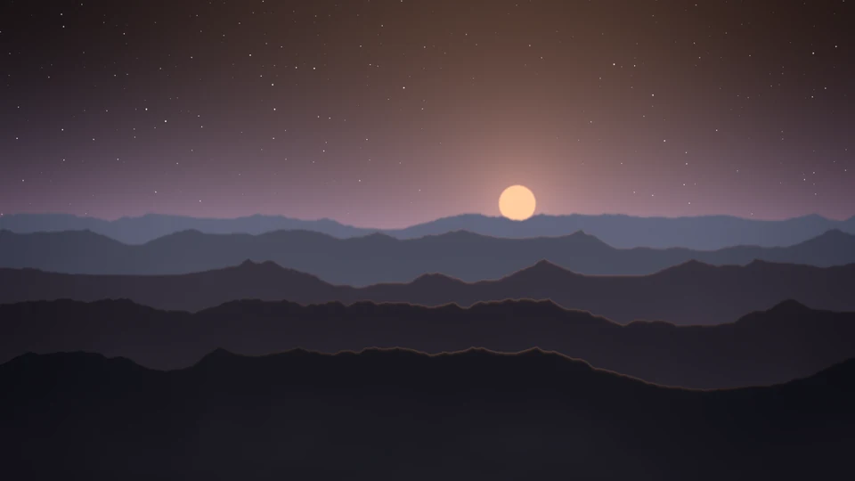 <b>Landscape · Kanagawa</b></td>
<td width="33%">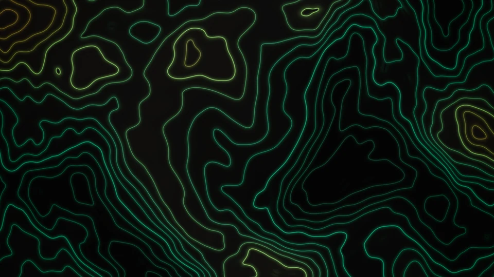 <b>Contours · Mandara Obsidian</b></td>
<td width="33%">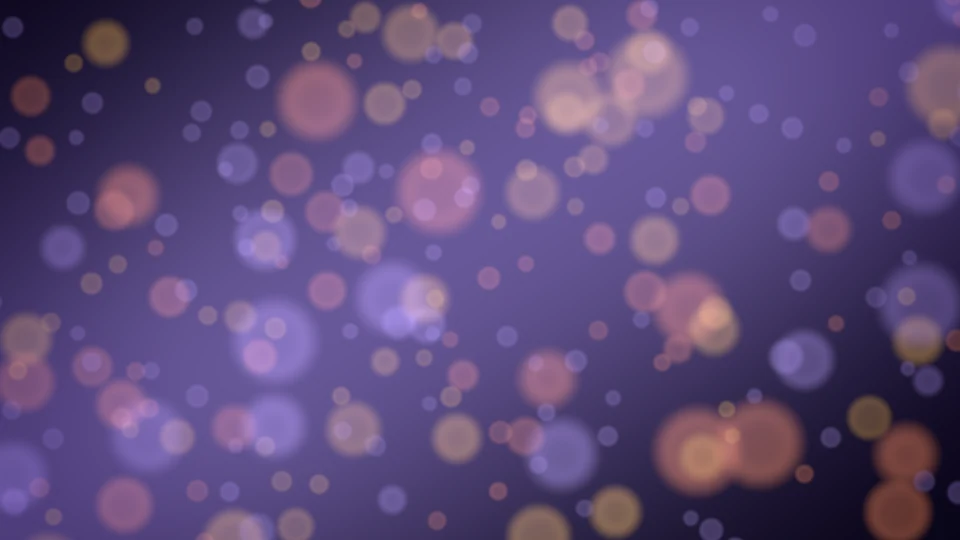 <b>Bokeh · Montaza Twilight</b></td>
</tr>
</table>

Every image above came out of the generator as is, at default settings with a palette and seed picked; shown here at 960 × 540.

Make your own wallpapers on your machine, in pure Rust: twelve styles (mesh
gradients, landscapes, the Corniche, aurora, dunes, silk flow, contours,
bokeh, low poly, liquid, waves and glass), the curated palettes, your theme's
colors or your own, and every variable on a slider. An opt-in plugin
(*Studio → Plugins*).

- **Designed in Studio**: a live preview that follows your sliders, a style
  gallery in your palette, clickable variations, a seed you can shuffle or
  lock, light or dark to follow the theme.
- **Any size, small files**: 1080p, 2K, 4K, 5K, 8K, ultrawide, portrait or
  your display's exact shape, saved lossless in the smallest file (WebP or
  PNG, whichever comes out smaller for the picture; or pick WebP, PNG or
  JPEG) with the expected size shown before you generate.
- **Video loops**: seamless AV1 loops that play as video wallpapers.
- **Remix anything**: each file remembers its recipe, so you can reopen it,
  vary it or re-render it bigger.
- **In the picker**: a Generate button, a marker on generated wallpapers
  and Remix.
- **On a schedule, if you want**: off until you turn it on; a fresh
  wallpaper every few hours, old ones cleaned up, missed runs never piling up.
- **Agent-ready**: `mandara msg wallgen generate aurora --size 8k`, and the
  rest of `wallgen …` in [the commands guide](commands.md#wallpaper-generator).

<table>
<tr>
<td width="58%" valign="top">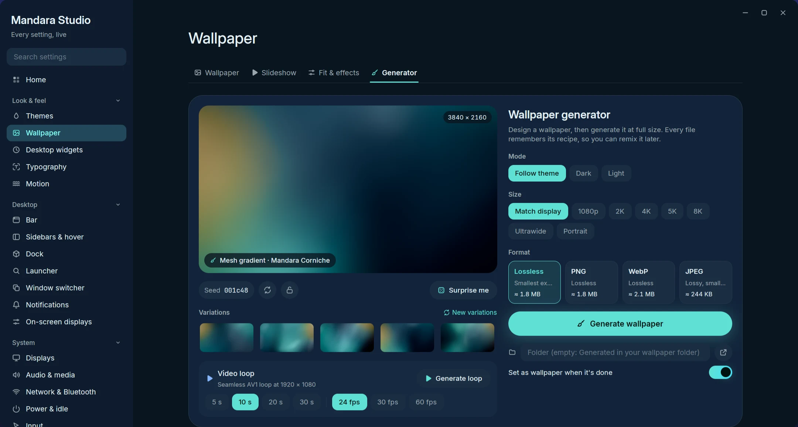 <b>Studio</b>: preview, variations, size and format</td>
<td width="42%" valign="top">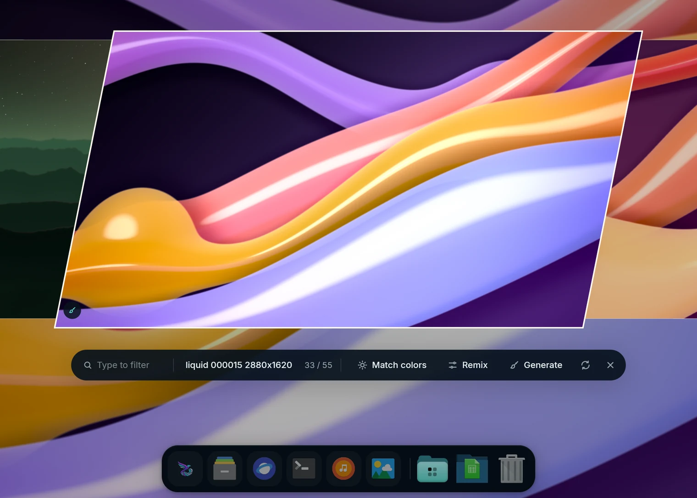 <b>Picker</b>: Generate and Remix</td>
</tr>
</table>
